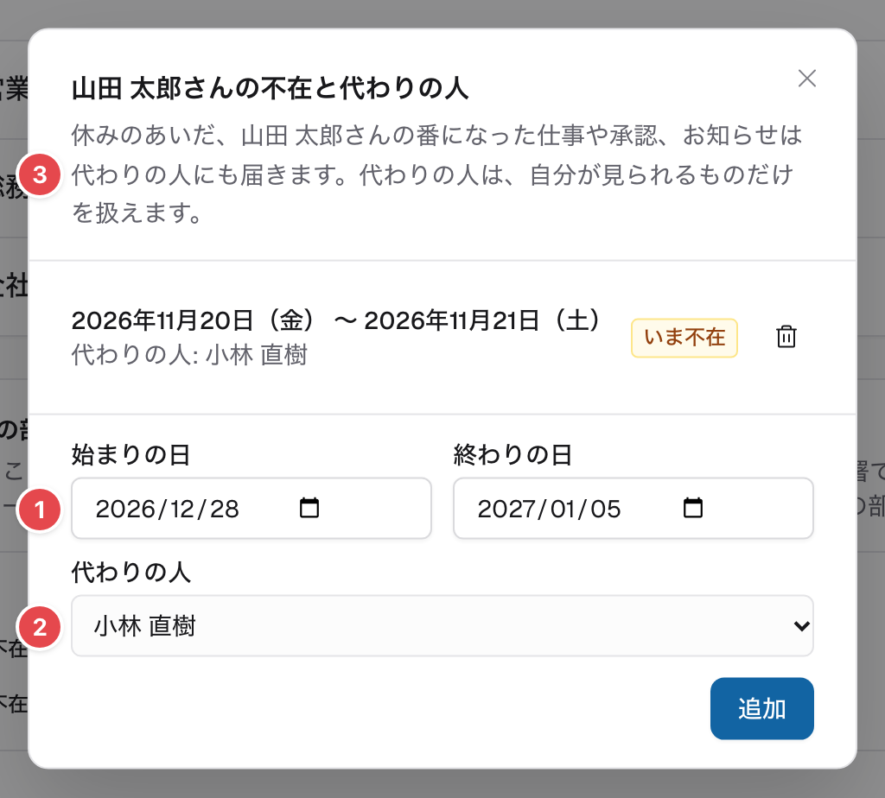

# 4節　不在と代わりの人

## この節でできること

- 社員が休むあいだ、仕事・承認・知らせを代わりの人に届けられます
- 管理者や部署の管理役が、本人の代わりに不在を入れられます
- 代わりの人に何が渡り、何が渡らないかが分かります

---

## 休むとき、仕事はどうなる？

メールの自動応答を設定したり、休暇中は上司が代わりに承認したりしていましたね。ACB では「不在と代わりの人」を入れておくと、休みのあいだ、その人の番の仕事・承認・知らせが、**代わりの人にも**届きます。

代わりの人の画面では、やることの一覧に「〇〇さんの代わり」と出て、承認のお願いは「代わりに承認」できます。

---

## だれが入れる？

ふつうは本人が、アプリの「設定」の「不在と代わりの人」で入れます。

本人が入れられないとき（急な病欠など）は、次の人が代わりに入れられます。

- オーナー・管理者
- その人が所属する部署の、部署の管理役

管理画面では、「部署」の所属する人の一覧で、その人の横の［不在・代わりの人］を押します。

1. 「〇〇さんの不在と代わりの人」が開きます。
2. 「始まりの日」「終わりの日」「代わりの人」を入れて［追加］を押します。
3. 休みに入っているあいだは「いま不在」の印が付きます。

① 始まりの日と終わりの日、② 代わりの人を選んで［追加］を押します。③ 上の説明に、代わりの人は自分が見られるものだけを扱えることが書いてあります。休みに入っている予定には「いま不在」の印が付き、ごみ箱の印で消せます。

---

## 代わりの人は、自分の権限のまま

ここが大事なところです。**代わりの人は、自分が見られるものだけを扱えます。** 休む人のメールや、休む人だけが見られるものは、代わりの人には渡りません。

代わりの人が見られないものがあると、次のように知らせが出ます。

「代わりの人が見られないものが N 件あります。部署の管理役に知らせました。」

この知らせを受けた部署の管理役は、そのものをどうするか（本人の復帰を待つ、見られる人を足すなど）を決めます。

---

## 選べない・重ねられない

- **同じ期間に休む人は、代わりの人に選べません。**「代わりの人もこの期間に不在です。別の人を選んでください」と出ます。代わりの人の代わり、という連鎖は起きません。
- **同じ人の不在の期間は重ねられません。**「この期間には、もう不在が設定されています」と出ます。

管理画面で入れるときは、「代わりの人」の選択肢に、同じ期間に休む人も並びます。選んで［追加］を押すと上の文が出るので、別の人を選び直してください。休みの予定は、分かった時点で早めに入れておくと、こうした行き違いが減ります。

---

## 定期の仕事は、代わりの人では動かない

定期の仕事（12節）の責任者が不在の日は、その回は見送られます。「責任者が不在の日だったため見送りました（代わりの人は動かしません）」と記録されます。定期の仕事は責任者の名前と権限で動くので、代わりの人に回すことはしません。

---

## 検証A社では

山田さんが1週間の夏休みを取るとき、本人がアプリで代わりの人を同じ営業部の先輩にしました。山田さんだけが見られる「あなただけ」のやることは、先輩には渡りません。

では、代わりの人が「見られない」のは、どういう決まりなのでしょう。次の節から、だれが何を見られるかを見ていきます。

---

## 社員の取説で指している所

- 20章「人に頼む・頼まれる」
- 23章「承認のお願い」
