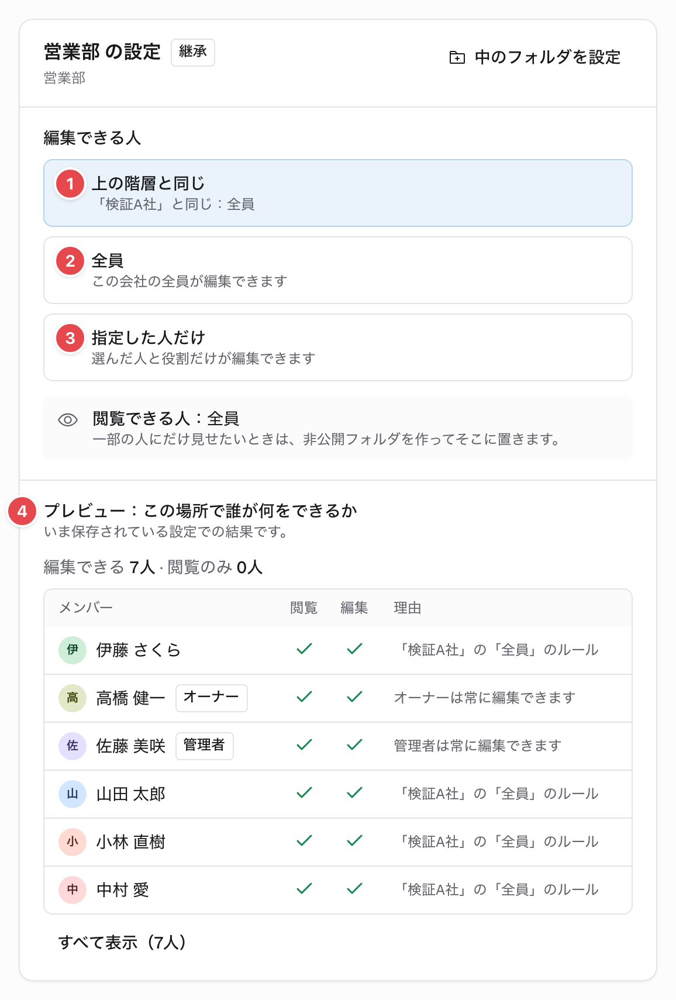
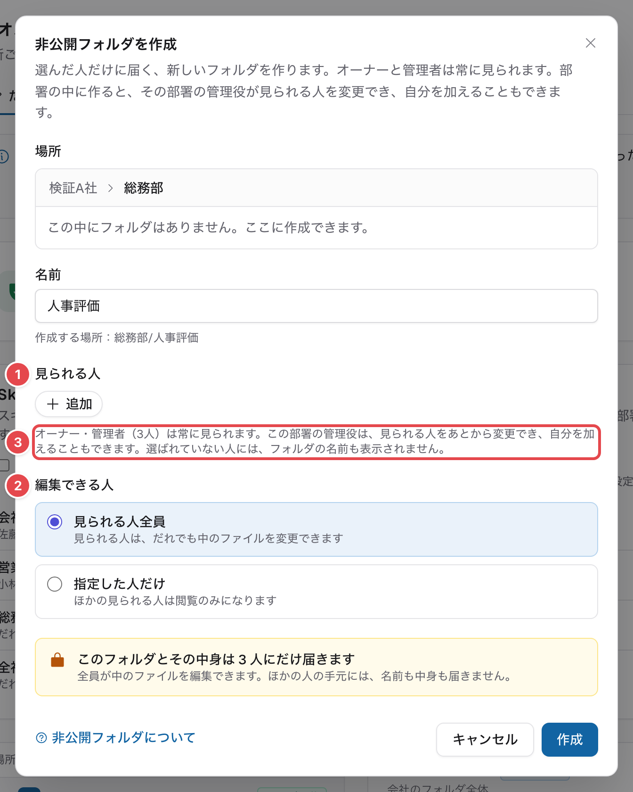
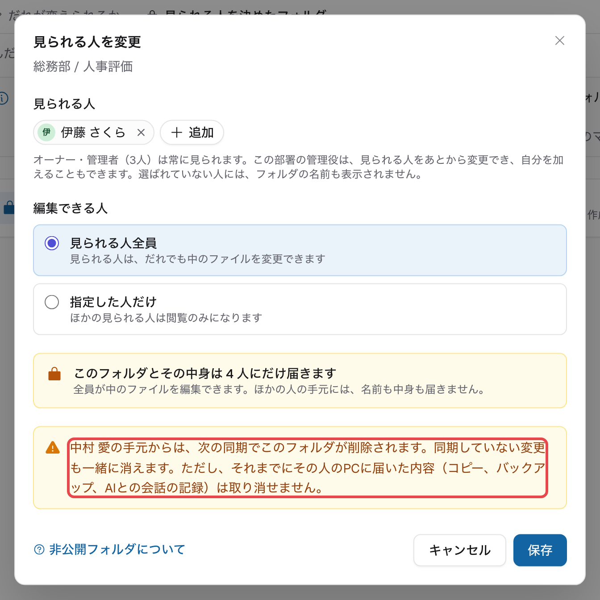
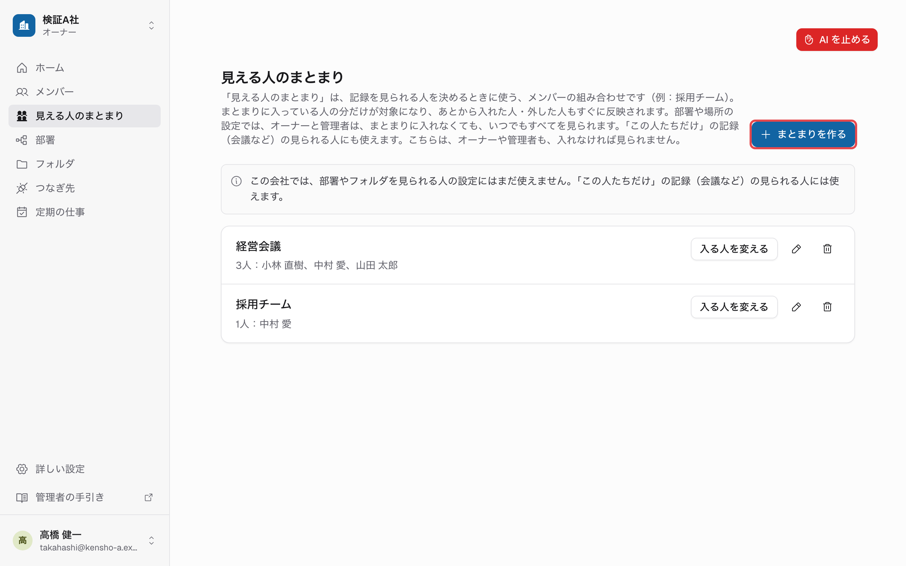

# 5節　だれが見られる・だれが変えられる（フォルダ・非公開フォルダ）

## この節でできること

- フォルダごとに「だれが変えられるか」を決められます
- 一部の人だけが見られる「非公開フォルダ」を作り、見られる人を変えられます
- 人を外す・フォルダを消す前に、何をしておくべきかが分かります
- 全社フォルダを使わない会社で、見られる人を決められます
- 同期しないファイルを決められます

---

## だれが変えられるか

Google ドライブでは、フォルダごとに「閲覧者」「編集者」を決めましたね。ACB では、全社フォルダを使う会社の「フォルダ」の「だれが変えられるか」で決めます。

場所ごとに、編集できる人を次から選びます。

- 「上の階層と同じ」（初めはこれ）
- 「全員」
- 「指定した人だけ」（人・役割・部署に所属する人を選びます）

左の一覧で場所を選ぶと、その場所の設定が出ます。①〜③ から選んで保存します。④ 下のプレビューに、だれが閲覧・編集できるかと、その理由が出ます。

「プレビュー：この場所で誰が何をできるか」で、だれが見られて、だれが編集できるかを、理由と一緒に確かめられます。オーナーと管理者は、ルールに関係なく、いつもすべての場所を見て編集できます。

フォルダの名前が変わったり消えたりして、決まりが迷子になると「ルールが付いているフォルダが見つかりません（名前の変更・削除の可能性）」と出ます。［新しい場所に移す］か［ルールを削除］で直します。

---

## 古いアプリの人がいるとき

権限を直して、だれかが編集できなくなるとき、その人が古いアプリを使っていると「アプリの更新が必要なメンバーがいます」と出ます。古いアプリのままだと、その人は同期できなくなるからです。先にアプリを更新してもらうのが安全です。どうしても今変えるときは［それでも保存する］を押します（オーナー・管理者だけ）。

---

## 非公開フォルダ

「総務部/人事評価」のように、一部の人だけが見られるフォルダを「非公開フォルダ」といいます。

**作る**
- 管理画面の［非公開フォルダを作成］か、アプリの「新しいフォルダ…」で「非公開」を選んで作ります。
- 作れるのは、オーナー・管理者と、部署の管理役（自分の部署の中だけ）です。
- 「見られる人」と「編集できる人」を選びます。

① 見られる人を［追加］で選びます。② 編集できる人は「見られる人全員」か「指定した人だけ」。③ オーナー・管理者は、選ばなくても常に見られます。

**今あるフォルダは、非公開に変えられません。** 守りたいファイルは、新しく作った非公開フォルダへ移します。ただし、**これまでに配られた分は各メンバーの手元に残り、過去の版も会社の履歴に残ります。** 移しても取り消せないので、最初から非公開フォルダで作るのがいちばんです。

**オーナー・管理者は、すべての非公開フォルダをいつも見られます。** 見られる人の一覧にも、オーナー・管理者の名前に「（オーナー・管理者は常に）」と添えて出ます。

**見られる人を変える・公開に戻す・削除する**（「見られる人を決めたフォルダ」）
- 「見られる人を変更」：人を足す・外す（「見られる人を決めたフォルダ」の一覧では、行の［見られる人］から開きます）。
- 「公開に戻す…」：中身がすべて会社の全員に届きます。**取り消せません。**
- 「削除…」：そのフォルダが、見られる人全員の PC から、次の同期で消えます。サーバーには控えが残り、誰にも配られません。戻したいときは運用担当者に頼みます。

公開に戻す・削除は、確かめのためにフォルダの名前を入れてから押します。オーナー・管理者だけができます。

---

## 人を外す前に、同期してもらう

ここがいちばん大事なところです。

**非公開フォルダの「見られる人」から外された人、会社から削除された人の PC からは、次の同期でそのフォルダが消えます。まだ同期していない書きかけも、そのフォルダのバックアップも一緒に消え、控えは残りません。** 自動で同期している人なら、本人が何も押さなくても起きます。

本人には、消えたあとで「このフォルダを見る権限がなくなったため、手元から削除しました（『…』）。同期していなかった変更も削除されています。」と出ます。サーバーにも届いていないので、管理者にも戻せません。

**だから、人を外す・会社から削除する・フォルダを消す前に、その人に同期してもらってください。** 管理画面の「見られる人を変更」にも、同じ注意が出ます。

### 預かり

外された人の PC に、まだ届けていなかった変更が残っていたときに、消す前にサーバーで預かる仕組みを準備しています。アプリの側はまだで、今は上のとおり消えます。

管理画面の側はできています。預かったものがあると、「フォルダ」に［預かり］のタブが出て、ホームの「対応が必要なこと」に「預かったファイルを確かめてください」が出ます。見られるのは、そのフォルダを見られる人のうち、オーナー・管理者・その部署の管理役だけです（消したフォルダの分は、オーナー・管理者だけ）。

- ［中身を確かめる］：だれから・いつ・なぜ預かったかと、ファイルの一覧が出ます。ファイルごとに［ダウンロード］で、預かった版・いまのフォルダの版を取り出せます。
- ［フォルダに入れる］：チェックしたファイルをフォルダに入れます。はじめは「まだ届けていなかった変更」だけにチェックが付いています。その後ほかの人が変えたファイルは、上書きせず「〇〇さんの版」という名前で横に置きます。上書きしたいときだけ「上書きする」を選びます。チェックしなかったものは、入れたあとで捨てます。
- ［捨てる…］：預かったものをすべて捨てます。元に戻せないので、確かめてから押します。
- 本人のメモ（`.personal`）と、パスワードなどが入っていて名前だけを預かったファイルは、フォルダに入れられません。
- 預かったものは、30日たつと自動的に捨てます。その7日前から、ホームで知らせます。

［写真：/companies/:id/folders?tab=holding — 預かりの一覧と、中身を確かめる画面］

---

## 全社フォルダを使わない会社では

全社フォルダを使わない会社には、非公開フォルダはありません。そのかわり、「部署」の［見られる人を決める］で、部署や部署の中の場所ごとに「全員」か「選んだ人だけ」を選びます。選ぶときは、人・部署に所属する人・**見える人のまとまり**から選べます。

**見える人のまとまり**は、左のメニューの「見える人のまとまり」で作ります。［まとまりを作る］で名前を付け、［入る人を変える］で人を入れます。「経営会議」のように、よく使う顔ぶれに名前を付けておくものです。

見られる人を決められるのは、オーナーと管理者だけです。部署の管理役は確認だけできます。

---

## 同期しないファイル【全社フォルダを使う会社】

アプリの「設定」の「同期しないファイル」に書いたファイルやフォルダは、チームと共有されません。会社全体に効くので、変えられるのは管理者だけです（FDE 向け：中身は `.gitignore` です）。`.backups/`、`.env`、100MB 以上のファイルは、書かなくても自動で共有されません。

---

## 検証A社では

総務部の佐藤さんは、「総務部/人事評価」を非公開フォルダとして作り、見られる人を総務部の2人にしました。担当が替わるときは、外す人に先に同期してもらってから、「見られる人を変更」で外しています。

では、管理者は会社の中のものを全部見られるのでしょうか。次の節で見ていきます。

---

## 社員の取説で指している所

- 15章「フォルダの見え方」
- 5章「ファイルを開いて直す」（ふつうのフォルダの作り方）
