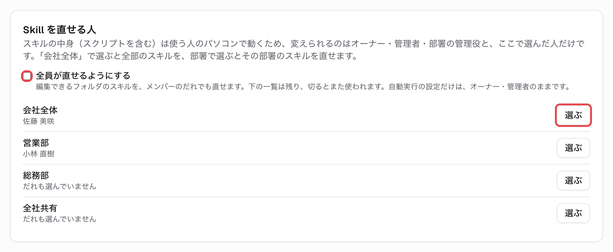
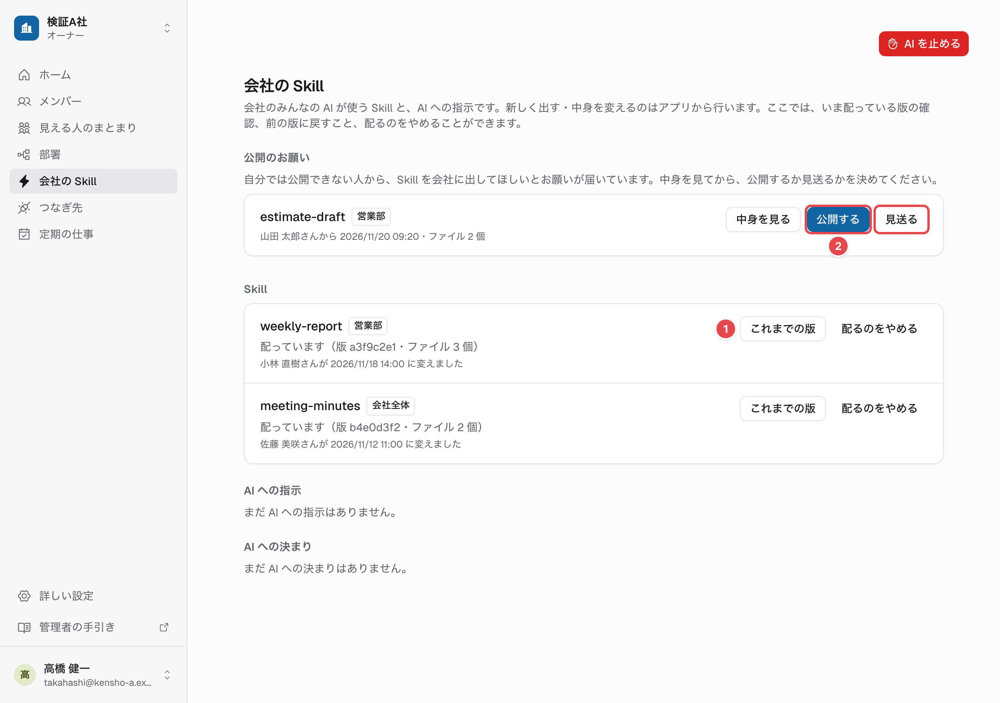

# 7節　Skill と AI への指示を会社でそろえる

## この節でできること

- 会社の Skill をだれが直せるかを決められます
- 全社フォルダを使う会社で、Skill がどう全員に届くかが分かります
- 全社フォルダを使わない会社で、「会社の Skill」の版を管理し、社員からの公開のお願いに答えられます

---

## 手順書の版がばらばらになる問題

共有ドライブに手順書を置いても、各自が書き換えて、だれのものが正しいのか分からなくなったことはありませんか。ACB の Skill（AI に渡す仕事の手順書）は、**直せる人を決めて、全員に同じ版を届けます。**

---

## Skill を直せる人【全社フォルダを使う会社】

「フォルダ」のページの「Skill を直せる人」で決めます。オーナー・管理者だけが変えられます。

- 「会社全体」の行と、部署ごとの行があります。［選ぶ］で、その範囲の Skill を直せる人を選びます。
- オーナー・管理者と、その部署の管理役は、ここで選ばなくても直せます。
- それ以外の人は、Skill を書き換えられません。書き換えて送ろうとしても、サーバーが止めます。
- 「全員が直せるようにする」をオンにすると、全員が直せます。初めはオフです。

全社フォルダを使う会社では、Skill は会社のフォルダの中に置かれ、同期で全員の PC に届きます。だれかが直した Skill は、次の同期でほかの人にも届きます。AI への指示ファイルも、オーナー・管理者と部署の管理役（自分の部署の分）が扱います。

社員は、会社の Skill をそのまま使うほかに、自分用にコピーして直せます（社員の取説 10章）。

---

## 会社の Skill【全社フォルダを使わない会社】

全社フォルダを使わない会社では、左のメニューの「会社の Skill」が Skill の置き場所（棚）です。オーナー・管理者・部署の管理役・Skill を直せる人に出ます。社員のアプリには、ここで配っている版が届きます。

**版を管理する**
- ［これまでの版］で、前の版を見られます。「いま配っている版」の印が付いています。
- ［この版に戻す］で、前の版を配り直せます。
- ［この版を消す］は、管理者だけが使えます。いま配っている版は消せません。

**配るのをやめる・消す**
- ［配るのをやめる］で、社員への配布を止めます。
- やめたあとに［消す］が出ます（管理者だけ）。**これまでの版もすべて消え、元に戻せません。**

**公開のお願いに答える**

社員が自分で作った Skill を「会社に出してほしい」と頼むと、「公開のお願い」に届きます。

- ［中身を見る］で中を確かめます。
- よければ［公開する］。
- 見送るときは［見送る］。理由は「理由（なくてもかまいません）」に書けます。
- 頼まれた中に、仕事の成果物らしいファイルが入っていると「成果物が入っていませんか？」と聞かれます。［外して出す］で、それを外して公開できます。

① ［これまでの版］で前の版を見たり戻したりします。② 公開のお願いは［中身を見る］で確かめてから、［公開する］か［見送る］を押します。

---

## Skill の名前

Skill の名前は、英小文字・数字・`-`・`_` で付けます（例：`weekly-report`）。日本語の名前は使えません。部署やフォルダの名前は日本語で大丈夫です。

---

## 検証A社では

田中さんは、営業部の Skill を直せる人に営業課長を選び、「会社全体」の Skill は総務部の佐藤さんに任せました。山田さんが作った週報の Skill は、自分用に直して使っています。

道具はそろいました。では、仕事の進め方そのものは会社で決められるのでしょうか。次の節で見ていきます。

---

## 社員の取説で指している所

- 9章「Skill を使う」
- 10章「Skill を自分用に直す」
