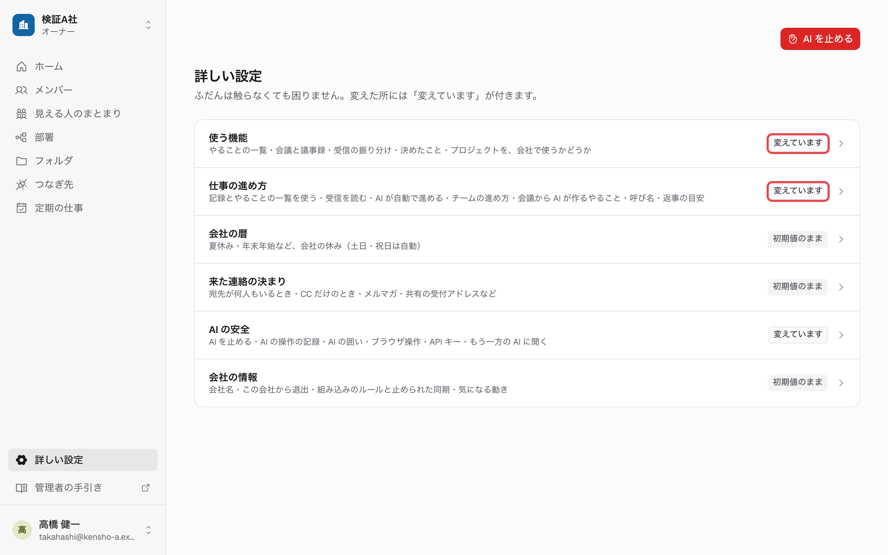
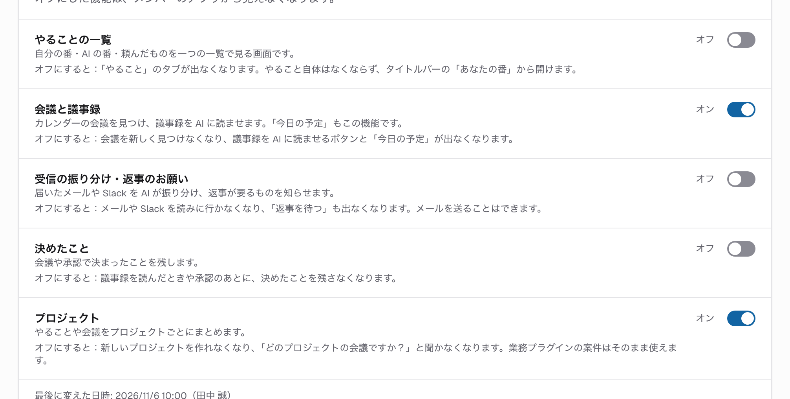
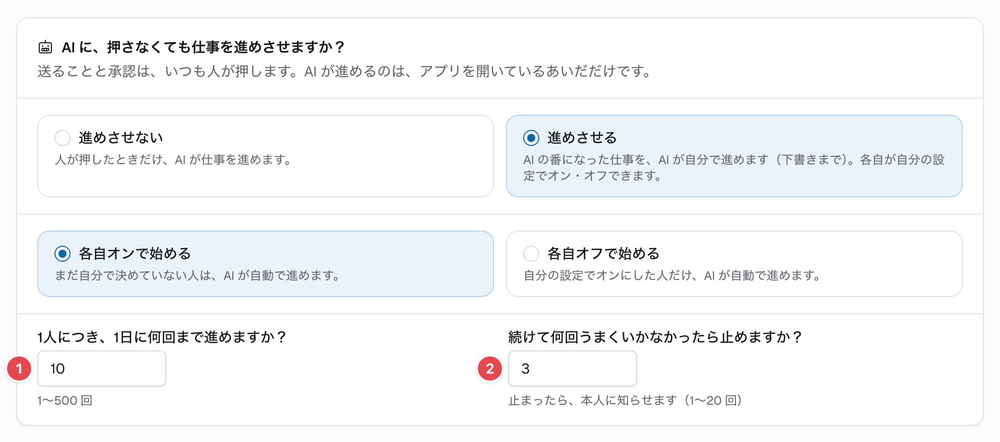
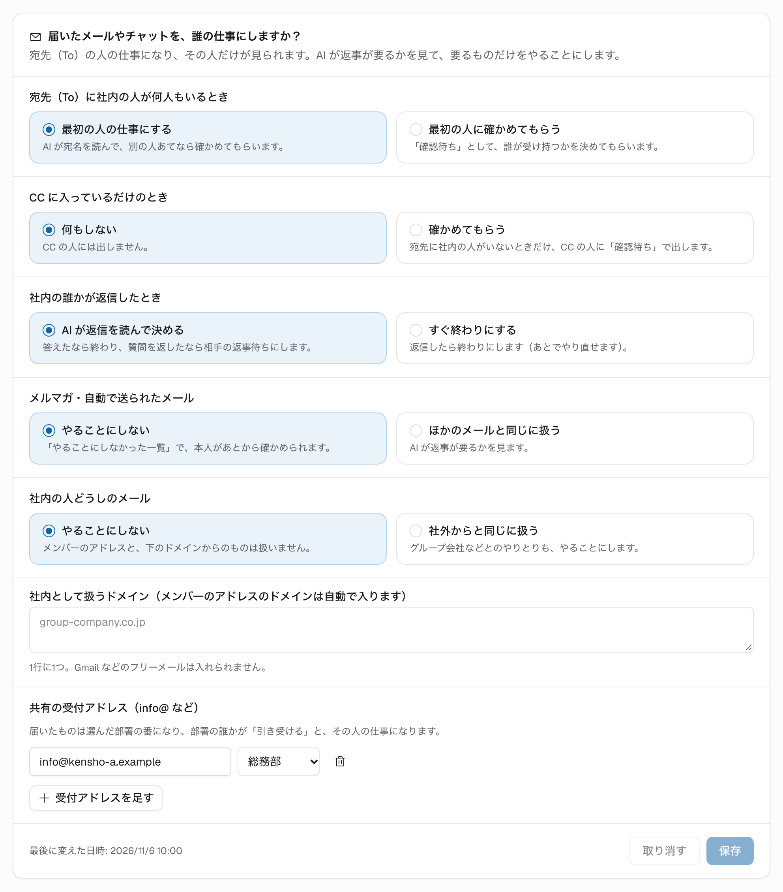

# 8節　仕事の進め方を決める

## この節でできること

- 会社で使う機能を選べます
- AI に、押さなくても仕事を進めさせるか、どこまで進めさせるかを決められます
- 人に頼んだとき・会議のあと・連絡が届いたときの扱いを、会社で決められます
- 届いたメールやチャットを、だれの仕事にするかを決められます

---

## 「詳しい設定」

左のメニューのいちばん下の「詳しい設定」には、6つの見出しがあります。

- 使う機能
- 仕事の進め方
- 会社の暦（3節）
- 来た連絡の決まり
- AI の安全（10・13・14節）
- 会社の情報（1節）

初めの値から変えた所には「変えています」、変えていない所には「初期値のまま」が付きます。**ふだんは触らなくても困りません。**

---

## 使う機能

新しいツールの機能を一度に全部見せると、社員は混乱しがちです。「使う機能」で、会社で使う機能を選べます。はじめは全部オンです。

- やることの一覧
- 会議と議事録
- 受信の振り分け・返事のお願い
- 決めたこと
- プロジェクト

オフにしても、これまでの記録は消えません。**オフにした機能の記録は、全員にとって「見るだけ」になり**、カードに「この機能は今オフです」と出ます。もう一度オンにすると、続きから使えます。

---

## 仕事の進め方

「仕事の進め方」では、次のことを決めます。

- **記録とやることの一覧を使う** — オン／オフ。オフのあいだ、ほかの設定は使えません。
- **どの部署で、やることの一覧を使うか** — 「すべての部署」か「選んだ部署だけ」。
- **AI に、押さなくても仕事を進めさせるか** — 「進めさせる」（初め）／「進めさせない」。各自の初めの値（「各自オンで始める」／「各自オフで始める」）、**1人1日に何回まで進めるか**（初めは30回）、**続けて何回うまくいかなかったら止めるか**（初めは3回。止まったら本人に知らせます）。**送ることと承認は、いつも人が押します。** AI が進めるのは、アプリを開いているあいだだけです。
- **受信を読む** — 「使ってよい」／「使わない」と、各自の初めの値（初めは「各自オフで始める」）。
- **チームの進め方** — 「使う」／「使わない」（初め）。
- **人に頼んだとき、相手が［引き受ける］を押すまで待つか**（チームの進め方を使うときだけ）— 同じ部署に所属する人に頼んだとき／部署の管理役が、その部署に所属する人に頼んだとき／会議の宿題を AI が作ったとき、のそれぞれで決めます。
- **会議から AI が作るやること** — 「案として出す」（初め）／「自動で作る」。
- **やることを束ねるものの名前** — 初めは「プロジェクト」。「案件」など、会社の言葉に変えられます。
- **締め切りが書いていない連絡に、いつまでに返すか** — 「次の営業日まで」（初め）／「その日のうち」と、何時より後に届いたら次の営業日にするか（初めは17:00）。営業日は会社の暦で数えます。

① 1人につき1日に何回まで進めるか、② 続けて何回うまくいかなかったら止めるかを決めます。

社員は、アプリの「自分の設定」で、会社が許した範囲の中で自分のオン・オフを変えられます。

---

## 決めたことを決められる人

会議の中で出た「決めたこと」は、AI が案として出し、人が確かめて決めます。決められるのは、つないだプロジェクトの責任者・部署の管理役・管理者です。責任者がいないときなどは、その会議を見られる人が決めます。これは設定ではなく、決まりです。

---

## 来た連絡の決まり

届いたメールやチャットを、AI が読んで「返事が要る」「やることにする」などに振り分けます。そのとき、だれの仕事にするかを「来た連絡の決まり」で決めます。

- **宛先（To）に社内の人が何人もいるとき** — 「最初の人の仕事にする」／「最初の人に確かめてもらう」
- **CC に入っているだけのとき** — 「何もしない」／「確かめてもらう」
- **社内の誰かが返信したとき** — 「AI が返信を読んで決める」／「すぐ終わりにする」
- **メルマガ・自動で送られたメール** — 「やることにしない」／「ほかのメールと同じに扱う」
- **社内の人どうしのメール** — 「やることにしない」／「社外からと同じに扱う」
- **社内として扱うドメイン** — メンバーのアドレスのドメインは自動で入ります。
- **共有の受付アドレス（info@ など）** — どの部署に届けるかを選びます。

---

## 検証A社では

検証A社では、はじめの1か月は「会議と議事録」と「プロジェクト」だけをオンにし、束ねるものの名前を「案件」にしました。AI が自動で進める回数は、様子を見るため1人1日10回にしました。

受信を読むには、Google や Slack をつなぐ必要があります。次の節で見ていきます。

---

## 社員の取説で指している所

- 17章「朝はここを見る：やることの一覧」
- 20章「人に頼む・頼まれる」
- 21章「AI の番：AI が先に用意してくれる」
- 24章「会議のあと：議事録・決めたこと」
- 25章「受け箱と知らせ」
