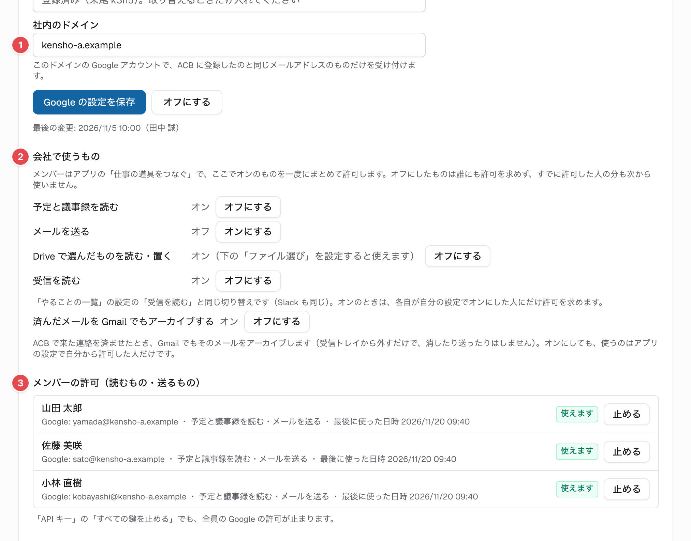
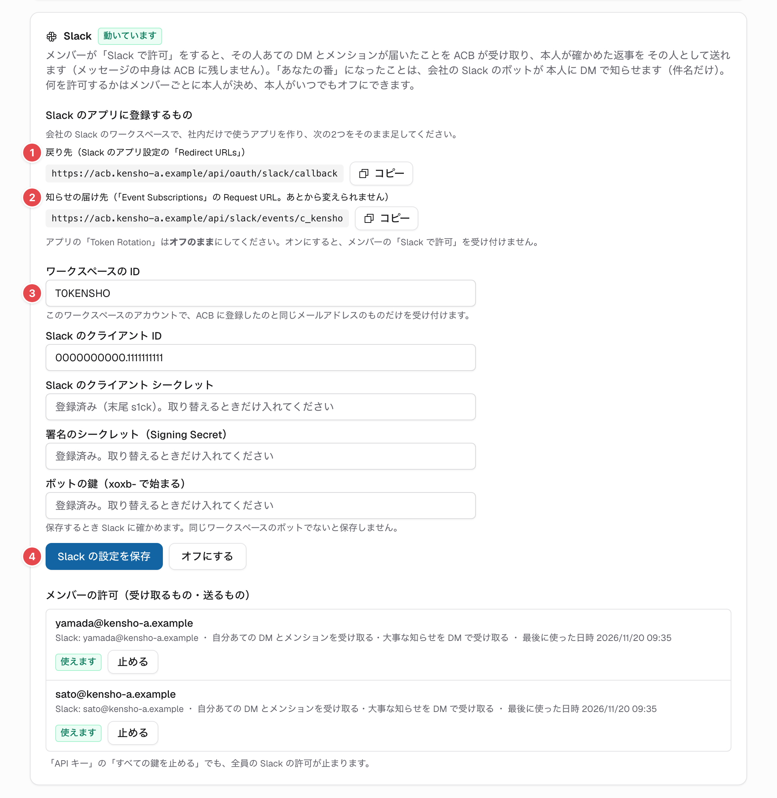
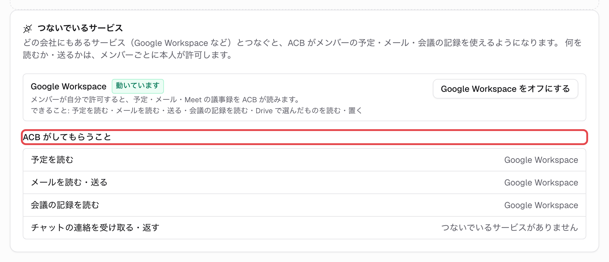

# 9節　道具をつなぐ：Google・Slack

## この節でできること

- Google を会社につなぐとき、だれが何をするかが分かります
- Slack を会社につなぐ手順が分かります
- 同じ役目を2つのサービスができるとき、どちらを使うかを決められます
- 会議の記録と Google ドライブについての決まりが分かります

---

## Google をつなぐ

Google Workspace のアプリ連携では、管理者が許可を出しましたね。ACB では、次の2段です。

1. **会社の登録** — 会社として Google を使えるようにします。**会社の登録は運用担当者が代わりにします。** ホームの「最初にやること」の「Google をつなぐ」にも「運用担当者に頼む」と出ています。運用担当者に「Google をつないでほしい」と伝えてください。
2. **各自の許可** — 社員一人ひとりが、アプリで自分の Google を許可します。許可していない人の予定やメールを、ACB が読むことはありません。

管理画面の「つなぎ先」の「Google」では、次のことを決めます。

- 「社内のドメイン」
- **会社で使うもの**（それぞれ［オフにする］／［オンにする］）：予定と議事録を読む／メールを送る／Drive で選んだものを読む・置く／受信を読む／済んだメールを Gmail でもアーカイブする
- **メンバーの許可（読むもの・送るもの）**：人ごとに［止める］で、その人の Google の許可を止められます。

① 社内のドメイン、② 会社で使うもの（ここでは「メールを送る」をオフにしています）、③ メンバーごとの許可と［止める］です。

「クライアント ID」「クライアント シークレット」などの欄は、会社の登録のためのものです。

---

## Slack をつなぐ【FDE】

Slack は、**会社ごとに、会社の Slack のワークスペースで社内だけで使うアプリを作って**つなぎます。FDE の田中さんの仕事です。

1. Slack で、社内だけで使うアプリを作ります。
2. 管理画面の「Slack」に出ている2つを、Slack のアプリ設定にそのまま足します。
   - 「戻り先」→ Slack のアプリ設定の「Redirect URLs」
   - 「知らせの届け先」→「Event Subscriptions」の Request URL（あとから変えられません）
3. アプリの「Token Rotation」は**オフのまま**にします。
4. 管理画面に「ワークスペースの ID」「Slack のクライアント ID」「Slack のクライアント シークレット」「署名のシークレット（Signing Secret）」「ボットの鍵（xoxb- で始まる）」を入れて［Slack の設定を保存］を押します。
5. ［オンにする］を押します。

社員は、アプリで自分の Slack を許可します。「メンバーの許可（受け取るもの・送るもの）」の［止める］で、人ごとに止められます。

番号は上の手順と同じ順です。① 戻り先と ② 知らせの届け先は［コピー］で写せます。③ から下の欄を入れて ④［Slack の設定を保存］、つないだあとは隣の［オンにする］（写真はつないだあとなので［オフにする］）を押します。

---

## つないでいるサービス

「つないでいるサービス」では、サービスごとのオン・オフと、「ACB がしてもらうこと」の受け持ちを見ます。

- 予定を読む
- メールを読む・送る
- 会議の記録を読む
- チャットの連絡を受け取る・返す

同じ役目を2つ以上のサービスができるときだけ、「どちらを使うか選んでください」が出ます。

---

## 会議の記録

「会議の記録」では、「どの案件・プロジェクトの会議かを聞く期間」を、3日／7日（おすすめ）／14日／30日から選びます。どの案件の会議か決まっていない社外との会議を、この期間、担当の人の「あなたの番」で「どの案件の会議ですか？」と聞きます。

---

## Google ドライブと非公開フォルダ

社員は、AI に Google ドライブのファイルを読ませたり、置かせたりできます。そのとき、次の決まりがあります。

- **非公開フォルダの資料は、社外の人も見られる場所には置けません。** AI は「置いていません」と答えます。
- 社内のほかの人が見られる場所に置くときは、確かめのカードが出て、社員が押してから置きます。

---

## 検証A社では

Google は運用担当者に登録してもらい、佐藤さんが社内のドメインを入れて、「メールを送る」はしばらくオフにしました。Slack は、田中さんが社内アプリを作ってつなぎました。

Google 以外の外のサービスの API キーは、どこに置けば安全でしょう。次の節で見ていきます。

---

## 社員の取説で指している所

- 24章「会議のあと：議事録・決めたこと」
- 25章「受け箱と知らせ」
