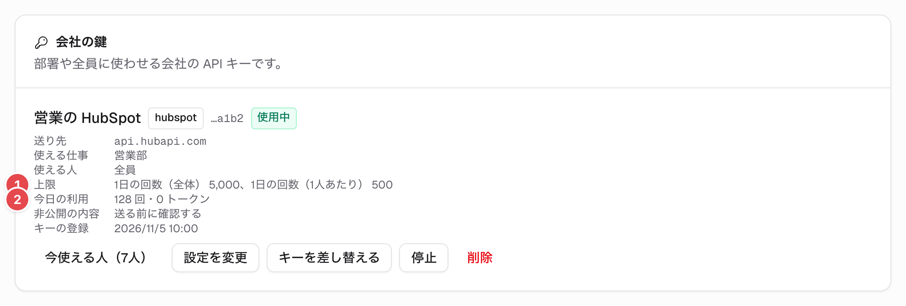
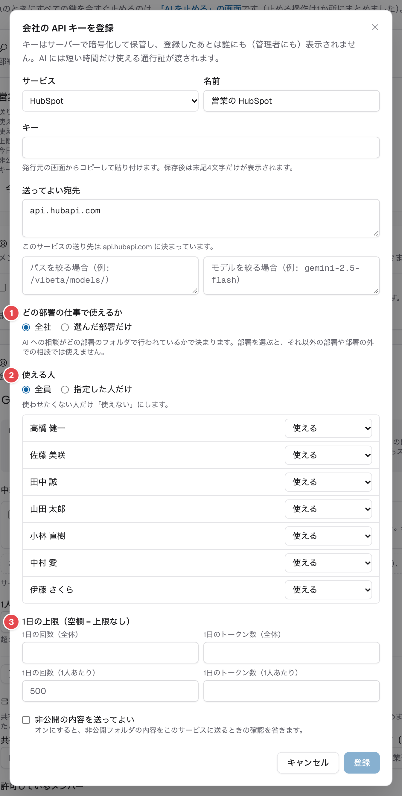
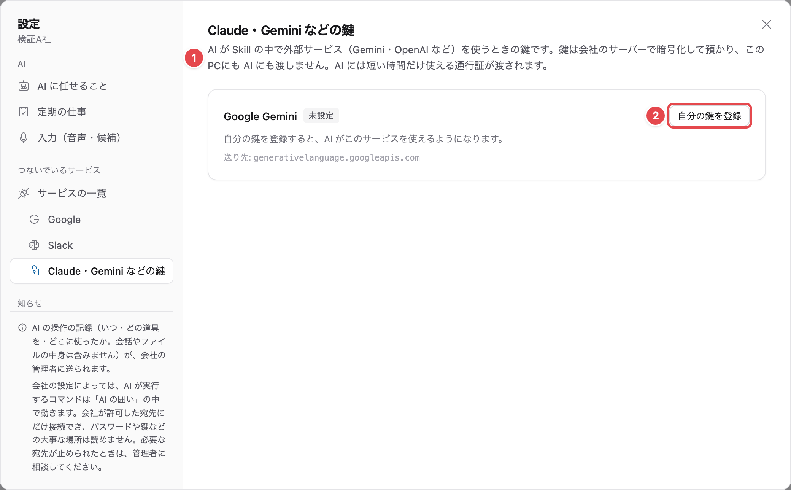
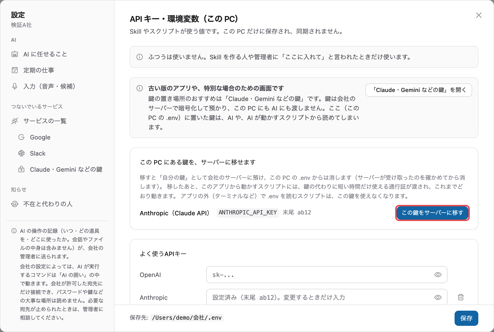

# 10節　鍵を預かる【FDE】

この節は FDE がやることが多い所です。管理者は「API キーはサーバーが預かり、PC にも AI にも渡らない」「止めるときは14節の［すべての鍵を止める］」だけ知っていれば大丈夫です。

## この節でできること

- 外のサービスの API キーを、会社の鍵としてサーバーに預けられます
- 1日に使える回数・量の上限を決められます
- 社員が自分の鍵を使ってよいか、どの部署で使えるかを決められます
- 社員の PC の .env にある鍵を、サーバーに移せます

---

## .env に書いた鍵の心配

これまで API キーは .env に書いて、スクリプトから読んでいたかもしれません。でも、AI と一緒に仕事をすると、AI がその鍵を読んで、どこかに書き出してしまうおそれがあります。使いすぎにも気づきにくくなります。

ACB では、鍵を**サーバーで暗号化して預かり、PC にも AI にも渡しません。** AI には、短い時間だけ使える通行証が渡り、サーバーが鍵を付けて外のサービスに取り次ぎます。

---

## 会社の鍵を登録する

「詳しい設定」の「AI の安全」の「API キー」を開きます。

- ［API キーを登録］で、サービスと鍵を登録します。
- 登録した鍵は、「キーを差し替える」「停止／再開」「削除」「設定を変更」ができます。鍵の中身は、登録したあと画面に出ません。

① 決めた1日の上限、② 今日どれだけ使ったかが出ます。鍵の中身は末尾4文字だけです。

**1日の上限**（空欄なら上限なし）
- 1日の回数（全体）・1日のトークン数（全体）
- 1日の回数（1人あたり）・1日のトークン数（1人あたり）

上限を超えると、その日は止まります。1日は日本時間で数えます。**お金の上限はありません。** 使いすぎが心配なときは、各サービスの予算の知らせも使ってください。

① どの部署の仕事で使えるか、② 使える人、③ 1日の上限（空欄なら上限なし）を決めます。

**だれが・どこで使えるか**
- 「どの部署の仕事で使えるか」：全社／選んだ部署だけ。
- 「使える人」：使えない人を除外できます。
- 同じサービスに会社の鍵が2つ以上あるときは、「〇〇 は、この鍵を使う」でどちらを使うか選びます。

---

## 社員の「自分の鍵」

「メンバーが自分の鍵を登録してよい」をオンにし、サービスごとに「メンバーが自分の鍵を使ってよい」を選ぶと、社員は自分の API キーを預けられます。オフなら会社の鍵だけを使います。

社員は、アプリの「設定」の「つないでいるサービス」の「Claude・Gemini などの鍵」で預けます。自分の鍵も、会社の鍵と同じくサーバーが預かり、PC にも AI にも渡りません。

---

## 中継するサービスと、社内の宛先

- 「登録したサービス」の［サービスを登録］で、ヘッダで鍵を渡す形の API を名前で登録できます（鍵の渡し方は Authorization: Bearer／X-API-Key／その他）。登録したサービスは、読むだけで中継されます。
- 「社内の宛先（例外）」で、社内のサービスの宛先を決めます。

---

## 本人の許可で中継する（Google）

「本人の許可で中継する」では、社員本人が Google で許可した範囲で、AI が Google を使えるようにします。今はスプレッドシート（読む・書く。消すは通さない）だけです。1人あたりの1日の上限（初めは500回）を決められ、［全員の中継を止める］もあります。

---

## .env の鍵をサーバーに移す

社員の PC の .env に鍵が残っているときは、アプリの「設定」の「詳しい設定」にある「API キー・環境変数（この PC）」を開くと、「この PC にある鍵を、サーバーに移せます」と出ます。［この鍵をサーバーに移す］を押すと、その鍵が「自分の鍵」になります。

移したあと、**アプリの外（ターミナルなど）で .env を読むスクリプトは、この鍵を使えなくなります。** アプリの中から動かすスクリプトは、通行証で使えます。

---

## 止めるとき

鍵ごとに「停止」できます。すべての鍵を一度に止めるときは、「AI の安全」の「AI を止める」にある［すべての鍵を止める］を使います（14節）。止めた鍵は、この「API キー」で1つずつ再開します。

---

## 検証A社では

田中さんは、HubSpot の鍵を会社の鍵として登録し、1日の回数（1人あたり）を決めました。山田さんの PC の .env にあった古い鍵は、［この鍵をサーバーに移す］で「自分の鍵」にしました。

鍵がそろいました。HubSpot のような業務のしくみは、どうつなぐのでしょう。次の節で見ていきます。
