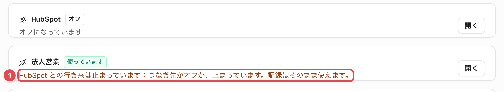
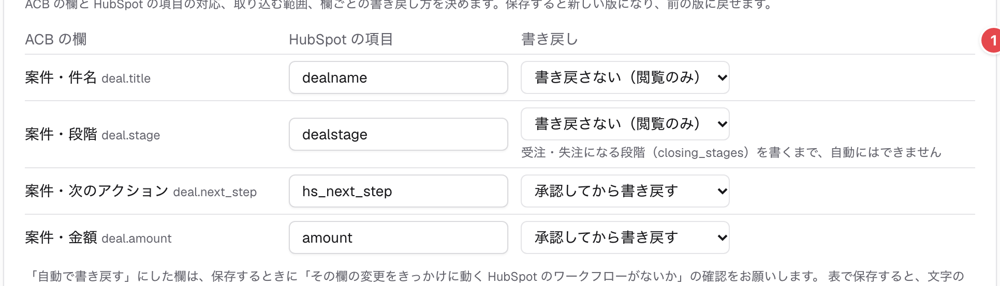

# 11節　業務プラグインを入れる【FDE】

この節は FDE がやることが多い所です。管理者は「つなぎ先（HubSpot など）と業務（法人営業など）は別々に使い始める」「外へ書き戻すかどうかは欄ごとに決め、受注・失注はいつも承認が要る」だけ知っていれば大丈夫です。

## この節でできること

- 「つなぎ先」と「業務」の違いと、入れる流れが分かります
- 読み替え表で、外のサービスへ書き戻すかどうかを欄ごとに決められます
- 役割・手順の始め方・置き場所を決められます
- どの操作が承認のお願いになるかが分かります

---

## つなぎ先と業務

SaaS の連携では、「連携アプリを入れて、項目を対応づけて、取り込む」流れでしたね。ACB では、2種類を別々に使い始めます。

- **つなぎ先**：HubSpot のような外のサービス。会社に1つのつながりです。
- **業務**：法人営業のような仕事の型。案件などの種類・手順・役割を持ちます。

業務がつなぎ先を使います（逆はありません）。どちらも管理画面の「つなぎ先」に並びます。

法人営業を先に使い始め、HubSpot をまだオンにしていないところです。① 外との行き来だけが止まり、記録はそのまま使えます。HubSpot をオンにすると、ここが「HubSpot とつながっています。」に変わります。

業務には3つの形があります。画面の説明で見分けます。

- 「案件や顧客などの記録を扱う業務です（外のサービスとは「〇〇」でつなぎます）」— 記録を取り込んで使う
- 「外のサービス「〇〇」を使う業務です」— 外を読むだけ（読み替え表と取り込みはありません）
- 「案件や顧客などの記録を扱う業務です（外のサービスにはつなぎません）」— ACB の中だけ

---

## 入れる順番

**順番は決まっていません。** 業務だけ先に使い始めても、ACB の中では動きます。つなぎ先がそろうまでは「〇〇 との行き来は止まっています」と出て、外との行き来だけが止まります。記録はそのまま使えます。

法人営業と HubSpot の場合の、おすすめの流れの例です。

1. HubSpot の鍵を、会社の鍵として登録する（10節）
2. 「つなぎ先」で HubSpot の［使い始める］。「版」と「鍵」を選んで［保存］
3. 「HubSpot を読める人」で、読める部署・メンバーを選んで［読める人を保存］（だれも選ばないと、オンにできません）
4. HubSpot を［オンにする］
5. 法人営業の［使い始める］
6. 読み替え表を決める
7. ［HubSpot に聞いて確かめる］
8. 法人営業を［オンにする］
9. ［取り込む］

使えるものがないときは「使えるつなぎ先はまだありません」と出ます。用意するのは運用担当者です（15節）。

---

## 読み替え表

ACB の欄と外のサービスの欄の対応を「読み替え表」で決めます。［表で直す］か［文字で直す（詳しい人向け）］で直し、［保存（新しい版にする）］で保存します。

欄ごとに、外へ書き戻すかを選びます。

- 「書き戻さない（閲覧のみ）」
- 「承認してから書き戻す」
- 「自動で書き戻す」

「自動で書き戻す」を選ぶと「自動で書き戻す欄の確認」が出ます。「この欄の変更をきっかけに動く 〇〇 のワークフローがないか確かめました」に印を付けて［確認して保存する］を押します。**自動にしても、受注・失注にする（そこから戻す）ときは承認が要ります。**

① 欄ごとに「書き戻さない（閲覧のみ）」「承認してから書き戻す」「自動で書き戻す」を選びます。段階の欄は、受注・失注になる段階を書くまで自動にできません。

「これまでの版」から［この版に戻す］で前の版に戻せます。変更は「履歴」に残ります。外のサービスのアカウントが変わったときは、［新しいつなぎ先として始める］が出ます。

---

## 承認のお願いになる操作

次のような操作は、AI や社員が頼んでもすぐには外へ書かず、「承認のお願い」になります。

- 「承認してから書き戻す」にした欄を変える
- 受注・失注にする、そこから戻す
- 金額の欄を変える（金額の欄は自動にできません）
- 業務が「承認が要る」と決めている操作

承認されて初めて、外のサービスに書かれます。

---

## AI が外を読むとき

業務を入れると、社員の AI の道具に「〇〇 の「…」を読む（読むだけ。〇〇 は変えない）」が増えます。今動く呼び出しは、読む・探す・文書を読むだけです。だれが何を読んだかは記録に残り、読んだ中身は保存しません。業務が宣言しているそのほかの呼び出しや、外の変化の見張りは、まだ動きません。

---

## 役割・手順

- **役割**（例：営業の責任者）は、「役割」で会社全体で決めます。人ごとに印を付けて［保存］。今は会社全体で決めます。プロジェクトごとに変える画面はまだありません。
- **手順の始め方と置き場所**：「ボタンで始める」か「自動で始める」と、できたものを置くフォルダを決めます。
- **手順を会社のスキルで**：業務の手順を、会社の Skill に置き換えられます。もう始まっている仕事は、始めたときの手順のまま進みます。

業務が会社に合わないときは、設定 → 役割 → 会社の Skill の順で合わせられないか試します。それでも合わないときは、会社に合わせた別の業務を用意します（もとの業務を引き継ぐ形にはしません）。

---

## 検証A社では

田中さんは、練習用の HubSpot で流れを確かめてから、本物の HubSpot をつなぎました。はじめは全部の欄を「書き戻さない（閲覧のみ）」にし、慣れてから商談の段階だけ「承認してから書き戻す」にしました。

人が押すたびではなく、決まった時間に動かすには？　次の節で見ていきます。

---

## 社員の取説で指している所

- 23章「承認のお願い」
