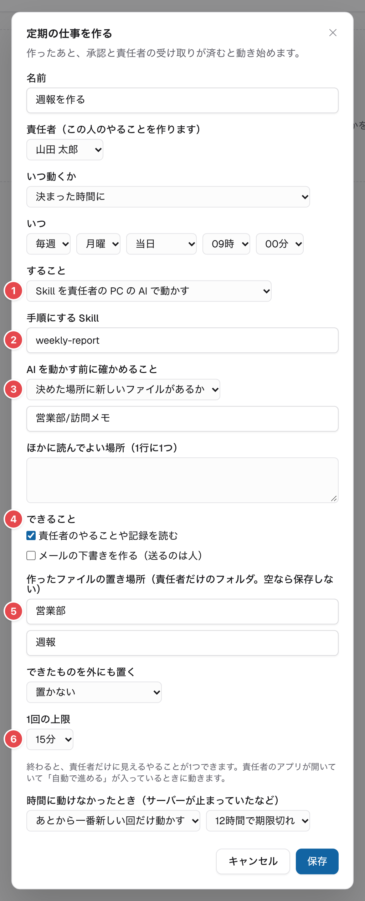
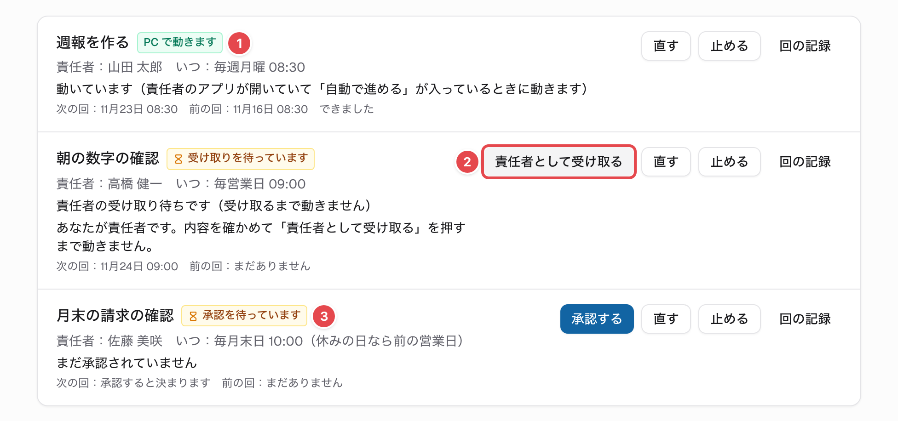
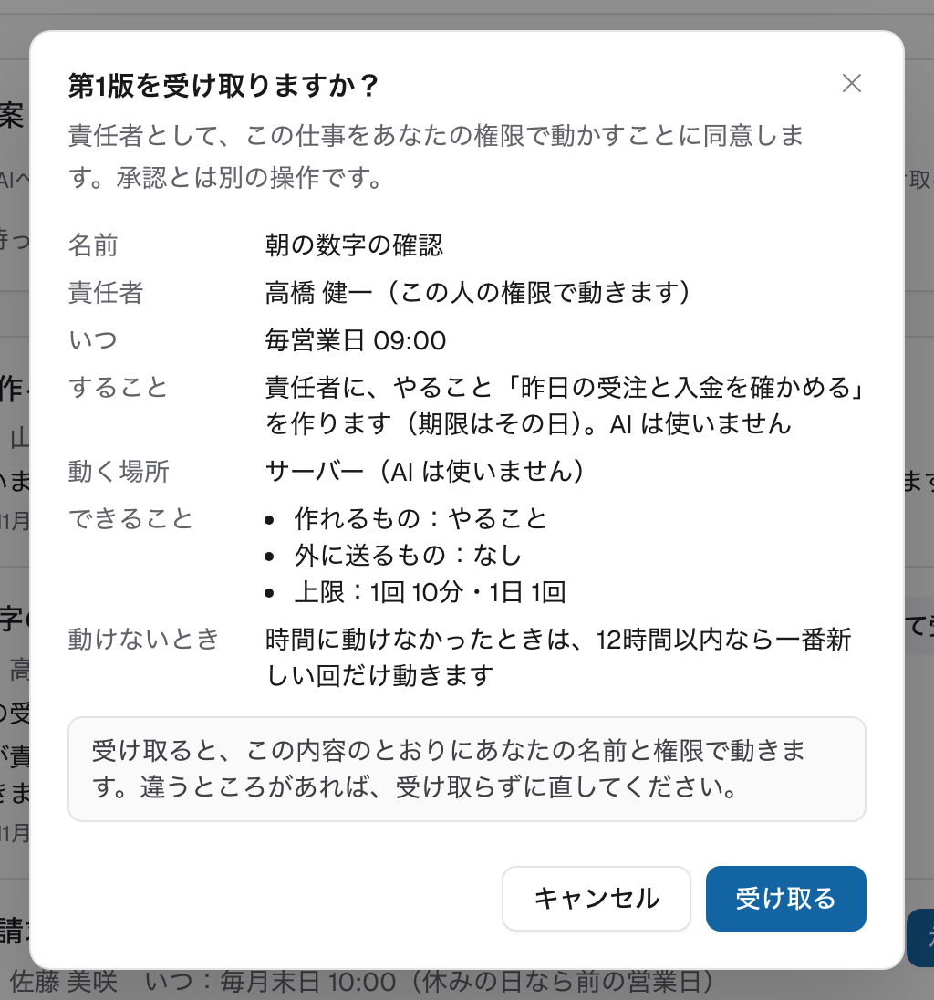
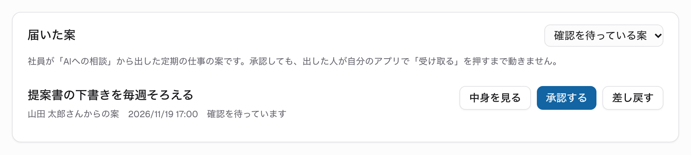

# 12節　自動にする：定期の仕事と AI の番【FDE】

この節は FDE がやることが多い所です。管理者は「作った定期の仕事は、管理者が承認し、責任者が受け取るまで動かない」「止めていた間の回は、再開しても動かない」だけ知っていれば大丈夫です。

## この節でできること

- 決まった時間や出来事で、やることを作ったり、AI に Skill を動かさせたりできます
- 承認と「受け取る」の流れが分かります
- 動けなかった回・止めていた間の回がどうなるかが分かります
- 定期の仕事の止め方と、記録の見方が分かります

---

## 定期の仕事の2種類

カレンダーのリマインダや Zapier の定期実行は、PC を閉じていても動きましたね。ACB の定期の仕事には、動く場所の違う2種類があります。

左のメニューの「定期の仕事」で［定期の仕事を作る］を押し、「すること」で選びます。

- **「やることを作る（サーバーで。AI は使いません）」** — サーバーが決まった時間にやることを作ります。PC を閉じていても動きます。
- **「Skill を責任者の PC の AI で動かす」** — 責任者の PC で、AI が Skill の手順で仕事をします。**責任者のアプリが開いていて、「自動で進める」がオンのときだけ**動きます。

AI で動かすものは、次のことを決めます。

- 「手順にする Skill」
- 「ほかに読んでよい場所」
- 「できること」：「責任者のやることや記録を読む」「メールの下書きを作る（送るのは人）」
- 「作ったファイルの置き場所」（責任者だけのフォルダ）
- 「1回の上限」（5〜60分）
- 「AI を動かす前に確かめること」：「決めた場所に新しいファイルがあるか」か「責任者が出た会議があったか」。**時間が来ただけでは AI は動きません。** 新しいものがない回は、AI は動かずに終わります。

① すること、② 手順にする Skill、③ AI を動かす前に確かめること、④ できること、⑤ 作ったファイルの置き場所、⑥ 1回の上限です。

---

## いつ動かすか

- **時間で**：「毎日」（「営業日だけ」も選べます）、「毎週」（曜日の「当日」か「N営業日前」。例：火曜の1営業日前）、「毎月」（1〜28日か「末日」）。時刻は5分きざみです。営業日は会社の暦で数えます（3節）。
- **出来事で**：見張っているやることが「完了」になったときなど。1日の上限を決められます。

---

## 作る → 承認 → 受け取る

定期の仕事は、作っただけでは動きません。

1. 作る（「承認を待っています」）
2. 管理者が［承認する］
3. 責任者が［受け取る］（「受け取りを待っています」）

**責任者が受け取るまで動きません。** 定期の仕事は、責任者の名前と権限で動くからです。管理者が自分を責任者にして承認しても、それは受け取ったことにはなりません。自分が責任者なら、管理画面の［責任者として受け取る］を押します。社員はアプリの「設定」の「定期の仕事」で［受け取る］を押します。

① 山田さんの PC で動いている仕事。② 高橋さん（オーナー）が自分を責任者にして承認した仕事で、受け取るまで動きません。③ 作ったばかりで、承認を待っている仕事。

---

## 動けなかった回・止めていた間の回

- サーバーが止まっていたなどで時間に動けなかった回は、「あとから一番新しい回だけ動かす」か「見送る」を選び、どれだけたったら期限切れにするかを決めます。
- **［止める］や［すべて止める］で止めていた間の回は、再開しても動きません。**
- 責任者が不在の日は見送ります（4節。代わりの人では動かしません）。
- 責任者が会社を離れたり、権限が足りなくなったりすると止まり、管理者に知らせが届きます。新しい責任者を決めてください。

---

## 止める・確かめる

- ［止める］／［再開する］：1つの定期の仕事を止める・戻す
- ［すべて止める］／［動かせるようにする］：会社の定期の仕事を全部止める・戻す
- ［回の記録］：回ごとの結果。結果が分からなかった回は［作られていた］［作られていなかった］を記録し、［もう一度］で動かし直せます
- ［直す］：中身を直す

---

## 社員の案

社員が出した定期の仕事の案が「届いた案」に届くことがあります（会社によっては出ます）。［中身を見る］で確かめて、［承認する］か［差し戻す］を押します。

---

## AI の番の上限

社員の AI が押さなくても仕事を進める「AI の番」の回数と、続けて失敗したら止まる回数は、8節の「仕事の進め方」で決めます。定期の仕事の回は、この1日の回数には数えません。

---

## 検証A社では

田中さんは、毎週月曜の朝に「先週の訪問メモから週報を作る」定期の仕事を、山田さんを責任者にして作りました。佐藤さんが承認し、山田さんがアプリで受け取ってから動き始めました。

画面のある外のサイトを、AI に操作させることはできるのでしょうか。次の節で見ていきます。

---

## 社員の取説で指している所

- 21章「AI の番：AI が先に用意してくれる」
- 26章「定期の仕事：「次から自動にしますか？」」
