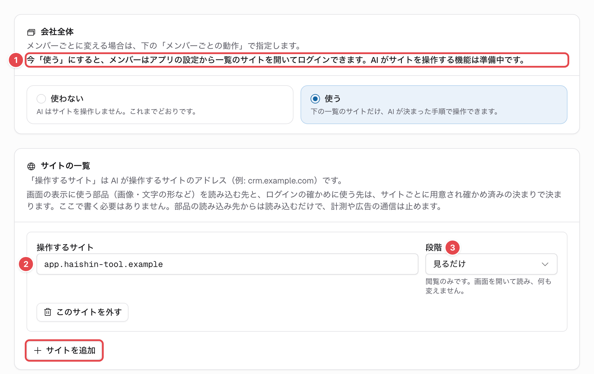
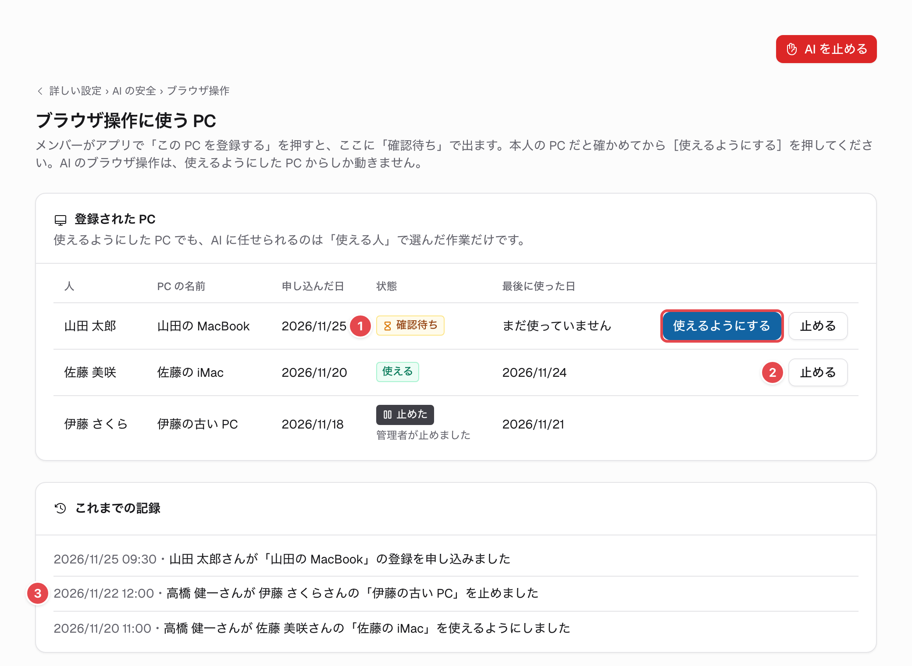
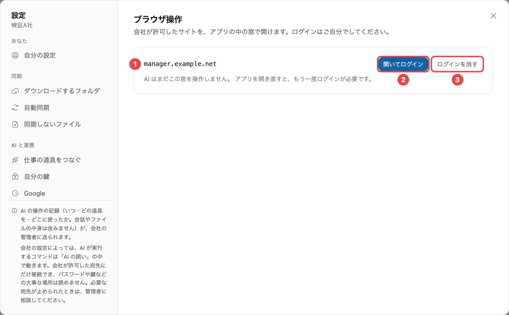
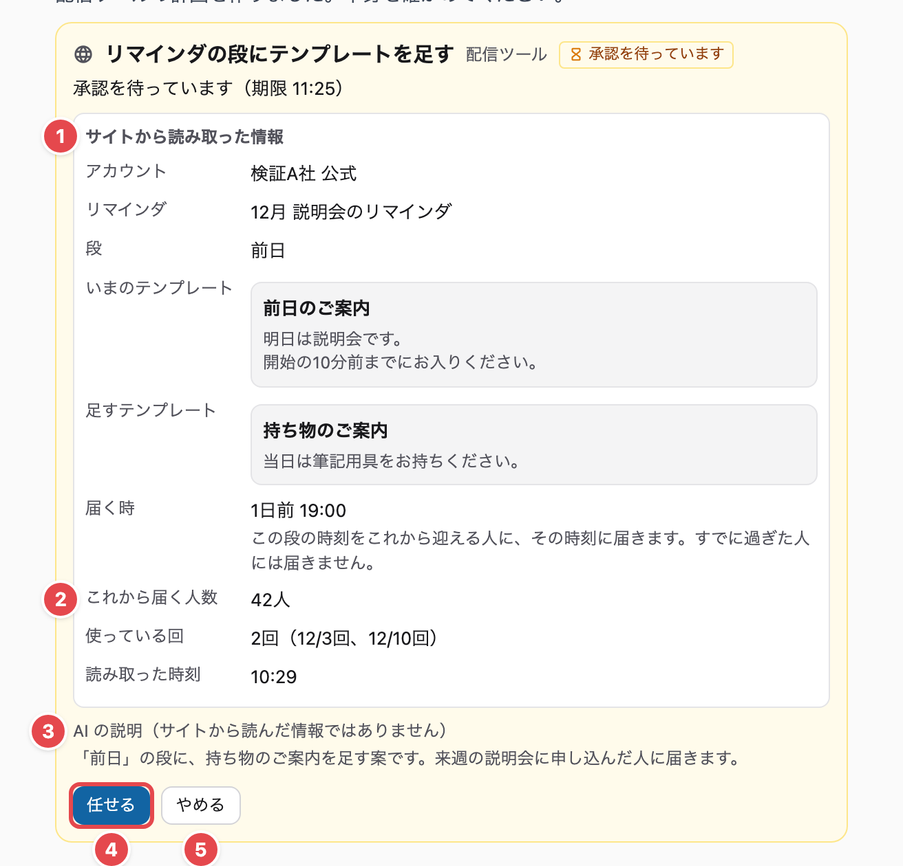

# 13節　ブラウザ操作（試し中）【FDE】

この節は FDE がやることが多い所です。管理者は「初めは使わない」「許可したサイトだけ」「止めるときは［AI を止める］か『使わない』」だけ知っていれば大丈夫です。

## この節でできること

- いまのブラウザ操作でできること・まだできないことが分かります
- 操作してよいサイトと段階を、会社とメンバーごとに決められます
- AI がサイトを操作するときの「計画のカード」の流れと、AI にできないことが分かります
- ブラウザ操作の止め方が分かります

---

## いまの段階

RPA は画面をクリックして回るので、サイトの見た目が変わると誤操作することがありました。ACB のブラウザ操作は、それを避けるように作っています。ただし、**まだ試している段階です。**

- 管理画面で「使う」にすると、社員はアプリから、一覧のサイトを開いてログインできます。
- **AI がサイトを操作するのは、今は ACB の開発元のオーナーの PC 1台だけで試しています**（会社の「オーナー」の役割のことではありません）。管理画面にも「AI がサイトを操作する機能は準備中です。」と出ます。ほかの社員のアプリでは、AI はまだサイトを操作しません。

この節では、試している仕組みをそのまま説明します。

---

## 許可したサイトだけ

「詳しい設定」の「AI の安全」の「ブラウザ操作」で決めます。

- **会社全体**：「使わない」（初め）／「使う」
- **サイトの一覧**：［サイトを追加］で「操作するサイト」と「段階」を決めます。［このサイトを外す］で外せます。「*」・IP アドレス・localhost・https:// やパスは書けません。
- **段階**：「見るだけ」／「入力・保存まで」／「削除も」
- **メンバーごとの動作**：「会社と同じ」／「使わない」／「使う」
- **変更の記録**：だれがいつ何を変えたか

① 会社全体の下に、AI の操作は準備中だという文が出ます。② 操作するサイトと ③ 段階を決め、［サイトを追加］で足します。

**サイトごとの決まり**：サイトの画面の部品をどこから読み込むか、ログインの確かめ（reCAPTCHA など）にどこを使うかは、サイトごとに用意され、確かめ済みの決まりで決まります。管理者が書く必要はありません。決まりは版ごとに確かめられ、確かめ済みのものだけが使われます。

---

## 使う PC と使える人

AI にブラウザ操作を任せられるのは、**管理者が使えるようにした PC** から、**その人に許したサイトと使い方** だけです。どちらも「ブラウザ操作」のページの上にあるリンクから開きます。

**ブラウザ操作に使う PC**：社員がアプリで「この PC を登録する」を押すと、ここに「確認待ち」で出ます。

- 本人の PC だと確かめてから［使えるようにする］を押します（自分の PC も同じです）。
- ［止める］を押すと、その PC からの新しい頼みはすぐに断られます。ちょうど送ろうとしていた1回は送られることがあり、途中の作業は次の書き込みの前で止まります。もう一度使うには、本人が登録し直します。
- 会社を抜けた人の PC は自動で止まります。下に、だれがいつどの PC を使えるようにした・止めたかが残ります。

**ブラウザ操作を使える人**：行が人、列が登録したサイトの表です。それぞれのますで「使わない」「見るだけ」「変えてよい」を選びます。選ぶとすぐに変わります。

- サイトを登録すると、全員「見るだけ」から始まります。使わせたくない人は「使わない」にします。
- 「変えてよい」（入力や保存を AI に任せてよい）は、1人ずつ選びます。
- 会社の設定（段階）が上限です。段階が「見るだけ」のサイトでは「変えてよい」は選べません。
- オーナーと管理者も同じ表に従います（自動で「変えてよい」にはなりません）。
- 会社を抜けた人は使えません。招待し直したときは「見るだけ」から始まります。

---

## ログイン

社員は、アプリの「設定」の「AI と連携」の「ブラウザ操作」で［開いてログイン］を押し、自分でサイトにログインします（会社が「使う」にしていて、サイトが1つ以上あるときだけ出ます）。

- **ログインは PC に保存されません。** アプリを開き直すと、もう一度ログインが要ります。AI が実行するコマンドからログイン情報を読まれないようにするためです。
- ［ログインを消す］で、すぐに消せます。
- ログインの確かめに使う先（reCAPTCHA など）は、人がログインしている間だけ通り、AI が操作する間は閉じます。

---

## 計画のカードを1回承認

AI は、サイトを自由にクリックするのではなく、**決まった操作の種類から「計画」を作るだけ**です。計画は、カードで社員に見せます。

- カードには、操作する対象・変える中身と、「サイトから読み取った情報」「AI の説明（サイトから読んだ情報ではありません）」が分けて出ます。
- 社員が［任せる］を1回押すと、**その1回だけ**動きます。
- やめるときは［やめる］。
- 結果が分からなかったときは、サイトを見て［済んでいた］か［されていなかった］を押します。もう一度は送りません。もう一度やるときは、相談で頼み直します。

① サイトから読み取った情報と ③ AI の説明は分けて出ます。② のような数は、サイトから読んだものです。社員が ④［任せる］を押すと1回だけ動き、⑤［やめる］で取りやめます。

---

## AI にできないこと

- 自由にクリックすること
- 一覧にないサイトや宛先を開くこと
- 1回の計画で2つ以上書き込むこと
- 決まりにない操作をすること
- 計画を自分で承認する・実行する・結果を報告すること

書き込む直前と直後に、確かめ役がサイトを読み直します。読めなければ、書かずに止まります。

---

## 止め方

- どのページの上にもある［AI を止める］（14節）。「Web へのアクセス」だけを止めることもできます。
- 会社全体を「使わない」にする。
- そのサイトを［このサイトを外す］で一覧から外す。

「使わない」にしたり、サイトを外したりすると、そのサイトの窓は閉じ、ログインも消えます。

---

## 検証A社では

検証A社では、ブラウザ操作は「使わない」のままにしています。開発元での試しが終わって、ほかの会社の社員にも広げられるようになったら、まず「見るだけ」でサイトを1つ足す予定です。

任せる範囲が広がりました。毎日どこを見て、もしものときはどう止めるのでしょう。次の節で見ていきます。
