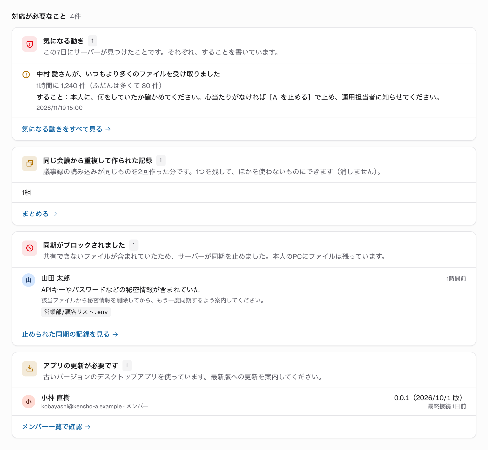
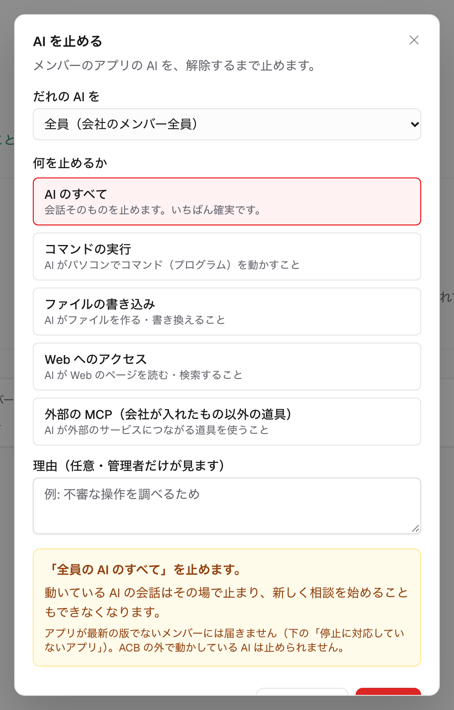
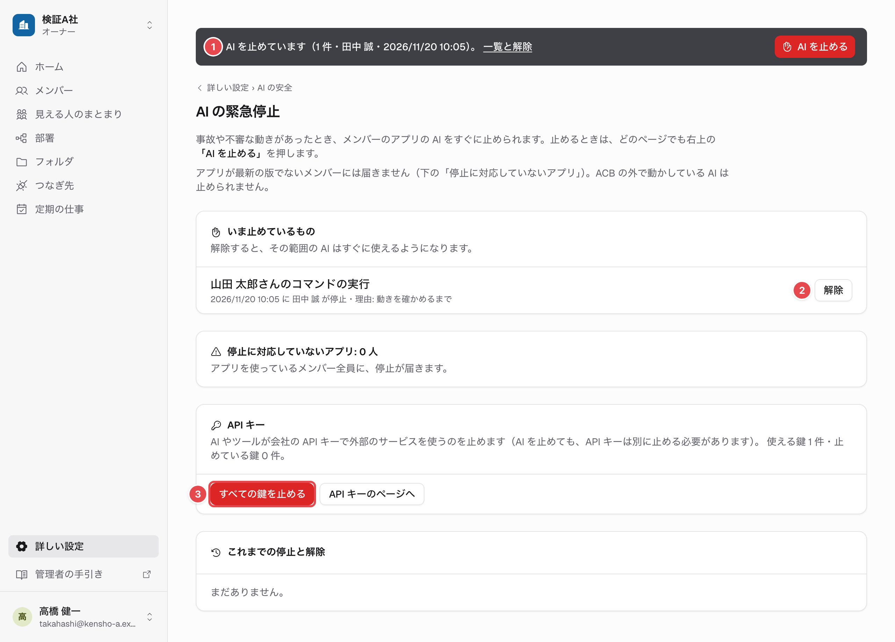
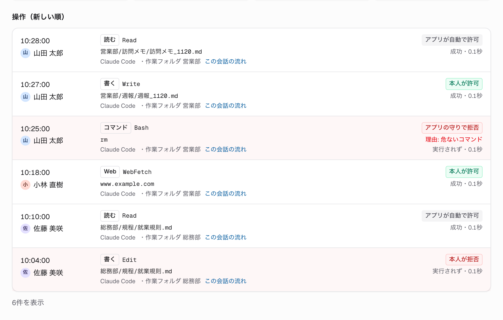
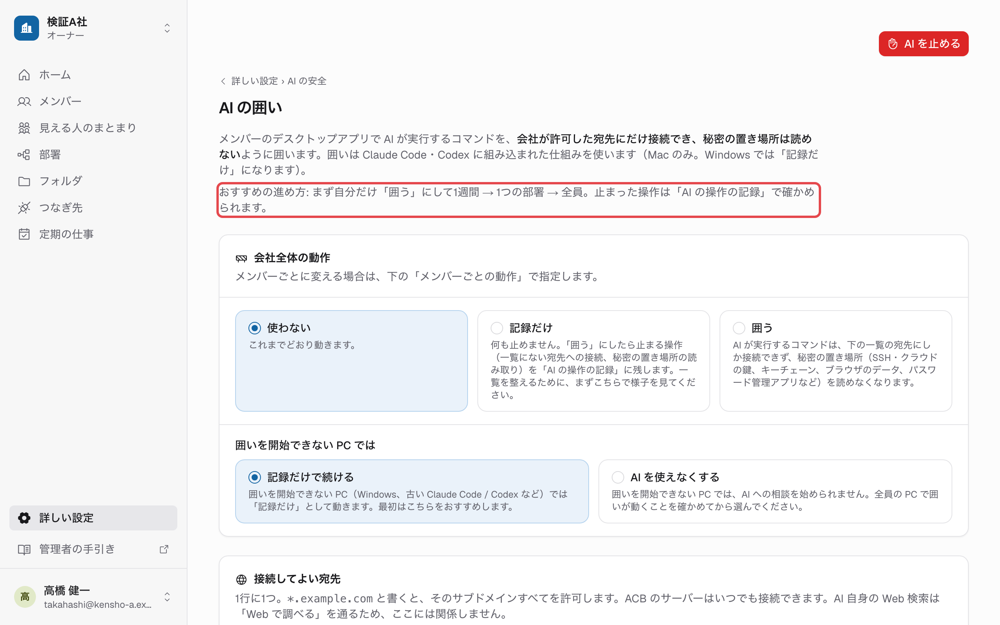
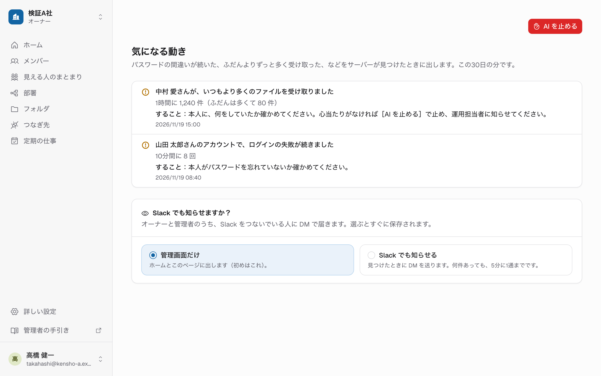

# 14節　見守る・止める

## この節でできること

- 毎朝ホームの「対応が必要なこと」を見て、困りごとに早く気づけます
- もしものときに［AI を止める］で、会社全体か1人の AI を止められます
- AI の操作の記録を見て、AI が何をしたかを確かめられます
- AI の囲い・もう一方の AI に聞く・気になる動きの知らせを決められます

---

## 毎朝見る所：「対応が必要なこと」

セキュリティの管理画面は、知らせが多すぎて見なくなりがちです。ACB では、**ホームの「対応が必要なこと」だけ**を毎朝見れば大丈夫です。何もなければ「対応が必要なことはありません」と出ます。

- 「気になる動き」— この7日にサーバーが見つけたこと
- 「同じ会議から重複して作られた記録」— ［まとめる］で開き、1件にまとめます（消すのではなく、まとめます）
- 「動いていない業務・つなぎ先」— オンなのに動けないもの（11節）
- 「同期がブロックされました」— 「止められた同期の記録を見る」で中身を確かめます
- 「ルールが付いているフォルダが見つかりません（名前の変更・削除の可能性）」（5節）
- 「アプリの更新が必要です」「アプリのバージョンがわかりません」
- 「しばらく同期していません」（全社フォルダを使う会社だけ）

部署の管理役がホームを開くと、自分の部署に所属する人のアプリの更新と同期のことだけが出ます。

「止められた同期の記録」と「組み込みのルール」は、「詳しい設定」の「会社の情報」の「組み込みのルールと止められた同期」からも開けます。

---

## AI を止める

どのページの上にもある赤い［AI を止める］で止めます（オーナー・管理者だけ）。

- **だれの AI を**：「全員（会社のメンバー全員）」か、1人のメンバー
- **何を止めるか**：「AI のすべて」か、コマンドの実行／ファイルの書き込み／Web へのアクセス／外部の MCP のどれか

メンバーのアプリには数秒で届きます。社員の相談には「管理者が AI の利用を一時停止しています。再開されるまでお待ちください。」と出ます。止めているあいだは、ページの上に「AI を止めています」の帯が出て、「一覧と解除」から解除します。

気をつけること：アプリが最新の版でないメンバーには届きません。ACB の外で動かしている AI は止められません。

**鍵もすぐ止めたいとき**は、「詳しい設定」の「AI の安全」の「AI を止める」で［すべての鍵を止める］を押します。メンバーの Google・Slack の許可も止まります。鍵は「API キー」で1つずつ再開します（10節）。

① 止めているあいだ、どのページの上にも帯が出ます。② 止めたものは［解除］で戻します。③ 鍵もまとめて止めるときは［すべての鍵を止める］。

---

## AI の操作の記録

「AI の安全」の「AI の操作の記録」では、いつ・誰が・どの AI で・どの道具を・どこに使ったか、それが許可されたかを見られます。**会話の中身・ファイルの中身・コマンドの引数は記録しません。**

- 残す期間：7日〜。初めは180日です。
- 記録を見られる人：「オーナーと管理者だけ」（初め）か、部署の管理役にも自分の部署の分だけ見せるか。

社員のアプリには「AI の操作の記録について」というお知らせが出て、記録が管理者に送られることが伝わります。

---

## AI の囲い【FDE】

「AI の囲い」は、社員の PC で AI が読んだりつないだりできる範囲を囲うものです。

- 「使わない」（初め）／「記録だけ」／「囲う」
- 「接続してよい宛先」と「ほかに読ませない場所」。SSH・クラウドの鍵、キーチェーン、ブラウザのデータ、パスワード管理アプリ、ACB アプリのデータは、書かなくても読めません。
- 「囲いを開始できない PC では」：「記録だけで続ける」か「AI を使えなくする」
- 「メンバーごとの動作」、影響のカード「囲うと止まる操作（直近30日）」、「変更の記録」
- 囲えるのは Mac です。Windows は「記録だけ」で動きます。

画面のおすすめのとおりに進めます。**まず自分だけ「囲う」にして1週間 → 1つの部署 → 全員。** 止まった操作は「AI の操作の記録」で確かめられます。

---

## もう一方の AI に聞く

社員が相談の中で、もう一方の AI（Claude と Codex）にも意見を聞けるかどうかを、「聞かない」（初め）か「聞いてよい」で決めます。**聞くと、会社の中身がもう一方の会社にも渡ります。** 片方の会社とだけ契約しているなら「聞かない」のままにします。

---

## 気になる動き

「気になる動き」は、サーバーが見つけた、ふだんと違う動き（たくさんのダウンロードなど）です。「Slack でも知らせますか？」で、「管理画面だけ」（初め）か「Slack でも知らせる」を選びます。

---

## 管理者だけに届く知らせ

受け箱には、管理者だけに届く知らせがあります。

- 社員から定期の仕事の案が届いた
- 定期の仕事が止まった（責任者が会社を離れた・権限が変わった）
- 会社のデータをバックアップから戻したため、自動の仕事を止めた

---

## 検証A社では

佐藤さんは、毎朝ホームの「対応が必要なこと」を見ています。田中さんは、AI の囲いをまず自分だけ「囲う」にして1週間試し、止まった操作を記録で確かめてから、営業部に広げました。

自分では直せないことは、だれに頼むのでしょう。最後の節で見ていきます。

---

## 社員の取説で指している所

- 25章「受け箱と知らせ」
