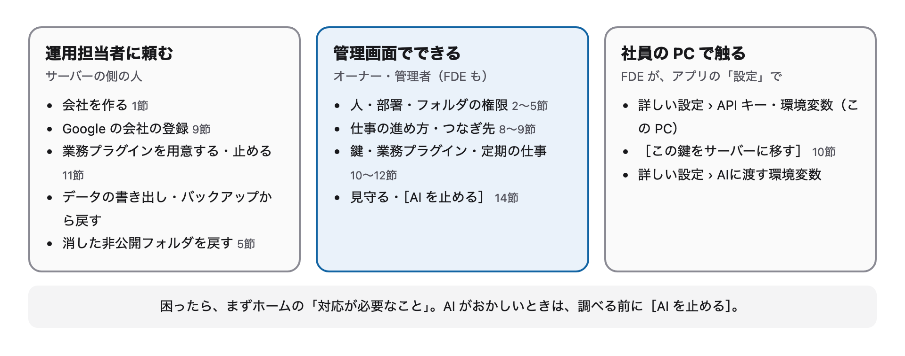
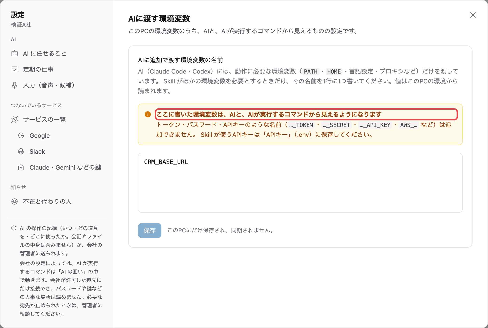

# 15節　困ったとき・運用担当者に頼むこと・FDE が PC で触る設定【FDE】

この節は FDE がやることが多い所です。管理者は「管理画面にないことは運用担当者に頼む」「困ったときに見る順」だけ知っていれば大丈夫です。

## この節でできること

- 管理画面ではできず、運用担当者に頼むことが分かります
- FDE が社員の PC で触る設定（API キー・環境変数）が分かります
- 困ったときに、どこから見ればよいかが分かります

---

## 運用担当者に頼むこと

クラウドサービスでも、契約や上限の変更はサポートに頼みましたね。ACB では、サーバーの側のことは運用担当者に頼みます。

- **会社を作る**（1節）
- **Google の会社の登録**（9節）
- **業務プラグインを用意する・止める** — 「つなぎ先」に使いたいものが出ていないときは、運用担当者に頼みます（11節）
- **会社のデータの書き出しと、バックアップからの復元**
- **消した非公開フォルダを戻す**（5節）

**バックアップから戻したあとは、定期の仕事と AI が止まったままになります。** 管理者に「会社のデータをバックアップから戻したため、自動の仕事を止めた」の知らせが届き、AI の停止の一覧に「バックアップから戻したとき（自動）」と出ます。戻す前にもう済んでいた仕事（送ったメール・Google ドライブに置いたファイル・HubSpot への書き込みなど）を確かめてから、定期の仕事を［動かせるようにする］で戻し、AI の停止を解除してください。

---

## FDE が社員の PC で触る設定

社員のアプリの「設定」のいちばん下の「詳しい設定」（ふだんは畳んであります）には、ふつうの社員が触らない設定があります。社員の取説にも載せていません。社員には「分からない設定は触らなくて大丈夫」と伝えてください。

**「API キー・環境変数（この PC）」**

古い版のアプリや、特別な場合のための画面です（画面にもそう出ます）。ここに書いた鍵は、AI や、AI が動かすスクリプトから読めてしまいます。**おすすめは「Claude・Gemini などの鍵」（自分の鍵）です**（10節）。ここに鍵が残っているときは、［この鍵をサーバーに移す］で自分の鍵に移します。

**「AIに渡す環境変数」**

AI と、AI が実行するコマンドに見せる環境変数の名前を足します。

- 「ここに書いた環境変数は、AIと、AIが実行するコマンドから見えるようになります」と出ます。
- 秘密情報らしい名前は足せません（「秘密情報の可能性がある名前のため追加しませんでした」と出ます）。
- この PC にだけ保存され、同期されません。ほかの人の PC には、それぞれ設定します。

---

## 困ったときに見る順

1. **ホームの「対応が必要なこと」**（14節）— 古いアプリ、止められた同期、動いていないつなぎ先など、多くのことはここに出ます。
2. **AI の操作の記録**（14節）— AI が何をしたか、何が止められたか。
3. **止められた同期の記録**（「詳しい設定」の「会社の情報」）— 社員の同期がなぜ止められたか。
4. **運用担当者**— 管理画面でできないこと、サーバーの側のこと。

AI がおかしいと思ったら、調べる前にまず［AI を止める］で止めて大丈夫です。止めても、社員のファイルや記録は消えません。

---

## 検証A社では

田中さんは立ち上げの最後に、佐藤さんと一緒にこの「見る順」を確かめ、運用担当者の連絡先を総務部の非公開フォルダの手順書に書いておきました。

これで、手引きはおしまいです。社員が毎日の仕事で使う画面は、社員の取説の17章から先にあります。

---

## 社員の取説で指している所

- 17章「朝はここを見る：やることの一覧」から先の、2日目からの章
