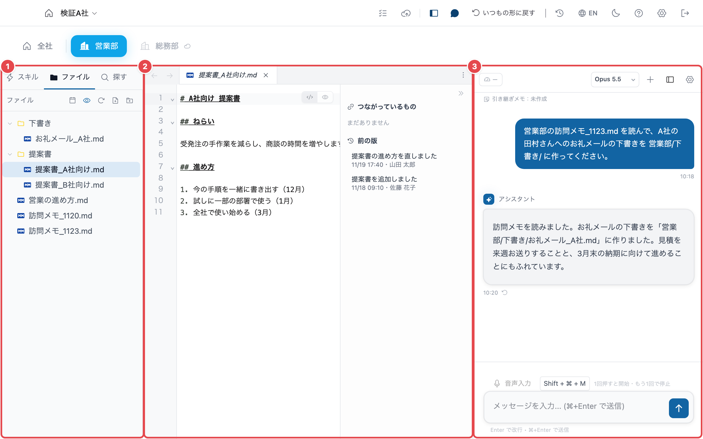
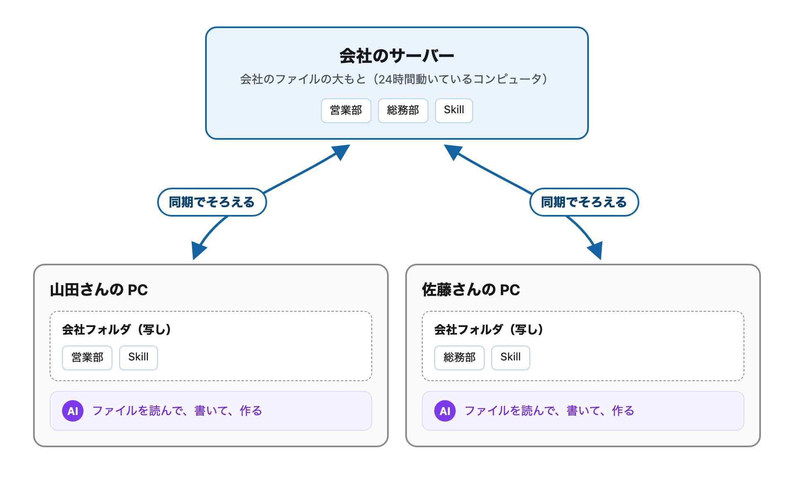

# 1章　ACB ってなに？

## はじめに

ある日、管理者からこんな連絡が届きました。

「今日から、会社のファイルは ACB で共有します。招待のメールを送ったので、アプリを入れておいてくださいね」

……ACB？　聞いたことのない名前ですよね。

いま会社のファイルは、Google ドライブや Dropbox の共有フォルダに置いているかもしれません。AI なら ChatGPT をもう使っている、という人もいるでしょう。それなのに、どうして新しいアプリが要るのでしょうか？

この章では、ACB が何をするアプリなのかを、あなたがもう知っているものと比べながら見ていきます。難しい操作はまだ出てきません。気楽に読み進めてください。

### この章で分かること

- ACB が何をするアプリなのか
- 今使っている共有フォルダや ChatGPT と、どこが違うのか
- 1日目にやることは何か

---

## いつもの共有フォルダと ChatGPT を思い出してみましょう

まずは、あなたがふだんどう仕事をしているかを思い出してみてください。

提案書や議事録は、Google ドライブの共有フォルダに置いてありますね。フォルダを開けば、部署のみんなが作ったファイルが並んでいます。誰かが直せば、あなたにもその内容が見えます。

では、そのファイルを ChatGPT に手伝ってもらうときはどうしていますか？

ファイルを開いて、中身をコピーして、ChatGPT の入力欄に貼りつけて、「これを要約して」と頼む。返ってきた答えをまたコピーして、ファイルに貼り直す……。

**ChatGPT は賢いのですが、あなたの会社のファイルがどこにあるのかを知りません。**

だから毎回、あなたが運び役になっていたのです。ファイルが3つ、4つと増えると、それだけでひと仕事ですよね。

---

## ACB は「会社の共有フォルダ」と「そこで働く AI」がひとつになったアプリです

ACB（AI Company Builder）は、この運び役をなくすためのアプリです。

ACB を開くと、画面には会社の共有フォルダ（①）と、開いたファイルの中身（②）と、AI と話す欄「AIへの相談」（③）が並んでいます。

このアプリの中で、AI はあなたと同じフォルダを見ています。「営業部の訪問メモを読んで、お礼メールの下書きを作って」と頼めば、AI が自分でファイルを開いて読み、下書きのファイルを作って、フォルダに置いてくれます。コピーも貼りつけも要りません。

ここで1つ、Google ドライブとの大きな違いがあります。ACB では、会社のファイルが あなたの PC の中にも置かれる のです。

### ファイルは「会社のサーバー」と「あなたの PC」の両方にあります

会社のファイルの大もとは「サーバー」に置かれています。

> **用語解説：サーバー**
>
> サーバーとは、インターネットにつながったまま24時間動き続けているコンピュータのことです。Google ドライブのファイルも、Gmail のメールも、実は Google のサーバーに置かれています。あなたがスマホでメールを見られるのは、サーバーがいつでも「はい、どうぞ」と中身を渡してくれるからです。
>
> ACB では、あなたの会社専用のサーバーが、会社のファイルの大もとを預かっています。今は「会社のファイルの本棚がある、いつも開いているコンピュータ」くらいのイメージで OK です！

ACB を入れると、このサーバーにあるファイルの写しが、あなたの PC の中の「会社フォルダ」に置かれます。山田さんの PC にも、佐藤さんの PC にも、同じ写しがあります。そして AI は、それぞれの PC の中で、その写しを読んだり書いたりして働きます。

図にすると、こうなります。上にあるのが会社のサーバー（ファイルの大もと）、下にあるのが山田さんの PC と佐藤さんの PC です。それぞれの PC の中に会社フォルダの写しがあり、AI もその PC の中で働きます。

あなたの PC とサーバーの間で内容をそろえることを「同期」と呼びます。ACB には［サーバーと同期］というボタンがあって、これを押すと、あなたが直したものが会社に届き、ほかの人が直したものがあなたの PC に届きます。くわしくは11章で見ていきます。

> **用語解説：同期**
>
> 同期とは、2つの場所の中身を同じにそろえることです。スマホで撮った写真が、しばらくするとパソコンの写真アプリにも出てくることがありますよね。あれも同期です。
>
> ACB では、あなたの PC の会社フォルダと、会社のサーバーの中身をそろえることを指します。今は「自分の PC と会社を、同じ中身にそろえること」と覚えておけば十分です。

### だから、AI に「会社の仕事」を頼めるようになります

ファイルがあなたの PC の中にあるので、AI はそれを直接読めます。AI が作ったファイルも、あなたの会社フォルダにそのまま置かれます。

**だから ACB の AI は、質問に答えるだけでなく、会社のファイルを使って仕事を進めてくれるのです。**

しかも、AI が作ったファイルは、同期すればみんなに届きます。会社でうまくいった AI への頼み方も、「Skill（スキル）」という形で全員に配られます（9章で見ます）。一人が見つけたうまいやり方が、会社みんなのものになるわけです。

検証A社の山田さんなら、営業部のフォルダにある訪問メモをもとに、AI にお礼メールの下書きを作ってもらう。これが、ACB でのいちばん身近な使い方になります。

---

## 1日目にやることは5つだけです

できることがたくさんありそうで、少し不安になったかもしれませんね。

でも大丈夫です。**1日目に覚えることは、この5つだけです。**

1. **会社を開く** — 招待のメールからアプリを入れて、ログインする（2章・3章）
2. **ファイルを開いて直す** — 共有フォルダと同じように、ファイルを読んで書く（5章）
3. **AI に頼む** — 「AIへの相談」で、ファイルを使った仕事を頼む（6章〜8章）
4. **Skill を使う** — 会社の上手なやり方を、AI に使ってもらう（9章）
5. **同期する** — ［サーバーと同期］を押して、会社と内容をそろえる（11章〜14章）

この順に、1つずつ進めていきます。同期やフォルダのくわしいことは、後ろの「困ったとき・もっと知る」の章（11章〜15章）にまとめてあります。ボタンを押して何かが起きても、同期であなたの作業が消えることはありません。ACB はそうならないように作られています（13章でくわしく見ます）。安心して手を動かしてみてください。

---

## まとめ

- ACB は、会社の共有フォルダと、そこで働く AI がひとつになったアプリです。
- 会社のファイルの大もとはサーバーにあり、写しがあなたの PC の「会社フォルダ」に置かれます。
- AI はあなたの PC の中でそのファイルを読み書きするので、コピーして貼りつける手間がなくなります。
- PC と会社の内容をそろえることを「同期」と呼びます。
- 1日目にやることは、開く・ファイルを直す・AI に頼む・Skill を使う・同期する、の5つです。

## やってみよう

1. メールの受信箱で、管理者から届いた ACB の招待メールを探してみましょう。まだ開かなくて大丈夫です。
2. 最近 ChatGPT や共有フォルダで「面倒だな」と思った作業を1つ、思い出してメモしておきましょう。6章で AI に頼むときの題材になります。

---

さて、ACB が何をするアプリなのかは分かりました。

では、届いた招待のメールから、どうやって始めればいいのでしょうか？
