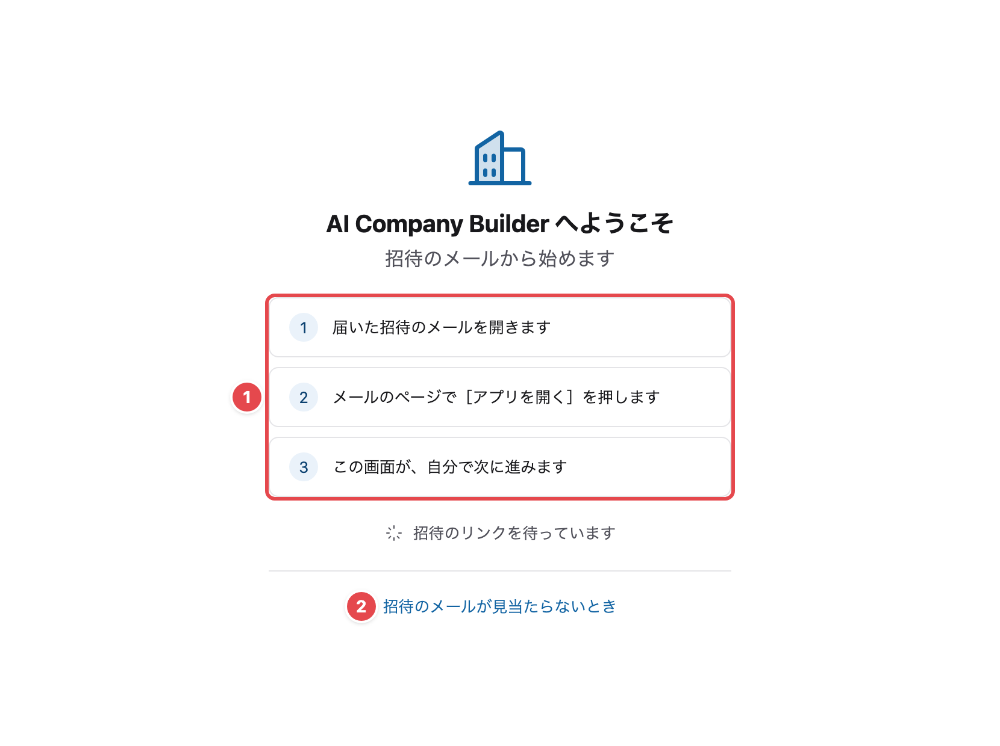
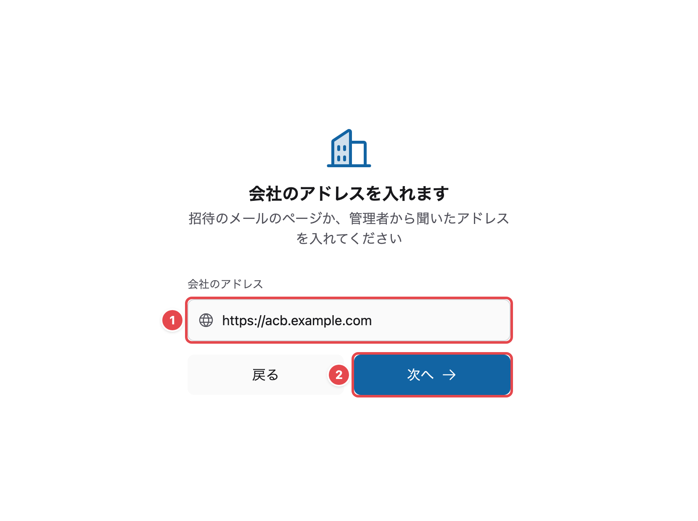
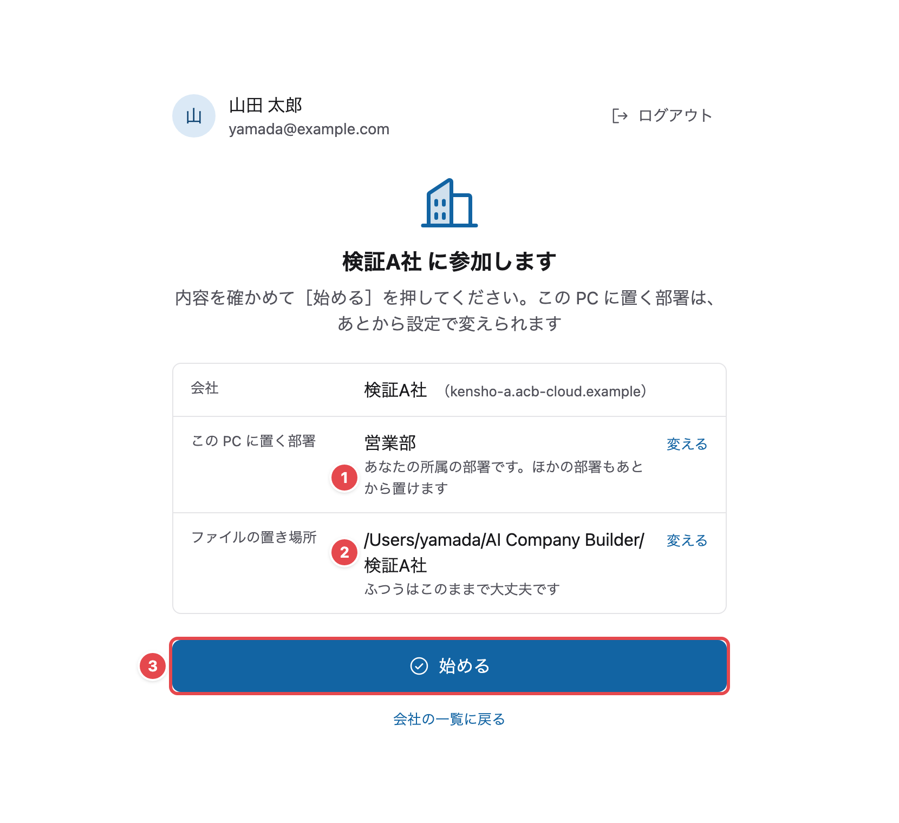
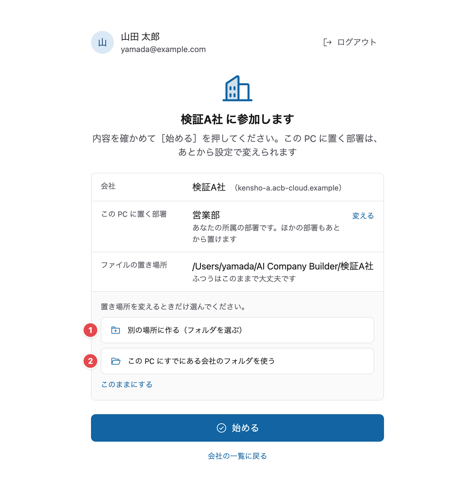
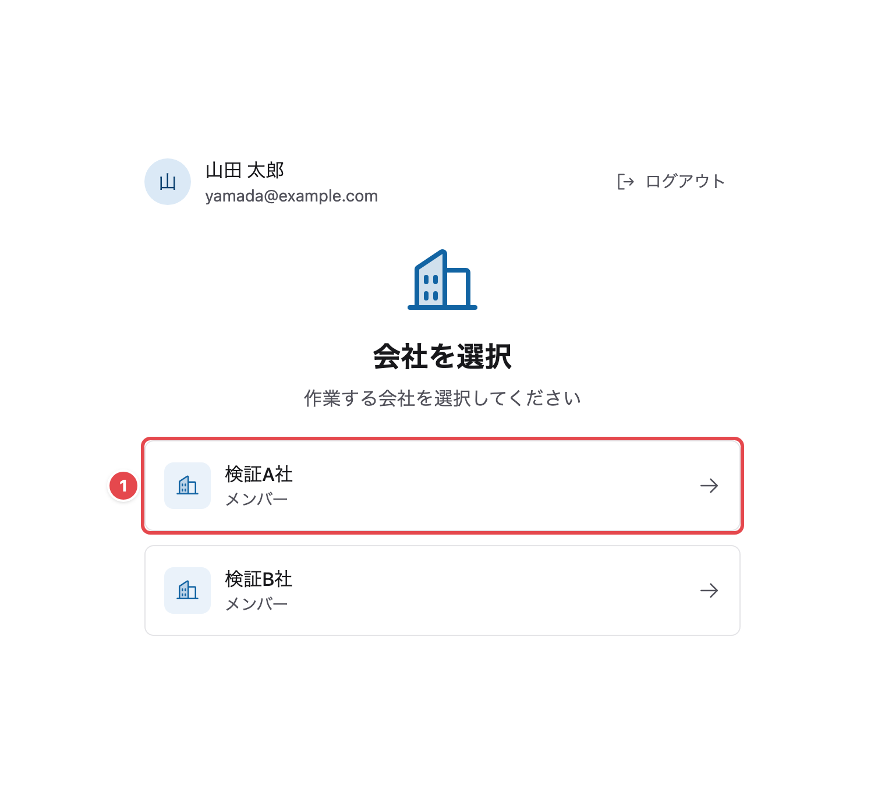
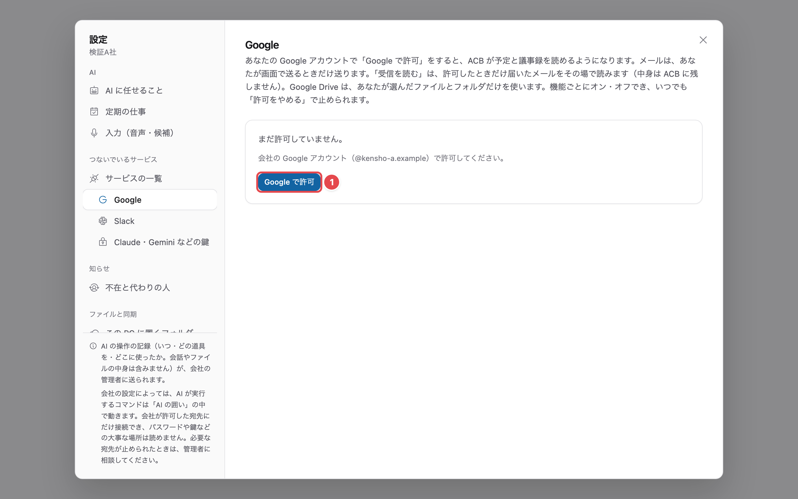

# 2章　招待からログインして、会社を開く

## はじめに

前の章の最後に、こんな疑問が残りましたね。

「届いた招待のメールから、どうやって始めればいいの？」

LINE のグループに誘われたときのことを思い出してみてください。招待のリンクを押して、ログインすれば、もうグループに入っていましたよね。

**ACB の始め方も、それとほとんど同じです。** 招待のリンクを押して、アカウントを作り、アプリを入れて開く。この3つの手順で、あなたの会社の画面にたどり着けます。

### この章で分かること

- 招待のメールから、アカウントを作るまで
- アプリを入れて、つなぎ先を確かめてログインするまで
- 「〇〇 に参加します」で確かめて、会社を開くまで

---

## 招待のリンクを押して、アカウントを作りましょう

招待のメールを開いて、中のリンクを押してみてください。ブラウザで、ACB の招待のページが開きます。

ページのいちばん上には「招待リンク」「アカウント」「アプリ」という3つの手順が並んでいます。今どこまで進んだかが、ここで分かるようになっています。

最初の画面には「佐藤さんが、検証A社に招待しています」のように、誰がどの会社に招待してくれたのかが書いてあります。あわせて「営業部のメンバーとして参加します」と、あなたの部署も出ているはずです。

内容に心当たりがあれば、［参加する］を押しましょう。

次の画面で、あなたのアカウントを作ります。

> **用語解説：アカウント**
>
> アカウントとは、「このサービスを使うあなた」を見分けるための登録のことです。Gmail を使うときに、メールアドレスとパスワードでログインしますよね。あの「メールアドレスとパスワードの組」がアカウントです。
>
> ACB のアカウントがあると、会社のサーバーは「この人は検証A社の山田さんだ」と分かります。今は「ACB に入るための自分専用の鍵」くらいのイメージで OK です。

入れるのは3つだけです。

- **名前**（例：山田 太郎）
- **メール**（招待が届いたメールアドレス）
- **パスワード**（8文字以上）

入れ終わったら［アカウントを作る］を押します。

**ここで決めたメールアドレスとパスワードは、このあとアプリにログインするときにも使います。** 忘れないように控えておいてください。

ほかの会社の招待などで、ACB のアカウントをもう持っている人もいるかもしれません。その場合は［ログインして参加］を押して、いつものアカウントで入れば大丈夫です。

---

## アプリを入れて、会社のサーバーにつなぎましょう

アカウントができると、招待のページは最後の手順「アプリを入れて開く」に進みます。

ここで不思議に思うかもしれません。Google ドライブはブラウザだけで使えるのに、ACB はどうしてアプリを入れるのでしょうか？

1章で見たとおり、ACB では会社のファイルの写しが あなたの PC の中に置かれ、AI もあなたの PC の中で働きます。ブラウザのページは、あなたの PC にファイルを置いたり、AI を動かしたりできません。だから、PC に入れるアプリが要るのです。

### アプリを入れる

アプリは、管理者が用意してくれます。招待のページからダウンロードできることもありますし、管理者から直接受け取ることもあります。入れ方が分からないときは、管理者に聞いてください。

### ［アプリを開く］を押して、ログインする

アプリを入れたら、招待のページに戻って［アプリを開く］を押してください。

すると ACB のアプリが開いて、「ログインして参加」という画面が出ます。

いちばん上の「つなぎ先」（①）に出ているのは、あなたの会社のサーバーの「住所」です。

> **用語解説：サーバーの URL**
>
> URL とは、インターネットの上の住所のことです。ブラウザの上の欄に出ている「https://〜」という文字が URL です。
>
> 1章で、会社のファイルの大もとは会社のサーバーにある、と話しましたね。アプリはその住所を知らないと、ファイルを受け取りに行けません。招待のページから［アプリを開く］を押すと、この住所がアプリに自動で伝わります。今は「アプリに会社の場所を教える仕組み」くらいで OK です。

①の住所が、招待のメールのページに書かれたアドレスと同じか確かめてください。同じなら、さきほど招待のページで作ったメールアドレス（②）とパスワードを入れて、③の［ログイン］を押します。［ログイン］を押したときにはじめて、アプリはこの住所につなぎ、そのままログインします。

もし、何もしていないのにこの画面が出たときは、①の中の［つながない］を押してください。知らないサーバーにつながないための確認です。

**だから、あなたが住所を打ちこむ必要はありません。** 招待のページからアプリを開けば、会社の場所はもう伝わっています。

### アプリを先に開いてしまったときは

招待のページより先にアプリを開くと、「招待のメールから始めます」という画面になります。

①の3つの手順のとおり、招待のメールのページで［アプリを開く］を押せば、この画面が自分で次に進みます。アプリは閉じずに、そのままにしておいて大丈夫です。

招待のメールがどうしても見つからないときだけ、②の［招待のメールが見当たらないとき］を押してください。会社のアドレスを入れる画面になります。管理者から聞いたアドレスを①の欄に入れて、②の［次へ］を押します。

---

## 次からのログイン

一度つないだあとは、アプリを開くと「ログイン」の画面が出ます。ここにも、つなぎ先（①）が出ています。

メールアドレス（②）とパスワードを入れて、③の［ログイン］を押してください。

これで、会社のサーバーは「山田さんが来た」と分かりました。次は、いよいよ会社を開きます。

---

## 「〇〇 に参加します」で確かめて、［始める］を押しましょう

ログインすると、「検証A社 に参加します」という画面が出ます。会社の名前は、ログインしたあとにはじめて出ます（ログインの前は、つなぎ先の住所で確かめます）。

この画面には、これから あなたの PC に何をするかが並んでいます。

- **この PC に置く部署**（①）：あなたの所属の部署です。くわしくは次の章で見ます。
- **ファイルの置き場所**（②）：会社フォルダを作る場所です。ACB が自動で決めています。

> **用語解説：会社フォルダ**
>
> 会社フォルダとは、会社のサーバーにあるファイルの写しを置いておく、あなたの PC の中のフォルダです。Dropbox を入れると PC に「Dropbox」フォルダができますよね。あれに近いものです。
>
> ACB の画面に並ぶファイルは、このフォルダの中身です。AI もこのフォルダの中で働きます。今は「会社のファイルが入る、自分の PC の中の箱」と覚えておけば OK です！

会社フォルダは、あなたのホームフォルダの中の「AI Company Builder」フォルダに、会社の名前（検証A社）で作られます。「ふつうはこのままで大丈夫です」と書いてあるとおり、ほとんどの人は変えなくて大丈夫です。

内容を確かめたら、③の［始める］を押してください。**［始める］を押すまで、PC には何も入りません。**

### 置き場所を変えたいとき（任意）

置き場所を自分で決めたいときだけ、「ファイルの置き場所」の［変える］を押します。

- ①［別の場所に作る（フォルダを選ぶ）］：選んだフォルダの中に、会社の名前のフォルダを作ります。
- ②［この PC にすでにある会社のフォルダを使う］：前にこの PC で使っていた会社フォルダを、もう一度使うときのものです。

やっぱり変えないときは［このままにする］を押します。

選んだ場所に、ほかの会社のフォルダや あなた自身のファイルがあるときは、「置き場所を変えてください」と理由が出て、［始める］は押せません。ACB があなたのファイルを上書きしたり、混ぜたりすることはありません。別の場所を選び直してください。

### 会社がいくつかあるときは

いくつかの会社に参加している人には、先に「会社を選択」が出ます。一覧から①の「検証A社」を押すと、上の「検証A社 に参加します」の画面に進みます。

---

## Google とつなぐ（会社が用意しているときだけ）

招待のページに「最後に［Google で許可］を1回押すと…」と書いてあった人もいるでしょう。これは、会社が Google とつなぐ準備をしているときだけの手順です。書いていなかった人は、ここは読み飛ばして大丈夫です。

### 何のためにつなぐの？

あなたの Google カレンダーの予定や、Google Meet の会議の議事録は、Google の中にあります。ACB はそのままでは読めません。

**あなたが許可すると、ACB があなたの予定と会議の議事録を読めるようになります。** 予定が一覧に出たり、会議の議事録を AI が読んでまとめたりできるようになるのです。

### どこで押すの？

ログインのあと、「仕事の道具をつなぐ」という画面が出ることがあります。そこで［Google でつなぐ］を押すと、会社が使えるようにしているものをまとめて許可できます（それぞれ何ができるようになるかが、画面に書いてあります）。今は決めずに［あとで］を押しても大丈夫です。

あとからつなぐときは、タイトルバーの右はしのあなたの丸から［設定］を押し、左の一覧の「Google」を開いて、①の［Google で許可］を押します。

### 押すと何が出るの？

ブラウザが開いて、Google の画面が出ます。そこでは「ACB に何を許可するか」が Google の言葉で書いてあります。この取説では、その Google の画面の写真は載せていません。

選ぶのは、**会社の Google アカウント**（ACB に登録したのと同じメールアドレス）です。個人の Gmail のアカウントでは許可できません。内容を確かめて許可したら、ACB のアプリに戻ってください。アプリには「ブラウザで Google の画面を開きました。許可したらこの画面に戻ってください。」と出ています。

### 何ができるようになって、何はしないの？

- ［Google で許可］で許可するのは、**予定と会議の議事録を読むこと**です。
- メールを送る許可は別です。会社が用意していれば［メールを送る許可も足す］で足せます。足したあとも、メールが送られるのは、あなたが画面で確かめて送るときだけです。
- 許可は、いつでも設定の「Google」の［許可をやめる］で止められます。止めると、ACB は予定や議事録を読めなくなります。

---

## まとめ

- 招待のメールのリンクから、ブラウザで招待のページが開きます。
- 招待のページで［参加する］を押し、名前・メール・パスワードで［アカウントを作る］を押します。
- アプリを入れたら、招待のページの［アプリを開く］を押します。アプリには会社のサーバーの住所が自動で伝わります。
- 「つなぎ先」の住所を確かめて、作ったメールアドレスとパスワードで［ログイン］します。
- 「〇〇 に参加します」で、置く部署と置き場所を確かめて［始める］を押します。置き場所は、ふつうはそのままで大丈夫です。

## やってみよう

1. 招待のメールのリンクを押して、［参加する］からアカウントを作ってみましょう。
2. アプリを入れて［アプリを開く］を押し、「ログインして参加」の画面で、つなぎ先の住所を確かめてから［ログイン］しましょう。
3. 「〇〇 に参加します」の画面で、置く部署と置き場所を確かめて［始める］を押してみましょう。

---

［始める］を押すと、ACB は会社のファイルをあなたの PC に置く準備を始めます。

……ちょっと待ってください。会社のファイルって、全部でどれくらいあるのでしょう？　全部が PC に入ってきたら、重くなってしまわないでしょうか？
