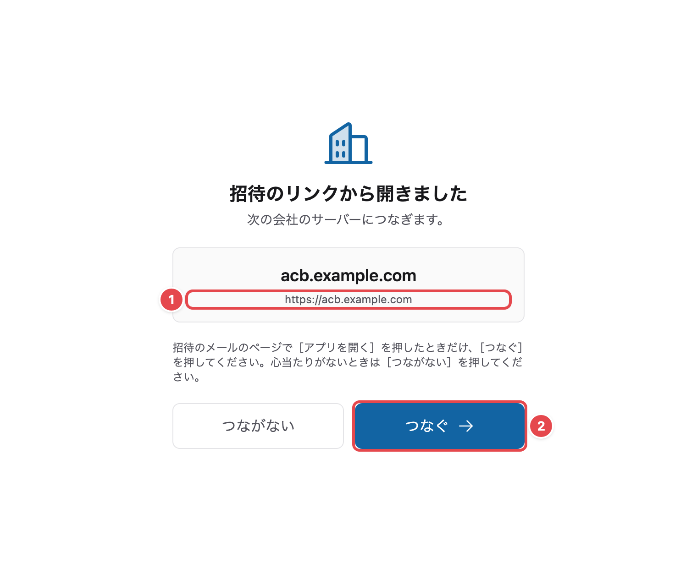
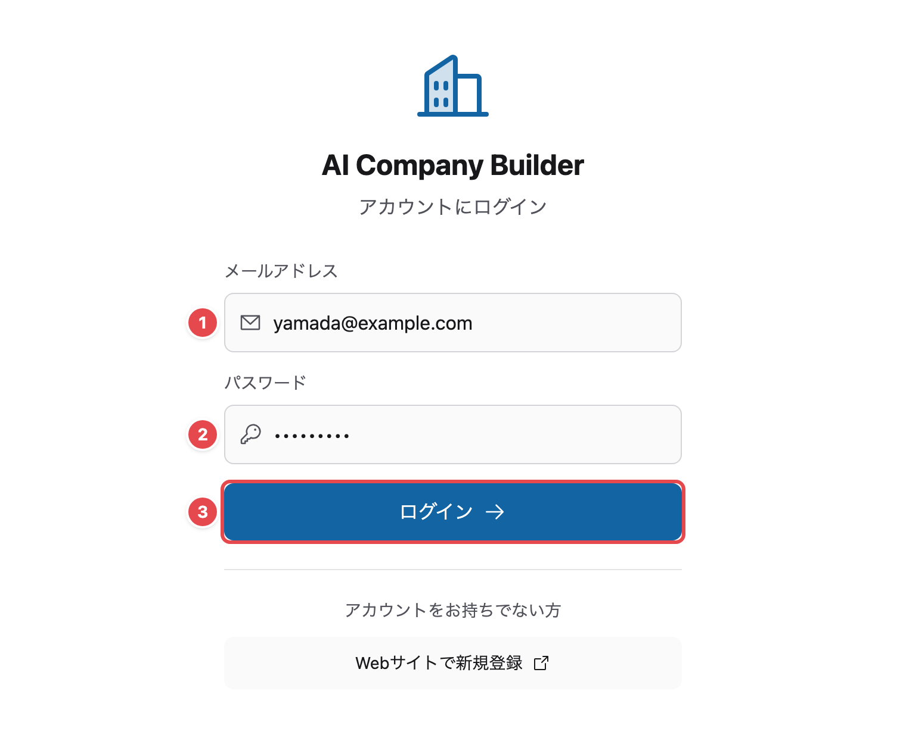
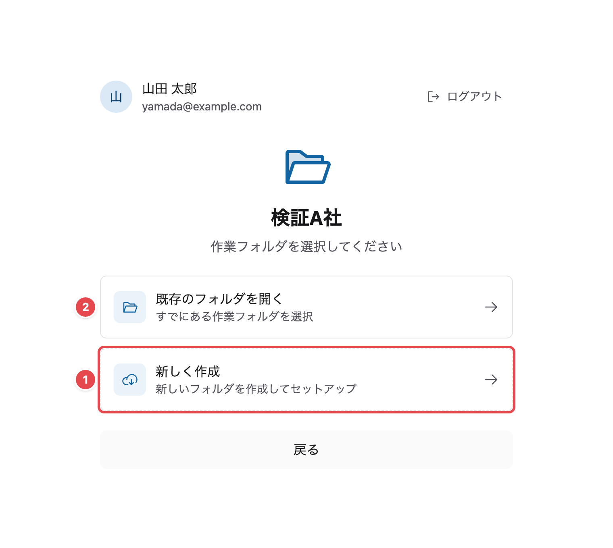
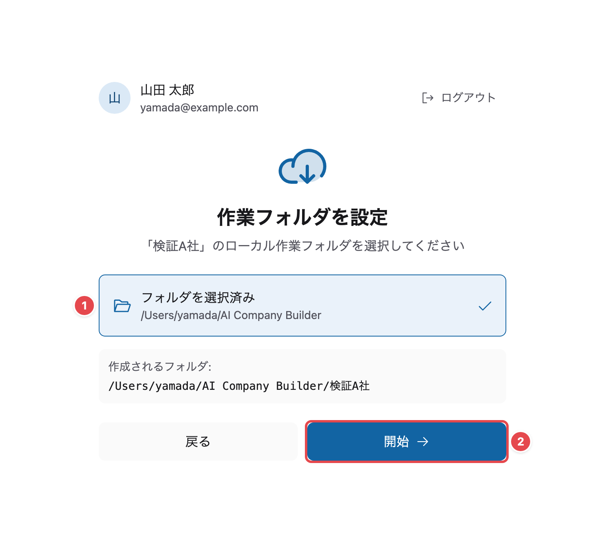

# 2章　招待からログインして、会社を開く

## はじめに

前の章の最後に、こんな疑問が残りましたね。

「届いた招待のメールから、どうやって始めればいいの？」

LINE のグループに誘われたときのことを思い出してみてください。招待のリンクを押して、ログインすれば、もうグループに入っていましたよね。

**ACB の始め方も、それとほとんど同じです。** 招待のリンクを押して、アカウントを作り、アプリを入れて開く。この3つの手順で、あなたの会社の画面にたどり着けます。

### この章で分かること

- 招待のメールから、アカウントを作るまで
- アプリを入れて、会社のサーバーにつなぐまで
- ログインして、会社が開くまで

---

## 招待のリンクを押して、アカウントを作りましょう

招待のメールを開いて、中のリンクを押してみてください。ブラウザで、ACB の招待のページが開きます。

ページのいちばん上には「招待リンク」「アカウント」「アプリ」という3つの手順が並んでいます。今どこまで進んだかが、ここで分かるようになっています。

最初の画面には「佐藤さんが、検証A社に招待しています」のように、誰がどの会社に招待してくれたのかが書いてあります。あわせて「営業部のメンバーとして参加します」と、あなたの部署も出ているはずです。

内容に心当たりがあれば、［参加する］を押しましょう。

次の画面で、あなたのアカウントを作ります。

> **用語解説：アカウント**
>
> アカウントとは、「このサービスを使うあなた」を見分けるための登録のことです。Gmail を使うときに、メールアドレスとパスワードでログインしますよね。あの「メールアドレスとパスワードの組」がアカウントです。
>
> ACB のアカウントがあると、会社のサーバーは「この人は検証A社の山田さんだ」と分かります。今は「ACB に入るための自分専用の鍵」くらいのイメージで OK です。

入れるのは3つだけです。

- **名前**（例：山田 太郎）
- **メール**（招待が届いたメールアドレス）
- **パスワード**（8文字以上）

入れ終わったら［アカウントを作る］を押します。

**ここで決めたメールアドレスとパスワードは、このあとアプリにログインするときにも使います。** 忘れないように控えておいてください。

ほかの会社の招待などで、ACB のアカウントをもう持っている人もいるかもしれません。その場合は［ログインして参加］を押して、いつものアカウントで入れば大丈夫です。

---

## アプリを入れて、会社のサーバーにつなぎましょう

アカウントができると、招待のページは最後の手順「アプリを入れて開く」に進みます。

ここで不思議に思うかもしれません。Google ドライブはブラウザだけで使えるのに、ACB はどうしてアプリを入れるのでしょうか？

1章で見たとおり、ACB では会社のファイルの写しが あなたの PC の中に置かれ、AI もあなたの PC の中で働きます。ブラウザのページは、あなたの PC にファイルを置いたり、AI を動かしたりできません。だから、PC に入れるアプリが要るのです。

### アプリを入れる

招待のページに［アプリをダウンロード（Mac）］があれば、それを押してアプリを入れます。ボタンがないときは「アプリは、招待した方から受け取ってください」と書いてあるので、管理者に聞いてください。

〔要確認：Mac にアプリを入れる手順（アプリケーションフォルダへ移す操作と、初めて開くときに Mac が出す確認の画面）をここに書くか〕

### ［アプリを開く］で、会社のサーバーにつなぐ

アプリを入れたら、招待のページに戻って［アプリを開く］を押してください。

すると ACB のアプリが開いて、「招待のリンクから開きました」という画面が出ます。

画面の真ん中（①）に出ているのは、あなたの会社のサーバーの「住所」です。

> **用語解説：サーバーの URL**
>
> URL とは、インターネットの上の住所のことです。ブラウザの上の欄に出ている「https://〜」という文字が URL です。
>
> 1章で、会社のファイルの大もとは会社のサーバーにある、と話しましたね。アプリはその住所を知らないと、ファイルを受け取りに行けません。招待のページから［アプリを開く］を押すと、この住所がアプリに自動で伝わります。今は「アプリに会社の場所を教える仕組み」くらいで OK です。

招待のページで自分で［アプリを開く］を押したのなら、②の［つなぐ］を押しましょう。

もし、何もしていないのにこの画面が出たときは［つながない］を押してください。知らないサーバーにつながないための確認です。

**だから、あなたが住所を打ちこむ必要はありません。** 招待のページからアプリを開けば、会社の場所はもう伝わっています。

ちなみに、アプリを先に開いてしまったときは「接続先サーバーのURLを入力してください」という画面になります。あわてずに招待のページに戻って［アプリを開く］を押すか、管理者から聞いたサーバーの URL を①の欄に入れて、②の［接続］を押してください。

---

## ログインしましょう

サーバーにつながると、「アカウントにログイン」という画面になります。

さきほど招待のページで作ったメールアドレスを①に、パスワードを②に入れて、③の［ログイン］を押してください。

これで、会社のサーバーは「山田さんが来た」と分かりました。次は、いよいよ会社を開きます。

---

## 会社が開きます

ログインすると、ACB はあなたの会社を開く準備を始めます。

参加している会社が1つだけなら、あなたは何も選ばなくて大丈夫です。ACB が PC の中に会社フォルダを作って、そのまま会社を開きます。会社フォルダは、あなたのホームフォルダの中の「AI Company Builder」フォルダに、会社の名前（検証A社）で作られます。

> **用語解説：会社フォルダ**
>
> 会社フォルダとは、会社のサーバーにあるファイルの写しを置いておく、あなたの PC の中のフォルダです。Dropbox を入れると PC に「Dropbox」フォルダができますよね。あれに近いものです。
>
> ACB の画面に並ぶファイルは、このフォルダの中身です。AI もこのフォルダの中で働きます。今は「会社のファイルが入る、自分の PC の中の箱」と覚えておけば OK です！

**だから、1つの会社に参加しただけなら、ログインのあとは待っているだけで会社が開きます。**

### こんな画面が出たときは

いくつかの会社に参加している人などには、選ぶ画面が出ることがあります。

「会社を選択」が出たら、一覧から①の「検証A社」を押してください。押すと、その会社を開く準備に進みます。

続いて「作業フォルダを選択してください」が出たら、はじめての人は①の［新しく作成］を選びます。②の［既存のフォルダを開く］は、前にこの PC で使っていた会社フォルダをもう一度開くときのものです。迷ったら［新しく作成］で大丈夫です。

［新しく作成］を選ぶと、会社フォルダを作る場所を聞かれます。①の［フォルダを選択］で置き場所を選ぶと、その下の「作成されるフォルダ」に、これから作られる会社フォルダの場所が出ます。確かめたら、②の［開始］を押してください。

〔要確認：ログインのあとに［Google で許可］の案内が出る会社では、この章で一言ふれるか（招待のページには「会社が用意しているときだけ」とある）〕

---

## まとめ

- 招待のメールのリンクから、ブラウザで招待のページが開きます。
- 招待のページで［参加する］を押し、名前・メール・パスワードで［アカウントを作る］を押します。
- アプリを入れたら、招待のページの［アプリを開く］を押します。アプリには会社のサーバーの住所が自動で伝わるので、［つなぐ］を押します。
- 作ったメールアドレスとパスワードで［ログイン］します。
- 参加している会社が1つなら、会社フォルダが自動で作られて、会社が開きます。

## やってみよう

1. 招待のメールのリンクを押して、［参加する］からアカウントを作ってみましょう。
2. アプリを入れて［アプリを開く］を押し、「招待のリンクから開きました」の画面で、会社のサーバーの住所が出ていることを確かめてから［つなぐ］を押しましょう。
3. ログインして、会社を開く準備が始まるところまで進めてみましょう。

---

ログインすると、ACB は会社のファイルをあなたの PC に置く準備を始めます。

……ちょっと待ってください。会社のファイルって、全部でどれくらいあるのでしょう？　全部が PC に入ってきたら、重くなってしまわないでしょうか？
