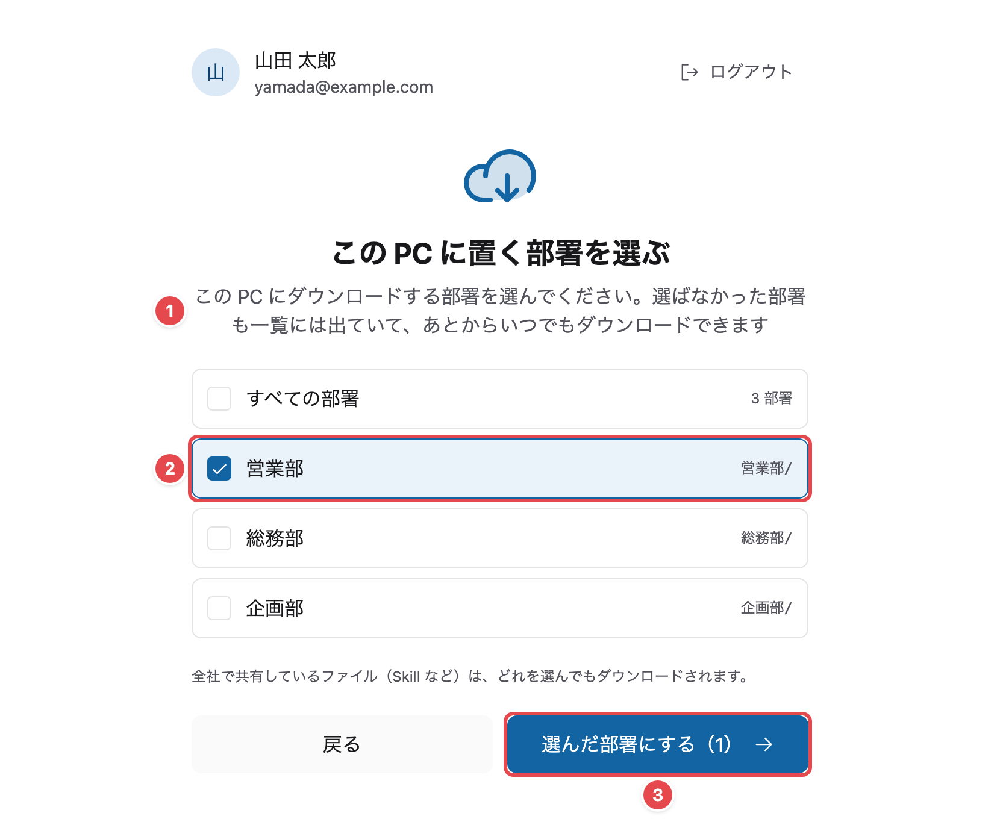
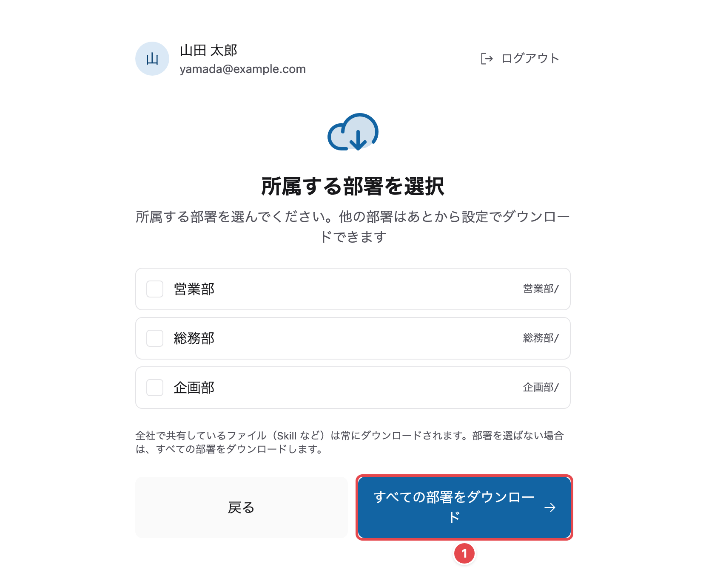
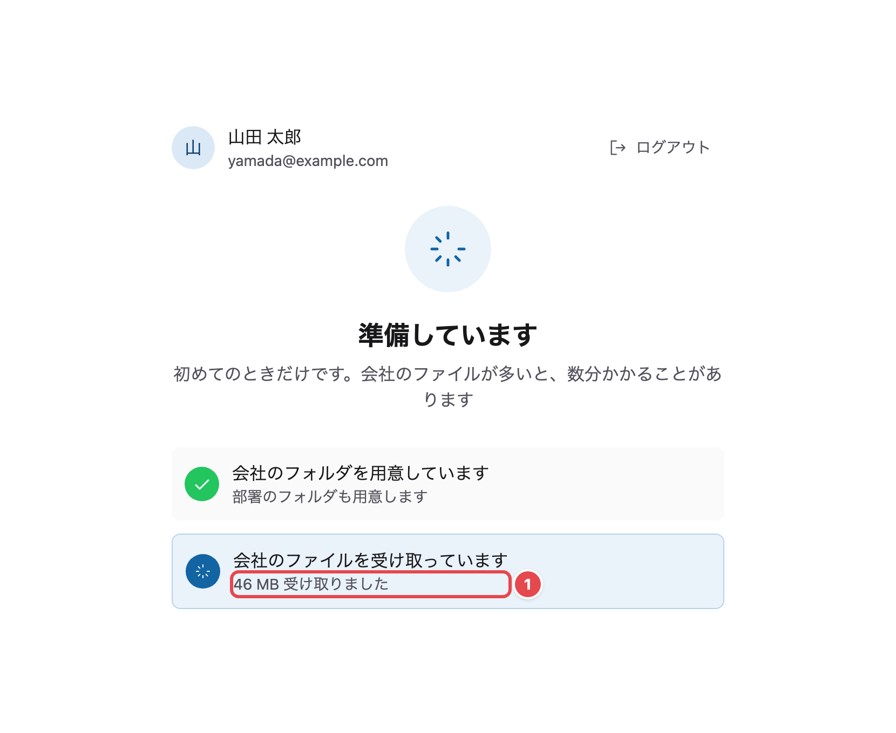
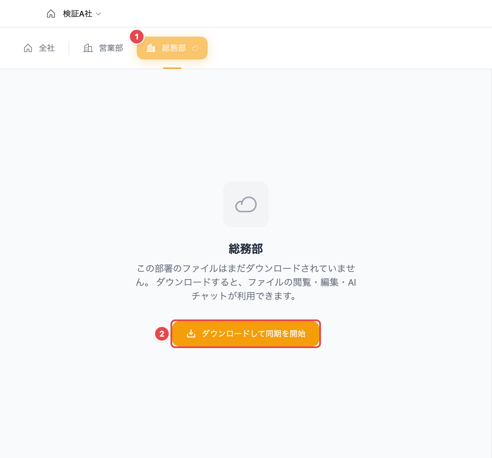

# 3章　自分の部署を選ぶ（はじめの準備）

## はじめに

前の章の最後の疑問はこうでした。

「会社のファイルが全部 PC に入ってきたら、重くなってしまわない？」

Dropbox を入れたとき、PC の空きがみるみる減って、「容量が足りません」と出て困ったことはありませんか？　会社の共有フォルダには、ほかの部署の動画や過去の資料まで、何年分ものファイルが入っていることがあります。それを全部 PC に入れたら、たしかに大変です。

でも大丈夫です。ACB は、そうならないようにできています。

### この章で分かること

- ACB が PC に入れるのは、どのファイルなのか
- 部署を選ぶ画面が出たときに、何を選べばいいのか
- はじめの準備が終わるまで、どう待てばいいのか

---

## PC に入るのは、あなたの部署のファイルだけです

会社のファイルの大もとは、会社のサーバーにありましたね。ACB は、その中から あなたが仕事で使う部署のファイルだけ を、あなたの PC に入れます。

**ほかの部署のファイルは、サーバーに置いたままにしておくのです。**

> **用語解説：ダウンロード**
>
> ダウンロードとは、インターネットの向こうにあるファイルを、自分の PC に持ってくることです。メールに付いてきた資料を PC に保存するのも、ダウンロードです。
>
> ACB では、会社のサーバーにある部署のファイルを、あなたの会社フォルダに持ってくることを指します。今は「サーバーから自分の PC に持ってくること」で OK です。

では、PC に入れなかった部署は、画面から消えてしまうのでしょうか？

そうではありません。ほかの部署のフォルダも、名前は一覧に出ています。ただ、中身があなたの PC にないので「未ダウンロード」と表示されます（15章でくわしく見ます）。あとで必要になったら、いつでも PC に持ってこられます。

**だから、PC の空きを気にせずに始められます。** 毎日使う部署のファイルだけが手元にあって、残りは会社のサーバーがしっかり預かっています。

検証A社の山田さんなら、PC に入るのは営業部のファイルです。総務部のフォルダは、名前は見えますが中身はサーバーにあります。

---

## 部署を選ぶ画面が出たら、自分の部署にチェックを入れましょう

では、どの部署を PC に入れるのかは、誰が決めるのでしょうか？

ほとんどの人は、何も選ばなくて大丈夫です。招待のときに「営業部のメンバーとして参加します」と出ていましたね。このように所属する部署が決まっていれば、前の章の「検証A社 に参加します」の「この PC に置く部署」に、その部署がはじめから入っています。ほかの部署も置きたいときは、そこの［変える］で選び直せます。

所属する部署がまだ決まっていないときは、「〇〇 に参加します」の前に「この PC に置く部署を選ぶ」という画面が出ます。

画面には①のとおり「この PC にダウンロードする部署を選んでください。選ばなかった部署も一覧には出ていて、あとからいつでもダウンロードできます」と書いてあります。

ふだん仕事で使う部署（②）を押してチェックを入れ、③の［選んだ部署にする（1）］を押してください。かっこの中の数字は、選んだ部署の数です。「〇〇 に参加します」の画面に戻るので、内容を確かめて［始める］を押します。

全部の部署を PC に入れたいときは、一覧のいちばん上の「すべての部署」（下の写真の①）を選ぶと、ボタンが［すべての部署にする］になります。何も選んでいないあいだは、ボタンは［部署を選んでください］（②）のままで押せません。知らないうちに全部の部署が入ってくることはありません。

迷う必要はありません。あとから部署を足すことも外すこともできるので、まずは「いちばんよく使う部署」を選べば十分です。

なお、全社で共有しているファイル（Skill など）は、選んだ部署にかかわらず、いつも PC に入ります。

---

## 準備が終わるまで、待ちましょう

［始める］を押すと、ACB ははじめの準備を始めます。画面には「準備しています」と出て、「会社のファイルを受け取っています」の段で、会社のサーバーからファイルを受け取っていきます。

①の「受け取りました」の前の数字は、これまでに受け取ったファイルの量です。

**この数字が増えていれば、ちゃんと進んでいます。** 会社のファイルが多いと、数分かかることもあります。画面にも「初めてのときだけです。会社のファイルが多いと、数分かかることがあります」と書いてあるとおり、時間がかかるのは最初の1回だけです。

途中でアプリを閉じたり、PC をスリープにしたりせず、そのまま待ちましょう。お茶を一杯いれてくるくらいの気持ちで大丈夫です。

「準備ができました」と出たら完了です。会社の画面が開きます。

---

## ほかの部署は、あとからいつでも入れられます

仕事をしていると、「総務部の申請書のひな形を見たい」というように、ほかの部署のファイルが必要になることもありますよね。

そのときは、あとから PC に入れれば大丈夫です。たとえば、PC に入れていない部署のタブ（①の「総務部」）を開くと「この部署のファイルはまだダウンロードされていません。」と出て、②の［ダウンロードして同期を開始］を押すだけでその部署が入ります。

設定の「ダウンロードするフォルダ」では、どの部署やフォルダを PC に入れるかを、まとめて選び直せます。それぞれの大きさも出るので、PC の空きと相談しながら決められます（15章で見ます）。

**最初の選び方で失敗することはありません。** あとから何度でも変えられるので、安心してください。

---

## まとめ

- ACB は、会社のファイルを全部 PC に入れるわけではありません。PC に入るのは、あなたの部署のファイルと、全社で共有しているファイルです。
- PC に入れていない部署も、名前は一覧に出ます（「未ダウンロード」）。中身はサーバーにあります。
- 所属する部署が決まっていれば、「〇〇 に参加します」にはじめから入っています。「この PC に置く部署を選ぶ」が出たら、自分の部署にチェックを入れて［選んだ部署にする（1）］を押し、［始める］を押します。
- 全部の部署を入れたいときだけ「すべての部署」を選びます。何も選ばないうちは始まりません。
- はじめの準備は最初の1回だけです。「受け取りました」の数字が増えていれば進んでいます。
- ほかの部署は、あとからいつでも PC に入れられます。

## やってみよう

1. はじめの準備が終わるまで待って、「準備ができました」が出ることを確かめましょう。
2. 部署を選ぶ画面が出た人は、どの部署を選んだかをメモしておきましょう。あとで足したくなったときの目安になります。

---

「準備ができました」と出て、ついに会社の画面が開きました。

……ところが、ボタンやタブがたくさん並んでいます。いったい、どこを見ればいいのでしょうか？
