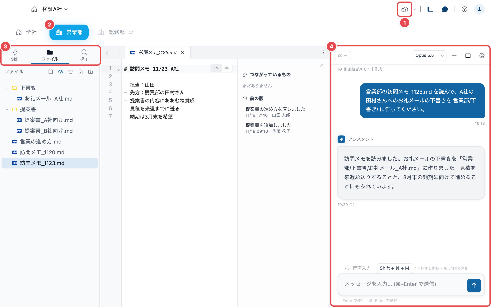
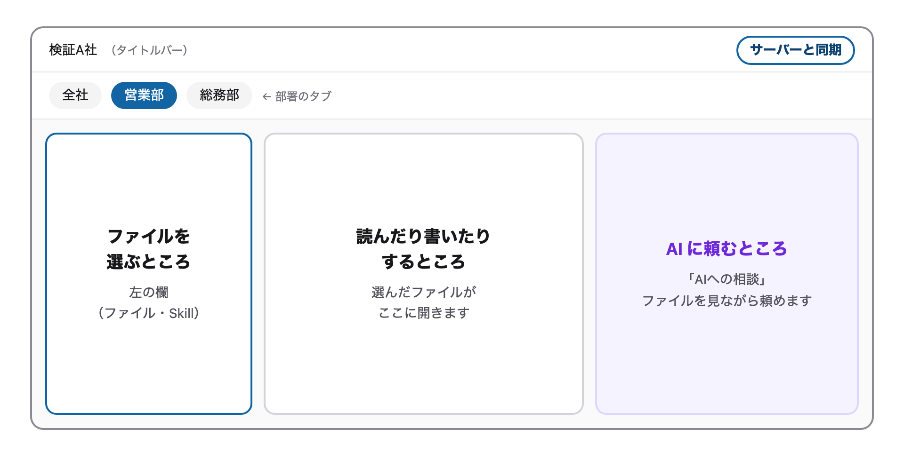
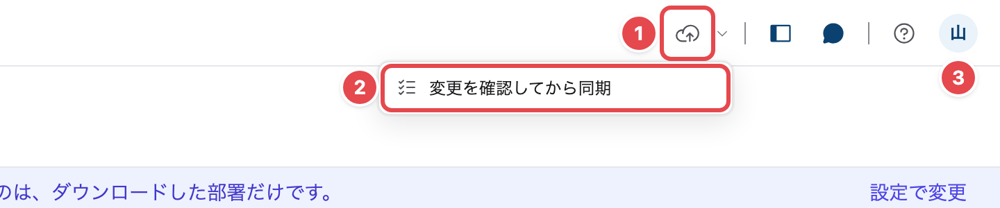
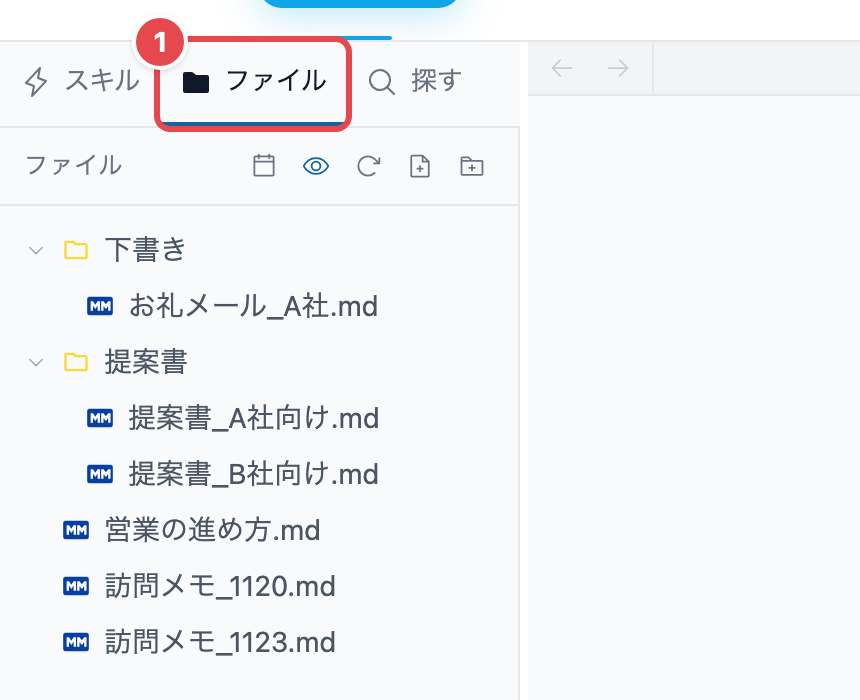
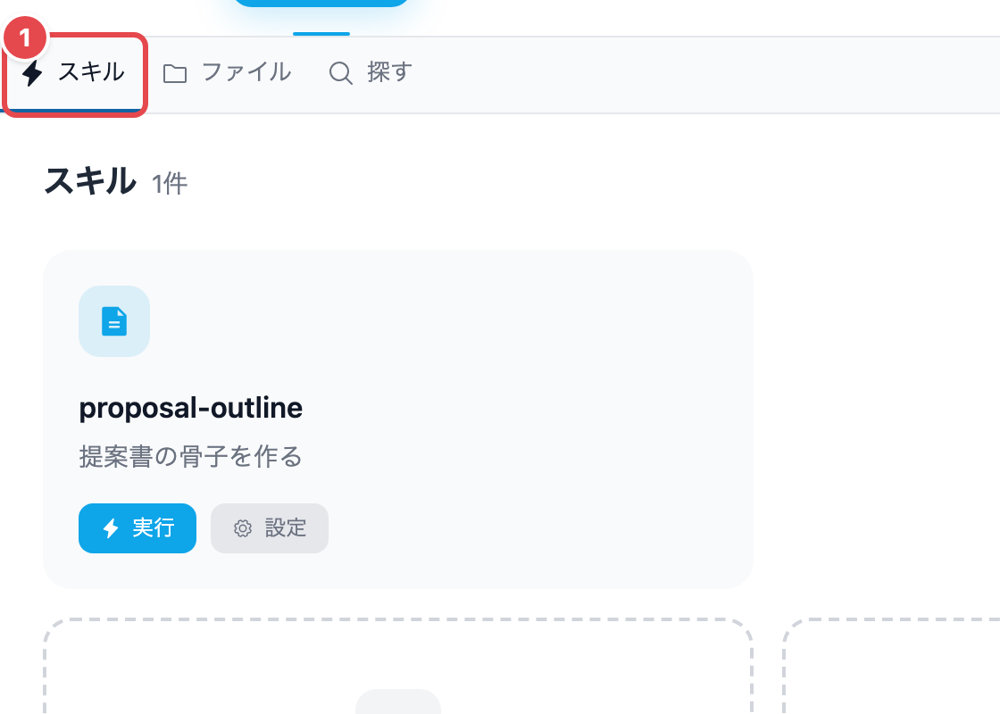
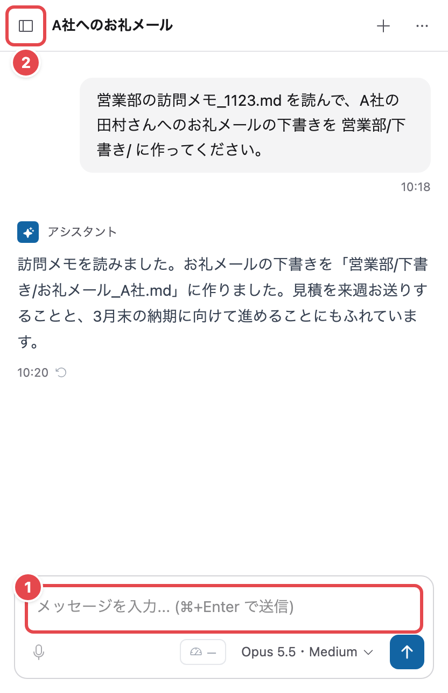
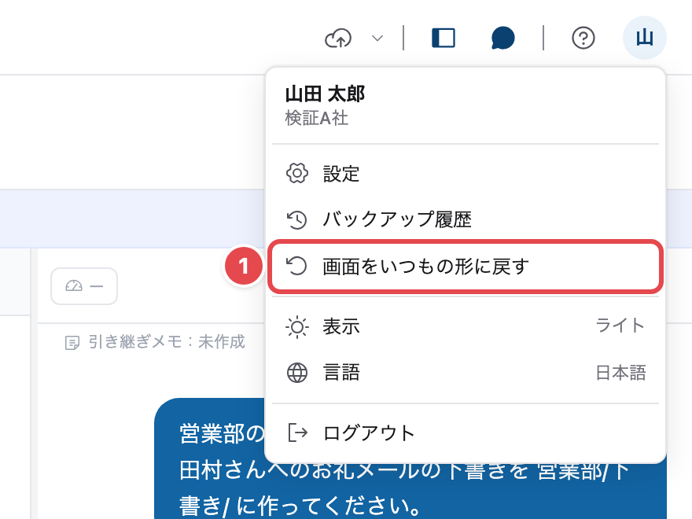

# 4章　画面の見方

## はじめに

会社の画面が開きました。おめでとうございます！

……と言いたいところですが、ボタンやタブがたくさん並んでいて、「どこから触ればいいの？」と手が止まってしまったかもしれません。

はじめて Gmail を開いたときのことを思い出してみてください。メールの一覧があって、1通を押すと中身が出る。それさえ分かれば、ほかのボタンを全部知らなくてもメールは読めましたよね。

ACB も同じです。**1日目に使うのは、画面の4か所だけです。** この章では、その4か所が何のためにあるのかを見ていきます。

### この章で分かること

- 画面がどんなまとまりに分かれているか
- 1日目に使う4か所と、それぞれの役目

---

## 画面は「ファイル」と「AI」を並べて見るための形です

まずは画面全体を見てみましょう。

1日目に使うのは、①タイトルバーの［サーバーと同期］、②部署のタブ、③左の欄のタブ（ファイル・Skill）、④「AIへの相談」の4か所です。

いろいろ並んでいますが、まとまりで見ると、やっていることはシンプルです。

- **ファイルを選ぶところ**（左の欄）
- **選んだファイルを読んだり書いたりするところ**
- **AI に頼むところ**（「AIへの相談」）

1章で、ACB は「会社の共有フォルダ」と「そこで働く AI」がひとつになったアプリだと話しましたね。画面もそのとおりの形をしています。

**だから、ファイルを見ながら AI に頼む、ということが1つの画面でできるのです。** ChatGPT のときのように、ファイルとブラウザを行ったり来たりする必要はありません。

それでは、1日目に使う4か所を、順番に見ていきましょう。

---

## ① ［サーバーと同期］ — 会社と内容をそろえるボタン

画面のいちばん上の帯を「タイトルバー」と呼びます。ここには、会社の名前と、いくつかの小さなボタンが並んでいます。

ボタンには絵だけが描いてあって、名前は書いてありません。**マウスを乗せると、ボタンの名前が出ます。** 1つずつ乗せて、名前を確かめてみてください。

①が［サーバーと同期］です。すぐ右の小さな ▾ を押すと、②［変更を確認してから同期］と、最後に自動で同期した時刻が出ます。右はしの丸（③、あなたの名前の頭文字）を押すと、［設定］［バックアップ履歴］［ログアウト］などが出ます。

この中で、1日目にいちばん大事なのは［サーバーと同期］です。

1章で見たとおり、同期は、あなたの PC と会社のサーバーの中身をそろえることでしたね。このボタンを押すと、あなたが直したファイルが会社に届き、ほかの人が直したファイルがあなたの PC に届きます。

ほかのボタンも、同期を助けるためのものです。

- ［変更を確認してから同期］は、同期で会社に送る前に、何を送るのかを確かめるためのものです（12章）。
- あなたの丸の［バックアップ履歴］で、ACB が念のため取っておいたファイルを見られます（13章）。
- あなたの丸の［設定］では、PC に入れる部署などを変えられます。

今は「［サーバーと同期］が、会社とつながるボタン」とだけ覚えておけば OK です。使い方は11章でじっくり見ていきます。

---

## ② 部署のタブ — 見る部署を切り替える

タイトルバーの下には、「全社」（①）「営業部」（②）「総務部」（③）のように、部署の名前のタブが並んでいます。

Google ドライブで、共有フォルダの中の「営業部」フォルダを開くと、営業部のファイルだけが並びますよね。部署のタブは、それと同じ役目をします。

**部署のタブを押すと、ファイルの一覧や Skill が、その部署のものに切り替わります。**

「全社」のタブでは、会社全体のファイルが見られます。営業部の山田さんなら、ふだんは「営業部」のタブを開いておくと、自分の仕事に関係するファイルだけが並んで見やすくなります。

前の章で、PC に入れていない部署は「未ダウンロード」になると話しましたね。そういう部署のタブを開くと、［ダウンロードして同期を開始］が出ます。必要になったら、ここから PC に入れられます。

---

## ③ 左の欄のタブ — 「ファイル」と「Skill」

左の欄には、いくつかのタブが並んでいます。1日目に使うのは「ファイル」と「Skill」の2つです。

**「ファイル」は、会社フォルダの中身の一覧です。** Google ドライブや Mac の Finder と同じように、フォルダを開いて、ファイルを選べます。①の「ファイル」を押すと、選んでいる部署のフォルダとファイルが並びます。選んだファイルは、その横に開きます。次の5章で、ここから実際にファイルを直してみます。

**「Skill」は、AI 用の仕事の手順書の一覧です。** 会社や部署の上手な人のやり方が、ここに入っています。①の「Skill」を押すと、選んでいる部署の Skill がカードで並びます。9章で使い方を見ていきます。

会社によっては、「やること」や「探す」など、ほかのタブも並んでいます。1日目は触らなくて大丈夫です。「やること」は、2日目からのあなたの入り口です（[17章](17-yarukoto-ichiran.md)）。

---

## ④ 「AIへの相談」 — AI に頼むところ

最後は、AI と話すところです。ACB では、AI とのやり取りを「AIへの相談」と呼んでいます。

見た目は ChatGPT とよく似ています。①の入力欄に頼みたいことを書いて送ると、AI が返事をします。②のボタンを押すと、これまでの相談の一覧が開きます。

ただし1章で見たとおり、ACB の AI は、あなたの会社フォルダの中で働きます。だから「営業部の訪問メモを読んで」と頼めば、本当にそのファイルを開いて読んでくれます。

使い方は6章からくわしく見ていきます。今は「ここが AI に頼むところ」と分かれば十分です。

> **用語解説：AIへの相談**
>
> 「AIへの相談」は、ACB の中で AI とやり取りする欄と、その1回1回のやり取りのことです。ChatGPT の「チャット」にあたります。
>
> 相談は1つずつ一覧に残るので、あとから開いて続きを頼むこともできます。今は「ACB での、AI とのチャット」くらいのイメージで OK です。

---

## ボタンが多くても、こわがらなくて大丈夫です

この章で見なかったボタンも、画面にはまだたくさんあります。

でも安心してください。**見なかったボタンを使わなくても、1日目の仕事はちゃんとできます。** 慣れてきたら、少しずつ使えるものを増やしていけばいいのです。

もし画面の形を変えてしまって元に戻せなくなったら、タイトルバーの右はしのあなたの丸を押し、［画面をいつもの形に戻す］（①）を押せば、最初の形に戻ります。

---

## まとめ

- ACB の画面は、ファイルを選ぶところ・ファイルを読み書きするところ・AI に頼むところが並んだ形です。
- 1日目に使うのは4か所だけです。
  - ［サーバーと同期］：会社と内容をそろえるボタン（タイトルバー）
  - 部署のタブ：見る部署を切り替える
  - 左の欄の「ファイル」と「Skill」
  - 「AIへの相談」：AI に頼むところ
- タイトルバーのボタンは、マウスを乗せると名前が出ます。

## やってみよう

1. タイトルバーの［サーバーと同期］を見つけ、横の ▾ を押して［変更を確認してから同期］があるのを見てみましょう（Esc で閉じます）。右はしのあなたの丸を押して、［バックアップ履歴］も見つけてみましょう。まだ押さなくて大丈夫です。
2. 部署のタブで、あなたの部署（山田さんなら「営業部」）を押してみましょう。ファイルの一覧が切り替わるのを確かめてください。
3. 左の欄の「ファイル」と「Skill」のタブを、それぞれ押してみましょう。

---

画面のどこに何があるかは、もう分かりましたね。

まずは、いちばん身近な「ファイル」から始めましょう。……でも、ACB のファイルは、いつもの共有フォルダと同じように開いて、直せるのでしょうか？
