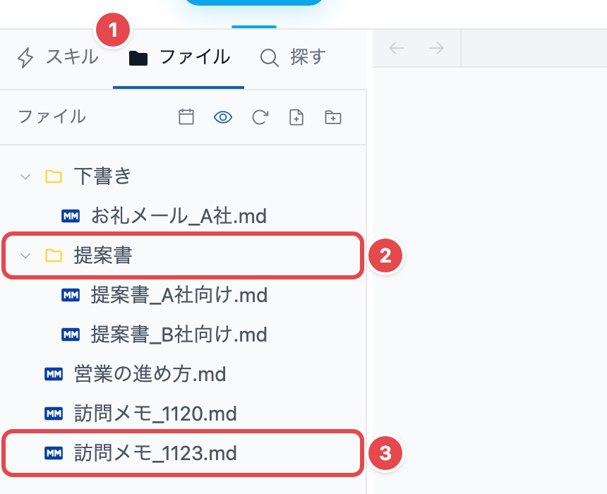
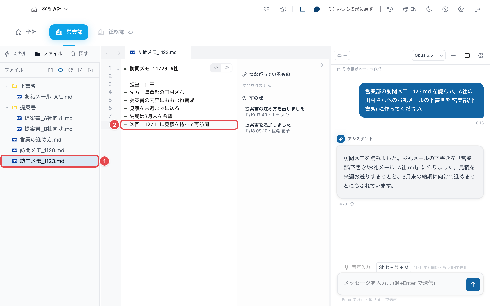
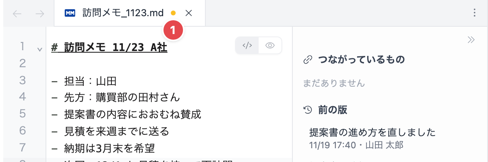
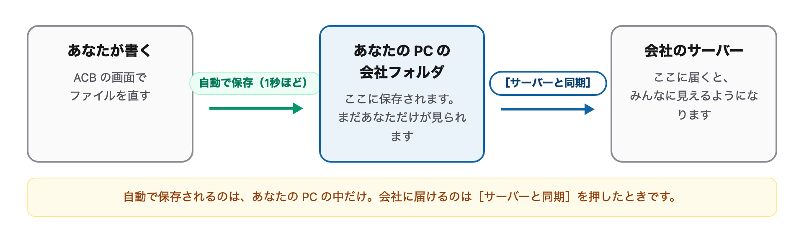
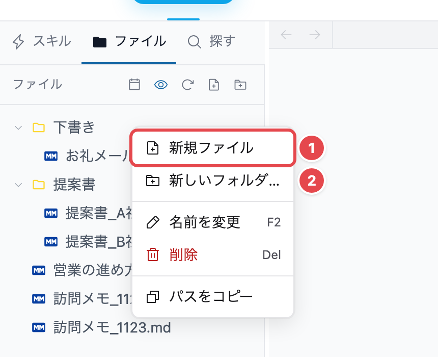
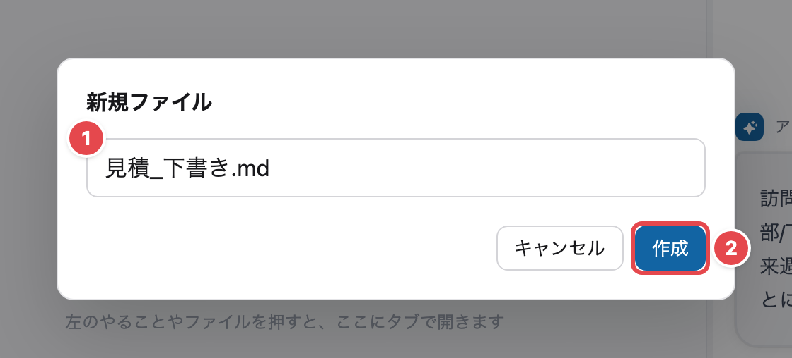
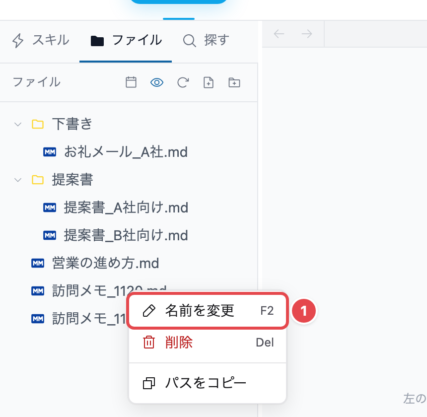

# 5章　ファイルを開いて直す

## はじめに

前の章の最後に、こんな疑問が残りました。

「ACB のファイルは、いつもの共有フォルダと同じように開いて、直せるの？」

答えから言うと、**開いて直すところまでは、いつもとほとんど同じです。** ただ1つだけ、Google ドキュメントに慣れている人ほど「あれ？」と思うところがあります。

この章では、実際にファイルを1つ開いて書き足しながら、その「あれ？」の正体を見ていきます。

### この章で分かること

- ファイルを開いて、書き足す方法
- 書いた内容が、いつ・どこに保存されるのか
- 新しいファイルを作る方法、名前を変える方法

---

## ファイルを開いて、書き足してみましょう

まずは、いつもどおりにやってみましょう。

左の欄の「ファイル」タブ（①）を開くと、会社フォルダの中身が並んでいます。フォルダ（②）を押すと中が開いたり閉じたりし、ファイル（③）を押すと、そのファイルが開きます。Google ドライブや Mac の Finder と同じ感覚ですね。

検証A社の山田さんは、今日の訪問の記録を残したいと思っています。「営業部」のタブを選んで「訪問メモ_1123.md」（①）を押すと、中身が開きました。最後に1行書き足してみます（②）。

開いたファイルは、ブラウザのタブのように並んでいきます。いくつか開いて、タブで行き来することもできます。

> **用語解説：md ファイル**
>
> ファイルの名前の最後にある「.md」は、「マークダウン」という書き方のファイルであることを表しています。Word のファイルが「.docx」で終わるのと同じで、ファイルの種類を表す印です。
>
> マークダウンは、「# 」で見出し、「- 」で箇条書き、というように、記号を使って文書の形を表す書き方です。AI が読み書きしやすいので、ACB ではよく使われます。今は「メモ帳のように書ける、見出しや箇条書きも使える文書」くらいで OK です！

---

## 書いた内容は、自動で保存されます

さて、1行書き足しました。保存はどうすればいいのでしょうか？

Google ドキュメントでは、保存ボタンを押さなくても、書いたそばから保存されますよね。

**ACB も、書いた内容は自動で保存されます。** 書く手を止めて1秒ほどたつと、ファイルに保存されます。

まだ保存されていない変更があるときは、タブに小さな点（①）が出ます。点が消えれば、保存が済んだ合図です。

すぐに保存したいときは、⌘S（command キーと S を同時に押す）でも保存できます。

ここまでは、Google ドキュメントとほとんど同じですね。

---

## でも、保存されたのは「あなたの PC の中」だけです

では、山田さんが書き足した1行は、営業部のほかの人にも、もう見えているのでしょうか？

……実は、まだ見えていません。

ここが、この章でいちばん大事なところです。

1章を思い出してみてください。ACB では、会社のファイルの大もとは会社のサーバーにあって、その写しがあなたの PC の「会社フォルダ」に置かれているのでしたね。

あなたが ACB の画面で開いて直しているのは、この **あなたの PC の中の写し** です。自動で保存されるのも、この写しです。

**自動で保存されただけでは、あなたが直した内容は、まだあなたの PC の中にしかありません。**

Google ドキュメントは、ファイルがはじめから Google のサーバーの上にあります。だから、書いた瞬間にほかの人にも見えるのです。ACB は、ファイルがあなたの PC の中にある。そこが違います。

### だから、書きかけでも安心して書けます

「みんなにすぐ見えないなんて、不便じゃない？」と思ったかもしれませんね。

でも、こう考えてみてください。Google ドキュメントでは、まだ考えがまとまっていない書きかけの文章も、打った瞬間からみんなに見えてしまいます。誤字だらけの下書きを、上司に見られていたこともあるかもしれません。

**ACB では、同期するまで、直した内容はあなたの手元にとどまります。** だから、書きかけでも気にせず書けますし、区切りのいいところで、まとめて会社に届けられます。

AI に作ってもらったファイルも同じです。まずはあなたの PC の中にできて、あなたが確かめてから会社に届けられます。

もちろん、PC の中には保存されているので、アプリを閉じても、書いた内容がなくなることはありません。

---

## 新しいファイルを作る・名前を変える

書き足すだけでなく、新しいファイルを作りたいこともありますよね。

フォルダを右クリックすると、メニューが出ます。

- ①の［新規ファイル］を選ぶと、ファイルの名前を聞かれます。次の写真のように、名前を欄（①）に入れて［作成］（②）を押すと、そのフォルダの中に空のファイルができます。文書なら「見積_下書き.md」のように、最後に「.md」を付けておきましょう。

  

- メニューの②［新しいフォルダ…］では、フォルダを作れます。
- ファイルやフォルダを右クリックして［名前を変更］（次の写真の①）を選ぶと、名前を変えられます。

  

ここで作ったファイルや、変えた名前も、書き足した内容と同じです。**まずはあなたの PC の中だけに反映されて、同期すると会社に届きます。**

なお、フォルダの中には、読めるけれど書けないフォルダもあります。そういうフォルダの見分け方は、10章で見ていきます。

---

## まとめ

- 左の欄の「ファイル」タブから、フォルダを開いてファイルを開けます。
- 書いた内容は、手を止めて1秒ほどで自動で保存されます。保存していない変更があるときは、タブに小さな点が出ます。⌘S でも保存できます。
- 自動で保存されるのは、あなたの PC の中の会社フォルダです。この時点では、まだほかの人には見えていません。
- だから、書きかけでも気にせず書けます。会社に届けるのは［サーバーと同期］を押したときです。
- フォルダを右クリックすると、［新規ファイル］［新しいフォルダ…］［名前を変更］が使えます。

## やってみよう

1. 「ファイル」タブで自分の部署のフォルダを開いて、ファイルを1つ開いてみましょう。
2. 最後に1行、今日の日付と「ACB を使い始めました」と書き足してみましょう。タブの小さな点が消えて、保存されたことを確かめてください。
3. 自分の部署のフォルダを右クリックして、［新規ファイル］で「練習_あなたの名前.md」というファイルを作ってみましょう。

---

直した内容は、あなたの PC の中にちゃんと保存されました。でも、このままでは営業部のほかの人には見えません。

では、あなたが直したものをみんなに届けるには、どうすればいいのでしょうか？　そして、［サーバーと同期］を押すと、いったい何が起きるのでしょうか？
