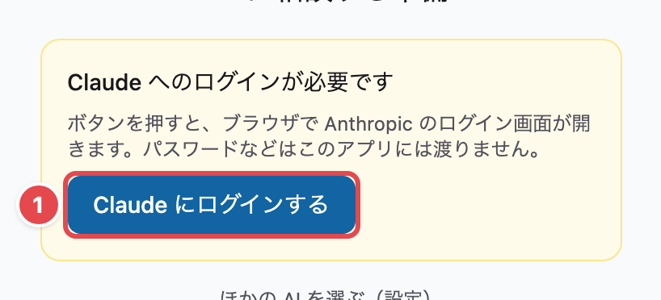
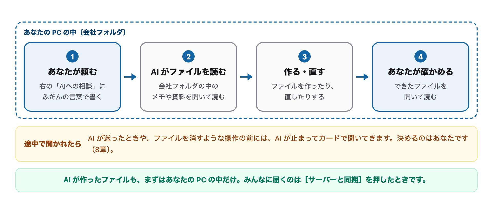
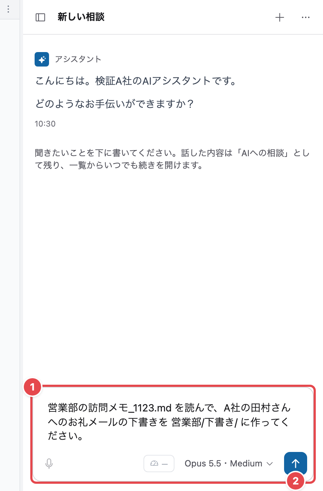
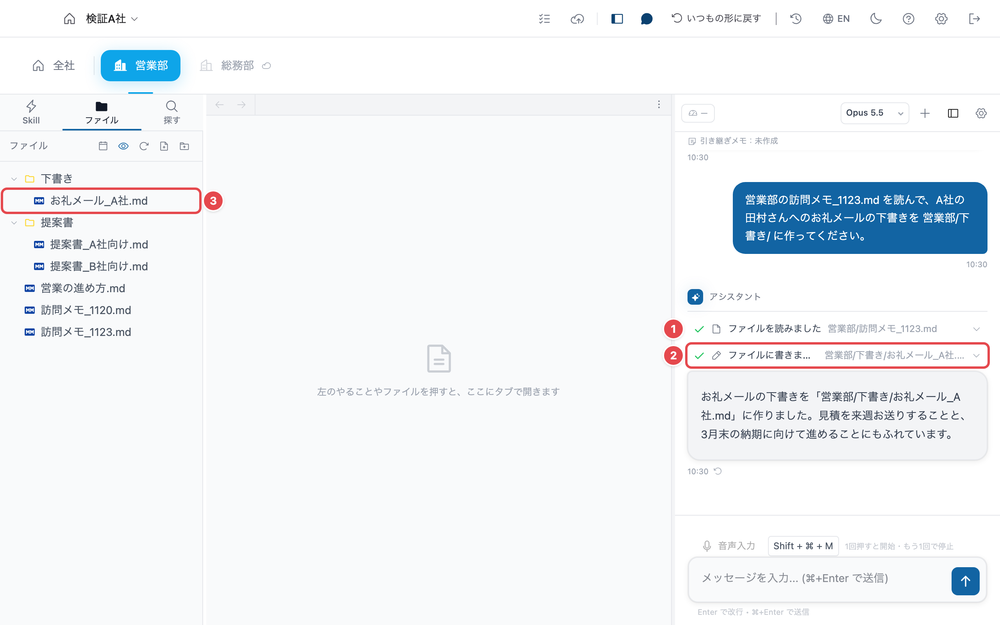
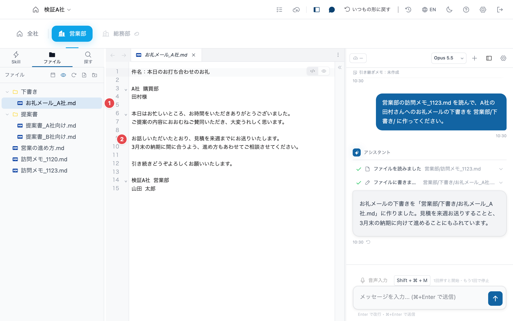

# 6章　AI に頼む（はじめて）

## はじめに

前の章の最後に、こんな疑問が残りました。

「訪問メモをもとにお礼メールを書く、といった仕事を、AI に頼めないの？」

ChatGPT を使ったことがある人は、こんなふうにしていたかもしれません。訪問メモを開いて、中身をコピーして、ChatGPT に貼りつけて、「お礼メールを書いて」と頼む。返ってきた文章をまたコピーして、新しいファイルに貼りつけて、保存する。

ChatGPT は、あなたの会社のファイルを知りません。だから、あなたが運び役になるしかありませんでした。

**ACB の AI は、あなたの PC の会社フォルダの中で働きます。** ファイルを自分で開いて読み、新しいファイルを作って、フォルダに置くところまでやってくれます。この章では、はじめての1回を、山田さんと一緒にやってみましょう。

### この章で分かること

- はじめて使うときに、1回だけすること
- AI に頼んでから、ファイルができるまでの流れ
- AI が作ったファイルの確かめ方

---

## はじめての1回だけ：Claude にログインします

ACB の AI は、Anthropic という会社の「Claude（クロード）」という AI です。会社が用意した Claude のアカウントで、1回だけログインします。

右の「AIへの相談」を開いたときに、次のカードが出たら、［Claude にログインする］（①）を押します。

ブラウザで Anthropic のログイン画面が開きます。会社の Claude のアカウントでログインすると、ACB に自動で戻ってきます。パスワードなどが ACB に渡ることはありません。

このカードが出なければ、もうログインできています。そのまま次へ進んでください。

> **こんなときは**
>
> 「このパソコンに Claude Code が入っていません」と出たときは、AI を動かすための部品が、まだ PC に入っていません。［入れ方を見る］で案内のページが開きますが、会社の PC では、管理者が入れることになっている場合もあります。迷ったら、まず管理者に聞いてみましょう。

---

## 頼んでから、ファイルができるまで

まず、全体の流れを図で見てみましょう。

ポイントは2つです。

- **AI がするのは、あなたの PC の会社フォルダの中での仕事です。** 読むのも、作るのも、直すのも、ここでのことです。
- **AI が迷ったときや、気をつけたい操作の前には、AI が止まって、あなたに聞いてきます。** 決めるのはあなたです。このカードは8章で見ます。

会社のファイルのうち、AI が読めるのは、あなたが読めるものだけです。あなたが読めない非公開のフォルダを、AI が代わりに読むことはありません。

---

## 1. 頼みたいことを書いて、送ります

検証A社の山田さんは、5章で訪問メモを書き足しました。今度は、そのメモをもとに、A社の田村さんへのお礼メールの下書きを AI に頼みます。

右の「AIへの相談」のいちばん下にある入力欄（①）に、頼みたいことをふだんの言葉で書きます。

まだ何も書いていない相談には、「聞きたいことを下に書いてください。話した内容は「AIへの相談」として残り、一覧からいつでも続きを開けます。」と1行出ています。最初のひとことを送ると消えます。

山田さんは、こう書きました。

> 営業部の訪問メモ_1123.md を読んで、A社の田村さんへのお礼メールの下書きを 営業部/下書き/ に作ってください。

書けたら、②の矢印のボタンを押すか、⌘+Enter（command キーと Enter を同時に押す）で送ります。

**Enter だけでは送られません。改行になります。** LINE と違うので、最初は気をつけてください。

---

## 2. AI が読んで、作ります

送ると、AI が仕事を始めます。何をしているかは、「AIへの相談」に1行ずつ出てきます。

- ①「ファイルを読みました　営業部/訪問メモ_1123.md」— AI が訪問メモを開いて読みました。
- ②「ファイルに書きました　営業部/下書き/お礼メール_A社.md」— AI がお礼メールの下書きを作って、下書きフォルダに置きました。
- ③ 左のファイルの一覧にも、「お礼メール_A社.md」が出てきました。

作業の途中では、行の頭がくるくる回り、「ファイルを読んでいます」のように出ます。終わると、緑のチェックに変わります。最後に、AI が何をしたかを短く報告してくれます。

行を押すと、くわしい中身を開いて見られます。

---

## 3. できたファイルを、自分の目で確かめます

AI に頼んだら、**できたものは必ず開いて読みましょう。** AI はとても頼りになりますが、まちがえることもあります。宛名や日付、金額のような大事なところは、特によく見てください。

左の一覧で「お礼メール_A社.md」（①）を押すと、真ん中に中身が開きます。

訪問メモにあった「見積を来週までに送る」が、②の行に入っていますね。直したいところがあれば、5章と同じように自分で直してもいいですし、「AIへの相談」で「もう少し短くして」のように続けて頼むこともできます。

### AI が作ったファイルも、まずはあなたの PC の中だけです

5章で見たとおり、ACB では、直した内容はまずあなたの PC の中に保存されます。**AI が作ったファイルも同じです。** この時点では、まだ営業部のほかの人には見えていません。

だから、AI の下書きが少しおかしくても、慌てなくて大丈夫です。確かめて、直してから会社に届けられます。会社に届ける方法（同期）は、後ろの章（11章）でくわしく見ます。

また、AI が作ったのは「下書きのファイル」です。この例では、AI がメールを田村さんに送ってしまうことはありません。送るのは、確かめたあとのあなたです。

---

## まとめ

- はじめてのときだけ、［Claude にログインする］で、会社の Claude のアカウントにログインします。
- 右の「AIへの相談」の入力欄に、頼みたいことをふだんの言葉で書いて、⌘+Enter か矢印のボタンで送ります。Enter だけでは改行です。
- AI は、あなたの PC の会社フォルダの中でファイルを読み、作り、直します。何をしたかは、1行ずつ出てきます。
- AI が作ったファイルは、左の一覧にすぐ出ます。必ず開いて、自分の目で確かめましょう。
- AI が作ったファイルも、まずはあなたの PC の中だけです。

## やってみよう

1. 「AIへの相談」を開いて、ログインのカードが出たら、ログインしてみましょう。
2. 自分の部署のフォルダにあるファイルを1つ選んで、「〇〇.md を読んで、3行で要点をまとめてください」と頼んでみましょう。
3. 1章でメモした「面倒だな」と思った作業を、AI に頼めそうか考えてみましょう。

---

はじめての1回、うまくいきましたか？　でも、頼み方によっては、思っていたものと違うものが返ってくることもあります。

どう頼めば、AI は思ったとおりに動いてくれるのでしょうか？　途中で「やっぱりこうして」と言いたくなったら？　前の相談の続きをしたいときは？
