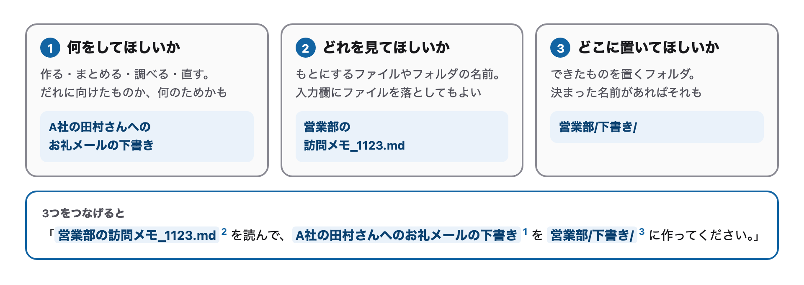
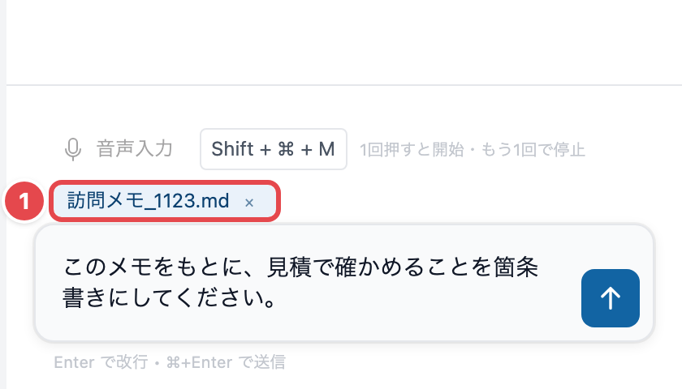
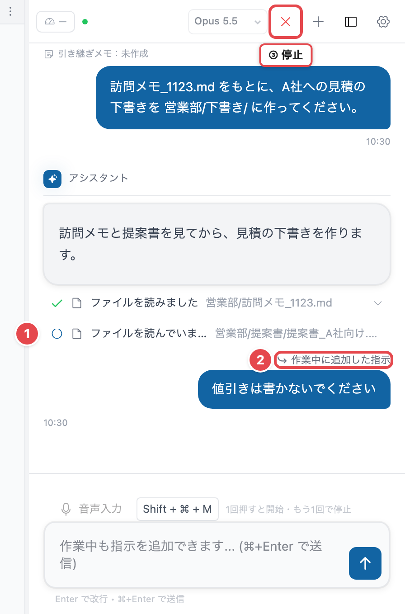
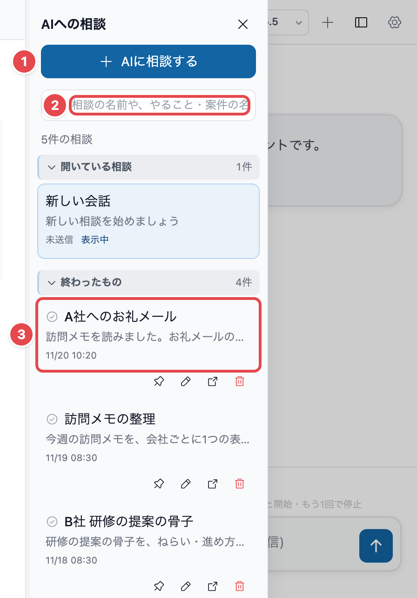

# 7章　上手な頼み方

## はじめに

前の章の最後に、こんな疑問が残りました。

「どう頼めば、AI は思ったとおりに動いてくれるの？　途中で言い直したくなったら？　前の相談の続きは？」

職場に入ったばかりの新人さんに仕事を頼むときのことを、思い出してみてください。「あれ、やっといて」だけでは、新人さんは困ってしまいます。何を作るのか、どの資料を見ればいいのか、できたらどこに置けばいいのか。そこまで伝えると、仕事はぐっとうまく進みますよね。

**AI も同じです。** ACB の AI は、あなたの会社フォルダの中で働く、とても手の早い新人さんのようなものです。この章では、その新人さんへの上手な頼み方を見ていきます。

### この章で分かること

- 頼むときに伝える3つのこと
- 見てほしいファイルを AI に渡す方法
- AI が作業している途中で、指示を足す方法・止める方法
- 前の相談の続きをする方法

---

## 頼むときは、3つのことを伝えます

6章で山田さんが書いた頼み方を、もう一度見てみましょう。実は、上手な頼み方の3つが、ちゃんと入っていました。

1. **何をしてほしいか**：作る・まとめる・調べる・直す。だれに向けたものか、何のためかも書くと、仕上がりが近づきます。
2. **どれを見てほしいか**：もとにするファイルやフォルダの名前です。AI は会社フォルダの中を自分で探すこともできますが、名前を書いたほうが確実で、早く終わります。
3. **どこに置いてほしいか**：できたものを置くフォルダです。書かないと、AI が置き場所を決めます。あとで探すのが大変になるので、書いておきましょう。

ほかにも、「A4 1枚くらいで」「敬語はていねいすぎないように」のような希望があれば、最初に書いておくと、やり直しが減ります。

---

## 見てほしいファイルは、入力欄に落として渡せます

ファイルの名前を打つのが面倒なときは、左のファイルの一覧から、ファイルを入力欄までドラッグして落とします。落とす前に「ここに落とすと、AI が読みます」と出ます。

落としたファイルは、入力欄の上に名前の札（①）として並びます。そのあとに頼みたいことを書いて送ると、AI はそのファイルを読んでから仕事をします。

まちがえて落としたときは、札の「×」を押すと外せます。

---

## 作業の途中でも、指示を足せます

AI に頼んだあとで、「あ、値引きのことは書かないでほしかった」と気づくこともありますよね。

**AI が作業している間も、入力欄は使えます。** 入力欄に足したいことを書いて、いつもどおり送ります。

- ①のように、行の頭がくるくる回っている間は、AI がまだ作業中です。
- 送った指示は、②のように「作業中に追加した指示」として AI の返事の中に入ります。AI は、作業を止めずに、この指示を取り入れて進めます。
- タイミングによっては、指示がすぐに届かないことがあります。そのときは、入力欄の上に「応答が終わったら送ります」と出て、AI の返事が終わったあとに送られます。

### 止めたいときは［停止］

頼み方をまちがえた、思っていたのと全然違う方向に進んでいる……そんなときは、③の［停止］（上のほうにある赤い「×」のボタン）を押すと、AI の作業が止まります。止めたあとで、頼み方を書き直して送り直しましょう。

止めても、それまでに AI が作ったファイルは残っています。いらなければ、左の一覧で確かめてから消してください。

---

## 前の相談の続きは、一覧から開きます

ACB では、AI とのやりとり1つ1つを「相談」と呼びます。相談は、あとで開いて続きができます。

「AIへの相談」の右上にある一覧のボタンを押すと、相談の一覧が開きます。

- ①［AIに相談する］：新しい相談を始めます。**話題が変わったら、新しい相談にしましょう。** 1つの相談に別々の話を混ぜると、AI が前の話に引っぱられることがあります。
- ②の欄に言葉を入れると、相談の名前や中身で探せます。
- ③のように、前の相談が並んでいます。押すと開いて、続きを頼めます。

6章で作ったお礼メールを「もう少し短くして」と頼みたいときは、③の「A社へのお礼メール」を開いて、続けて書けば OK です。前のやりとりを覚えているので、最初から説明し直す必要はありません。

---

## まとめ

- 頼むときは、①何をしてほしいか、②どれを見てほしいか、③どこに置いてほしいか、の3つを伝えます。
- 見てほしいファイルは、左の一覧から入力欄に落として渡せます。
- AI が作業している途中でも、入力欄から指示を足せます。止めたいときは［停止］を押します。
- 相談の一覧から前の相談を開くと、続きを頼めます。話題が変わったら［AIに相談する］で新しい相談にします。

## やってみよう

1. 6章で頼んだことを、3つ（何を・どれを見て・どこに置く）がそろっているか見直してみましょう。
2. ファイルを1つ、入力欄に落として、「このファイルの要点を3行で」と頼んでみましょう。
3. 相談の一覧を開いて、6章の相談を開き、「もう少し短くして」と続けて頼んでみましょう。

---

上手に頼めるようになると、AI はどんどん仕事を進めてくれます。でも、ときどき AI のほうから、何かを聞いてくることがあります。

カードが出てきて「どれにしますか？」と聞かれたり、黄色い帯に［許可］と［拒否］が出たり。これは押していいのでしょうか？
