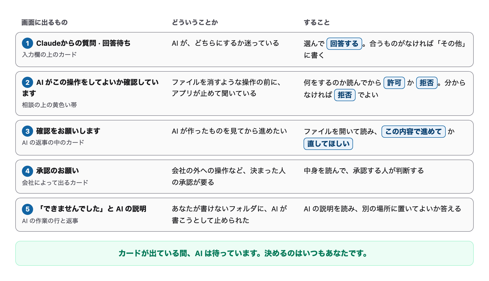
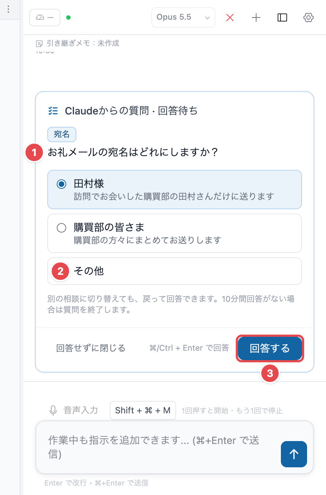
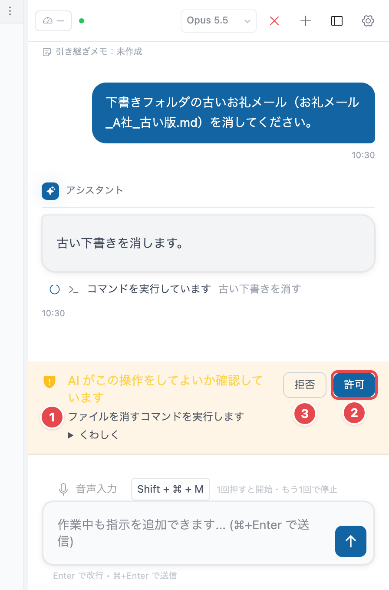
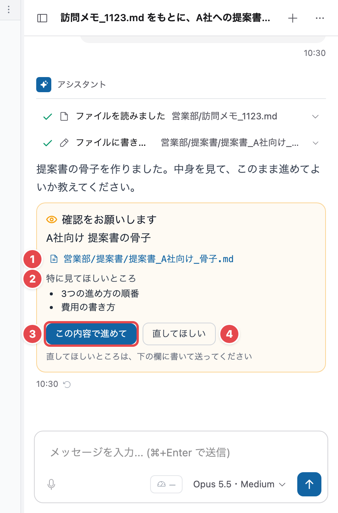
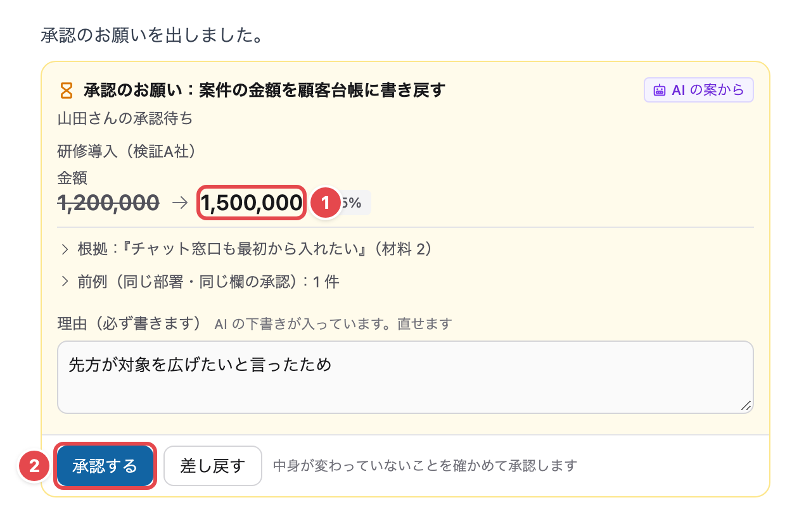
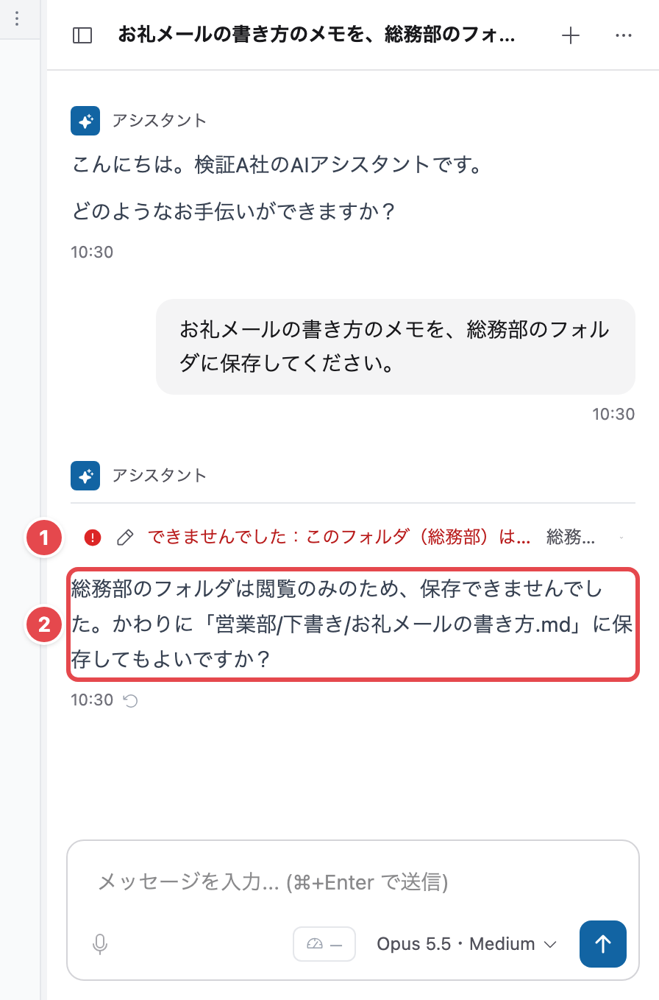

# 8章　AI が聞いてくるカード

## はじめに

前の章の最後に、こんな疑問が残りました。

「AI がカードを出して聞いてきた。黄色い帯に［許可］と［拒否］が出た。これは押していいの？」

スマホのアプリを入れたとき、「カメラを使ってもいいですか？」と聞かれたことがありますよね。会社でも、上司のハンコが要る書類があります。大事なことは、勝手に進めずに、決める人に聞く。ACB の AI も同じです。

**AI が止まってあなたに聞くのは、あなたに決めてほしいことがあるときです。** この章では、AI が聞いてくるときの形と、それぞれで何をすればいいのかを見ていきます。

### この章で分かること

- AI が聞いてくるときの5つの形
- それぞれで、あなたがすること
- 迷ったときの考え方

---

## 聞いてくる形は5つです

先に、全体を早見表で見ておきましょう。

カードが出ている間、AI は待っています。急がなくて大丈夫です。順番に見ていきましょう。

---

## 1. 選んでほしいとき：「Claudeからの質問」

山田さんが「お礼メールを、見積のお知らせも入れて書き直してください」と頼むと、AI がこう聞いてきました。

①に、AI が迷っていることが書いてあります。ここでは、お礼メールを田村さんだけに送るのか、購買部の皆さまに送るのか、を聞いています。

- 合うものを選んで、③［回答する］を押します。
- 選択肢に合うものがなければ、②の「その他」を選んで、自分の言葉で書けます。
- 答えたくないときは、［回答せずに閉じる］を押します。

カードにあるとおり、ほかの相談に切り替えても、戻ってきて答えられます。ただし、10分たっても答えがないと、質問は終わります。そのときは、AI に「宛名は田村様で」のように書いて送れば大丈夫です。

---

## 2. 気をつけたい操作の前：「AI がこの操作をしてよいか確認しています」

山田さんが「下書きフォルダの古いお礼メールを消してください」と頼むと、相談の下に黄色い帯が出ました。

AI は、ファイルを消すような、あとで戻しにくい操作をする前に、アプリに止められます。そして、あなたに［許可］してよいかを聞いてきます。

①には、AI がしようとしている操作が、ふつうの言葉で出ます。ここでは「ファイルを消すコマンドを実行します」と書いてあります。コンピューターへの命令（コマンド）そのものを見たいときは、その下の［くわしく］を開きます。英語まじりで読みにくいですが、たとえば「rm」は「消す」という意味です。

- 中身を読んで、そのとおりにしてよければ、②［許可］を押します。
- 違う、または**よく分からないときは、③［拒否］を押してください。** 拒否しても、何も壊れません。AI はその操作をせずに、ほかのやり方を考えたり、あなたに聞き直したりします。

非公開のフォルダを読んだあとに、AI がその内容をほかの人も見られる場所に書こうとしたり、外に送ろうとしたりしたときも、同じ黄色い帯で確かめられます。非公開の中身が広がってしまわないかを、よく考えてから答えましょう。

---

## 3. 見てから進めたいとき：「確認をお願いします」

AI が作ったものを、先にあなたに見てほしいとき、AI は返事の中にこのカードを出して止まります。

1. ①のファイル名を押すと、真ん中にそのファイルが開きます。中身を読みます。
2. ②に、AI が特に見てほしいところが書いてあります。そこは念入りに見ましょう。
3. よければ③［この内容で進めて］を押します。AI が次へ進みます。
4. 直してほしいところがあれば、④［直してほしい］を押して、入力欄に直してほしいことを書いて送ります。

このカードが出ている相談は、相談の一覧で「あなたの番」として上のほうに並びます。答えるまで、AI は先に進みません。

---

## 4. 会社によって出る：「承認のお願い」

> **会社によっては、こんなカードも出ます**
>
> 会社の外のしくみに書き込むような操作には、決まった人の承認が要るように、会社が設定していることがあります。そのときは、AI の返事の中に「承認のお願い」のカードが出ます。
>
> 
>
> カードのいちばん上に、何をどう変えるのか（①）が大きく、変えられない形で出ています。根拠（議事録の引用など）や前例は、その下に1行ずつ畳んであり、押すと開きます。承認する人は、中身を読んで、理由を書いてから②［承認する］を押します。ボタンはカードの下の帯にあり、カードが長くても画面の下に見えています。承認されたこの中身だけが実行されます。違うと思ったら［差し戻す］を押します。
>
> 1日目の山田さんの仕事では、まず出てきません。出てきたら、「中身を読んで、決める人が決める」とだけ覚えておけば十分です。

---

## 5. 書けない場所だったとき：AI が止まって聞いてくる

15章でくわしく見ますが、会社のフォルダには、読めるけれど書けない［閲覧のみ］のフォルダがあります。山田さんにとっては、総務部のフォルダがそうです。

山田さんが「お礼メールの書き方のメモを、総務部のフォルダに保存してください」と頼むと、こうなりました。

①のように、AI が総務部に書こうとしたところで、アプリが**書く前に**止めました。行が赤くなり、「できませんでした」と理由が出ています。そして AI は、②のように「かわりに営業部の下書きフォルダに保存してもよいですか？」と聞いてきました。

あなたは、ふつうに返事を書いて送ればいいだけです。「はい、そこに保存してください」でも、「保存しなくていいです」でも大丈夫です。

PC に入れていない［未ダウンロード］のフォルダに書こうとしたときも、同じように止まって、AI が説明してくれます。

---

## 迷ったら、「進めない」を選んでかまいません

カードや帯で迷ったときは、［拒否］や［回答せずに閉じる］を選んでかまいません。進めなかったことで、何かが壊れることはありません。そのうえで、AI に「どうしてそれが必要なの？」と聞いてみましょう。AI は理由を説明してくれます。

どうしても分からないときは、その画面のまま、管理者に見せて相談してください。

---

## まとめ

- AI が止まって聞いてくるのは、あなたに決めてほしいことがあるときです。カードが出ている間、AI は待っています。
- 「Claudeからの質問」：選んで［回答する］。合うものがなければ「その他」に書きます。
- 「AI がこの操作をしてよいか確認しています」：中身を読んで［許可］か［拒否］。分からなければ［拒否］で大丈夫です。
- 「確認をお願いします」：ファイルを開いて読み、［この内容で進めて］か［直してほしい］。
- 「承認のお願い」は、会社によって出ます。決める人が中身を読んで決めます。
- 書けないフォルダには、AI も書けません。書く前に止まって、AI が説明して聞いてきます。

## やってみよう

1. AI に「〇〇の下書きを作って。作ったら、進める前に確認をお願いします」と頼んで、「確認をお願いします」のカードを出してみましょう。
2. カードのファイル名を押して、中身を開いてみましょう。
3. 気になるところがあれば［直してほしい］を押して、直してほしいことを書いて送ってみましょう。

---

これで、AI とのやりとりはひととおりできるようになりました。でも、毎回「件名はこう、お礼のあとに次の約束を……」と同じ説明を書くのは、ちょっと面倒ですね。

会社でうまくいったやり方を、AI に覚えておいてもらうことはできないのでしょうか？
