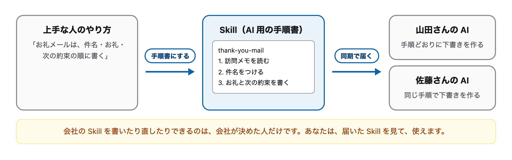
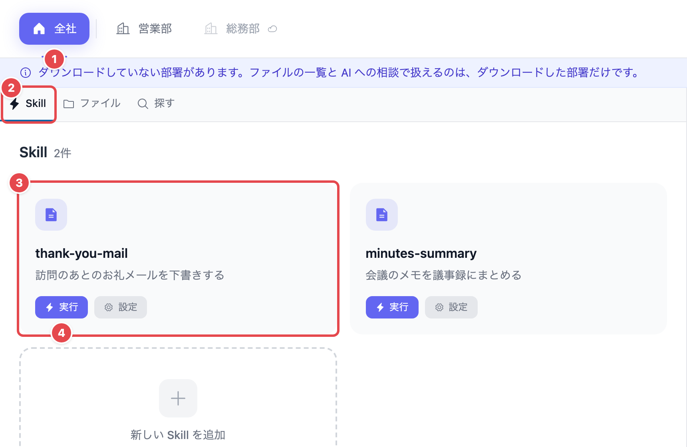
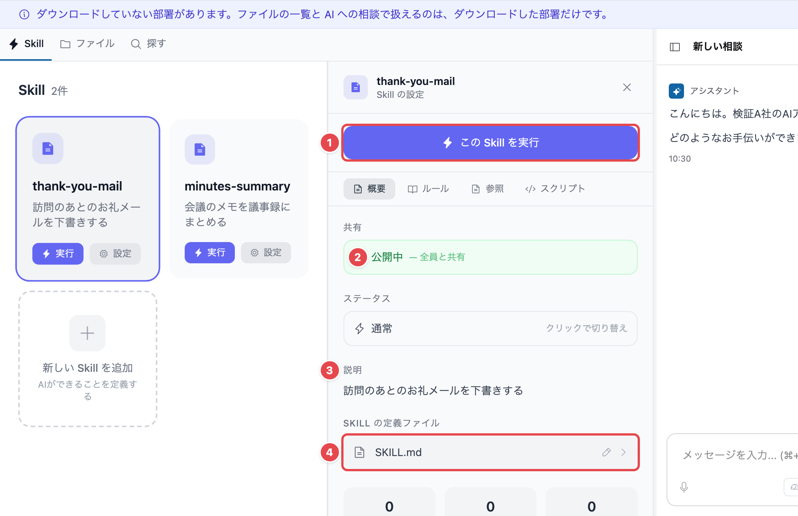
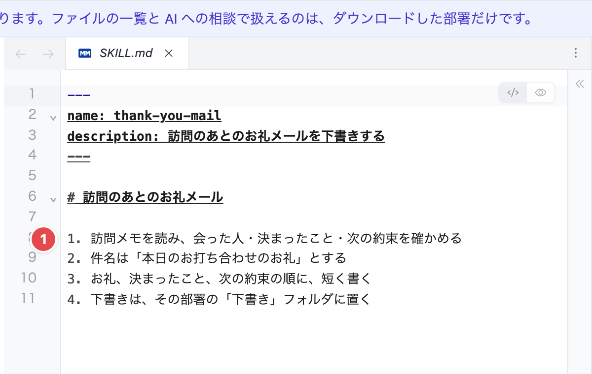
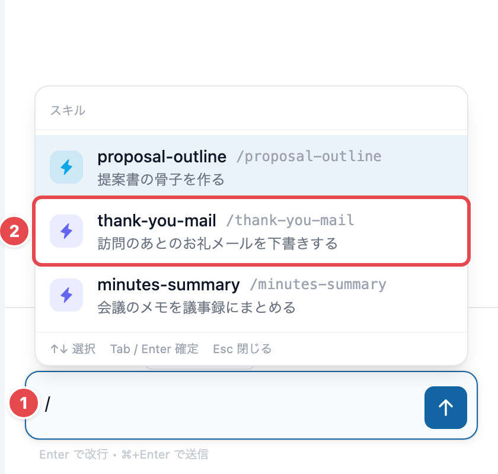
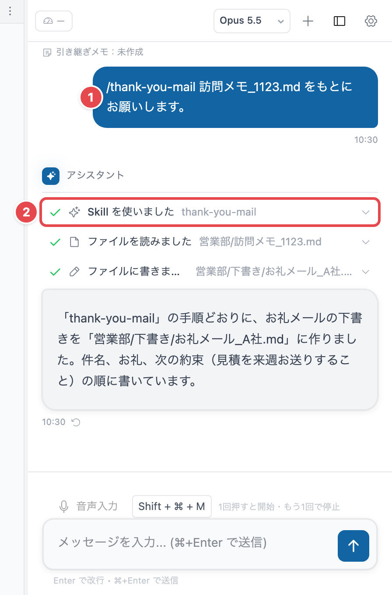

# 9章　Skill を使う

## はじめに

前の章の最後に、こんな疑問が残りました。

「会社でうまくいったやり方を、AI に覚えておいてもらうことはできないの？」

よく使うメールの文面を、テンプレートとして取っておいたことはありませんか？　共有フォルダに「〇〇の手順書」が置いてあって、新しく入った人はそれを見ながら仕事を覚える。そんな職場も多いですよね。

ACB には、AI のための手順書があります。それが **Skill（スキル）** です。この章では、Skill が何なのか、どこにあって、どう使うのかを見ていきます。

### この章で分かること

- Skill とは何か
- 会社や部署の Skill の見つけ方と、中身の見方
- Skill を使って AI に頼む2つの方法

---

## Skill は、AI 用の仕事の手順書です

営業部で一番お礼メールが上手な先輩は、いつも「件名をつけて、お礼を言って、決まったことと次の約束を短く書く」というやり方をしています。このやり方を、AI 向けの手順書にしたものが Skill です。

- Skill は、会社フォルダの中に置かれた手順書のファイルです。会社のほかのファイルと同じように、同期でみんなの PC に届きます。
- だから、一人が見つけたうまいやり方を、会社のみんなの AI が同じように使えます。
- Skill を書いたり直したりできるのは、会社が決めた人（管理者など）だけです。あなたは、届いた Skill を見て、使えます。

---

## Skill のある場所

Skill は、左の欄の［Skill］タブにあります。

1. 上の部署のタブ（①）で、どこの Skill を見るかを選びます。［全社］を選ぶと会社みんなの Skill が、「営業部」を選ぶと営業部の Skill が出ます。
2. 左の欄の②［Skill］を押すと、Skill がカードで並びます。
3. ③が1つの Skill です。上が Skill の名前（「thank-you-mail」）、その下が何をする Skill かの説明（「訪問のあとのお礼メールを下書きする」）です。

Skill の名前は英語で書かれていることが多いので、何をする Skill かは、名前の下の説明で見分けましょう。

---

## Skill の中身を見る

カードの［設定］を押すと、その Skill のくわしい中身が開きます。

- ①［この Skill を実行］は、この Skill を使って AI に頼むボタンです（このあと見ます）。
- ②「公開中 — 全員と共有」は、この Skill が会社のみんなに届いていることを表しています。
- ③に、何をする Skill かが書いてあります。
- ④の「SKILL.md」が、手順書の本体です。押すと、真ん中に開きます。

①のように、AI がどういう順番で仕事をするのかが、ふつうの言葉で書いてあります。**使う前に一度読んでおくと、AI が何をするのかが分かって安心です。**

会社の Skill を直すのは、会社が決めた人の仕事です。読むだけにしておきましょう。自分に合わないところがあるときは、次の10章を見てください。

---

## Skill を使って頼む

使い方は2つあります。

### その1：入力欄で「/」を打って選ぶ

「AIへの相談」の入力欄で、半角の「/」（①）を打つと、使える Skill の一覧が出ます。

使いたい Skill（②）を押すか、上下の矢印キーで選んで Enter を押します。入力欄に「/thank-you-mail」と入るので、続けて頼みたいことを書いて、⌘+Enter で送ります。

山田さんは、こう送りました。

> /thank-you-mail 訪問メモ_1123.md をもとにお願いします。

②の「Skill を使いました　thank-you-mail」の行が、AI がこの Skill の手順を読んで仕事を始めた印です。そのあと、6章と同じように、訪問メモを読んで、下書きを作っています。

**Skill を使うと、頼む文章は短くてすみます。** 件名のつけ方や書く順番は、Skill に書いてあるからです。

### その2：カードの［実行］を押す

Skill の一覧で、カードの［実行］（さきほどの一覧の写真の④）を押しても使えます。詳しい画面の［この Skill を実行］も同じです。

押すと、新しい相談が始まり、その Skill を使うことが AI に伝わります。AI が「何をしましょうか」のように聞いてきたら、頼みたいことを書いて送ります。

> **ふだんの言葉で頼んでも、使われることがあります**
>
> 「お礼メールの下書きを作って」のように頼むだけでも、AI が Skill の説明を見て、自分で Skill を使うことがあります。ただし、必ず使われるとは限りません。決まったやり方で作ってほしいときは、「/」で選ぶのが確実です。使われたかどうかは、「Skill を使いました」の行が出たかで分かります。

---

## まとめ

- Skill は、AI 用の仕事の手順書です。会社や部署の上手なやり方が入っていて、同期でみんなに届きます。
- 左の欄の［Skill］タブで、選んでいる部署（または［全社］）の Skill が見られます。
- カードの［設定］で中身が見られます。「SKILL.md」を開くと、AI が守る手順が読めます。
- 使うときは、入力欄で「/」を打って選ぶか、カードの［実行］を押します。
- Skill を書いたり直したりできるのは、会社が決めた人だけです。

## やってみよう

1. ［全社］と自分の部署のタブで、［Skill］を開いて、どんな Skill があるか見てみましょう。
2. 気になる Skill の［設定］を押して、「SKILL.md」を読んでみましょう。
3. 入力欄で「/」を打って、Skill を1つ選んで、AI に頼んでみましょう。

---

Skill を使うと、会社の上手なやり方で、AI が仕事をしてくれます。でも、使っているうちに「ここは自分のやり方と違うな」と思うところが出てくるかもしれません。

会社の Skill を、自分用に直してもいいのでしょうか？　直したら、みんなの Skill まで変わってしまわないのでしょうか？
