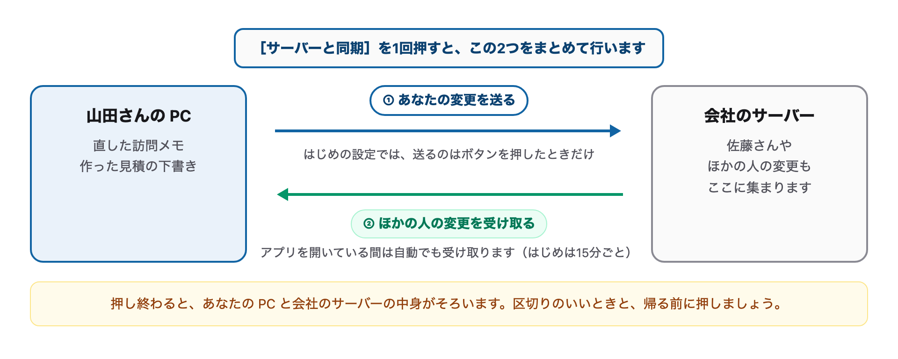
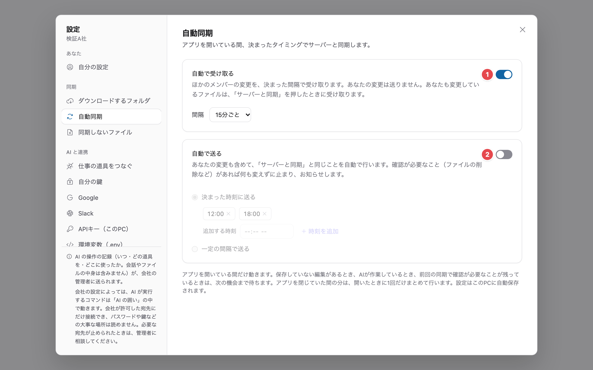

# 11章　同期ボタン

## はじめに

ここからは「困ったとき・もっと知る」の章です。同期とフォルダのことを、もう少しくわしく見ていきます。

前の章の最後に、こんな疑問が残りました。

「あなたや AI が作ったものをみんなに届けるには、どうすればいいの？　［サーバーと同期］を押すと、何が起きるの？」

LINE を思い出してみてください。メッセージは、入力欄に書いただけでは相手に届きません。「送信」を押して、はじめて届きますよね。

ACB の［サーバーと同期］は、この「送信」のボタンにあたります。ただし、ひとつだけ違うところがあります。**送るだけでなく、ほかの人の変更を受け取ることも、同じボタン1つで行います。**

この章では、そのボタンを実際に押してみましょう。

### この章で分かること

- ［サーバーと同期］を押すと何が起きるのか
- 押したあと、どうなれば終わりなのか
- 自動で行われること、ボタンを押したときだけ行われること
- いつ押せばいいのか

---

## 1回押すと、「送る」と「受け取る」をまとめて行います

まずは、同期で何が起きるのかを図で見てみましょう。

［サーバーと同期］を押すと、ACB は次の2つをまとめて行います。

1. **あなたの変更を送る**：5章で書き足した訪問メモや、新しく作った見積の下書きが、会社のサーバーに届きます。届いたものは、営業部のほかの人も見られるようになります。
2. **ほかの人の変更を受け取る**：佐藤さんたちが直したファイルが、あなたの PC に届きます。

押し終わると、あなたの PC の会社フォルダと、会社のサーバーの中身がそろいます。

---

## 押してみましょう

では、検証A社の山田さんになったつもりで、押してみましょう。

画面のいちばん上、タイトルバーの雲の形のボタンが［サーバーと同期］です（4章で見ましたね）。これを1回押します。

押すと、ボタンの絵がくるくる回る印に変わります（①）。これが「同期中」の合図です。

変更が少なければ、すぐに終わります。そのまま待ちましょう。

終わると、画面の右下に緑の知らせ「同期が完了しました」（①）が出ます。この知らせは、数秒たつと自分で消えます。

**この緑の知らせが出たら、同期は終わりです。** あなたの変更は会社に届き、ほかの人の変更もあなたの PC に届きました。

「同期で何か気をつけることがあったとき」は、黄色や赤の知らせが出ます。こちらは自分では消えず、あなたが閉じるまで残ります。13章と14章で見ていきます。

> **用語解説：同期**
>
> 「同期」は、2つの場所の中身をそろえることです。スマホの写真がパソコンにも入るのも「同期」と呼ばれますね。
>
> ACB では、あなたの PC の会社フォルダと、会社のサーバーの中身をそろえることを「同期」と呼んでいます。

---

## 受け取るのは自動でも、送るのはボタンを押したときです

「毎回ボタンを押さないと、ほかの人の変更が見えないの？」と思ったかもしれませんね。

安心してください。**ほかの人の変更は、アプリを開いている間、自動でも受け取ります。** はじめの設定では、15分ごとです。

この設定は、タイトルバーの［設定］を開いて、左の［自動同期］で見られます。

- ①［自動で受け取る］は、はじめからオンです。ほかの人の変更を、決まった間隔で受け取ります。あなたの変更は送りません。あなたも直しているファイルは、自動では受け取らず、［サーバーと同期］を押したときに受け取ります。
- ②［自動で送る］は、はじめはオフです。

つまり、はじめの設定では、**あなたの変更が会社に届くのは、あなたが［サーバーと同期］を押したときだけ**です。5章で見たとおり、書きかけの文章が勝手にみんなに届くことはありません。

②をオンにすると、決まった時刻（はじめは12:00と18:00）に、あなたの変更も自動で送ります。慣れるまではオフのまま、自分で押すのがおすすめです。

なお、自動で行われるのは、アプリを開いている間だけです。アプリを閉じている間は、何も起きません。

---

## いつ押せばいい？

押すタイミングに、きまりはありません。目安は次の2つです。

- **区切りのいいとき**：訪問メモを書き終えた、見積の下書きができた、など。
- **帰る前**：その日に直したものを、会社に届けておきます。

帰る前に押しておけば、次の日に別の PC から開いたときも、ほかの人があなたの資料を見たいときも困りません。

山田さんも、訪問メモを書き終えたところで［サーバーと同期］を押し、緑の「同期が完了しました」を確かめてから、次の仕事に移りました。

---

## まとめ

- ［サーバーと同期］を1回押すと、「あなたの変更を送る」と「ほかの人の変更を受け取る」をまとめて行います。
- 押すとボタンの絵がくるくる回り、終わると右下に緑の「同期が完了しました」が出ます。
- ほかの人の変更は、アプリを開いている間、自動でも受け取ります（はじめは15分ごと）。
- はじめの設定では、あなたの変更を送るのは、ボタンを押したときだけです。
- 区切りのいいときと、帰る前に押しましょう。

## やってみよう

1. 5章で書き足したファイルがある人は、［サーバーと同期］を押してみましょう。
2. ボタンの絵がくるくる回り、右下に「同期が完了しました」が出ることを確かめてください。
3. ［設定］の［自動同期］を開いて、［自動で受け取る］がオンになっていることを見てみましょう。

---

押せば送れる、ということは分かりました。……でも、ちょっと待ってください。

ボタンを押したら、何が会社に送られるのでしょうか？　うっかり、まだ見せたくないファイルまで送ってしまうことはないのでしょうか？
