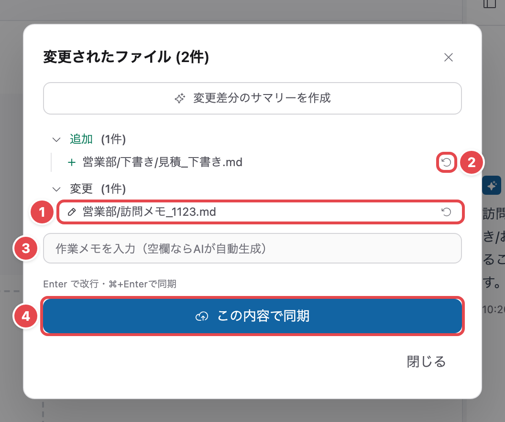
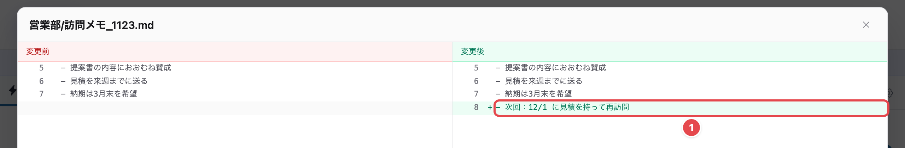
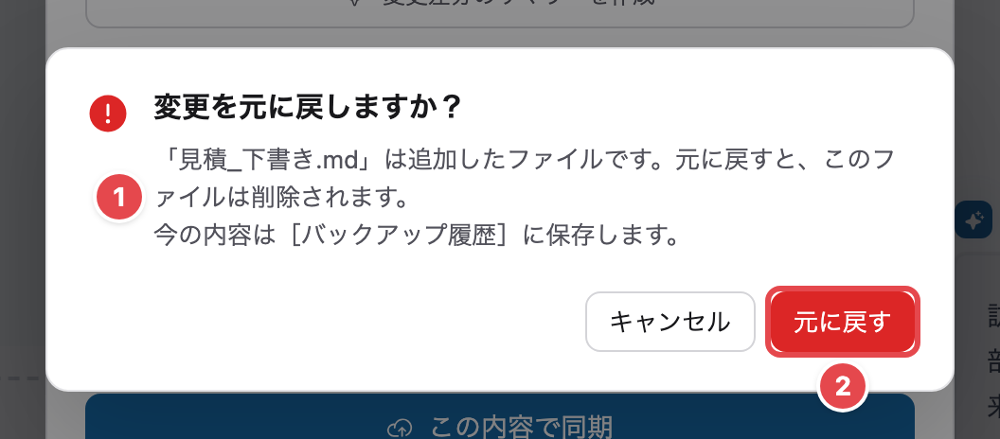

# 12章　送る前に確かめる

## はじめに

前の章の最後に、こんな疑問が残りました。

「ボタンを押したら、何が会社に送られるの？　うっかり、まだ見せたくないファイルまで送ってしまわない？」

大事なメールを送る前のことを思い出してみてください。宛先は合っているか、添付ファイルは正しいか、本文に書き間違いはないか。送信ボタンを押す前に、もう一度見直しますよね。

ACB にも、送る前に見直すためのボタンがあります。タイトルバーの［変更を確認してから同期］です（4章で見た、［サーバーと同期］のとなりの ▾ を押すと出ます）。

### この章で分かること

- 同期で何が送られるのかを、先に見る方法
- ファイルのどこが変わったのかを見る方法
- 送りたくない変更を取り消す方法

---

## ［変更を確認してから同期］で、送るものの一覧を見ましょう

5章で、山田さんは2つのことをしました。「訪問メモ_1123.md」に1行書き足して、「見積_下書き.md」を新しく作りました。

タイトルバーの［サーバーと同期］の横の ▾ を押し、［変更を確認してから同期］を押すと、次の同期で会社に送られるファイルの一覧が出ます。

一覧は、「追加」（新しく作ったファイル）、「変更」（直したファイル）、「削除」（消したファイル）に分かれています。山田さんの場合は、「追加」に見積_下書き.md、「変更」に訪問メモ_1123.md（①）が並んでいます。

ここに出ているのは、**前の同期のあとに直したファイル**です。心当たりのないファイルがないか、ざっと見てみましょう。

まだ何も直していないときに押すと、「変更はありません」と出ます。

> **気をつけること：前の同期が途中で止まったとき**
> サーバーにつながらなくて同期が止まったとき（14章）は、そのとき送るはずだったファイルが、この一覧に出ないことがあります。「変更はありません」と出ても、次の同期でそのファイルが送られます。送ってよいか迷うものがあるときは、同期の前に管理者に相談してください。

---

## どこが変わったのかを見る

一覧のファイル名（①）を押すと、そのファイルのどこが変わったのかが出ます。

左が「変更前」（前に同期したときの中身）、右が「変更後」（今の中身）です。書き足した行は、緑色になっています（①）。消した行があれば、赤色で出ます。

山田さんが書き足した「次回：12/1 に見積を持って再訪問」の1行だけが変わっていることが分かりますね。見終わったら、右上の×で閉じます。

一覧の上の［変更差分のサマリーを作成］を押すと、AI が変更の中身を短くまとめてくれます。変更が多いときに便利です（使わなくてもかまいません）。

---

## 送りたくない変更は、［変更を元に戻す］で取り消せます

一覧を見ていて、「見積の下書きは、まだ送りたくない」と思ったとします。

そのときは、ファイルの右はしにある矢印のボタン（前の写真の②）を押します。マウスを乗せると［変更を元に戻す］と名前が出るボタンです。

押すと、何が起きるのかを確かめる画面が出ます。

①に、何が起きるのかが書いてあります。

- **直したファイル**は、前に同期したときの中身に戻ります。
- **新しく作ったファイル**は、そのファイルがなくなります。
- **消したファイル**は、前に同期したときの中身で戻ってきます。

直したファイルと新しく作ったファイルは、**今の中身を、戻す前に「バックアップ履歴」に取っておきます。** うっかり押しても、あとから取り出せます（13章で見ます）。

よければ②の［元に戻す］を押します。そのファイルは一覧から消え、次の同期では送られなくなります。

ただし、ここで「元に戻す」と、そのファイルはあなたの PC の中でも前の中身に戻ります。「送らないけれど、手元では書き続けたい」というときは、元に戻さずに、同期するのを書き終わるまで待ちましょう。

---

## 作業メモを書いて、［この内容で同期］

一覧の下には、作業メモの欄（③）があります。

ここに「A社の訪問メモに次回の予定を追加」のように書いておくと、同期した変更に、このメモがつきます。メモは、ファイルの「前の版」の一覧に出るので、あとから「いつ、何を直したのか」を探すときの手がかりになります。

**空欄のままでもかまいません。** 空欄なら、AI が変更の中身を見て、メモを書いてくれます。

確かめ終わったら、④の［この内容で同期］を押します。［サーバーと同期］を押したときと同じように同期が始まり、終わると右下に知らせが出ます。

山田さんは、見積の下書きはまだ見直したかったので、あえて送らずに［閉じる］を押しました。訪問メモを直したときだけ、送る前にこの画面で確かめるようにしています。

---

## まとめ

- ［変更を確認してから同期］を押すと、前の同期のあとに直したファイルの一覧が出ます。前の同期がつながらずに止まったときは、そのとき送るはずだったファイルは一覧に出ないことがあります。
- ファイル名を押すと、変わったところが出ます。書き足した行は緑、消した行は赤です。
- 送りたくない変更は、［変更を元に戻す］で取り消せます。今の中身はバックアップ履歴に取っておきます。
- 作業メモは空欄でもかまいません。空欄なら AI が書きます。
- 確かめたら［この内容で同期］で送れます。

## やってみよう

1. 何かファイルを直したあとで、同期の ▾ から［変更を確認してから同期］を押してみましょう。直したファイルが「変更」に出ることを確かめてください。
2. ファイル名を押して、変わったところが緑や赤で出ることを見てみましょう。
3. 作業メモに一言書いて、［この内容で同期］を押してみましょう。

---

送る前に確かめる方法は分かりました。でも、もうひとつ気になることがあります。

山田さんが訪問メモを直している間に、佐藤さんも同じ訪問メモを直していたら……？　同期したら、どちらの内容が残るのでしょうか？　自分の作業は消えてしまわないのでしょうか？
