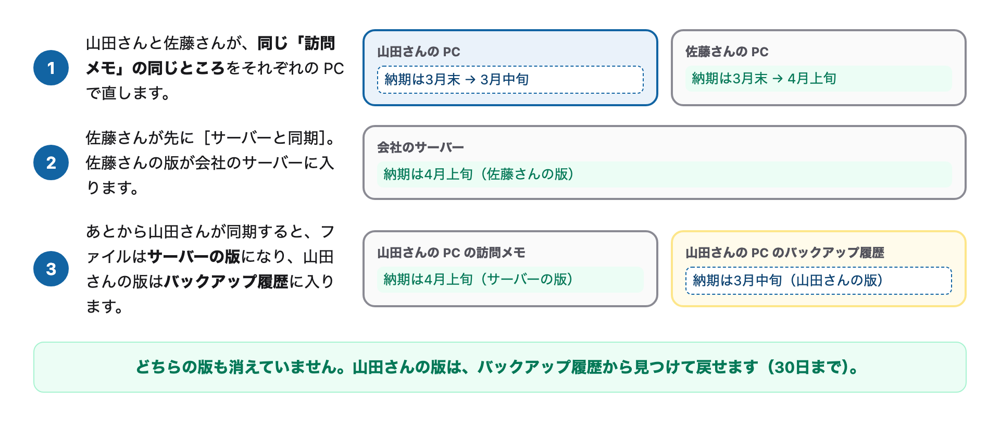
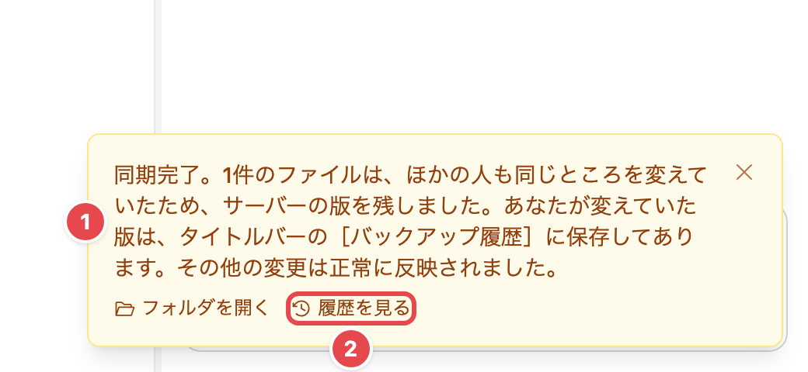
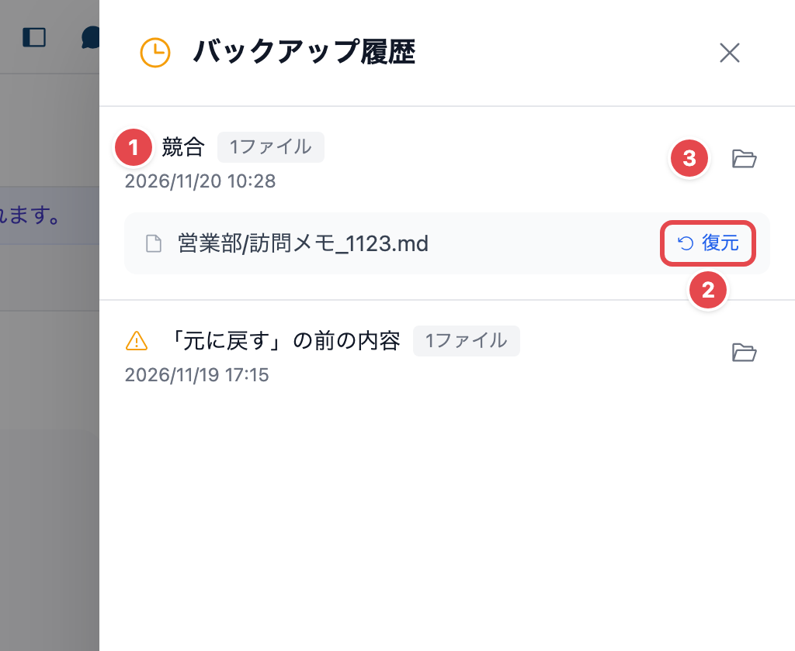
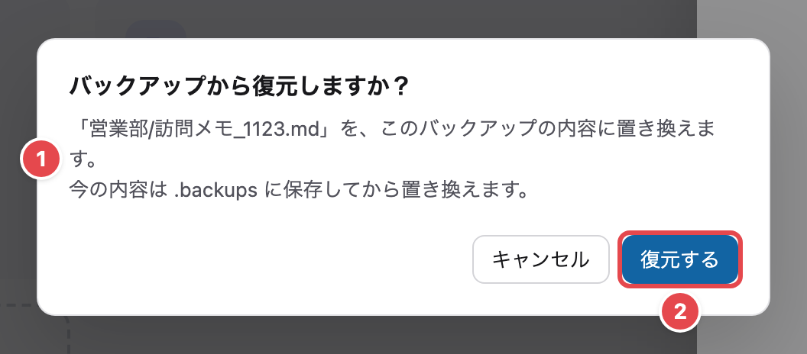

# 13章　同じファイルを二人が直したとき

## はじめに

前の章の最後に、こんな疑問が残りました。

「山田さんと佐藤さんが同じファイルを直して同期したら、どちらの内容が残るの？　自分の作業は消えないの？」

Google ドキュメントなら、二人で同時に書いても、それぞれの文字がその場で混ざっていきます。でも、共有フォルダの Excel を二人で開いて保存したら、同じ名前のファイルが2つできていたり、誰かの入力が消えていたり……そんな経験はありませんか？

ACB では、ファイルはそれぞれの PC の中で直します（5章）。だから、同じファイルを二人が別々に直すことも起こります。

先に答えを言っておきます。**同期で、あなたの作業が消えることはありません。** この章では、そのしくみと、自分の版を取り出す方法を見ていきます。

### この章で分かること

- 同じファイルを二人が直したとき、何が起きるのか
- あなたの版がどこに取っておかれるのか
- 取っておかれた版を見る方法、戻す方法

---

## 直した場所が離れていれば、両方の変更がまとまります

同じファイルでも、山田さんが最後に1行書き足し、佐藤さんが見出しの言葉を直した、というように**直した場所が離れていれば、ACB が両方の変更を1つにまとめます。** 二人とも何もしなくて大丈夫です。

困るのは、**同じところ**を二人が別々に直したときです。どちらの文を残すのか、ACB には決められません。Excel や PowerPoint のファイルも、中身をまとめることができないので、同じことが起きます。

---

## 同じところを直したら、「サーバーの版」が残り、あなたの版は取っておかれます

そのとき ACB がどうするのかを、図で見てみましょう。

1. 山田さんと佐藤さんが、訪問メモの「納期」の行を、それぞれの PC で直しました。
2. 佐藤さんが先に［サーバーと同期］を押しました。佐藤さんの版が、会社のサーバーに入ります。
3. あとから山田さんが同期すると、山田さんの PC の訪問メモは、**会社のサーバーにある版（佐藤さんの版）** になります。山田さんが直した版は、**消さずに「バックアップ履歴」に取っておきます。**

先に同期した人の版が、会社の版になる、ということです。あとから同期した人の版も、PC の中にちゃんと残っています。

そのファイルのほかに直したファイルがあれば、それらはふつうに会社に届きます。

---

## 黄色の知らせが出ます

このとき、同期が終わると、右下に黄色の知らせが出ます。

①の文は少しかたい言葉で書かれていますが、言っていることは「1つのファイルを、ほかの人も直していたので、会社のサーバーの版にしました。あなたが直した版は、バックアップに取っておきました。ほかの変更はちゃんと届きました」ということです。

この知らせは、自分では消えません。あなたが右上の×で閉じるまで残ります。アプリを閉じても、次に開いたときにまた出ます。見落とさないためです。

②の［履歴を見る］を押すと、取っておいた版の一覧が開きます。

---

## バックアップ履歴で、取っておいた版を見つける

タイトルバーの［バックアップ履歴］を押しても、同じ一覧が開きます。

一覧には、ACB が取っておいた版が、新しい順に並んでいます。

- ①は、取っておいた理由と日時です。同じところをほかの人も直していたときは「競合」と出ます。12章の［変更を元に戻す］で取っておいたものは、「「元に戻す」の前の内容」と出ます。
- ①の行を押すと、取っておいたファイル（②）が出ます。
- ③の［フォルダを開く］を押すと、取っておいたファイルが入ったフォルダが Finder で開きます。ファイルを開けば、あなたが直した版の中身を読めます。

まずは③で中身を読んで、今の訪問メモ（佐藤さんの版）と見比べてみましょう。

---

## 自分の版に戻すときは、［復元］

②の［復元］を押すと、そのファイルを、取っておいた版に置き換えられます。

①にあるとおり、置き換える前の今の中身も、バックアップ履歴に取っておきます。よければ②の［復元する］を押します。

**ただし、気をつけてください。** 復元してから同期すると、今度は会社のサーバーの訪問メモが山田さんの版になり、佐藤さんが直した「納期」の行は、みんなの PC から見えなくなります。

だから、多くの場合は、次のやり方がおすすめです。

1. ③の［フォルダを開く］で、自分の版を読む。
2. 必要なところだけを、今の訪問メモに書き写す。
3. どちらの「納期」が正しいのか、佐藤さんと話して決める。

山田さんも、佐藤さんに「納期、どちらが新しい情報ですか？」と聞いてから、訪問メモを直しました。

なお、**バックアップ履歴に取っておいた版は、30日たつと自動で消えます。** 必要なものは、早めに取り出しておきましょう。

---

## まとめ

- 同じファイルでも、直した場所が離れていれば、両方の変更が1つにまとまります。
- 同じところを二人が直したときは、先に同期した人の版（会社のサーバーの版）が残ります。あとから同期した人の版は、消さずにバックアップ履歴に取っておきます。
- そのときは、右下に黄色の知らせが出ます。閉じるまで消えません。
- ［履歴を見る］か、タイトルバーの［バックアップ履歴］で、取っておいた版を見つけられます。［フォルダを開く］で中身を読めます。
- ［復元］で自分の版に戻せますが、ほかの人の変更を上書きすることになります。必要なところを書き写し、相手と話して決めるのが安心です。
- 取っておいた版は、30日たつと自動で消えます。

## やってみよう

1. タイトルバーの［バックアップ履歴］を押して、一覧を開いてみましょう。まだ何もなければ「バックアップはありません」と出ます。それで正常です。
2. 12章で［変更を元に戻す］を使った人は、その版が一覧にあることを確かめてみましょう。

---

同期であなたの作業が消えないことは分かりました。でも、同期がいつもうまく終わるとは限りません。

同期の途中で、見慣れない確認の画面が出たら？　赤い知らせが出たら？　何をすればいいのでしょうか？
