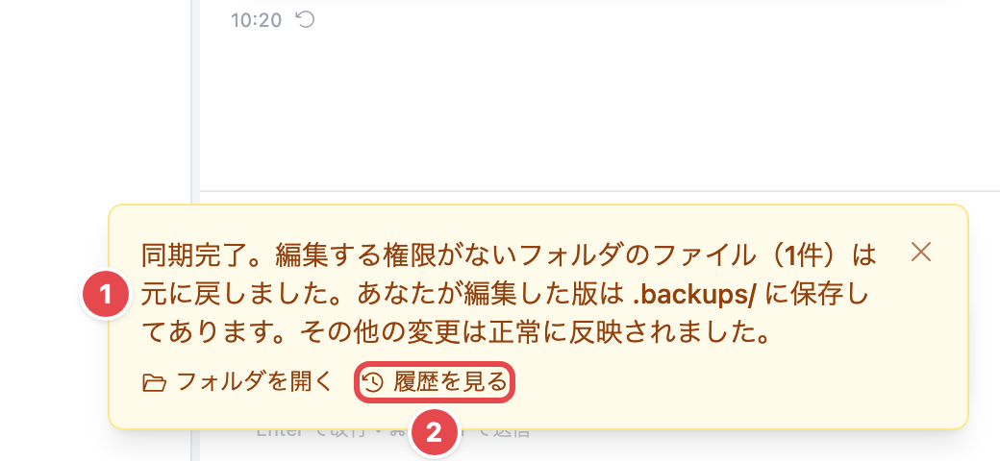
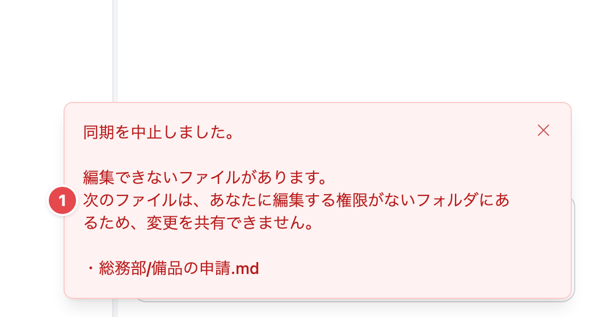
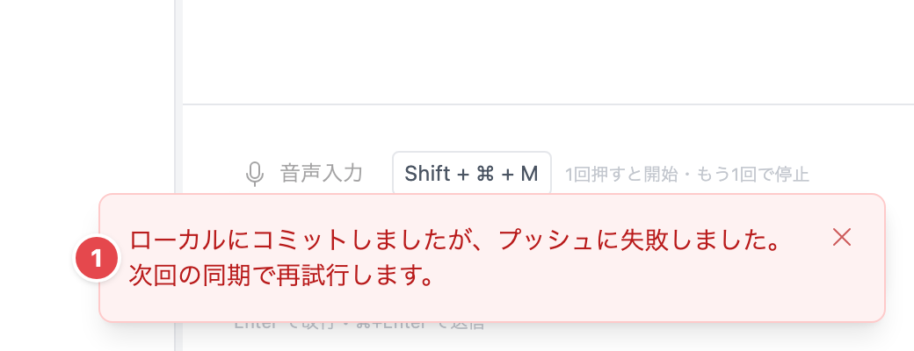
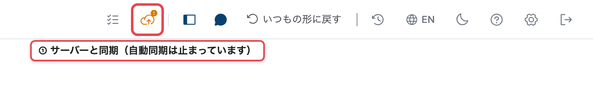

# 14章　同期が止まったとき

## はじめに

前の章の最後に、こんな疑問が残りました。

「同期の途中で、見慣れない確認の画面が出たら？　赤い知らせが出たら？　何をすればいいの？」

アプリを使っていて、突然「エラーが発生しました」と出て、何をすればいいのか分からず手が止まったこと、ありますよね。何か壊してしまったのでは、と不安にもなります。

まず、いちばん大事なことを言っておきます。**同期が止まっても、あなたが直したファイルは PC に残っています。** ACB は、うまく進められないときは、あなたのファイルをそのままにして止まるように作られています。

この章では、同期が止まったり、確認を求めてきたりする場面と、そのときにすることを見ていきます。全部を覚える必要はありません。困ったときに、この章を開いてください。

### この章で分かること

- 同期が確認を求めてくる場面と、選ぶボタン
- 赤い知らせが出たときにすること
- 自動の同期が止まっているときの見分け方

---

## 止まる場面と、することの早見表

まずは早見表です。

1〜3は、同期の途中で出る Mac の確認の画面です。4と5は、同期が終わったあと、画面の右下に出る知らせです。ひとつずつ見ていきましょう。

Mac の確認の画面は、この取説の写真には入れていません。出てくる題名とボタンの名前は、早見表と下の説明のとおりです。

---

## 1. 「ほかのアプリで開いているファイルがあります」

ほかの人が直したファイルを、あなたが Excel などのアプリで開いたままにしていると、この確認が出ます。

開いたまま新しい中身に置き換えると、そのアプリが古い中身で保存したときに、ほかの人の変更が消えてしまいます。それを防ぐための確認です。

［同期をやめる（おすすめ）］を押してください。何も変わらずに同期が止まります。そのファイルを Excel などで閉じてから、もう一度［サーバーと同期］を押しましょう。

もうひとつのボタン［閉じたので続ける］は、本当にファイルを閉じたあとだけ選んでください。

---

## 2. 「ファイルの削除を検出」

あなたの PC でファイルを消していると、この確認が出ます。同期すると、そのファイルは**みんなの PC からも消えます**。

- 消してよければ、［削除を含めて同期］を押します。
- うっかり消していたなら、［削除を取り消して同期］を押します。ファイルが元に戻ってから同期されます。

迷ったときは［削除を取り消して同期］を選びましょう。消すのは、あとからでもできます。

---

## 3. 「編集できないファイルがあります」

会社のフォルダには、読めるけれど書けないフォルダがあります（15章で見ます）。そこにあるファイルを直してしまうと、その変更は会社に送れません。このとき、この確認が出ます。

［元に戻して残りを同期］を押してください。書けない場所のファイルだけが会社の版に戻り、ほかの変更はふつうに会社に届きます。終わると、黄色の知らせが出ます。

①にあるとおり、**あなたが直した版は、バックアップ履歴に取っておいてあります**（②の［履歴を見る］で開けます。見方は13章と同じです）。そのフォルダのファイルを直したいときは、管理者に頼みましょう。

確認の画面で［キャンセル］を押すと、何も変えずに同期が止まり、赤い知らせが出ます。

①に、どのファイルが原因なのかが書いてあります。この場合、ほかの変更もまだ会社に届いていません。次に［サーバーと同期］を押すと、同じ確認がまた出ます。

AI の設定のファイルなど、管理者だけが変えられるファイルを直したときは、「管理者だけが変更できるファイル」という題名で、同じ確認が出ます。ボタンの名前は［サーバーの状態に戻して同期する（推奨）］ですが、することは同じです。

---

## 4. 赤い知らせ「…サーバーに届けられませんでした」

インターネットにつながっていなかったり、会社のサーバーにつながらなかったりすると、同期のあとにこの知らせが出ます。

あなたの変更は、この PC に取ってあります。会社にはまだ届いていません。

直したものがないときに同期して、サーバーにつながらなかったときは、「サーバーにつながらなかったため、同期できませんでした。このPCの内容はそのまま残っています。…」と出ます。どちらも、PC の中身はそのままです。

インターネットにつながっているかを確かめてから、もう一度［サーバーと同期］を押しましょう。

---

## 5. それ以外の赤い知らせ

上のどれにも当てはまらない赤い知らせが出たら、**ファイルを消したり、直したりせずに**、その画面をそのまま管理者に見せてください。画面の写真を撮って送るのもよい方法です。

慌ててファイルを消したり、別の場所にコピーし直したりすると、かえって元に戻しにくくなります。あなたのファイルは PC に残っていて、ACB が取っておいた版はバックアップ履歴にあります。落ち着いて、相談しましょう。

---

## 自動の同期が止まっているとき

11章で見た「自動で受け取る」や「自動で送る」は、あなたに確認が必要なことが残っていると、止まって待ちます。そのときは、［サーバーと同期］の絵がオレンジ色になり、小さな「!」の印がつきます。

この印を見たら、［サーバーと同期］を押してください。上の確認の画面が出たら、この章のとおりに選びます。同期が終われば、自動の同期もまた動き始めます。

---

## まとめ

- 同期が止まっても、あなたが直したファイルは PC に残っています。
- Excel などで開いたままのファイルがあるときは、［同期をやめる（おすすめ）］を押し、閉じてからもう一度。
- ファイルを消したときは、消してよければ［削除を含めて同期］、うっかりなら［削除を取り消して同期］。
- 書けない場所のファイルを直したときは、［元に戻して残りを同期］。あなたの版はバックアップ履歴に残ります。
- 「…サーバーに届けられませんでした」「…同期できませんでした」は、サーバーにつながらなかったという意味です。つながってからもう一度。
- それ以外の赤い知らせは、画面をそのまま管理者に見せましょう。
- ［サーバーと同期］がオレンジ色で「!」がついていたら、ボタンを押しましょう。

## やってみよう

1. 早見表の写真を、すぐに開けるようにしておきましょう（このページをブックマークするのもおすすめです）。
2. ［サーバーと同期］にマウスを乗せて、出てくる文を読んでみましょう。自動の同期が一度動いたあとなら、最後に動いた時刻も出ます。

---

「編集できないファイル」という言葉が出てきました。会社のフォルダには、書けない場所があるようです。

では、書けないフォルダは、どうやって見分ければいいのでしょうか？　ファイルの一覧に出てくる「未ダウンロード」や鍵の印は、何を意味しているのでしょうか？
