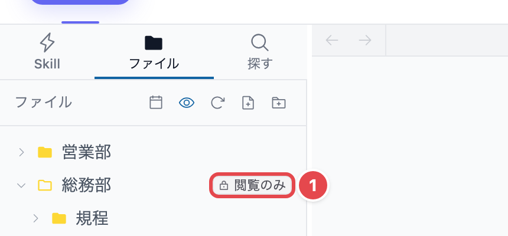
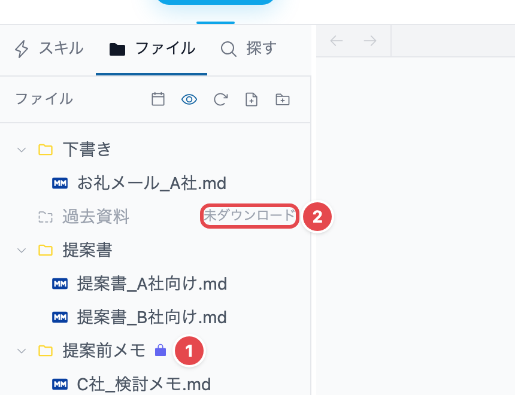
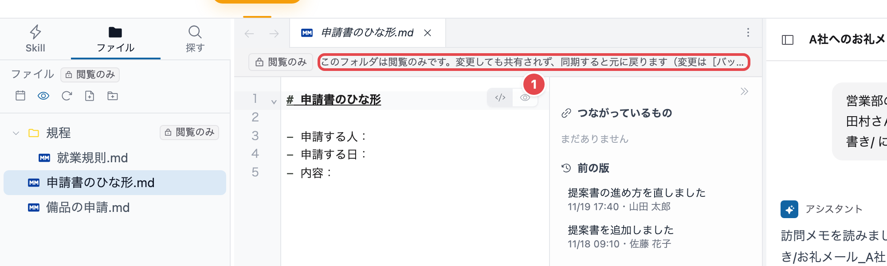
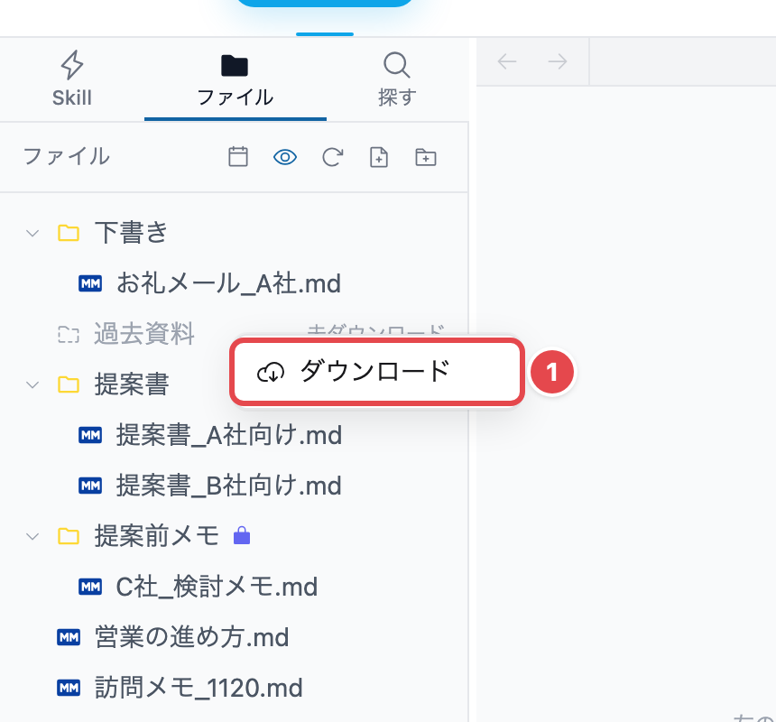
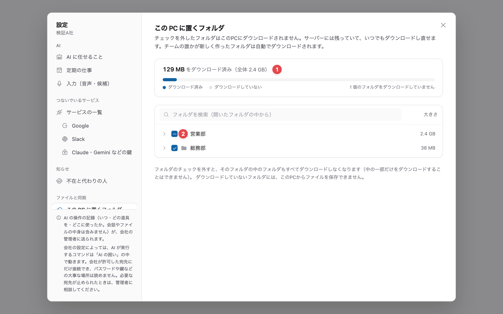
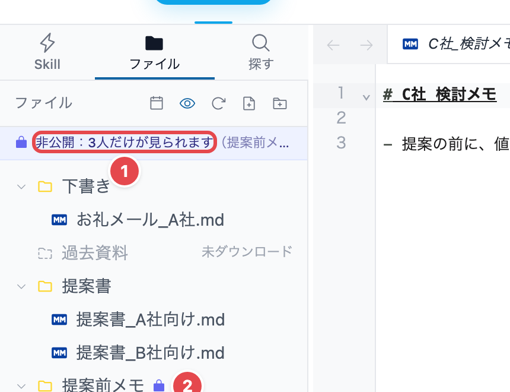
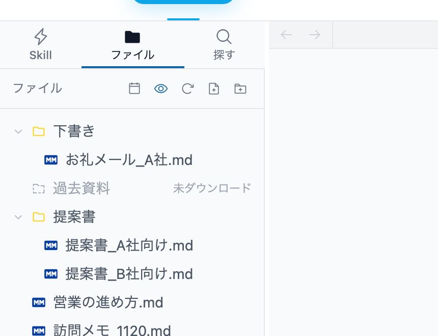

# 15章　フォルダの見え方

## はじめに

前の章の最後に、こんな疑問が残りました。

「書けないフォルダは、どうやって見分けるの？　『未ダウンロード』や鍵の印は、何を意味しているの？」

Google ドライブの共有フォルダを思い出してみてください。「閲覧者」として招かれたフォルダは、開いて読めても、直すことはできませんでしたね。そもそも招かれていないフォルダは、一覧に出てきすらしません。

ACB の会社フォルダにも、同じように「読めるけれど書けない」フォルダや、「決まった人だけが読める」フォルダがあります。ファイルの一覧には、それを見分けるための印がついています。

### この章で分かること

- ファイルの一覧に出る3つの印（閲覧のみ・未ダウンロード・鍵）の意味
- 印のついたフォルダで、できることとできないこと
- ほかの人のフォルダが一覧に出てこない理由

---

## 印は3つです

3章で総務部をダウンロードした山田さんの「ファイル」タブを見てみましょう。

まずは「全社」のタブです。総務部のフォルダの右に［閲覧のみ］（①）の印がついています。

次に「営業部」のタブです。

「提案前メモ」には鍵の印（①）、「過去資料」には［未ダウンロード］（②）の印がついています。

この3つの印の意味を、順番に見ていきましょう。

---

## ［閲覧のみ］ — 読めるけれど、書けないフォルダ

［閲覧のみ］は、Google ドライブの「閲覧者」と同じです。**中のファイルは開いて読めますが、あなたの変更は会社に送れません。** 山田さんの会社では、総務部の規程や申請書のひな形は、総務部の人だけが直せるようになっています。

このフォルダのファイルを開くと、上にお知らせの帯（①）が出ます。

帯にあるとおり、ここでは文字を打てても、その変更は会社に届きません。同期すると、14章の「編集できないファイルがあります」の確認が出て、会社の版に戻ります。あなたが打った中身は、バックアップ履歴に取っておかれます。

ひな形を使って申請書を書きたいときは、中身を写して、自分の部署のフォルダに新しいファイルを作りましょう（5章）。ひな形そのものを直したいときは、そのフォルダの管理者に頼みます。

AI に頼んだときも同じです。AI も、［閲覧のみ］のフォルダのファイルは直さないようになっています。

---

## ［未ダウンロード］ — あなたの PC に入れていないフォルダ

3章で見たとおり、ACB は会社のファイルを全部 PC に入れるわけではありません。［未ダウンロード］は、**サーバーにはあるけれど、あなたの PC には入れていない**フォルダの印です。

名前は見えますが、中身は PC にないので開けません。中に新しいファイルを作ることもできません（作ろうとすると、ACB が止めます）。

中身が必要になったら、そのフォルダを右クリックして［ダウンロード］（①）を選びます。マウスを乗せたときに出る［ダウンロード］を押しても同じです。

インターネットにつながっていれば、そのフォルダが PC に入り、ふつうのフォルダになります。

どのフォルダを PC に入れるかを、まとめて見直すこともできます。タイトルバーの右はしのあなたの丸から［設定］を開いて、左の「ファイルと同期」の［この PC に置くフォルダ］を選びます。

①に、PC に入れた量と、会社全体の量が出ます。下の一覧では、チェックの入ったフォルダが PC に入っています。②の営業部は、中の一部（過去資料）だけを入れていないので、チェックの箱が「ー」になっています。左の矢印を押すと、中のフォルダとそれぞれの大きさが見られます。

チェックを付けたり外したりしたら、下に出る［適用］を押すと、そのとおりになります。外したフォルダは PC から消えますが、サーバーには残っていて、いつでも入れ直せます。まだ同期していない変更があるフォルダを外そうとしたときは、先に確かめる画面が出ます。

---

## 鍵の印 — 決まった人だけが読める「非公開」のフォルダ

鍵の印は、**決まった人だけが読める「非公開」のフォルダ**の印です。たとえば、まだ社内に広めたくない提案前の検討メモを、営業部の数人だけで持っておく、というときに使います。

このフォルダの中を開くと、ファイルの一覧の上に、何人が読めるのかが出ます（①）。

①の帯にマウスを乗せると、読める人の名前が出ます。ここに入れたファイルは、この人たちにだけ届きます。

では、このフォルダを読めない人の画面はどうなっているのでしょうか。同じ営業部のフォルダを、読めない人の画面で見てみます。

「提案前メモ」は、一覧に出てきません。名前も見えません。

**読めない非公開のフォルダは、一覧に名前も出ません。それで正常です。** もし「〇〇さんが話していたフォルダが見当たらない」と思ったら、それは非公開のフォルダかもしれません。読む必要があるときは、管理者に頼みましょう。

---

## まとめ

- ［閲覧のみ］：読めるけれど、書けないフォルダ。直しても会社には届かず、同期すると会社の版に戻ります。直したいときは、そのフォルダの管理者に頼みます。
- ［未ダウンロード］：サーバーにはあるけれど、PC に入れていないフォルダ。右クリックの［ダウンロード］で入れられます。まとめて見直すときは［設定］の［この PC に置くフォルダ］。
- 鍵の印：決まった人だけが読める非公開のフォルダ。中を開くと、何人が読めるのかが出ます。
- 読めない非公開のフォルダは、一覧に名前も出ません。それで正常です。

## やってみよう

1. 「全社」のタブを開いて、［閲覧のみ］の印がついたフォルダがあるか探してみましょう。
2. ［未ダウンロード］のフォルダがあれば、右クリックして［ダウンロード］が出ることを確かめてみましょう（押すのは、必要なときだけで大丈夫です）。
3. ［設定］の［この PC に置くフォルダ］を開いて、PC に入れている量を見てみましょう。

---

これで、ファイルの扱い方はひととおり分かりました。直して、確かめて、同期する。困ったときの戻し方も、フォルダの印の意味も分かりましたね。

最後に、1日目にできるようになったことを振り返っておきましょう。明日からは、何を続ければいいのでしょうか？　困ったときは、どうすればいいのでしょうか？
