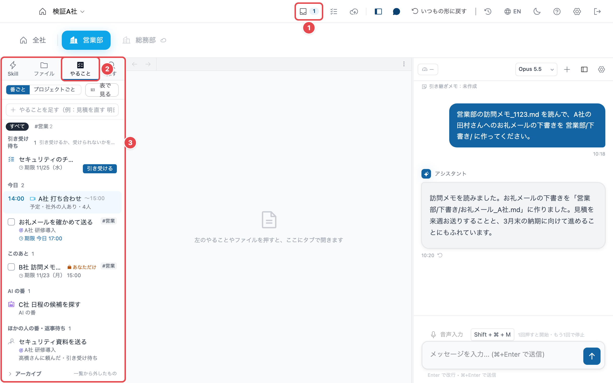
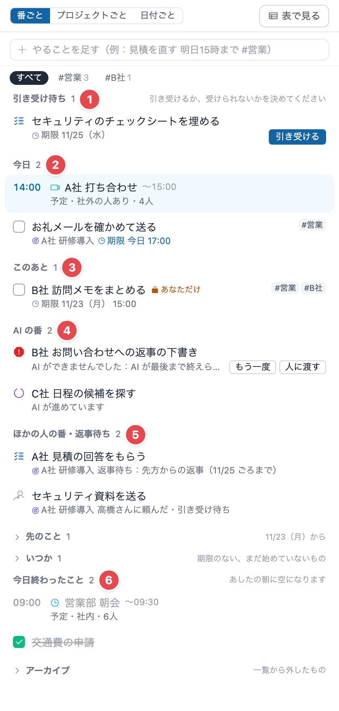
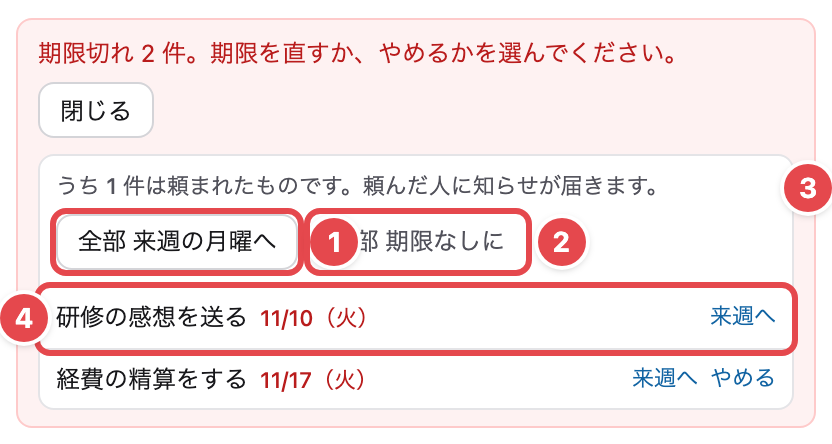
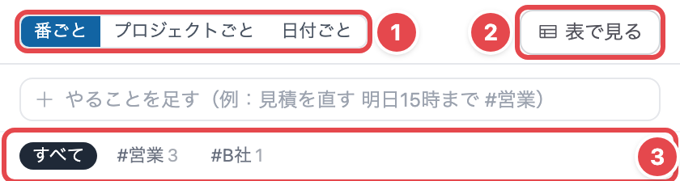
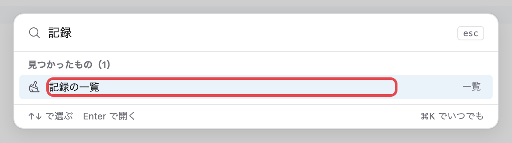
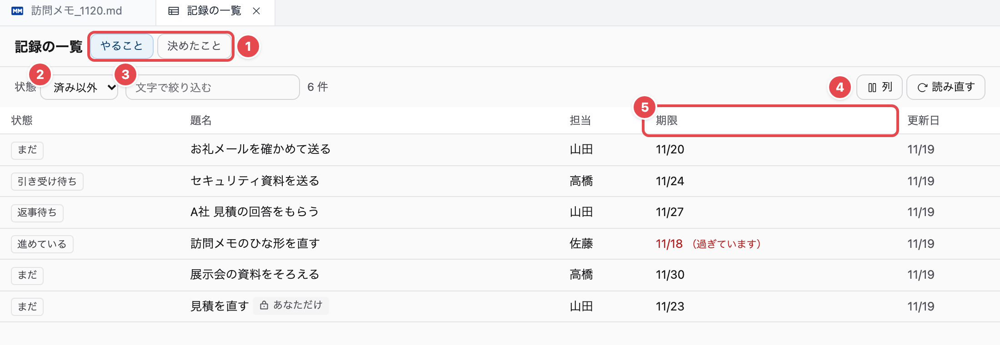
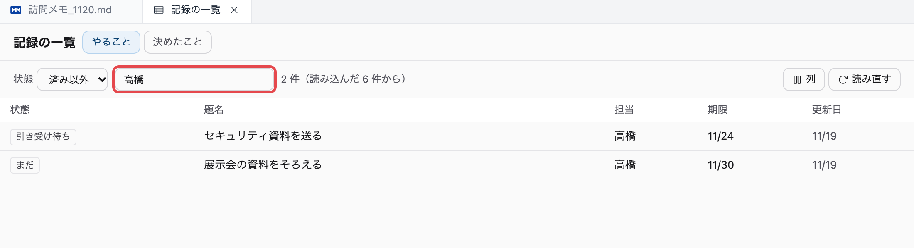

# 17章　朝はここを見る：やることの一覧

## はじめに

1日目のまとめで、こんな話をしましたね。「明日からは、AI と一緒に、あなたの仕事を少しずつ ACB に移していきましょう」。

2日目の朝です。アプリを開きました。……さて、最初にどこを見ればいいのでしょうか？

手帳や付箋に「やること」を書いて、机に貼っている人も多いと思います。スマホのアプリは、まだ見ていないものの数を赤い丸で教えてくれますよね。ACB にも、その2つがあります。

**朝に見るのは、2か所だけです。** 上の［受け箱］の数と、左の［やること］です。この章では、この2か所の見方と、やることを表にして見る「記録の一覧」を見ていきます。

### この章で分かること

- 朝、どこを見れば「今日なにをするか」が分かるのか
- やることの一覧の、上から下までの並び方
- やることや決めたことを、表にして並べ替える方法（記録の一覧）

---

## 見るのは［受け箱］の数と［やること］

アプリを開いて、部署のタブ（山田さんなら「営業部」）を選び、左の欄の［やること］を押してみましょう。

①のタイトルバーの［受け箱］には、数が2つ出ます。青い数はまだ見ていない知らせ（新着）、赤い数は **あなたが動くまで止まっているもの（あなた待ち）** の数です。やることそのものは、受け箱では数えません。受け箱の中身は25章でくわしく見ます。

②の［やること］タブを押すと、③にあなたのやることの一覧が並びます。新しく何か来ていると、タブに小さな点がつきます。

> **用語解説：やること**
>
> 「やること」は、ACB の中の付箋のようなものです。自分で書いたもの、人から頼まれたもの、会議のあと AI が案を出したものが、ここに集まります。
>
> 付箋と違うのは、だれの番か・いつまでか・だれに見えているかを ACB が覚えていてくれることです。終わったら印をつけますが、消えずに記録として残ります。

一覧は、部署のタブを切り替えても同じです。あなたのやることは、部署をまたいで1つの一覧に並びます。

---

## 一覧は「だれの番か」で並んでいます

一覧を上から見ていきましょう。

1. **引き受け待ち**（①）— だれかがあなたに頼んで、まだ返事をしていないものです。［引き受ける］か、受けられないかを決めます（20章）。
2. **今日**（②）— 今日が期限の、あなたのやることです。**今日の会議も、時間の順にここに混ざります**（水色の行。会社が Google の予定をつないでいるときだけ。つなぎ方は28章で）。
3. **このあと**（③）— 今週あなたがする、そのほかのことです。期限が近いもの、始めているもの、押すものが待っているものが並びます。
4. **AI の番**（④）— AI が下準備をしているものです（21章）。
5. **ほかの人の番・返事待ち**（⑤）— あなたが人に頼んだもの、相手の返事を待っているものです（20章）。
6. **今日終わったこと**（⑥）— 今日、印をつけたものと、終わった会議です。あしたの朝に空になります。

その下に、たたまれた「先のこと」と「いつか」があります。「先のこと」は、期限が来週以降で、まだ始めていないもの。「いつか」は、期限がなく、まだ始めていないものです。急がないものに気を取られないように、しまってあるのです。押すと開きます。

### 期限切れは1行にまとまります

期限を過ぎたやることがあると、「今日」の上に「期限切れ N 件。期限を直すか、やめるかを選んでください。」と1行だけ出ます。赤い行がたくさん並んで、今日することが見えなくなるのを防ぐためです。

［まとめて直す…］を押すと、①［全部 来週の月曜へ］、②［全部 期限なしに］、④1件ずつの［来週へ］［やめる］が出ます。［やめる］は、自分で足したやることにだけ出ます（アーカイブに移ります）。人から頼まれたやることが入っているときは、③のように「うち N 件は頼まれたものです。頼んだ人に知らせが届きます。」と、押す前に出ます。押したあとは［元に戻す］で戻せます。

いちばん下の「アーカイブ」は、一覧から外したものの置き場です（18章）。

> **会社によっては、［やること］の代わりに［確かめること］が出ます**
>
> 会社が「やることの一覧」を使っていないと、左の欄に［やること］がなく、［確かめること］という小さな一覧が出ます。そこには、今日の予定、届いた議事録、承認のお願い、AI が用意したもの、確かめてほしい決めたことだけが並びます。押し方は、この取説と同じです。

---

## 並べ方を変える・タグで絞る

一覧のいちばん上では、並べ方を変えたり、絞り込んだりできます。

- ①の並べ方は、［番ごと］（いま見た並び）、「プロジェクトごと」（22章）、［日付ごと］（期限切れ・今日・明日・今週…の順）から選べます。部署によっては「案件ごと」のような名前で出ます。
- ③のタグを押すと、そのタグのついたやることだけになります。［すべて］で元に戻ります。
- ②の［表で見る］は、このあと「記録の一覧」で見ます。

---

## 表にして見る：記録の一覧

やることが増えてくると、「高橋さんの分だけ、期限の順に並べたい」「期限を過ぎているものはどれ？」と思うことがありますね。Excel の表なら、並べ替えや絞り込みですぐ分かります。

ACB にも、同じように表で見る画面があります。それが **「記録の一覧」** です。

### 開き方は2つ

- やることの一覧の上の［表で見る］を押します。真ん中に「記録の一覧」のタブが開き、やることが表で並びます。
- どの画面からでも、⌘K を押して「記録」と打ち、「記録の一覧」を選びます。

### 表の見方

1. **種類**（①）— 何の表にするかを選びます。やること、決めたこと、プロジェクト、会議など、会社が使っているものが並びます。
2. **状態**（②）— はじめは「済み以外」で、終わっていないものだけが出ます。「すべて」にすると、終わったものも出ます。
3. **文字で絞り込む**（③）— 題名や担当の名前などで絞り込めます。
4. **［列］**（④）— 表に出す列を選びます。はじめは、担当・期限などがいくつか出ています。
5. **見出し**（⑤）— 押すたびに、小さい順 → 大きい順 → 元の順（新しく変わったものが上）に並び替わります。

期限を過ぎて終わっていないものは、赤い字で「（過ぎています）」と出ます。行を押すと、そのやることのカードが隣のタブで開きます。

たとえば山田さんが「高橋」と打つと、高橋さんが担当のものだけが残ります。

### 知っておくと安心なこと

- **表に出るのは、あなたが見られるものだけです。** 人の「あなただけ」のやることは出ません。あなたの「あなただけ」のものには、その印がつきます。
- 一度に読むのは 200 件までです。もっとあるときは、表の下の［さらに読む］で続きを読みます。並べ替えと絞り込みは、読み込んだ分の中で行います。
- 表の並べ方や絞り込みは、アプリを閉じると元に戻ります。困ったら［読み直す］を押せば、いまの中身を読み直します。

**一覧は「今日なにをするか」、表は「全体を見渡す」。** 毎朝は一覧、週に一度の見直しや「あれ、どうなった？」のときは表、と使い分けると便利です。

---

## 山田さんの朝

山田さんがアプリを開くと、［受け箱］には青い 3 と赤い 1 が出ていました。［やること］を開くと、引き受け待ちに佐藤さんから頼まれた「セキュリティのチェックシートを埋める」が1件。「今日」には、14時の A社との打ち合わせと、今日が期限の「お礼メールを確かめて送る」が並んでいます。

今日はまず、チェックシートを引き受けるかどうかを決めて、お礼メールを確かめれば大丈夫そうです。

---

## まとめ

- 朝に見るのは、上の［受け箱］の数と、左の［やること］の2か所です。
- ［受け箱］の青い数は新着、赤い数はあなた待ちです。やることは受け箱では数えません。
- やることの一覧は、引き受け待ち → 期限切れ（1行）→ 今日 → このあと → AI の番 → ほかの人の番・返事待ち → 今日終わったこと の順に並びます。今日の会議も時間の順に混ざります。
- 期限切れは［まとめて直す…］で、来週の月曜へ動かすか、期限なしにするか、1件ずつやめられます。
- 「先のこと」「いつか」は、たたまれています。
- ［表で見る］か ⌘K の「記録の一覧」で、やることや決めたことを表にして並べ替え・絞り込みができます。

## やってみよう

1. ［やること］を開いて、「今日」に何件あるか数えてみましょう。
2. 並べ方を［日付ごと］に変えて、期限の近い順に見てみましょう。
3. ［表で見る］を押して、「期限」の見出しを押して並べ替えてみましょう。

---

一覧の見方は分かりました。

では、思いついたことを書き足したいときは、どうすればいいのでしょうか？　終わったら、どうやって消すのでしょうか？
