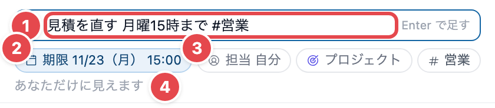
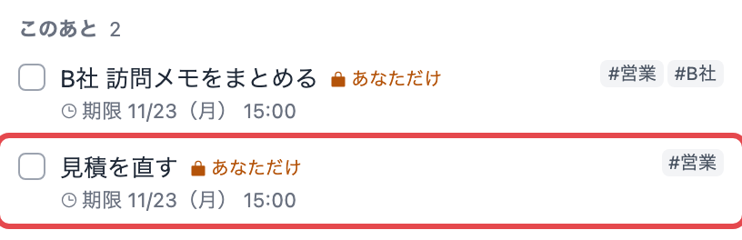
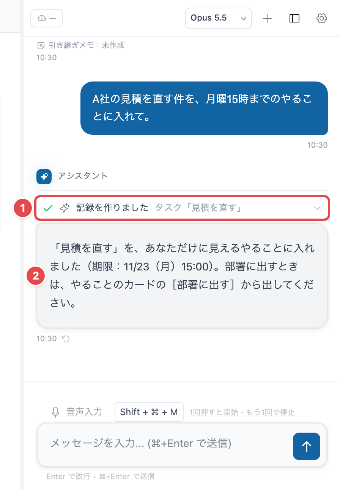
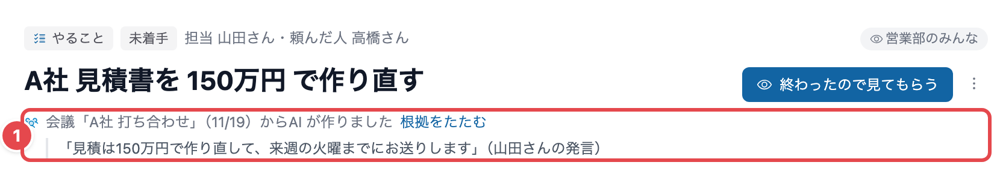
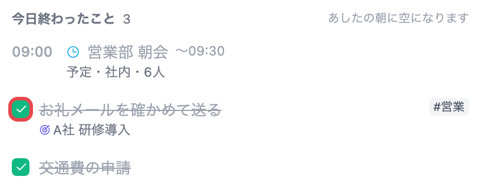
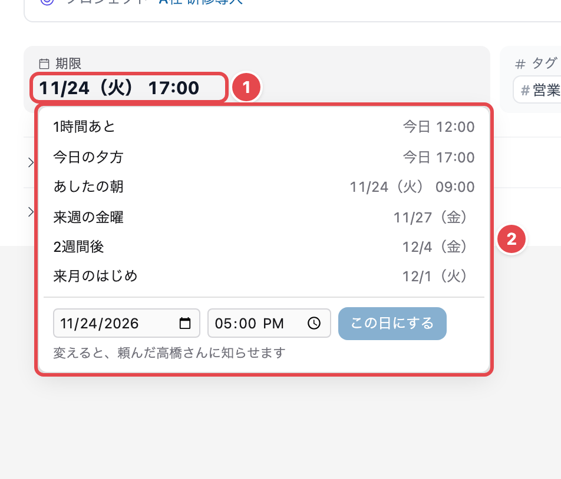
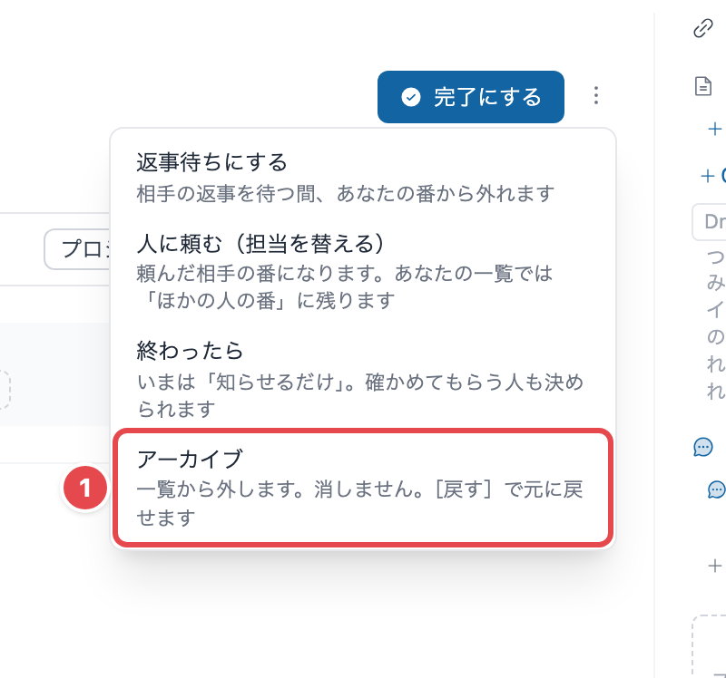
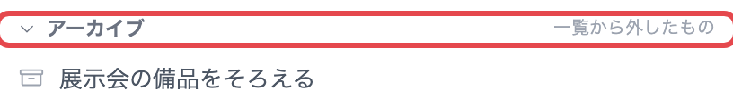

# 18章　やることを足す・終わらせる

## はじめに

前の章の最後に、こんな疑問が残りました。

「思いついたことを書き足したいときは？　終わったら、どうやって消すの？」

付箋なら、ペンで書いて貼り、終わったら線を引いて捨てますね。スマホのリマインダーなら、「明日 15時」と書くだけで日時が入ります。

ACB のやることも、同じくらい手軽です。しかも、**一度書いたやることは消えずに残るので、間違えても元に戻せます。**

### この章で分かること

- やることを1行で足す方法、AI に頼んで足してもらう方法
- 終わったときの印のつけ方と、取り消し方
- 期限を変える方法、要らなくなったときの片づけ方

---

## 1行で足す

やることの一覧のいちばん上に、「やることを足す」と書かれた1行があります。ここに、ふつうの言葉で書きます。

山田さんは、A社の訪問のあとで「見積を直す 月曜15時まで #営業」と書きました。

1. ①に書くと、ACB が言葉を読み取ります。
2. 「月曜15時まで」は、②の［期限］に「11/23（月）15:00」として入りました。「今日」「明日」「あさって」「来週の金曜」「12/1」「15時半」のような書き方が分かります。
3. 「#営業」は、タグになりました。タグは、あとで一覧を絞り込むときに使えます。打っている途中で、AI が合いそうなタグの候補を出すこともあります。押したときだけ付きます。
4. ③の［担当 自分］は、だれがやるかです。人に頼むときはここを変えます（20章）。
5. ④のとおり、自分で足したやることは「あなただけ」に見えます（19章）。

Enter を押すと、期限に合わせて「今日」か「このあと」に足されます。

分からなかった言葉は、そのまま題名に残ります。期限やタグは、あとからカードで直せます。

---

## AI に頼んで足してもらう

「AIへの相談」で話しているときに、「これ、やることに入れておいて」と頼むこともできます。

①の行は、AI がやることを作ったしるしです。②のように、AI が「あなただけに見えるやることに入れました」と教えてくれます。AI が作ったやることも、はじめは「あなただけ」です。

会議の議事録や、届いたメールから AI が作ったやることには、どこから来たかが書いてあります。

①の［根拠を見る］を押すと、AI が何を読んでこのやることを作ったのかが出ます。思っていたのと違うときは、ここを確かめましょう。

---

## 終わったら、印をつける

付箋に線を引くように、終わったやることには印をつけます。

一覧の行の左の □ を押すと、そのやることは「今日終わったこと」に移り、線が引かれます。

まちがえて押したときは、緑のチェック（枠で囲んだところ）をもう一度押します。「やり直す」になって、元の場所に戻ります。

やることの行を押すと、真ん中にそのやることのカードが開きます。カードの右上の［完了にする］を押しても同じです。完了にすると、そのカードのタブは閉じます。

### 一覧から次々片づける

一覧を左に出したまま、カードを1件ずつ片づけていけます。

- カードの上に「3 / 11」のように、一覧の何件目かが出ます。
- 一覧の行を押したあと、キーボードの ↓（または j）で次の件、↑（または k）で前の件のカードに替わります。
- Enter でカードの中に移り、Esc で一覧の行に戻ります。どこまで見たかは覚えているので、行き来しても迷いません。
- いま見ているやることを完了にすると、一覧の次の件のカードが出ます。一覧の上に「『…』を片づけました。次の件です」と出て、［取り消す］で元に戻せます。最後の件を片づけると、そう出てカードが閉じます。

プロジェクトのカードの「みんなのやること」でも同じです。行を押すと、プロジェクトの横にそのやることのカードが出ます（22章）。

> **用語解説：カード**
>
> やることや会議の記録を開いたときに、真ん中に出る画面を、この取説では「カード」と呼びます。題名、期限、だれの番か、つながっているファイルなどが1枚にまとまっています。カードの右上のボタンが、いま押すべきことです。ほかの操作は、その横の「…」に入っています。

カードで何かを押したあとは、たいてい［取り消す］が出ます。押してすぐなら、それで元に戻せます。

---

## 期限を変える

「今日はできそうにない」というときは、カードの期限の日付そのものを押します。その場に、日付を選ぶ小さな枠が開きます。

「1時間あと」「今日の夕方」「あしたの朝」「来週の月曜」などから選ぶだけです。土日や会社の休みの日に当たるときは、次の営業日になります。下のカレンダーで日付を選んだり、打ちこんだりもできます。前倒しにすることも、時刻を入れることもできます（時刻はなくてもかまいません）。人から頼まれたやることなら、変えたことは頼んだ人にも知らされます。

---

## 要らなくなったら、アーカイブ

予定が変わって、やることそのものが要らなくなることもありますね。そのときは、カードの「…」を開いて［アーカイブ］を押します。

**アーカイブは、消すことではありません。** 一覧から外して、しまっておくだけです。

しまったものは、一覧のいちばん下の「アーカイブ」を押すと見られます。

行を押してカードを開き、［戻す］を押せば、元に戻ります。ここに出るのは、この30日にしまったものです。それより前のものも消えてはいません。左の欄の「探す」で見つかります。

---

## ファイルをつなぐ

見積のファイルや訪問メモなど、そのやることで使うファイルは、カードにつないでおけます。カードの右側の「つながっているもの」の［ファイル・フォルダをつなぐ］を押して選ぶか、左のファイルの一覧からカードにドラッグします。

「あなただけ」のやることなら、［新しいファイル］で、そのやること用のメモを作ることもできます。このメモは、あなたの PC の今日のフォルダに作られ、ほかの人には見えません。

> Google ドライブのファイルをつなぐ方法は、29章で見ます。

---

## 山田さんの場合

訪問から戻った山田さんは、一覧の1行に「見積を直す 月曜15時まで #営業」と書いて Enter を押しました。夕方、お礼メールを送り終えたので、□を押して印をつけました。展示会の備品集めは中止になったので、［アーカイブ］でしまいました。

---

## まとめ

- やることは、一覧のいちばん上の1行に書いて Enter で足せます。期限やタグは、書いた言葉から読み取られます。
- 「AIへの相談」で「やることに入れて」と頼むこともできます。どこから来たかは、カードの［根拠を見る］で確かめられます。
- 終わったら □ か［完了にする］。まちがえたら、緑のチェックをもう一度押すか［取り消す］。
- 期限は日付を押してその場で変えます。要らなくなったら［アーカイブ］で。アーカイブは消しません。［戻す］で戻せます。

## やってみよう

1. 一覧の1行に「明日15時まで」を付けたやることを書いて、［期限］に何が入るか見てみましょう。
2. そのやることのカードを開いて、期限の日付を押し、延ばす先の選択肢を見てみましょう。
3. □ を押して完了にしてから、緑のチェックで元に戻してみましょう。

---

これで、やることを足して、終わらせられるようになりました。

でも、ちょっと気になりますね。自分で足したやることは、ほかの人にも見えているのでしょうか？
