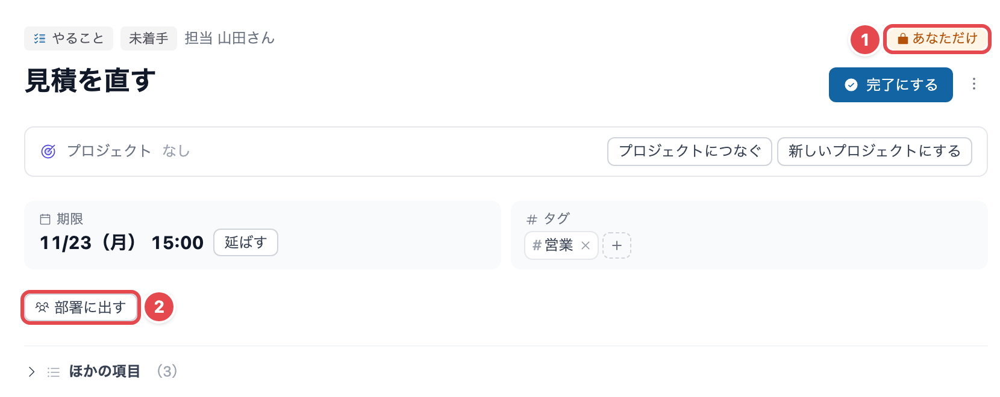
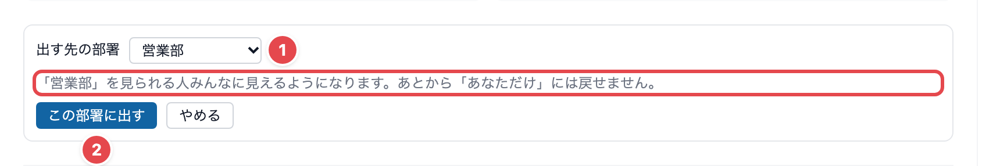
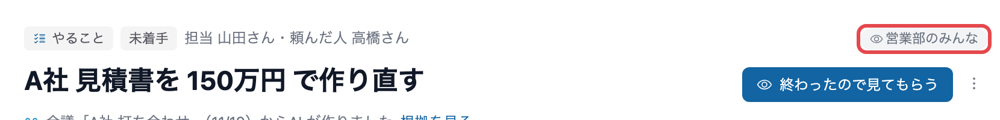

# 19章　だれに見える？：あなただけ・部署に出す

## はじめに

前の章の最後に、こんな疑問が残りました。

「自分で足したやることは、ほかの人にも見えているの？」

手帳に書いたことは、自分しか見ません。でも、会社のホワイトボードに書けば、みんなに見えます。「見積を直す」くらいなら見られてもかまいませんが、「◯◯さんに相談する（気が重い）」のようなメモは、あまり見られたくないですよね。

ACB では、**やることのカードの右上を見れば、だれに見えているかが分かります。** この章では、その見方と、部署のみんなに見せる方法を見ていきます。

### この章で分かること

- 自分で足したやることは、だれに見えるのか
- 部署のみんなに見せる方法（部署に出す）
- 人に頼んだやることや、プロジェクトのやることの見え方

---

## 自分で足したやることは「あなただけ」

自分で足したやることのカードを開いてみましょう。

①の右上に「あなただけ」と出ています。これは、**このやることを見られるのは、あなた一人だけ** という意味です。

ここが大事なところです。**「あなただけ」のやることは、上司にも、管理者にも、社長にも見えません。** 手帳と同じです。AI に頼んで足してもらったやることも、はじめは「あなただけ」です。

> **用語解説：見られる人**
>
> カードの右上には、いつも「だれが見られるか」が出ています。たとえば次のような書き方です。
>
> - 「あなただけ」— あなた一人
> - 「営業部のみんな」— 営業部を見られる人みんな
> - 「会社のみんな」— 会社の全員
> - 「『A社 研修導入』の参加者（3人）」— そのプロジェクトの参加者だけ
> - 「N人が見られます」— 会議に出た人など、決まった人たち

あなたの「あなただけ」のファイルを、やることにつないだ場合も、そのファイルの名前はほかの人には出ません。

---

## 部署のみんなに見せる：［部署に出す］

「見積を直す」を、営業部のみんなにも見えるようにしたい。チームで分担したり、上司に進み具合を見てもらったりしたいときですね。

そのときは、カードの②［部署に出す］を押します。

1. ①で、出す先の部署を選びます。選べるのは、あなたが書ける部署だけです。
2. 注意の文を読みます。**一度出したら、あとから「あなただけ」には戻せません。** 出す前に、見られて困ることが書いていないか確かめましょう。
3. ②［この部署に出す］を押します。やめるときは［やめる］です。

出したあとは、カードの右上が「営業部のみんな」に変わります。

部署に出したとき、同じ会議から出た似たやることがすでにあると、ACB が教えてくれます。

同じ仕事なら［まとめる］を押すと、いま出したほうがしまわれ、前からあるほうが開きます。別の仕事なら［このまま］で、両方残ります。どちらを選んでも、もとのやることが消えることはありません。

---

## 人に頼んだやること・プロジェクトのやること

自分で足すやること以外は、はじめから見える人が決まっています。

- **人に頼んだやること**（20章）は、「あなただけ」にはなりません。頼んだ相手が見られないと困るからです。そのとき開いていた部署のタブの部署を見られる人に見えます。
- **プロジェクトにつないだやること**（22章）は、そのプロジェクトを見られる人より広くは見せられません。プロジェクトより多くの人に見えているやることをつなごうとすると、ACB が「プロジェクトと同じ人たちだけに見えるようにしますか？」と聞いてきます。
- 「あなただけ」のやることをプロジェクトにつないだときは、「プロジェクトの人に見せる」で、そのプロジェクトの人たちに見せられます。これも、あとから元には戻せません。

会社全体に見せるのは、そうと選んだときだけです。勝手に会社中に広がることはありません。

---

## 山田さんの場合

山田さんは「見積を直す」を自分用に足しました。右上は「あなただけ」です。あとで、見積の作り直しを高橋さんと分担することになったので、［部署に出す］で営業部に出しました。右上が「営業部のみんな」に変わり、高橋さんにも見えるようになりました。

---

## まとめ

- カードの右上を見れば、だれに見えているかが分かります。
- 自分で足したやることは「あなただけ」です。管理者や社長にも見えません。
- 部署のみんなに見せたいときは［部署に出す］。一度出すと「あなただけ」には戻せないので、出す前に確かめます。
- 人に頼んだやることは、はじめから部署の人に見えます。プロジェクトのやることは、プロジェクトより広くは見せられません。
- 迷ったら「あなただけ」のままで大丈夫です。

## やってみよう

1. 自分で足したやることのカードを開いて、右上が「あなただけ」になっているか確かめましょう。
2. 部署のみんなに見せてもよいやることを1つ選んで、［部署に出す］を開き、注意の文を読んでみましょう（出すかどうかは、あなたが決めてください）。

---

自分のやることの見え方は分かりました。

では、人に仕事を頼むときは、どうすればいいのでしょうか？　頼まれたときは？
