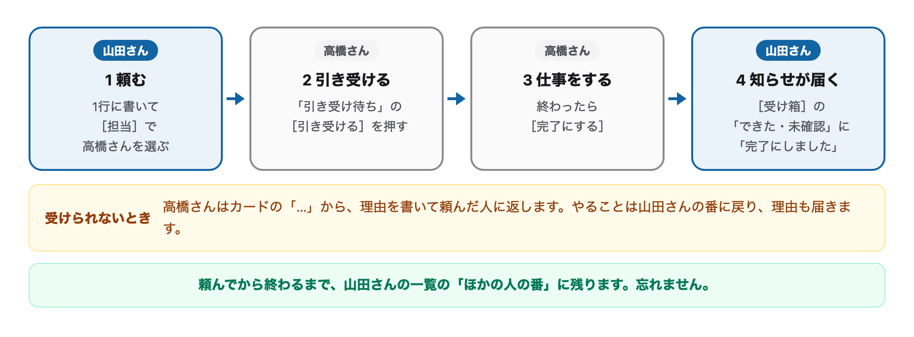
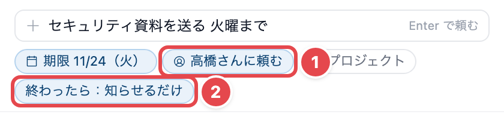
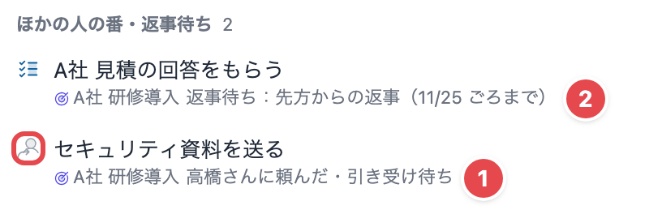
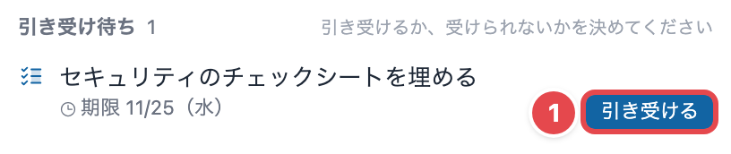
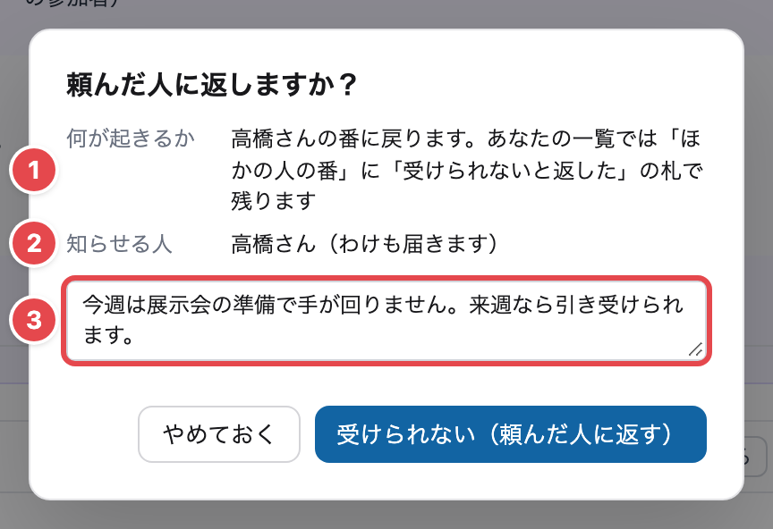
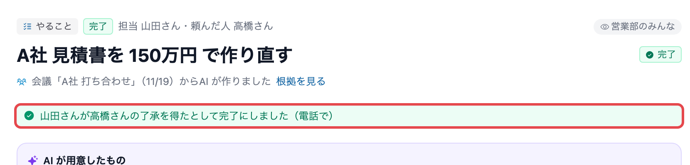
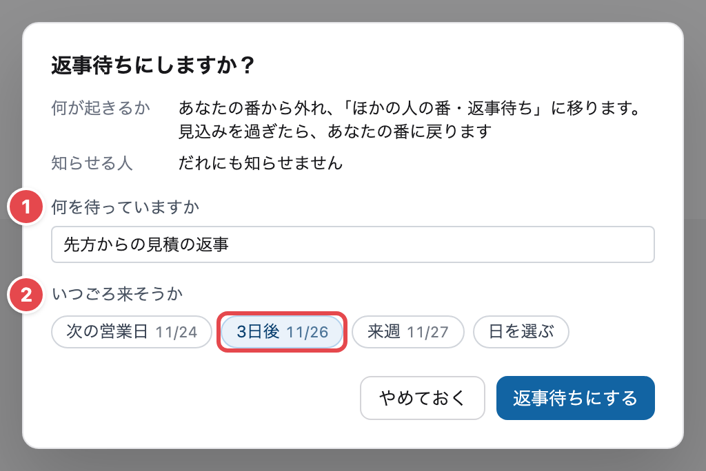
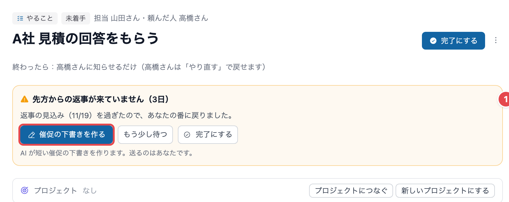
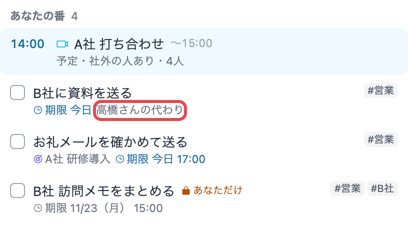

# 20章　人に頼む・頼まれる

## はじめに

前の章の最後に、こんな疑問が残りました。

「人に仕事を頼むときは、どうすればいいの？　頼まれたときは？」

いつもは LINE やメールで「これお願いできますか？」と送り、「了解です」の返事を待っていますね。返事が来ないと気になって、何日かしてから催促します。頼んだことを自分で覚えておくのは、意外と大変です。

ACB で頼むと、**頼んだこと・待っていることを、ACB が覚えていてくれます。** この章では、頼む・頼まれる・返事を待つ、の3つを見ていきます。

### この章で分かること

- 人にやることを頼む方法
- 頼まれたときに、引き受ける・受けられないと返す方法
- 相手の返事を待つときの「返事待ち」と、催促の下書き

---

## 頼む流れを先に見ておきましょう

山田さんが、営業部の高橋さんに「セキュリティ資料を送る」を頼む場合です。

---

## 頼む

やることの一覧の1行に、頼みたいことを書きます。そのあと、下に出る［担当 自分］を押して、頼む相手を選びます。

1. ①が「高橋さんに頼む」に変わりました。Enter を押すと、頼んだことになります。
2. ②の「終わったら」で、終わったときにどうするかを選べます。
   - **知らせるだけ** — 高橋さんが完了にしたら、あなたに知らせが届きます。
   - **確かめてから** — 高橋さんが終えたら、あなたが中身を見てから完了になります。

頼んだやることは、あなたの一覧の「ほかの人の番・返事待ち」に残ります。

①の左の小さな人の印が、「人に頼んだもの」のしるしです。高橋さんが引き受けると、「高橋さんの番」に変わります。

すでにあるやることを人に回したいときは、カードの「…」の［人に頼む（担当を替える）］を使います。

> **頼んだことは、見落としても大丈夫です**
>
> 頼んでから1営業日たっても引き受けられていないと、あなたの［受け箱］に知らせが届きます。期限を過ぎても終わっていないときも、次の朝に知らせが届きます。

---

## 頼まれたら：引き受ける・受けられない

だれかに頼まれると、あなたの［受け箱］に「〇〇さんから「…」を頼まれました」と届き、一覧の「引き受け待ち」に出ます。

- 引き受けるなら、①［引き受ける］を押します。「あなたの番」に移り、頼んだ人に「引き受けました」と知らせが届きます。
- 受けられないときは、カードの「…」から［受けられない（頼んだ人に返す）］を押します。

人の番を動かす操作のときは、ACB が先に①**何が起きるか**と②**知らせる人**を見せてくれます。③に理由を書いて、下の［受けられない（頼んだ人に返す）］を押すと、やることは頼んだ人の番に戻り、理由も届きます。

会社の設定によっては、頼まれた時点で引き受けたことになり、「引き受け待ち」を通らずに「あなたの番」に入ることもあります。

### 終わったら

頼まれたやることが終わったら、カードの［完了にする］を押します。頼んだ人が「確かめてから」を選んでいたときは、ボタンが［終わったので見てもらう］になります。押すと、頼んだ人の番になり、その人が中身を見て完了にします。

> **もっと知る：電話や口頭で OK をもらったとき**
>
> 「確かめてから」のやることで、頼んだ人から電話や口頭で「それで OK です」と言われることもありますね。そのときは、カードの「…」の［完了にする（OK をもらった）］で、だれの OK か（「OK をくれた人」）と、いきさつ（例：電話で）を書いて完了にできます。カードには、そのことがそのまま残ります。
>
> 
>
> OK をくれた人には「あなたの OK で完了にしました」と届き、その人は取り消せます。

---

## 返事を待つ：返事待ちにする

お客さんに見積を出して、回答を待っている。こういう「待ち」の間、やることが「あなたの番」に居座っていると、落ち着きませんね。

そのときは、カードの「…」から［返事待ちにする］を押します。

1. ①に、何を待っているかを書きます（例：先方からの見積の返事）。
2. ②で、返事がいつごろ来そうかを選びます。選ばなければ、3営業日後になります。

やることは「ほかの人の番・返事待ち」に移り、「返事待ち：先方からの見積の返事（11/26 ごろまで）」のように出ます。見込みを変えたいときは、カードの［見込みを変える］を押します。

### 見込みを過ぎたら、あなたの番に戻ってきます

返事が来ないまま見込みの日を過ぎると、ACB がやることを「あなたの番」に戻します。

- 返事が来ていたなら［完了にする］。
- もう少し待つなら［もう少し待つ］で、新しい見込みを選びます。
- 催促するなら［催促の下書きを作る］。新しい「AIへの相談」が開いて、AI が短い催促の下書きを作ります。**送るのは、いつもあなたです。** AI が勝手に送ることはありません。

**だから、待っていることを自分で覚えておかなくても、忘れません。** 戻ってきたときに考えればいいのです。

> AI が作ったメールの送り方は、あとの章で見ます。

---

## 休むとき：代わりの人

あなたが休む日は、代わりの人を決めておけます。休みの間、あなたの番・承認・知らせが代わりの人にも出ます。

代わりを頼まれた人の一覧には、その人の分が「〇〇さんの代わり」と出ます。

代わりの人は、自分の権限のままで動きます。休んでいる人の「あなただけ」のものや、代わりの人が見られないものは、代わりの人にも見えません。承認を代わりにしたときは「〇〇さん（代わりに承認・本来は〇〇さん）」と残ります（23章）。

> 休みの登録のしかた（設定の「不在と代わりの人」）は、あとの章で見ます。

---

## 山田さんの場合

山田さんは、高橋さんに「セキュリティ資料を送る」を頼みました。翌朝、受け箱に「高橋さんが「セキュリティ資料を送る」を引き受けました」と届いていました。A社への見積の回答は［返事待ちにする］で3日後にしました。3日後に戻ってきたので、［催促の下書きを作る］で下書きを作り、読んで直してから送りました。

---

## まとめ

- 頼むときは、1行に書いて［担当 自分］で相手を選び、「終わったら」を決めて Enter。
- 頼んだことは「ほかの人の番・返事待ち」に残り、引き受け・完了・遅れは［受け箱］に届きます。
- 頼まれたら［引き受ける］。受けられないときは「…」の［受けられない（頼んだ人に返す）］で理由を書いて返します。
- 返事を待つときは［返事待ちにする］。見込みを過ぎると「あなたの番」に戻り、［催促の下書きを作る］で AI が下書きを作ります。送るのはあなたです。
- 休むときは代わりの人を決めておけます（くわしくはあとの章で）。

## やってみよう

1. 1行に何か書いて［担当 自分］を押し、頼める人の一覧を見てみましょう（本当に頼むかは、あなたが決めてください）。
2. 自分のやることを1つ開いて、「…」の［返事待ちにする］の窓を開き、選べる日を見てみましょう。

---

一覧には「AI の番」というところもありました。

AI の番って、AI はいったい何をしているのでしょうか？
