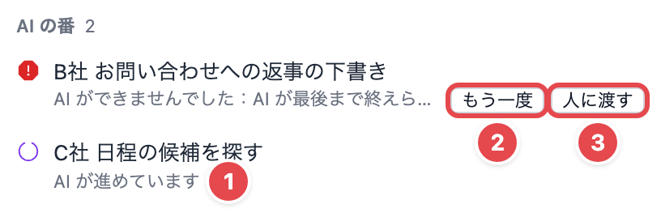
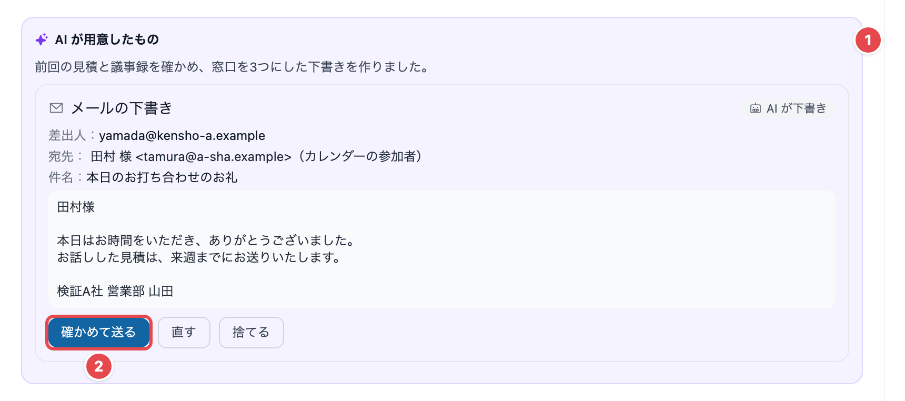
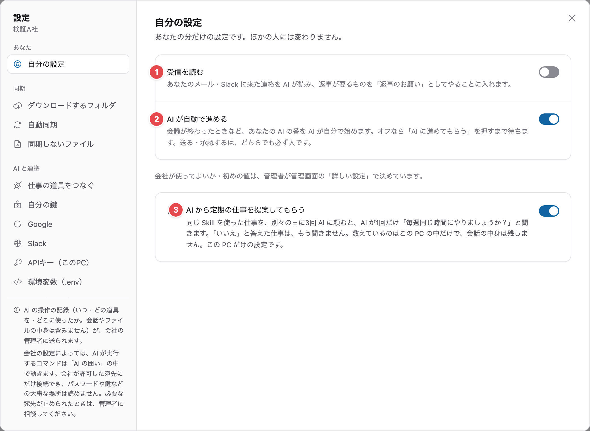
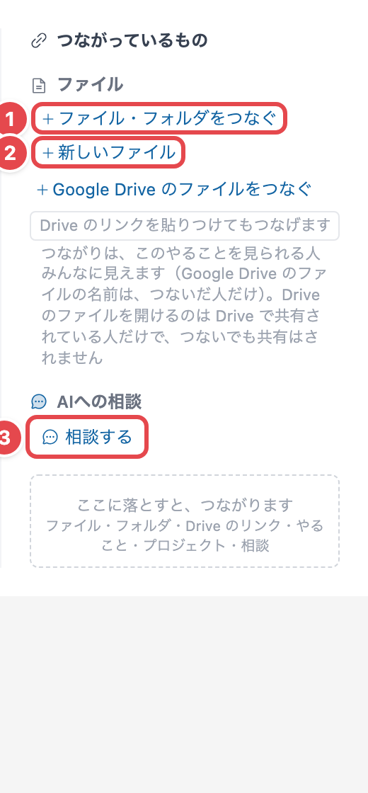

# 21章　AI の番：AI が先に用意してくれる

## はじめに

前の章の最後に、こんな疑問が残りました。

「一覧の『AI の番』って、AI はいったい何をしているの？」

新人さんに下準備を頼むと、資料をそろえて「確認お願いします」と持ってきてくれますね。決めるのは、あなたです。ACB の「AI の番」も、それと同じです。

**AI は用意まで。送る・承認する・完了にする・断るのは、いつも人です。** この章では、AI が先に用意するしくみと、そのやることについて AI に相談する方法を見ていきます。

### この章で分かること

- 「AI の番」で、AI が何をしているのか
- AI が用意したものの受け取り方
- AI が止まったときにすること
- やることについて AI に相談する方法

---

## AI の番に並ぶもの

会議の議事録を読む、来たメールへの返事の下書きを作る、見込みを過ぎた返事の催促の下書きを作る。こういう下準備は、AI が先に始めることがあります。その間、やることは一覧の「AI の番」にあります。

行の下には、AI がいまどうしているかが出ます。

- 「AI が進めています」（①）— いま準備しています。
- 「AI が始める予定です」— 順番を待っています。
- 「AI では始められません」— AI が自動で始められない理由があります（理由が続けて出ます）。
- 「AI ができませんでした」— 最後まで終えられませんでした。理由は「AIへの相談」に残っています。

止まったときは、②［もう一度］で AI にもう一度やってもらうか、③［人に渡す］であなたが引き取ります。期限が近いのに AI の準備が終わらないときは、ACB が待たずに、あなたの番に渡してくれます。

準備ができると、やることは「あなたの番」に移ります。

---

## AI が用意したものは、カードのいちばん上に

AI が用意したやることのカードを開くと、いちばん上に「AI が用意したもの」が並んでいます。

①には、AI が何をしたかのまとめと、作ったもの（ここではお礼メールの下書き）が出ます。中身を読んで、よければ②［確かめて送る］、直したいところがあれば［直す］を押します。

**AI が自分で送ることはありません。** 送るのは、②を押したあなたです。承認のお願いが用意されたときも同じで、決めるのは人です（23章）。

AI の準備を待たずに自分でやりたいときは、カードの［自分で進める］を押します。

> AI が作ったメールを確かめて送る方法は、あとの章でくわしく見ます。

---

## AI の番が動くのは、あなたの PC の中

AI の番は、会社のサーバーではなく、**あなたの PC の ACB の中で** 動きます。だから、アプリを開いているときだけ進みます。

自動で始めるかどうかは、設定の「自分の設定」で決められます。

②の「AI が自動で進める」がオンなら、会議が終わったときなどに、AI が自分で準備を始めます。オフなら、AI は待っています。どちらでも、送る・承認するのは必ず人です。会社がこの機能を止めているときは、オンにできません。

①は25章、③は26章で見ます。

---

## このやることについて、AI に相談する

「このやること、どう進めよう？」と思ったら、カードの右側の［相談する］を押します。一覧の行にマウスを乗せたときに出る吹き出しのボタンでも同じです。

③を押すと、右の「AIへの相談」に、このやることについての相談が開きます。いちばん上に「このやることについての相談：（題名）」と出て、AI はそのやることの中身（期限、だれの番か、つながっているもの、これまでの経緯）を読んでから話を始めます。前に相談したことがあれば、その相談が開きます。新しく始めたいときは［新しい相談］です。

この相談の中で AI が新しく作ったファイルは、自動でこのやることにつながります。返事の中に「『…』をやること「…」につなぎました」と出ます。

相談の途中で、ほかのやることを入力欄にドラッグすると、「『A』の相談を『B』の相談に切り替えますか？」と聞かれます。［切り替える］か［このまま］を選びます。相談の上の札の × を押すと、やることとのつながりを外せます（相談そのものは残ります）。

---

## 山田さんの場合

A社との打ち合わせのあと、AI がお礼メールの下書きを用意してくれました。山田さんはカードの「AI が用意したもの」を読み、1か所だけ直してから、自分で送りました。B社への返事の下書きは「AI ができませんでした」と止まっていたので、［人に渡す］で自分が引き取りました。

---

## まとめ

- 「AI の番」は、AI が下準備をしているやることです。終わると「あなたの番」に来ます。
- AI が用意したものは、カードのいちばん上に並びます。読んでから、送る・承認するのはあなたです。
- 止まったら［もう一度］か［人に渡す］。待たずに自分でやるなら［自分で進める］。
- AI の番は、あなたの PC でアプリが開いているときに動きます。自動で始めるかは「自分の設定」の「AI が自動で進める」で決めます。
- カードの［相談する］で、そのやることについて AI に相談できます。

## やってみよう

1. 設定の「自分の設定」を開いて、「AI が自動で進める」がオンかオフか確かめましょう。
2. やることを1つ開いて［相談する］を押し、「このやることを進める手順を3つに分けて」と頼んでみましょう。

---

ここまでは、一つひとつのやることを見てきました。

でも、研修の導入のように、何人もで進める大きな仕事もありますね。いくつものやることを、1つの仕事としてまとめて見るには、どうすればいいのでしょうか？
