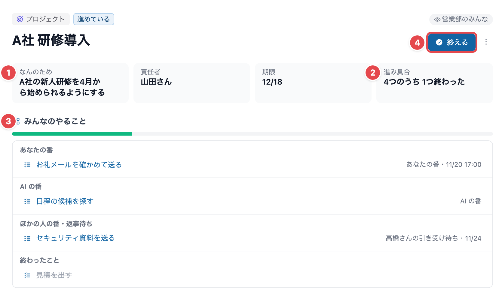
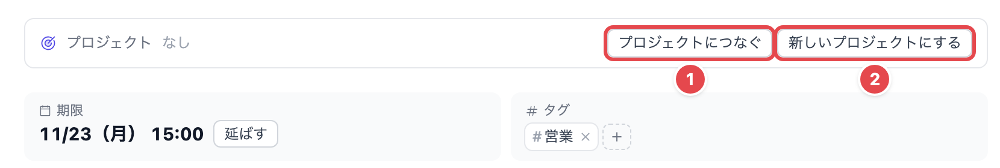
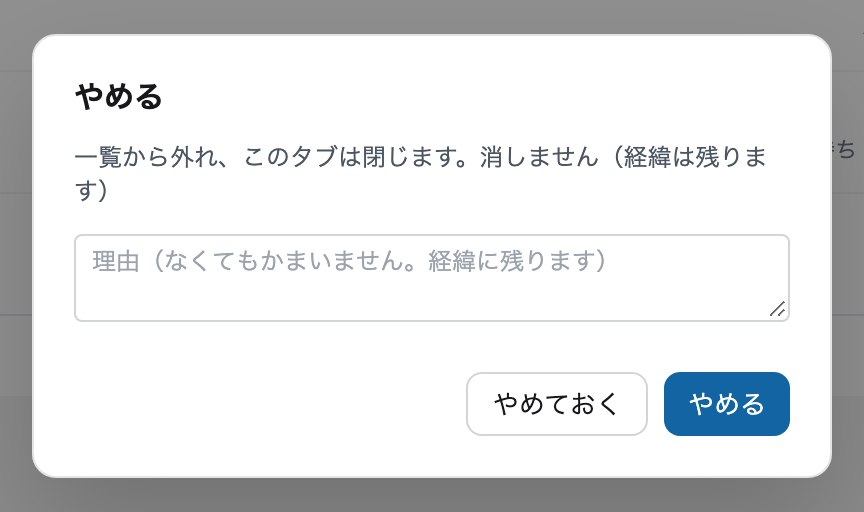

# 22章　プロジェクトでまとめる

## はじめに

前の章の最後に、こんな疑問が残りました。

「いくつものやることを、1つの仕事としてまとめて見るには？」

研修の導入やイベントの準備のような大きな仕事は、フォルダにまとめたり、Excel の進捗表を作って「だれが・何を・どこまで」を書き込んだりしていますね。でも進捗表は、書き直すのを忘れると、すぐ古くなってしまいます。

ACB では、そういう仕事を **プロジェクト** にまとめます。**プロジェクトのカードは、いつも今の進み具合を見せてくれます。** 進捗表を書き直す手間は要りません。

### この章で分かること

- プロジェクトのカードの見方
- やることをプロジェクトにつなぐ方法、新しく作る方法
- プロジェクトを終える・やめる方法

> **部署によって名前が違います**
>
> 部署によっては、プロジェクトが「案件」などの名前で出ます。見方や使い方は同じです。この章では「プロジェクト」と書きます。

---

## プロジェクトのカード

一覧の行の下に出ている小さなプロジェクトの名前（例：「A社 研修導入」）を押すと、プロジェクトのカードが開きます。

1. **なんのため・責任者**（①）— このプロジェクトの目的と、まとめ役の人です。
2. **進み具合**（②）— 「4つのうち 1つ終わった」のように、つながっているやることの何件が終わったかが出ます。
3. **みんなのやること**（③）— このプロジェクトのやることが、だれの番かで並びます。「あなたの番」「AI の番」「ほかの人の番・返事待ち」「終わったこと」です。行を押すと、そのやることが開きます。

右上には、このプロジェクトを見られる人（例：「営業部のみんな」）が出ます。承認のお願いが待っているときは、それもカードに出ます（23章）。

いちばん下の「経緯」を開くと、だれがいつ何をしたかが残っています。

---

## やることをプロジェクトにつなぐ

やることのカードには、プロジェクトの欄があります。まだどこにもつながっていないときは、こう出ます。

- ①「プロジェクトにつなぐ」— すでにあるプロジェクトから選んでつなぎます。
- ②「新しいプロジェクトにする」— このやることから、新しいプロジェクトを作ります。名前と、どの部署のプロジェクトにするかを決めます。

つないだあとは、欄の［変える］で別のプロジェクトに付け替え、［外す］で外せます。やることのカードや一覧の行を、プロジェクトのカードの「つながっているもの」にドラッグしても、つながります。

一覧の並べ方を「プロジェクトごと」にすると、プロジェクトごとにやることがまとまって見えます。

プロジェクトのカードの「みんなのやること」の行を押すと、そのやることのカードがプロジェクトの横に出ます。↑↓ で前後のやることに替わり、完了にすると次のやることが出ます（18章の「一覧から次々片づける」と同じです）。横のカードは［閉じる］でしまえます。

> **見える人に気をつけて**
>
> プロジェクトのやることは、そのプロジェクトを見られる人より広くは見せられません。プロジェクトより多くの人に見えているやることをつなごうとすると、「このやることは、プロジェクトより多くの人に見えています。」と聞かれます。［同じ人たちだけにする］か［つながない］を選んでください（同じ人たちだけにすると、元には戻せません）。
>
> 参加者だけが見られる「非公開」のプロジェクトもあります。非公開のプロジェクトを作れるのは、部署の管理役と管理者です。

---

## プロジェクトを終える・やめる

プロジェクトのボタンを押せるのは、責任者だけです。

- 目的を果たしたら、右上の［終える］を押します。
- 途中でやめることになったら、「…」の［やめる］を押します。

**終えても、やめても、プロジェクトは消えません。** 経緯もそのまま残ります。押したあとに出る［取り消す］で、すぐ元に戻せます。あとから再開したくなったら、プロジェクトのカードの［もう一度始める］を押します。

なんのため・責任者・期限は、カードに出ているところを押すと、その場で直せます（責任者は一覧から選び、期限は日付を選びます）。

> Google ドライブのファイルをプロジェクトにつなぐ方法は、29章で見ます。

---

## 山田さんの場合

山田さんは、A社の研修導入を「A社 研修導入」というプロジェクトにしました。お礼メール、日程の候補探し、高橋さんに頼んだセキュリティ資料を、すべてこのプロジェクトにつなぎました。佐藤さんに「A社の件、どうなってる？」と聞かれても、プロジェクトのカードを見せるだけで済みます。

---

## まとめ

- 何人もで進める仕事は、プロジェクトにまとめます。部署によっては「案件」などの名前です。
- プロジェクトのカードには、なんのため・責任者・進み具合・みんなのやることが、いつも今の状態で出ます。
- やることは、カードのプロジェクト欄から、つないだり新しく作ったりできます。
- 責任者は［終える］や［やめる］で区切りをつけます。どちらも消えず、［もう一度始める］で戻せます。

## やってみよう

1. 一覧の並べ方を「プロジェクトごと」にしてみましょう。
2. プロジェクトのカードを1つ開いて、進み具合と「みんなのやること」を見てみましょう。

---

プロジェクトを進めていると、値引きや金額の変更など、上の人の OK が要る場面も出てきます。

ハンコが要るときは、ACB ではどうすればいいのでしょうか？
