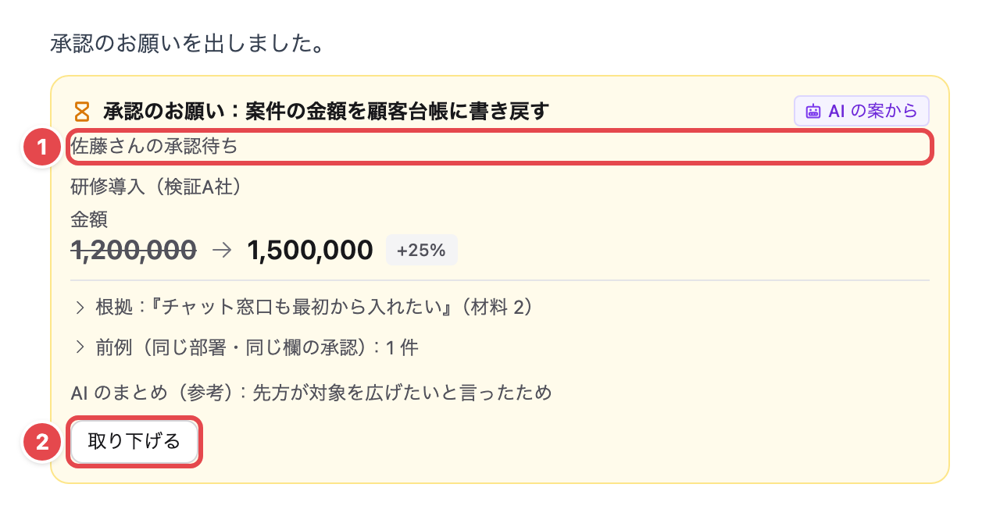
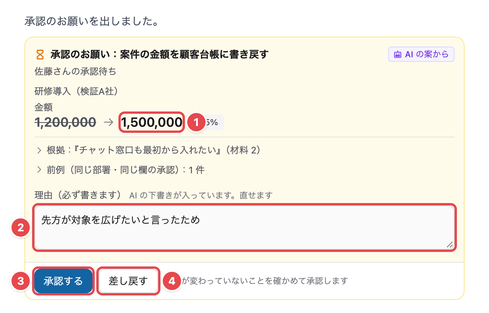

# 23章　承認のお願い

## はじめに

前の章の最後に、こんな疑問が残りました。

「上の人の OK（ハンコ）が要るときは、ACB ではどうすればいいの？」

稟議書を回して、ハンコをもらう。戻ってくる（差し戻し）こともある。そして、ハンコをもらったあとで中身を書き換えるのはご法度ですよね。

ACB の「承認のお願い」も、この決まりのとおりに動きます。**ハンコのあとで中身がすり替わることはありません。** 8章で少しだけ見たカードを、この章では「頼む側」と「決める側」の両方から見ていきます。

> **会社によって出るものです**
>
> 承認のお願いは、会社が「この操作には承認が要る」と設定しているときだけ出ます（顧客台帳の金額を書き換える、など）。出ていなければ、この章は読み飛ばしてかまいません。どの操作に承認が要るかは、管理者が決めています。

### この章で分かること

- 承認のお願いを出す側がすること
- 承認する側がすること
- 休みの人の代わりに承認したときの残り方

---

## 頼む側：お願いを出して、待つ

山田さんが AI に「A社の研修導入の金額を 150万円に直して」と頼むと、AI は承認が要る操作だと分かり、承認のお願いを作ります。「AIへの相談」の中に、こんなカードが出ます。

カードのいちばん上に、何をどう変えるか（金額 1,200,000 → 1,500,000）が大きく出ます。その下に、根拠（議事録の引用と AI が使った材料）、前に同じような承認があったか（前例）が1行ずつ畳んであります。根拠の行には引用の書き出しが見えていて（「根拠：『チャット窓口も最初から入れたい』」）、押すと全部開きます。**この中身は、もう変えられません。** 承認されたら、この中身のとおりにだけ実行されます。

①には、だれの承認を待っているかが出ます。お願いをやめたいときは、②［取り下げる］を押します。

結果は、あなたの［受け箱］に届きます（「…が承認されました（佐藤さん）」「…が差し戻されました」など）。差し戻されたときは、［受け箱］の行の［開く…］でカードを開き、理由を読んで、直して出し直すか、取り下げます。

---

## 決める側：中身を読んで、決める

承認する人（ここでは佐藤さん）には、［受け箱］の「あなた待ち」に「承認を待っています」と届きます。Mac の通知にも「承認のお願いが来ました」と出ます。

受け箱の行の［承認する…］を押すと、カードが開きます。**受け箱の行を押しただけで承認されることはありません。** 承認は、必ずカードの中で押します。

1. ①で、何がどう変わるのかを確かめます。畳んである根拠・前例も、押して開いて読みます。
2. ②に理由を書きます。**理由は必ず書きます。** AI の下書きが入っていることもあるので、自分の言葉に直してかまいません。
3. よければ③［承認する］を押します。理由を書くまでは押せません（ボタンの横に「理由を書くと押せます」と出ます）。
4. 違うと思ったら④［差し戻す］を押します。

③④のボタンは、カードの下の帯にあります。カードが長いときや画面が小さいときも、帯は画面の下に見えたままです。

相談の中のカードが狭くて読みにくいときは、カードの右上の［大きく開く（タブ）］を押すと、同じお願いが真ん中のタブで大きく開きます。どこで答えても、同じお願いの結果になります。

承認ボタンを押したあとで中身が変わっていたときは、「内容が変わりました。もう一度確かめてください」と出て、新しい中身が表示されます。**見ていない中身が承認されることはありません。** 新しい中身を読んでから、もう一度押します。

承認した判断は、「決めたこと」として残ります（会社が決めたことを使っているとき）。

新しく作るお願いで、似ている記録がすでにあるときは、カードの「まず確かめてください」にそれが出ます。そのときは、同じもの（作らない）か別のものかを先に選んでから承認します。選ぶまでは、ボタンの横に「先に『同じかどうか』を選ぶと承認できます」と出ます。

---

## AI は承認できません

承認のお願いを作るところまでは、AI が手伝ってくれます。でも、**承認するのは、いつも人です。** AI が承認を押すことはありません。

---

## 休みの人の代わりに承認したとき

承認する人が休みで、代わりの人が決まっているときは（20章）、代わりの人も承認できます。そのときは、カードや経緯に「佐藤さん（代わりに承認・本来は木下部長）」のように、だれの代わりだったかが残ります。

---

## 山田さんの場合

A社が窓口を3つに増やしたいと言ったので、山田さんは AI に金額の変更を頼みました。AI が作った承認のお願いを読み、中身が合っていることを確かめて待ちました。夕方、［受け箱］に「承認されました（佐藤さん）」と届きました。

---

## まとめ

- 承認のお願いは、会社が設定した操作のときに出ます。
- 頼む側は、カードで「〇〇さんの承認待ち」を確かめて待ちます。やめるなら［取り下げる］。結果は［受け箱］に届きます。
- 決める側は、［受け箱］の［承認する…］でカードを開き、中身を読んで理由を書き、［承認する］か［差し戻す］を押します。
- 承認された中身だけが実行されます。あとで中身がすり替わることはありません。
- AI は承認できません。代わりに承認したときは、そのことが残ります。

## やってみよう

1. あなたの会社で承認が要る操作があるか、管理者に聞いてみましょう。
2. 承認のお願いが来たら、［受け箱］の［承認する…］から開いて、前例と材料まで読んでから決めましょう。

---

承認は「決めたこと」として残る、という話が出ました。

では、会議で決まったことも、こうやって残せるのでしょうか？　会議のあと、何をすればいいのでしょうか？
