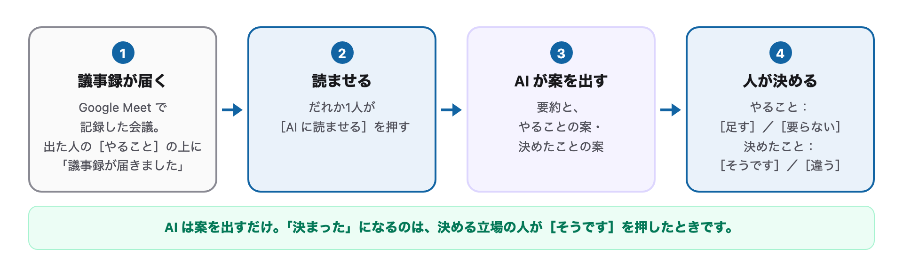
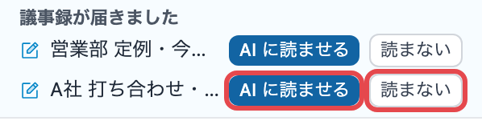
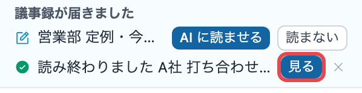
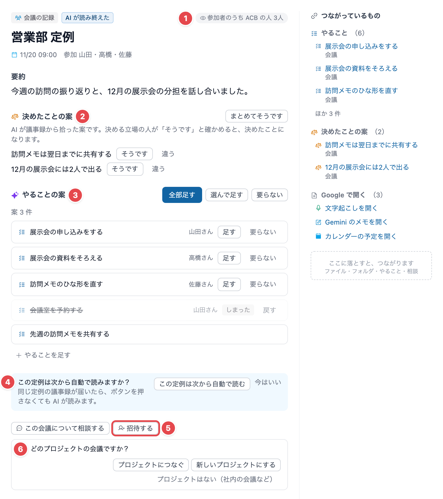
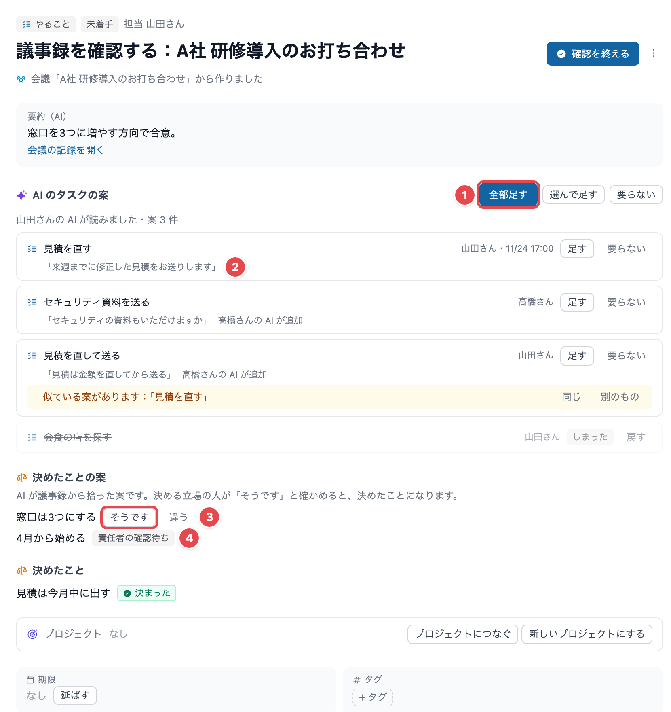
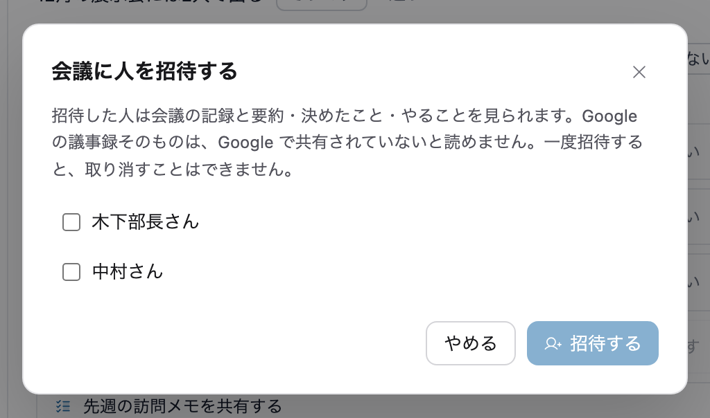

# 24章　会議のあと：議事録・決めたこと

## はじめに

前の章の最後に、こんな疑問が残りました。

「会議で決まったことも残せるの？　会議のあと、何をすればいい？」

会議のあと、議事録を読み返して「だれが・何を・いつまでに」を書き出し、LINE やメールで共有する。けっこう手間がかかりますよね。しかも、書き出すのを忘れると、宿題がうやむやになってしまいます。

ACB では、この書き出しを AI が手伝います。**あなたは、AI が出した案を確かめるだけです。決めるのは人です。**

> **会社によって出るものです**
>
> この章のことは、会社が Google とつながっていて、「会議と議事録」を使っているときに出ます。会議を Google Meet で記録（議事録・文字起こし）しておくと、ACB に届きます。出ていなければ、読み飛ばしてかまいません。Google とのつなぎ方は、あとの章で見ます。

### この章で分かること

- 議事録が届いてから、やることと決めたことになるまでの流れ
- AI の案の確かめ方
- 会議の記録が、だれに見えるのか

---

## 流れを先に見ておきましょう

---

## 議事録が届いたら、AI に読ませる

会議の議事録が届くと、会議に出た人の［やること］の一覧の上に「議事録が届きました」と出ます。

- ［AI に読ませる］を押すと、あなたの AI が議事録を読みます。押すのは、会議に出た人のうちだれか1人で大丈夫です。
- 読む必要のない会議なら［読まない］。ほかの参加者には「〇〇さんが読まないにしました」と出ます。

AI が読み終わると、「読み終わりました」の行に、決めたことの案とやることの案の数が出ます。

［見る］を押すと、会議の記録が開きます。AI に読ませた人の「あなたの番」には、「議事録を確認する：（会議の名前）」というやることも入ります。

---

## 会議の記録を見る

1. **見られる人**（①）— 会議の記録を見られるのは、**その会議に出た人だけ** です。管理者でも、出ていなければ見られません。
2. **決めたことの案**（②）— AI が議事録から拾った「決まったらしいこと」です（このあとくわしく）。
3. **やることの案**（③）— AI が拾った宿題です。
4. **定例のとき**（④）— 毎週の定例なら、［この定例は次から自動で読む］を押すと、次からは議事録が届いたときに AI が自動で読みます。［今はいい］で閉じられます。
5. **［招待する］**（⑤）— 会議に出ていない人にも記録を見せたいときに使います（このあとくわしく）。
6. **どのプロジェクトの会議か**（⑥）— 社外の人と話した会議なら、どのプロジェクトの会議かを選べます。選ぶとプロジェクトのカードからも見られます。社内の会議なら「プロジェクトはない（社内の会議など）」です。

右側の「Google で開く」から、文字起こしや Gemini のメモを Google で開けます。［この会議について相談する］で、この会議について AI に相談することもできます。

---

## やることの案を確かめる

「議事録を確認する」のやることを開くと、AI の案がまとまっています。

やることの案（「AI のタスクの案」）は、1件ずつ、担当と期限つきで並んでいます。②のように、どの発言から作った案なのかも出ています。

- 全部そのとおりなら、①［全部足す］。
- いくつかだけなら、［選んで足す］で選んで［選んだものを足す］。または行ごとに［足す］。
- 要らない案は［要らない］。しまった案は［戻す］で戻せます。

ほかの参加者の AI が足した案には「〇〇さんの AI が追加」、似た案があるときは「似ている案があります」と出ます。同じ案なら［同じ］、違う案なら［別のもの］を押します。

確かめ終わったら、カードの［確認を終える］を押します。このやることは、自分で終えるまで残ります。

---

## 決めたことの案を確かめる

**AI が拾った決めたことは、まだ「案」です。** 決める立場の人が［そうです］を押して、はじめて「決まった」になります。

- そのとおりなら［そうです］。2件以上あれば［まとめてそうです］も使えます。
- 違うなら［違う］。

決める立場の人は、会議がつながっているプロジェクトの責任者、部署の管理役、管理者です。プロジェクトにつながっていない会議や、責任者がいない・責任者がその会議を見られないときは、その会議に出た人が決めます。あなたが決める立場でないときは、案の横に「責任者の確認待ち」と出ます。

> **決まったあとで間違いに気づいたら**
>
> 「決まった」になったものを取り消すボタンは、いまのアプリにはありません。間違いに気づいたら、そのプロジェクトの責任者か管理者に伝えてください。

**だから、AI が勝手に「決まった」ことにすることはありません。** 前例として使われるのも、人が確かめたものだけです。

---

## 会議に出ていない人に見せる：［招待する］

会議の記録は、出た人だけが見られます。出ていない上司などにも見せたいときは、会議の記録の［招待する］を押します。

招待した人は、会議の記録と要約・決めたこと・やることを見られるようになります。**一度招待すると、取り消すことはできません。** Google の議事録そのものは、Google で共有されていないと読めません。

---

## 山田さんの場合

A社との打ち合わせのあと、「議事録が届きました」が出たので、山田さんは［AI に読ませる］を押しました。読み終わったら、やることの案から「見積を出す」だけを足し、ほかは［要らない］にしました。値引きの件は、決める立場の佐藤さんが［そうです］を押して、決まったことになりました。

---

## まとめ

- 議事録が届くと、出た人の一覧の上に「議事録が届きました」と出ます。［AI に読ませる］で AI が読みます。
- 会議の記録は、出た人だけが見られます。見せたいときは［招待する］（取り消せません）。
- やることの案は［全部足す］［選んで足す］［足す］［要らない］で確かめます。
- 決めたことの案は、決める立場の人が［そうです］を押して、はじめて「決まった」になります。AI は案を出すだけです。
- 定例は［この定例は次から自動で読む］で、次から自動で読めます。

## やってみよう

1. 次の会議を Google Meet で記録して、届いた議事録を［AI に読ませる］で読ませてみましょう。
2. やることの案を1件ずつ読んで、［足す］か［要らない］を選んでみましょう。

---

やること、承認、議事録、そしてメール……。いろいろなものが届くようになりました。

全部、どこで気づけばいいのでしょうか？　見落とさないためには？
