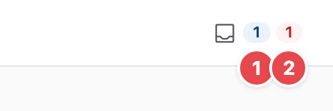
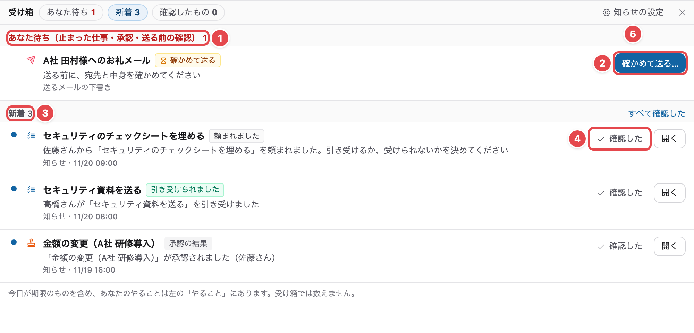
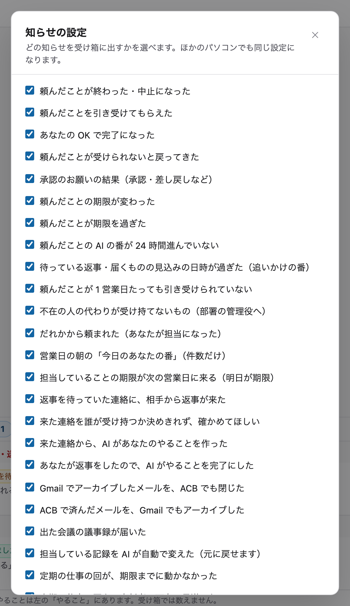

# 25章　受け箱と知らせ

## はじめに

前の章の最後に、こんな疑問が残りました。

「いろいろ届くようになった。全部、どこで気づけばいい？」

スマホの通知や、メールの受信トレイの未読の数。読めば未読は消えて、気になるものだけが残りますね。

ACB では、それが **［受け箱］** です。受け箱に並ぶのは2つだけです。**あなたが動くまで止まっているもの（あなた待ち）** と、**まだ見ていない知らせ（新着）** です。やることそのものは受け箱には並ばず、左の［やること］にあります（17章）。この章では、受け箱の見方と、知らせの選び方、それに会社がメールや Slack をつないでいるときに届く「来た連絡」を見ていきます。

### この章で分かること

- ［受け箱］の青い数と赤い数の意味
- 「あなた待ち」と「新着」、確認したものの見方
- 知らせの選び方
- 来た連絡（メール・Slack）が届いたときにすること

---

## ［受け箱］の青い数と赤い数

タイトルバーの［受け箱］には、トレイの絵の横に数が2つ出ます。

- ①の青い数は「新着」の数です。まだ見ていない知らせの数で、開くか［確認した］を押すと1つ減ります。全部見れば消えます。
- ②の赤い数は「あなた待ち」の数です。止まった仕事、承認のお願い、送る前に確かめるメールの下書きなど、**あなたが動くまで止まっているもの** の数です。済めば減ります。見ただけでは減りません。

どちらも 0 のときは、数は出ません。今日が期限のやることは、ここでは数えません。左の［やること］の「今日」で見ます（17章）。

［受け箱］を押すか ⌘J で、画面の下に受け箱が開きます。もう一度押すと閉じます。

---

## 受け箱の中

開くと、上に「あなた待ち」、その下に「新着」が並びます。

- **あなた待ち**（①）— 止まってしまったもの、承認のお願い、送る前に確かめるメールの下書きです。済むまで、ここに残ります。止まった仕事は、直したら行の［済んだ］を押します。
- **新着**（③）— まだ見ていない知らせです。新しいものが上です。行を押して開くか、④［確認した］を押すと、「確認したもの」に移ります。開かなくても［確認した］だけで構いません。

**受け箱の行からは、承認も送信もされません。** ②の［確かめて送る…］や［承認する…］は、カードを開くだけです。送る・承認するは、必ずカードを読んでから押します。

会議の議事録も、新着に並びます（24章）。行の［AI に読ませる］［読まない］で決めます。AI が読んでいる間は「AI が読んでいます…」と出て、新着の数には入りません。読み終わると「読み終わりました：決めたこと N・やることの案 N」が、もう一度新着に来ます。読める日が残り1日になると、行に「あと1日で読めなくなります」と出ます。

### 新着をまとめて片づける

新着が多いときは、「新着」の右の［すべて確認した］で、一度に確認済みにできます。「あなた待ち」は変わりません。①の新着は 0 になります。確認したものは、上のボタンの②「確認したもの」で、あとからも見られます。

AI が自動で変えたものなどは、行に［元に戻す］が出ます。違うと思ったら、ここで戻せます。

---

## Mac の通知

すべての知らせが Mac の通知になるわけではありません。通知が出るのは、次のようなときだけです。

- 承認のお願いが来たとき
- あなたのやることが新しく来たとき
- 返事の見込みを過ぎて、あなたのやることに戻ってきたとき
- 営業日の朝の「今日のあなたの番」（件数だけ）。押すと受け箱が開きます
- 明日が期限のとき、頼まれたとき

---

## 知らせを選ぶ：知らせの設定

知らせが多すぎると感じたら、受け箱の右上の「知らせの設定」を開きます。

種類ごとに、受け箱に出すかどうかを選べます。この設定は、ほかのパソコンでも同じになります。会社が使っていない機能の知らせは、はじめから出ていません。

---

## 来た連絡：メールや Slack が届いたとき

> **会社によって出るものです**
>
> 来た連絡は、会社が Gmail や Slack をつないでいて、あなたが設定の「自分の設定」で［受信を読む］をオンにしているときだけ出ます（21章の写真の①）。つなぎ方は、28章で見ます。

オンにしていると、あなた宛てのメールや Slack を AI が読んで、振り分けます。

- **返事が要るもの** — 「返事のお願い」として、あなたのやることに入ります。返事の目安の期限つきです。
- **やることがあるもの** — 期限つきのやることになり、「やることができました」と知らせが届きます。
- **AI が迷ったもの** — 「確認待ち」の来た連絡として、あなたの番に出ます。

来た連絡のカードは、こう見えます。

ACB は本文を持っていません。要約だけが出て、本文は［Slack で開く］や「Gmail で開く」で元のところで読みます。会社によっては、カードの下に前後のやりとりと返事の下書きが出ます。

- もう対応したなら、①［済んだ］を押します。押したあとも［元に戻す］で戻せます。
- やることにする必要がないなら、②「…」の［取り込まない］。「やることにしなかった一覧」に移るだけで、消えはしません。

返事のお願いのカードは、こうです。

- 返事が済んだら［終わりにする］。
- 電話など別の道で返したときは、「…」の［もう返した］。AI の下書きは送らずに片づけられます。

> AI が作った返事の下書きを送る方法と、Gmail のアーカイブとの連動は、28章と30章で見ます。

---

## 山田さんの場合

朝、［受け箱］には青い 3 と赤い 1 が出ていました。開くと、「あなた待ち」にお礼メールの下書きが1件。［確かめて送る…］でカードを開き、宛先と中身を確かめて送りました。「新着」には、佐藤さんから頼まれたチェックシートと、高橋さんが引き受けた知らせが並んでいます。頼まれたものは開いて中身を確かめ、残りは［すべて確認した］で片づけました。

---

## まとめ

- ［受け箱］の青い数は新着（まだ見ていない知らせ）、赤い数はあなた待ち（あなたが動くまで止まっているもの）です。⌘J でも開けます。
- 新着は、開くか［確認した］で「確認したもの」に移ります。あなた待ちは、済むまで残ります。
- 受け箱の行からは、承認も送信もされません。カードを開いて押します。
- 新着は［すべて確認した］でまとめて片づけられます。今日が期限のやることは、受け箱ではなく［やること］の「今日」にあります。
- 知らせの種類は「知らせの設定」で選べます。
- 会社がメールや Slack をつないでいれば、来た連絡を AI が振り分けます。確認待ちは［済んだ］か［取り込まない］、返事のお願いは［終わりにする］か［もう返した］。

## やってみよう

1. ⌘J で受け箱を開いて、新着を1つ開いてみましょう。［受け箱］の青い数が1つ減ります。
2. 「知らせの設定」を開いて、どんな知らせがあるか見てみましょう。

---

毎日の仕事が、ACB の中で回るようになってきました。

ところで、山田さんは毎週月曜に、同じ Skill で週報をまとめてもらっています。毎回頼まなくても、自動でやってもらえないのでしょうか？
