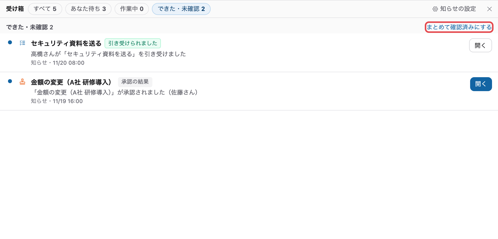
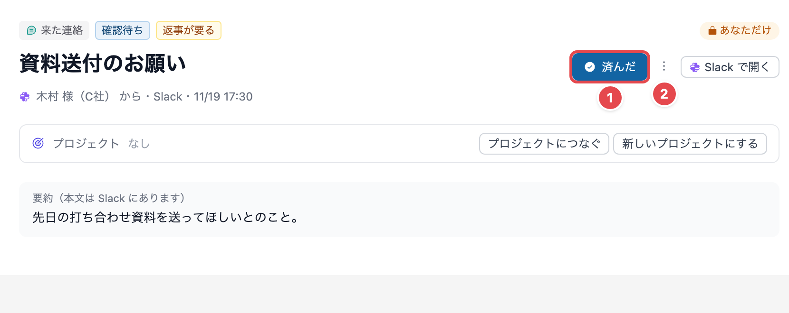
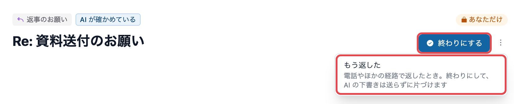

# 25章　受け箱と知らせ

## はじめに

前の章の最後に、こんな疑問が残りました。

「いろいろ届くようになった。全部、どこで気づけばいい？」

スマホの通知や、メールの受信トレイの未読の数。読めば未読は消えて、気になるものだけが残りますね。

ACB では、それが **［受け箱］** です。**［受け箱］の数が 0 なら、あなた待ちのものはありません。** この章では、受け箱の見方と、知らせの選び方、それに会社がメールや Slack をつないでいるときに届く「来た連絡」を見ていきます。

### この章で分かること

- ［受け箱］の数と点の意味
- 受け箱の中の分け方と、読み方
- 知らせの選び方
- 来た連絡（メール・Slack）が届いたときにすること

---

## ［受け箱］の数と点

タイトルバーの［受け箱］には、数と点が出ます。

- ①の数は「あなた待ち」の数です。あなたが押したり決めたりするのを待っているものの数で、やることの一覧の「あなたの番」と同じ決まりで数えています。
- ②の点は、受け箱を最後に見てから新しく届いたものがあるしるしです。

［受け箱］を押すか ⌘J で、画面の下に受け箱が開きます。もう一度押すと閉じます。

---

## 受け箱の中

上のボタンで、見るものを切り替えられます。

- **すべて** — 全部。
- **あなた待ち**（①）— あなたが押すもの。止まってしまったもの、承認のお願い、送るメールの下書き、確かめるもの、頼まれたもの…の順に並びます。
- **作業中** — AI が議事録を読んでいる会議など。
- **できた・未確認** — 頼んだことが終わった、引き受けてもらえた、承認された、など。

行を押すと、そのやることや記録のカードが開き、その知らせは「読んだ」になります。知らせだけの行は、開くと「あなた待ち」から消えます。

**受け箱の行からは、承認も送信もされません。** ②の［確かめて送る…］や［承認する…］は、カードを開くだけです。送る・承認するは、必ずカードを読んでから押します。

まだ始めていない、期限が来週以降か期限のないやることは、受け箱には出ません。受け箱の下に「…件は、やることの一覧の「先のこと」「いつか」にあります。」と出ます。

### 「できた・未確認」を片づける

「できた・未確認」は、読んだら片づけて大丈夫なものです。［まとめて確認済みにする］で、一度に確認済みにできます。確認したものは、下の「きょう確認したもの」「前に確認したもの」にたたまれて、あとからも見られます。14日より前のものは、1行にまとめられます。

AI が自動で変えたものなどは、行に［元に戻す］が出ます。違うと思ったら、ここで戻せます。

---

## Mac の通知

すべての知らせが Mac の通知になるわけではありません。通知が出るのは、次のようなときだけです。

- 承認のお願いが来たとき
- 「あなたの番」に新しく来たとき
- 返事の見込みを過ぎて、あなたの番に戻ってきたとき
- 営業日の朝の「今日のあなたの番」（件数だけ）。押すと受け箱が開きます
- 明日が期限のとき、頼まれたとき

---

## 知らせを選ぶ：知らせの設定

知らせが多すぎると感じたら、受け箱の右上の「知らせの設定」を開きます。

種類ごとに、受け箱に出すかどうかを選べます。この設定は、ほかのパソコンでも同じになります。会社が使っていない機能の知らせは、はじめから出ていません。

---

## 来た連絡：メールや Slack が届いたとき

> **会社によって出るものです**
>
> 来た連絡は、会社が Gmail や Slack をつないでいて、あなたが設定の「自分の設定」で［受信を読む］をオンにしているときだけ出ます（21章の写真の①）。つなぎ方は、あとの章で見ます。

オンにしていると、あなた宛てのメールや Slack を AI が読んで、振り分けます。

- **返事が要るもの** — 「返事のお願い」として、あなたのやることに入ります。返事の目安の期限つきです。
- **やることがあるもの** — 期限つきのやることになり、「やることができました」と知らせが届きます。
- **AI が迷ったもの** — 「確認待ち」の来た連絡として、あなたの番に出ます。

来た連絡のカードは、こう見えます。

ACB は本文を持っていません。要約だけが出て、本文は［Slack で開く］や「Gmail で開く」で元のところで読みます。会社によっては、カードの下に前後のやりとりと返事の下書きが出ます。

- もう対応したなら、①［済んだ］を押します。押したあとも［元に戻す］で戻せます。
- やることにする必要がないなら、②「…」の［取り込まない］。「やることにしなかった一覧」に移るだけで、消えはしません。

返事のお願いのカードは、こうです。

- 返事が済んだら［終わりにする］。
- 電話など別の道で返したときは、「…」の［もう返した］。AI の下書きは送らずに片づけられます。

> AI が作った返事の下書きを送る方法と、Gmail のアーカイブとの連動は、あとの章で見ます。

---

## 山田さんの場合

朝、［受け箱］は 3 でした。開くと、「あなた待ち」にお礼メールの下書き、議事録の確認、佐藤さんから頼まれたチェックシートが並んでいます。上から順に開いて片づけ、「できた・未確認」の「高橋さんが引き受けました」は［まとめて確認済みにする］で片づけました。

---

## まとめ

- ［受け箱］の数は「あなた待ち」の数、点は新しく届いたもののしるしです。⌘J でも開けます。
- 受け箱は、あなた待ち・作業中・できた・未確認に分かれています。行を開くと読んだことになります。
- 受け箱の行からは、承認も送信もされません。カードを開いて押します。
- 「できた・未確認」は［まとめて確認済みにする］で片づけられます。
- 知らせの種類は「知らせの設定」で選べます。
- 会社がメールや Slack をつないでいれば、来た連絡を AI が振り分けます。確認待ちは［済んだ］か［取り込まない］、返事のお願いは［終わりにする］か［もう返した］。

## やってみよう

1. ⌘J で受け箱を開いて、「あなた待ち」の数と［受け箱］の数が同じか見てみましょう。
2. 「知らせの設定」を開いて、どんな知らせがあるか見てみましょう。

---

毎日の仕事が、ACB の中で回るようになってきました。

ところで、山田さんは毎週月曜に、同じ Skill で週報をまとめてもらっています。毎回頼まなくても、自動でやってもらえないのでしょうか？
