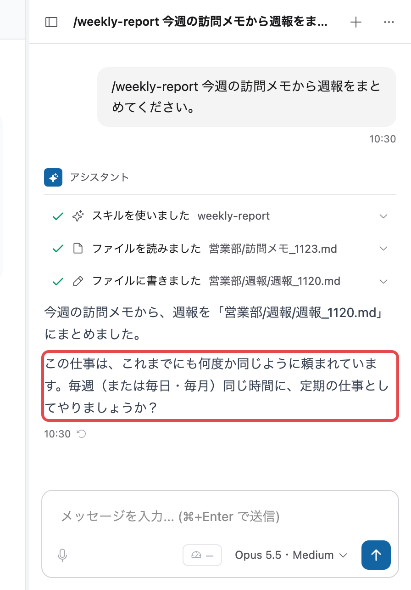
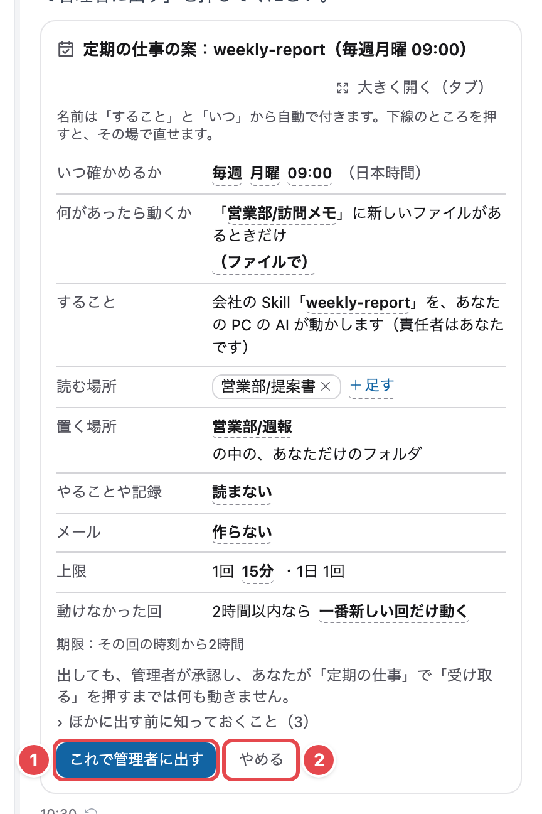
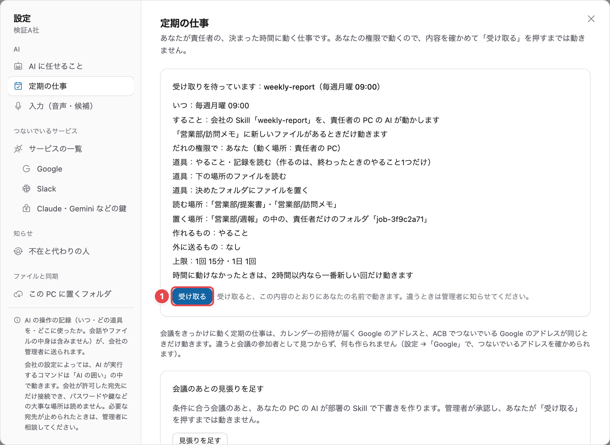
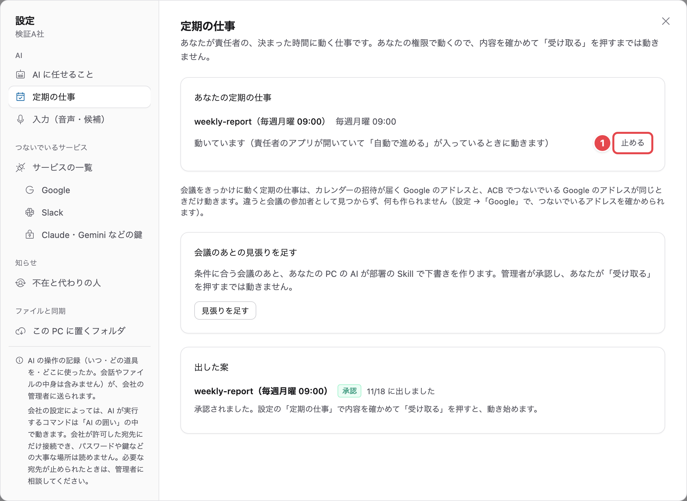

# 26章　定期の仕事：「次から自動にしますか？」

## はじめに

前の章の最後に、こんな疑問が残りました。

「毎週同じ仕事を AI に頼んでいる。毎回頼まなくてもいいの？」

毎週月曜の朝に、同じ集計を頼む。スマホなら「毎朝7時」とアラームを決めておけば、自分で思い出さなくても鳴りますね。

ACB にも「定期の仕事」というしくみがあります。決まった時間に、AI が決まった仕事をしてくれます。**ただし、勝手には始まりません。あなたが内容を確かめて押すまで、動きません。**

### この章で分かること

- AI が「定期の仕事にしましょうか？」と聞いてくるとき
- 案を管理者に出してから、動き出すまでの流れ
- 定期の仕事を止める・再開する方法

---

## AI が聞いてくるとき

同じ会社の Skill を使う仕事を、別々の日に3回頼むと、AI が仕事を終えたあとで1回だけこう聞いてきます。

- 「いいえ」と答えたら、その仕事について二度と聞きません。
- 「はい」と答えると、AI が、いつ・何があったら動くかを確かめてから、案を作ります。

数えているのは、この PC の中だけです。会話の中身は残しません。聞かれたくないときは、設定の「自分の設定」の「AI から定期の仕事を提案してもらう」をオフにします（21章の写真の③）。

---

## 案を確かめて、管理者に出す

「はい。毎週月曜の朝9時にお願いします」と答えると、相談の中に案のカードが出ます。

カードには、次のようなことが書いてあります。上から読んで、思っているとおりか確かめましょう。

- **いつ確かめるか** — 例：毎週月曜 09:00（日本時間）
- **何があったら動くか** — 例：「営業部/訪問メモ」に新しいファイルがあるときだけ。新しいものがない回は、AI は動きません。
- **すること** — どの Skill を、だれの PC の AI が動かすか。責任者はあなたです。
- **読む場所・置く場所・上限** — AI ができることの範囲です。
- **動けなかった回** — その時間にアプリが開いていなかったときなどに、あとからどうするか。

思っていたのと違うところは、**カードの上でその場で直せます**。点線の下線がある値（曜日・時刻・確かめる場所・Skill・読む場所・置く場所・メール・1回の時間など）を押すと、そこが一覧になるので、選び直します。文字を打って入れるところはありません。

- 選ぶと、サーバーがその内容でもう一度確かめます。確かめている間は「直した案をサーバーで確かめています…」と出て、［これで管理者に出す］は押せません。
- 確かめ終わると、カードが新しい案に変わり、「出すのはこの案です（曜日：月曜 → 火曜）」のように、何を直したかが出ます。
- 使えない場所（読めない場所・書けない場所など）を選んだときは、元の内容に戻り、そのわけが出ます。
- 定期の仕事の名前は、「すること」と「いつ」から自動で付きます。名前は直せません（出したあとに管理者が直すことはあります）。

「出す前に知っておくこと」は、いちばん大事な1行だけが出ています。残りは「ほかに出す前に知っておくこと」を押すと開きます。

相談の欄が狭くて見にくいときは、カードの［大きく開く（タブ）］を押すと、真ん中のタブに同じ案が大きく出ます。どちらで直しても、もう一方にも同じ内容が出ます。

よければ①［これで管理者に出す］を押します。やめるなら②［やめる］です。まだ出していない案は、受け箱には出ません。

出したあとは、カードに「管理者の確認待ちです。まだ何も動いていません。」と出ます。待っている間は［取り下げる］で取り下げられます。この案のカードは、作ってから24時間たつと見られなくなります。そのときは、もう一度 AI に頼んでください。

---

## 承認されたら、［受け取る］

管理者が案を承認すると、［受け箱］に「…の責任者になりました…「受け取る」を押してください」という知らせが届きます。押すと、設定の「定期の仕事」が開きます。

もう一度、内容を読みます。管理者が名前や時刻を直していることもあります。よければ①［受け取る］を押します。

**［受け取る］を押すまで、定期の仕事は動きません。** あなたの名前と権限で動く仕事だからです。

受け取ったあとは、決まった時間に、**あなたの PC で、アプリが開いていて「AI が自動で進める」がオンのときに** 動きます。PC を閉じていた時間の分は、カードの「動けなかった回」の決まりのとおりになります（たとえば、2時間以内なら一番新しい回だけ動く）。

---

## 止める・再開する

しばらく止めたいときは、①［止める］を押します。止めたあとは［再開する］で戻せます。止めていた間の回は、再開しても、あとから動きはしません。

「出した案」には、あなたが出した案と、その結果（承認・差し戻し・取り下げ）が残ります。差し戻されたときは、理由も出ます。

> **もっと知る：出来事で動く定期の仕事**
>
> 管理者が作る定期の仕事には、時間ではなく「やることが終わったら」のような出来事で動くものもあります。見張っているやることがなくなって止まったときは、「定期の仕事」に知らせが出るので、次に見張るやることを選び直します。AI が動いた回で、結果が分からなかったものは、ここで「作られていた」「作られていなかった」を記録したり、［もう一度動かす］を選んだりできます。

定期の仕事がうまくできなかった回や、期限までに動かなかった回は、［受け箱］に知らせが届きます。

---

## 山田さんの場合

山田さんは、月曜の朝に「weekly-report」の Skill で週報をまとめてもらうのが3週目になりました。AI に聞かれて「はい」と答え、案を読んで［これで管理者に出す］を押しました。佐藤さんが承認したあと、設定の「定期の仕事」で内容を読み、［受け取る］を押しました。次の月曜からは、頼まなくても週報の下書きができています。

---

## まとめ

- 同じ Skill の仕事を別々の日に3回頼むと、AI が1回だけ「定期の仕事にしましょうか？」と聞きます。
- 「はい」なら案のカードが出ます。読んで［これで管理者に出す］。
- 管理者が承認したら、設定の「定期の仕事」で内容を読んで［受け取る］。押すまでは動きません。
- 動くのは、あなたの PC でアプリが開いていて「AI が自動で進める」がオンのときです。
- ［止める］［再開する］は、設定の「定期の仕事」で。

## やってみよう

1. 設定の「定期の仕事」を開いて、あなたが責任者の仕事があるか見てみましょう。
2. 「自分の設定」で「AI から定期の仕事を提案してもらう」がオンになっているか確かめましょう。

---

2日目の仕事を、ひととおり見てきました。

明日から、毎日何を続ければいいのでしょうか？　困ったときは？
