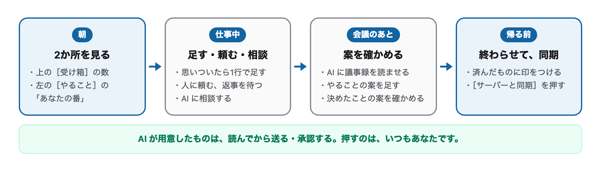

# 27章　2日目のまとめ

## はじめに

前の章の最後に、こんな疑問が残りました。

「明日から、毎日何を続ければいいの？　困ったときは？」

1日目の終わりと同じように、この章は「これだけやれば大丈夫」のまとめです。

---

## ACB の1日

- **朝** — ［受け箱］の数と、［やること］の「あなたの番」を見ます。今日することが分かります（17章・25章）。
- **仕事中** — 思いついたら1行で足します（18章）。人に頼むのも、返事を待つのも ACB で（20章）。迷ったら、やることのカードの［相談する］で AI に相談します（21章）。
- **会議のあと** — 議事録が届いたら AI に読ませて、やることの案と決めたことの案を確かめます（24章）。
- **帰る前** — 済んだものに印をつけて、［サーバーと同期］を押します（11章）。

---

## 2日目のチェックリスト

| やったこと | 見る章 | できた？ |
|---|---|---|
| 朝、［受け箱］の数と［やること］を見た | 17章 | |
| やることを1つ足して、1つ完了にした | 18章 | |
| カードの右上で、だれに見えているかを確かめた | 19章 | |
| だれかに1つ頼んだ（または、頼まれたものを引き受けた） | 20章 | |
| AI が用意したものを読んでから使った | 21章 | |
| ［受け箱］を開いて、「できた・未確認」を片づけた | 25章 | |

プロジェクト（22章）、承認のお願い（23章）、会議のあと（24章）、定期の仕事（26章）は、その場面が来たときに読み返せば大丈夫です。

---

## 明日から続けること

**朝は2か所だけ見る。** ［受け箱］の数と、［やること］の「あなたの番」です。

**頼んだこと・待っていることは、ACB に覚えさせる。** 頼んだものは「ほかの人の番」に残り、返事待ちは見込みを過ぎると戻ってきます。

**AI が用意したものは、読んでから押す。** 送る・承認する・完了にする・断るのは、いつも人です。

**迷ったら「あなただけ」のまま。** 部署に出すのは、出してもよいと確かめてからで間に合います。

---

## 困ったときは

- **押してしまった** → カードの［取り消す］、一覧の緑のチェック、アーカイブの［戻す］で、たいていは元に戻せます。ACB のやることは、消さずに残ります。
- **やることが見当たらない** → 「先のこと」「いつか」「アーカイブ」を開いてみましょう。それでもなければ、左の欄の「探す」か、［表で見る］の「記録の一覧」で「すべて」にして探します。
- **AI が止まっている** → 一覧の「AI の番」の［もう一度］か［人に渡す］を押します（21章）。
- **一部の機能が出てこない** → 会社によって、使っていない機能があります。その機能の記録は「この機能は今オフです」と出て、見るだけになります。
- **それでも分からない** → その画面のまま、管理者に見せて相談してください。

---

## まとめ

- 朝は［受け箱］と［やること］。仕事中は足す・頼む・相談。会議のあとは案を確かめる。帰る前は印をつけて同期。
- AI は用意まで。決めて押すのは、あなたです。
- 押してしまっても、たいていは元に戻せます。困ったら、画面を管理者に見せます。

## やってみよう

1. 上のチェックリストで、まだできていないものを1つやってみましょう。
2. 明日の朝、アプリを開いたら、まず［受け箱］の数を見てみましょう。

---

2日目、おつかれさまでした。これで、毎日の仕事を ACB の中で回せるようになりました。

Google や Slack をつなぐと、予定やメールも ACB に届くようになります。その使い方は、あとの章で見ていきます。
