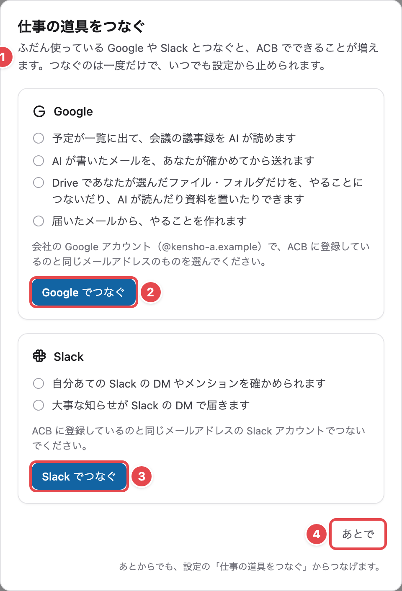
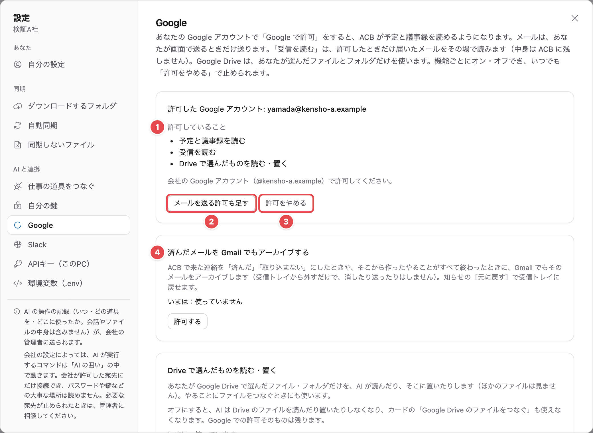
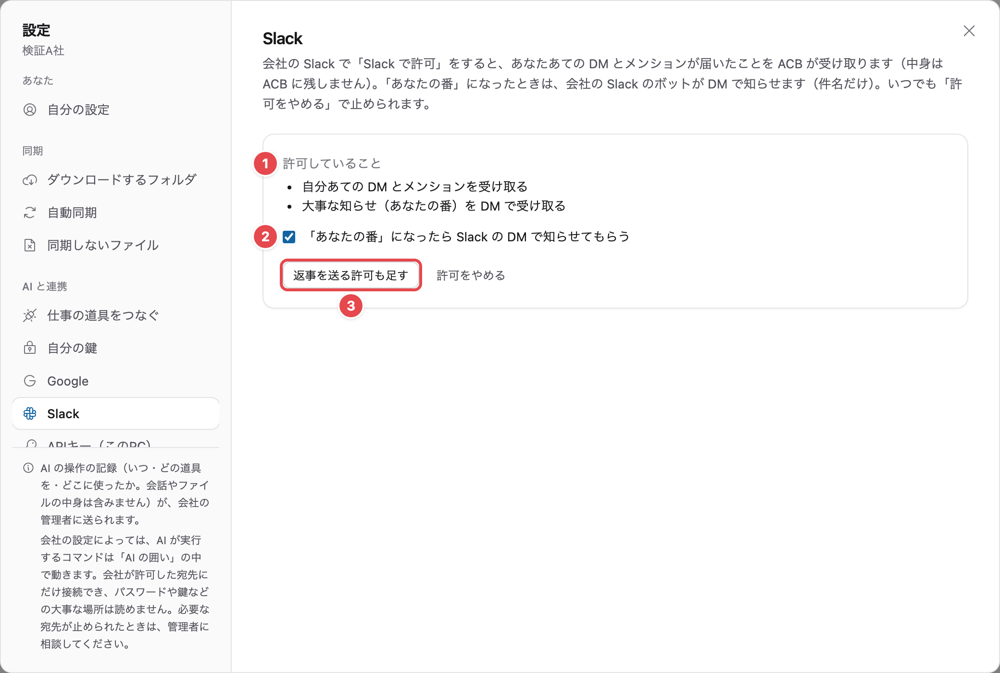
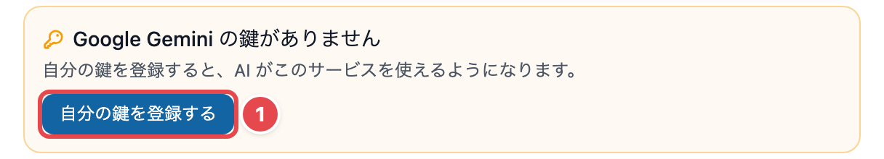
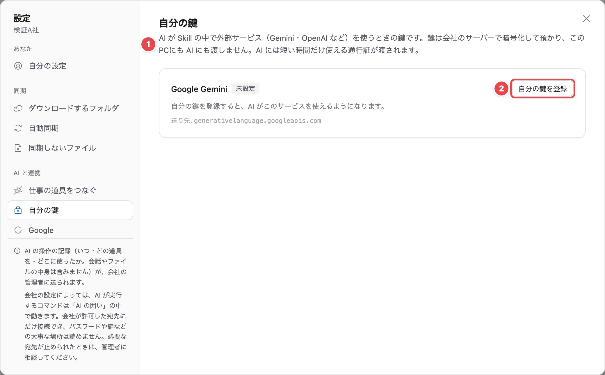

# 28章　Google・Slack とつなぐと何ができる？

## はじめに

前の章の最後に、こんな予告がありました。

「Google や Slack をつなぐと、予定やメールも ACB に届くようになります。」

スマホのアプリを入れると、「Google でログインしますか？」「連絡先へのアクセスを許可しますか？」と聞いてくることがありますね。何を許したのかよく分からないまま「許可」を押して、あとで不安になった人もいるかもしれません。

ACB をはじめて開いたときにも、「仕事の道具をつなぐ」という画面が出たはずです。押していいの？　つなぐと、AI が勝手にメールを読んだり送ったりしない？　やめられるの？

答えから言うと、**許すのは機能ごと、やめるのはいつでも。送るのは、いつもあなたです。** この章では、つなぐと何が増えるのか、何を許したことになるのかを見ていきます。

> **会社によって出るものです**
>
> この章のことは、会社が Google や Slack を用意しているときに出ます。つなぐ準備（会社のアカウントとの登録）は管理者がします。準備のしかたは、管理者向けの手引きにあります。出ていなければ、読み飛ばしてかまいません。

### この章で分かること

- つなぐと、ACB で何が増えるのか
- 「仕事の道具をつなぐ」の画面で押すもの
- 設定の「Google」「Slack」で、許していることを見る・足す・やめる方法
- 「〇〇の鍵がありません」と出たときにすること

---

## つなぐと増えること

先に、全体を見ておきましょう。

17章の「今日の予定」も、24章の議事録も、25章の来た連絡も、実は Google や Slack とつながっているから届いていたのです。

そして、右の箱がいちばん大事なところです。**メールを送る、社外の人も見る場所にファイルを置く。そういう「外に出ること」は、いつもあなたが押して決めます。** AI が下書きを作っても、あなたが押すまで外には何も出ません（30章）。

---

## はじめての起動で出る「仕事の道具をつなぐ」

ログインしたあと、会社が Google や Slack を用意していると、この画面が出ます。

1. ①に書いてあるとおり、**つなぐのは一度だけで、いつでも設定から止められます。**
2. ［Google でつなぐ］（②）を押すと、ブラウザで Google の画面が開きます。Google と Slack の箱には、それぞれ「つなぐと何ができるようになるか」が並んでいます。
3. ［Slack でつなぐ］（③）も同じです。Slack は、ACB に登録しているのと同じメールアドレスの Slack アカウントでつなぎます。
4. 今は決めたくなければ、［あとで］（④）。あとからでも、設定の「仕事の道具をつなぐ」から同じ画面を開けます。

Google の画面では、**会社の Google アカウント**（ACB に登録したのと同じメールアドレス）を選んでください。Google の画面で、許したくない項目のチェックを外すこともできます。許可したら、ACB のアプリに戻ってください。

会社が新しい機能を使い始めたときは、「新しくつなぐもの」として、増えた分だけもう一度この画面が出ます。

会社が何も用意していなければ、「いまは、会社でつなげるものがありません。管理者が Google や Slack を用意すると、ここからつなげます。」と出ます。そのときは、することはありません。

---

## 設定の「Google」で、許していることを見る

つないだあと、何を許しているかは、タイトルバーの［設定］から「Google」を開くと見られます。

1. **許可していること**（①）— いま ACB に許していることの一覧です。山田さんは「予定と議事録を読む」「受信を読む」「Drive で選んだものを読む・置く」を許しています。
2. **足す**（②）— まだ許していないものは、［メールを送る許可も足す］［受信を読む許可も足す］のように、あとから1つずつ足せます。押すと、また Google の画面が開きます。
3. **やめる**（③）— ［許可をやめる］を押すと「Google の許可をやめますか？」と聞かれます。［許可をやめる］でやめると、ACB は予定や議事録を読めなくなり、メールも送れなくなります。［やめない］で戻れます。

それぞれの許可で、ACB が何をするのかをまとめておきます。

| 許していること | ACB がすること | 見る章 |
|---|---|---|
| 予定と議事録を読む | 今日の予定を一覧の上に出す。会議の議事録を届ける | 17章・24章 |
| メールを送る | **あなたが画面で送るときだけ**、あなたの Gmail から送る | 30章 |
| 受信を読む | 届いたメールをその場で読んで、来た連絡にする（中身は ACB に残さない） | 25章 |
| Drive で選んだものを読む・置く | **あなたが選んだファイルとフォルダだけ**を、AI が読んだり置いたりする | 29章 |

「メールを送る」を許しても、AI が勝手に送ることはありません。AI にはメールを送る道具がないからです（30章でくわしく見ます）。

### 済んだメールを Gmail でもアーカイブする

会社が使っていれば、④の「済んだメールを Gmail でもアーカイブする」も出ます。

ACB で来た連絡を［済んだ］や［取り込まない］にしたとき、Gmail でもそのメールを受信トレイから外してくれる機能です。**外すだけで、消したり送ったりはしません。** 知らせの［元に戻す］で、受信トレイに戻せます。

使うときは［許可する］、使うのをやめるときは［やめる］です。［やめる］は ACB がアーカイブしなくなるだけで、Google での許可は残ります。

---

## 設定の「Slack」で、知らせの受け取り方を決める

Slack は、設定の「Slack」で［Slack で許可］を押してつなぎます。

1. **許可していること**（①）— 「自分あての DM とメンションを受け取る」「大事な知らせ（あなたの番）を DM で受け取る」が並びます。DM やメンションが届いたことを ACB が受け取りますが、**中身は ACB に残しません**（25章の来た連絡）。
2. **「あなたの番」の知らせ**（②）— チェックが入っていると、やることが「あなたの番」になったとき、会社の Slack のボットが DM で知らせてくれます。DM に出るのは**件名だけ**です。いらなければ、チェックを外します。
3. **返事も Slack から**（③）— ［返事を送る許可も足す］を押すと、来た連絡への返事を、元の Slack のスレッドに送れるようになります（30章）。

Slack も、［許可をやめる］でいつでもやめられます。やめると、DM やメンションを受け取れなくなり、Slack への知らせも止まります。

---

## 「〇〇の鍵がありません」と出たら

Skill の中で、AI が外のサービス（画像を作るサービスなど）を使うことがあります。そのサービスの鍵がないと、相談の中にこんなカードが出ます。

①［自分の鍵を登録する］を押すと、設定の「自分の鍵」が開きます。

- ①に書いてあるとおり、**鍵は会社のサーバーが預かり、この PC にも AI にも渡しません。** AI には、短い時間だけ使える通行証が渡されます。
- ②［自分の鍵を登録］を押して、サービスの画面からコピーした鍵を貼りつけ、保存します。あとで［鍵を差し替える］や［削除］もできます。
- 登録したら、AI にもう一度頼んでください。

会社が許していないときは、「この会社では、メンバーが自分の鍵を登録することは許可されていません。」と出ます。そのときは、管理者に鍵を使えるようにしてもらってください。

> **用語解説：鍵**
>
> ここでいう「鍵」は、外のサービスを使うための合言葉のようなものです。持っている人はそのサービスを使えてしまうので、ACB ではあなたの PC にも AI にも置かず、会社のサーバーが預かります。

---

## 山田さんの場合

はじめてアプリを開いた日、山田さんは「仕事の道具をつなぐ」で［Google でつなぐ］を押し、会社の Google アカウントで許可しました。Slack はよく分からなかったので［あとで］にしました。

翌日、高橋さんに「Slack で『あなたの番』が来ると便利だよ」と聞いて、設定の「Slack」から［Slack で許可］。いまは、やることが自分の番になると、Slack に件名だけの DM が届きます。

---

## まとめ

- Google や Slack をつなぐと、予定・議事録・来た連絡・ドライブのファイルが ACB で使えるようになります。つなぐ準備は管理者がします。
- 許すのは機能ごと。設定の「Google」「Slack」で、許していることを見て、足して、［許可をやめる］でいつでもやめられます。
- 「メールを送る」を許しても、送るのはいつもあなたです。
- Slack をつなぐと、「あなたの番」を DM で知らせてもらえます（件名だけ）。
- 「〇〇の鍵がありません」と出たら、設定の「自分の鍵」で登録します。鍵は会社のサーバーが預かります。

## やってみよう

1. 設定の「Google」を開いて、いま何を許しているか、「許可していること」を読んでみましょう。
2. Slack を使っている会社なら、設定の「Slack」で「あなたの番」の知らせを受け取るかどうか、決めてみましょう。

---

Google ドライブの資料も、AI に読ませたくなってきました。

でも、ドライブには社外の取引先と共有しているフォルダもあります。AI にそこへ置かせても、大丈夫なのでしょうか？
