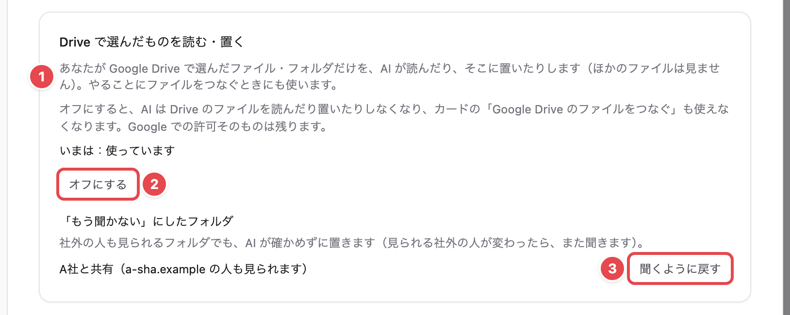
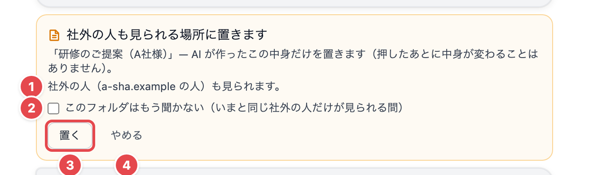
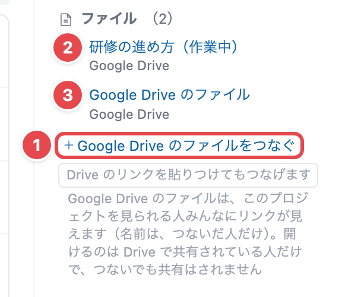
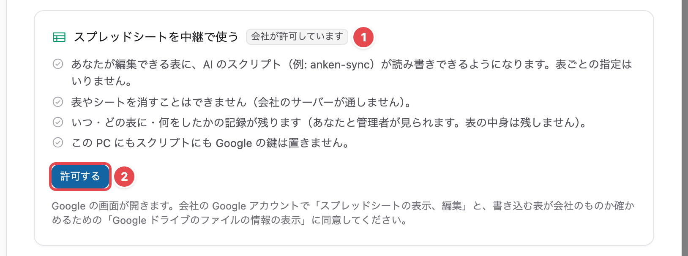

# 29章　Google ドライブのファイルを AI と使う

## はじめに

前の章の最後に、こんな疑問が残りました。

「Google ドライブの資料も AI に読ませたい。社外の人も見るフォルダに AI が置いて大丈夫？」

ドライブで共有の設定を「リンクを知っている全員」にしてしまって、ヒヤッとしたことはありませんか？　取引先と共有しているフォルダに、社内向けのメモをうっかり置いてしまう。ドライブの共有は便利なぶん、間違えると怖いものです。

ACB では、**AI が使えるのは、あなたが選んだファイルとフォルダだけです。社外の人も見られる場所に置く前には、必ずあなたに確かめます。** この章では、ドライブのファイルを AI に渡す方法、置かせる方法、やることやプロジェクトにつなぐ方法を見ていきます。

> **会社によって出るものです**
>
> この章のことは、会社が Google を用意していて、あなたが設定の「Google」で「Drive で選んだものを読む・置く」を許しているときに使えます（28章）。出ていなければ、読み飛ばしてかまいません。

### この章で分かること

- ドライブのファイルを AI に読ませる方法
- AI がドライブに置くとき、何を確かめるのか
- やること・プロジェクトにドライブのファイルをつなぐと、だれに何が見えるのか
- スプレッドシートを中継で使う、とは何か

---

## AI が使えるのは、あなたが選んだものだけ

設定の「Google」には、ドライブの欄があります。

①に書いてあるとおり、**AI はあなたが Google Drive で選んだファイル・フォルダだけを読んだり、そこに置いたりします。ほかのファイルは見ません。**

使いたくないときは、②［オフにする］。AI はドライブのファイルを読んだり置いたりしなくなります。Google での許可そのものは残るので、［オンにする］ですぐ戻せます。③は、このあと「置かせる」で見ます。

---

## ドライブのファイルを AI に読ませる

相談で、たとえばこう頼みます。

> ドライブにある A社の見積の表を読んで、提案書の金額のところを直してください。

すると AI は、相談の中に「ブラウザで Google Drive のファイルを選んでください（開いた画面で選びます）」と出して待ちます。ブラウザに Google の選ぶ画面が開くので、**読ませたいファイルを、あなたが選びます。** 選んだら、ブラウザに「選びました。アプリに戻ってください。」と出ます。アプリに戻ると、AI がそのファイルを読んで続けます。

- AI が自分でファイルを探して選ぶことはできません。**選ぶのは、いつもあなたです。**
- ブラウザが複数の Google アカウントでログインしているときは、会社のアカウントで選んでください。画面にも、どのアカウントで選ぶかが出ます。
- 選んだファイルは、しばらく使わないと、また選んでもらうことになります。

---

## AI にドライブへ置かせる

AI が作った資料をドライブに置かせることもできます。置き場所のフォルダも、読ませるときと同じように、ブラウザの Google の画面であなたが選びます。

置き場所が**社外の人も見られるフォルダ**のときは、置く前に、相談の中に確かめのカードが出ます。

1. **だれが見られるか**（①）— 「社外の人（a-sha.example の人）も見られます。」のように、どこの会社の人が見られるかが出ます。「リンクを知っている人なら、インターネット上の誰でも見られます。」と出たら、特に気をつけてください。
2. **もう聞かない**（②）— 取引先と決まって共有しているフォルダなら、チェックを入れて置くと、次からはそのフォルダには確かめずに置きます。**ただし、見られる社外の人が変わったら、また聞きます。**
3. よければ［置く］（③）。AI が作った**この中身だけ**を置きます。押したあとに中身が変わることはありません。
4. やめるなら［やめる］（④）。何も置きません。

すでに置いたファイルを上書きするときは、ボタンが［上書きする］になります。ほかの人がドライブで直したりコメントを付けたりしたファイルを上書きするときも、「〇〇さんの直し・コメントが入っています」と出て確かめます。

**非公開フォルダの資料は、社外の人が見られる場所には置けません。** 社内のほかの人が見られる場所に置くときは、カードで確かめます（非公開フォルダは 15章）。

「もう聞かない」にしたフォルダは、設定の「Google」の「『もう聞かない』にしたフォルダ」に並びます（前の写真の③）。［聞くように戻す］を押すと、次からまた毎回確かめます。

---

## やること・プロジェクトにドライブのファイルをつなぐ

やることやプロジェクトのカードには、ドライブのファイルもつなげます（ファイルをつなぐのは 18章・22章）。

- ①［Google Drive のファイルをつなぐ］を押すと、前に選んだファイルが並び、そこになければ Google の選ぶ画面が開きます。ドライブのリンクを貼りつけても、ドラッグしてもつなげます。
- つながりを外すときは、行の「…」から「つながりを外す」。**外しても、ドライブのファイルは消えません。**

### つないだファイルは、だれに何が見える？

ここは大事なところです。カードの下にも、こう書いてあります。

- カードを見られる人には、**リンクが見えます**。
- ただし、**ファイルの名前が見えるのは、つないだ本人だけ**です。ほかの人には「Google Drive のファイル」と出ます（③）。ファイル名から中身が分かってしまうことがあるからです。
- **開けるかどうかは、ドライブの共有の設定で決まります。つないでも、共有はされません。** 見てほしい人がいるときは、ドライブで共有してください。

AI が中身を読めない種類のファイルには「AI では中身を読めません」、つないだときに中身を確かめられなかったファイルには「中身を確かめられていません」と出ます。どちらも、つないだあなたにだけ出るしるしです。

---

## スプレッドシートを中継で使う（会社が許可しているときだけ）

会社が許可していると、設定の「Google」の下のほうに、もう1つ欄が出ます。

AI の Skill の中には、スプレッドシートの表を読んだり書いたりする道具（スクリプト）を使うものがあります。①の札があるときに②［許可する］を押すと、**あなたが編集できる表に、その道具が読み書きできる**ようになります。

- 表やシートを**消すことはできません**（会社のサーバーが通しません）。
- いつ・どの表に・何をしたかの記録が残ります。あなたと管理者が見られます（表の中身は残しません）。
- この PC にも道具にも、Google の鍵は置きません。

使わなくなったら、同じ欄の［やめる］で止められます。

---

## 山田さんの場合

山田さんは、提案書を作るときに「ドライブの A社の見積を読んで」と頼みました。ブラウザに開いた Google の画面で「A社_見積」の表を選ぶと、AI が金額を読んで提案書に入れてくれました。

できた提案書を A社と共有しているフォルダに置かせようとしたら、「社外の人も見られる場所に置きます」のカードが出ました。「a-sha.example の人も見られます」を読んで、A社に見せてよい中身か確かめてから［置く］を押しました。社内だけのメモは、社内のフォルダに置かせています。

---

## まとめ

- AI が使えるのは、あなたがブラウザの Google の画面で選んだファイルとフォルダだけです。
- 社外の人も見られる場所に置く前には、必ずカードで確かめます。［置く］を押すまで、何も置きません。
- 「もう聞かない」にしても、見られる社外の人が変わればまた聞きます。設定で［聞くように戻す］もできます。
- やること・プロジェクトにつないだドライブのファイルは、名前はつないだ本人だけに見えます。つないでも、共有はされません。

## やってみよう

1. 設定の「Google」で、ドライブの欄が「いまは：使っています」になっているか確かめましょう。
2. 相談で「ドライブの〇〇を読んで、要点を3つにまとめて」と頼み、ブラウザでファイルを選んでみましょう。

---

AI が、打ち合わせのお礼メールの下書きを書いてくれました。

これは、どうやって送るのでしょうか？　もう送られてしまった、なんてことはない？
