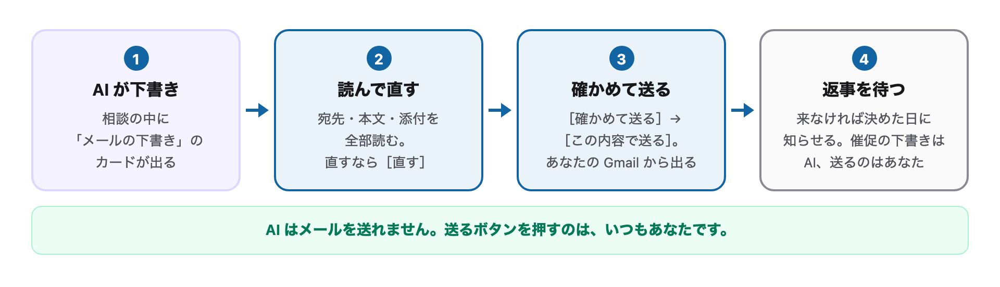
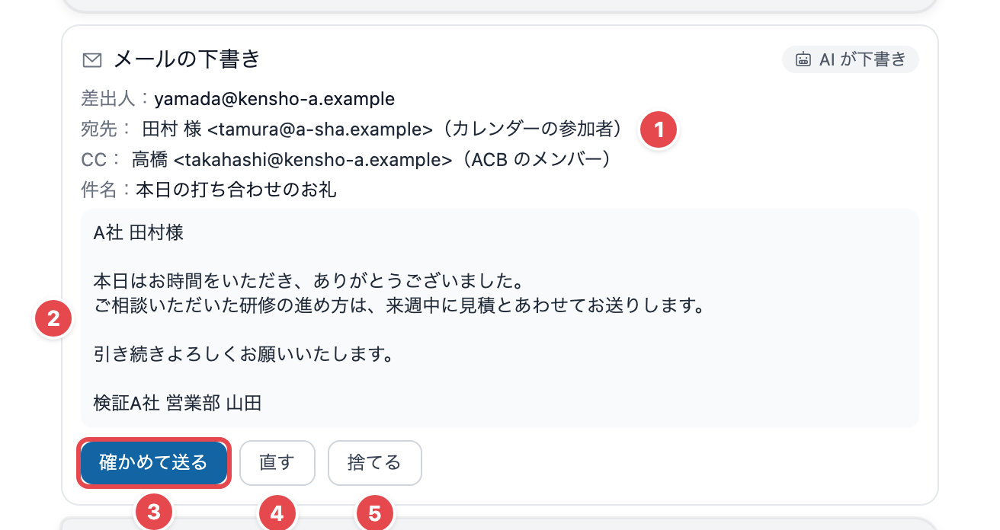
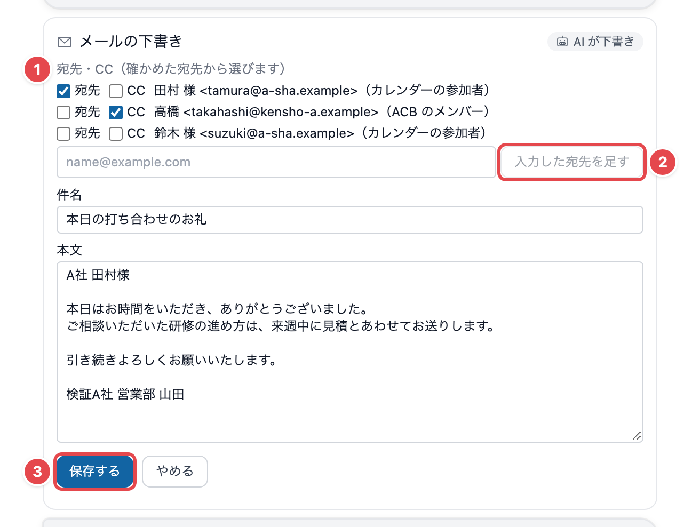
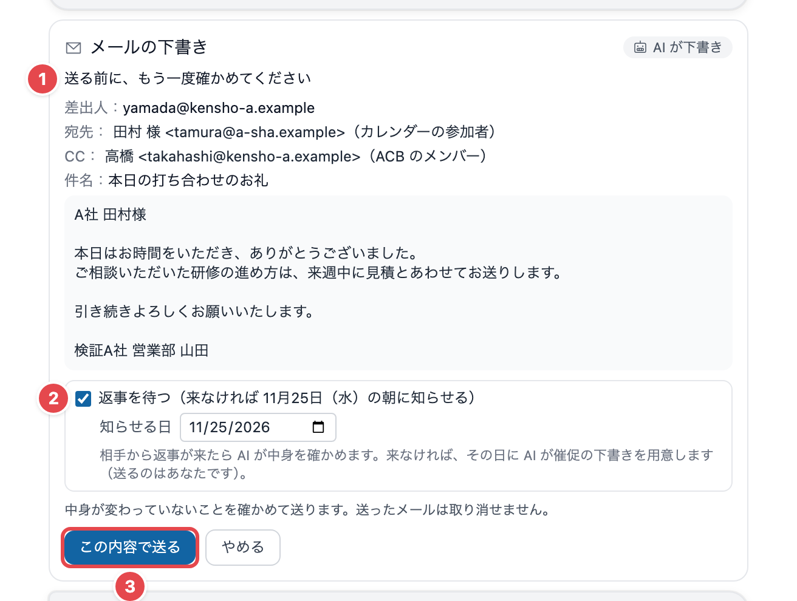
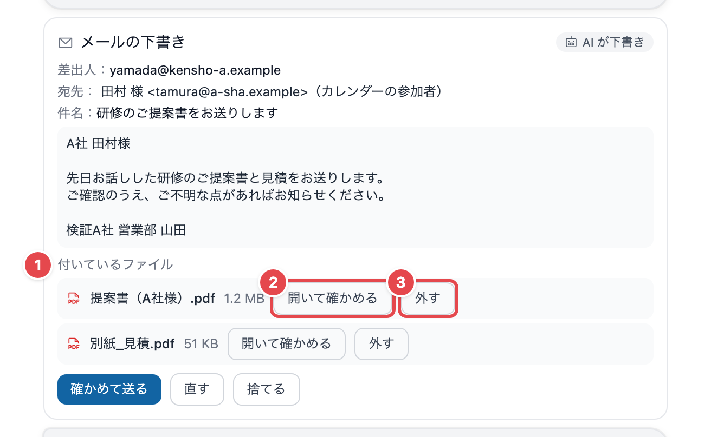
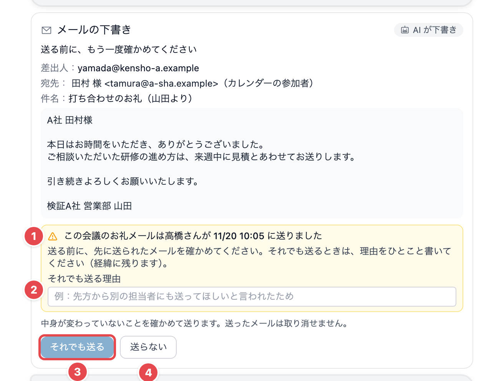
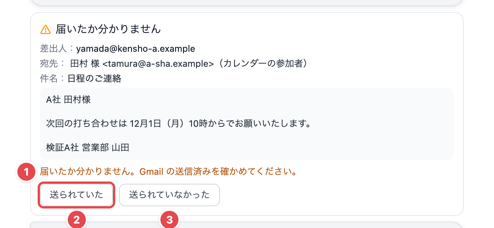
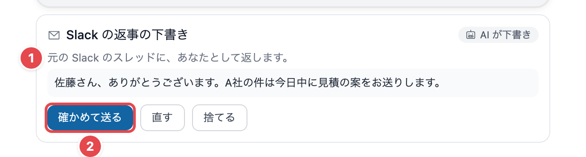

# 30章　AI が作ったメールを送る

## はじめに

前の章の最後に、こんな疑問が残りました。

「AI がお礼メールの下書きを書いてくれた。どうやって送るの？　もう送られてしまった？」

Gmail では、下書きを作って、宛先と本文を見直してから「送信」を押しますね。送ったメールは取り消せません。宛先を間違えて冷や汗をかいたことがある人も多いでしょう。

安心してください。**AI はメールを送れません。送る道具を持っていないのです。** AI が作るのは下書きまでで、送るボタンを押すのは、いつもあなたです。しかも、押す前に、宛先も本文も添付も、全部が見えます。

> **会社によって出るものです**
>
> この章のことは、会社が Google を用意していて、あなたが「メールを送る」を許しているときに使えます（28章）。Slack の返事は、Slack で「返事を送る」を許しているときです。出ていなければ、読み飛ばしてかまいません。

### この章で分かること

- AI が作ったメールの下書きの読み方
- 確かめて送るまでの手順
- 返事を待つ・添付・「先に送られています」と出たとき
- 届いたか分からないときにすること

---

## 流れを先に見ておきましょう

---

## メールの下書きのカードを読む

AI に「打ち合わせのお礼メールを作って」と頼むと、相談の中に「メールの下書き」のカードが出ます。21章で見たように、AI の番で用意されたときは、やることのカードの「AI が用意したもの」にも同じカードが出ます。

1. **宛先**（①）— 宛先と CC の横に、その宛先がどこから来たかが出ます。
   - 「カレンダーの参加者」— その会議の予定に入っていた社外の人
   - 「HubSpot の連絡先」— 会社の顧客台帳にある、その案件の連絡先
   - 「ACB のメンバー」— 社内の人
   - 「あなたが入力」— あなたが自分で打ち込んだ宛先

   はじめての会社に送るときは「この宛先に送るのは初めてです」と黄色の札が出ます。
2. **本文**（②）— 本文は省略されずに**全部**出ます。リンクが入っていると「本文にリンクが N つあります」と出ます。
3. よければ［確かめて送る］（③）へ。
4. 直したいときは［直す］（④）。
5. 要らなければ［捨てる］（⑤）。

> **宛先は、確かめた相手からしか選べません**
>
> AI が宛先のメールアドレスを書くことはできません。宛先に選べるのは、上の4つのところから来た相手だけです。だから、AI が覚え違えたアドレスに送ってしまう、ということは起きません。

---

## 直す

［直す］を押すと、カードが直す形になります。

- 宛先と CC は、①の一覧からチェックで選びます。
- 一覧にない人に送りたいときは、メールアドレスを入れて②［入力した宛先を足す］。その宛先は「あなたが入力」として残ります。
- 件名と本文を直したら、③［保存する］。やめるときは［やめる］です。

相談で「もう少し短くして」と AI に頼んで直してもらうこともできます。どちらでも、**直すたびに、新しい版の下書きになります。**

---

## 確かめて送る

［確かめて送る］を押すと、送る前の確かめの段になります。

1. ①のとおり、差出人・宛先・件名・本文を、もう一度上から読みます。
2. **返事を待つ**（②）— 返事がほしいメールなら、チェックを入れておきます。返事が来たら AI が中身を確かめ、来なければ「知らせる日」の朝に知らせてくれます。そのとき AI が催促の下書きを用意しますが、**送るのはあなたです**（返事待ちは 20章）。
3. ③［この内容で送る］を押すと、**あなたの Gmail から**送られます。画面のとおり、中身が変わっていないことを確かめて送ります。**送ったメールは取り消せません。**

送ったあとは、カードが「送りました」になります。Gmail の「送信済み」にも残ります。

> 「メールを送るには、Google で『メールを送る許可』が要ります。」と出たら、［メールを送る許可］を押して、Google の画面で許可してから、もう一度［確かめて送る］を押します（28章）。

---

## ファイルが付いているとき

提案書の PDF などを付けたメールでは、「付いているファイル」が出ます。

- ②［開いて確かめる］で、**送られるのとまったく同じファイル**が、PC のビューアで開きます。
- 付けたくないファイルは③［外す］。
- 確かめの段でも、付いているファイルがもう一度並びます。付いたまま送られます。

付けられるのは PDF だけです。

---

## 「先に送られたメール」が出たとき

同じ会議のお礼を、ほかの人がもう送っていることがあります。そのとき［この内容で送る］を押すと、送られずに、こう出ます。

1. ①に、だれがいつ送ったかが出ます。
2. まず、先に送られたメールを確かめましょう。
3. それでも送るときは、②に理由をひとこと書いて、③［それでも送る］。理由は経緯に残ります。
4. 送らないなら④［送らない］。

二人が同じ相手に同じお礼を送ってしまう、ということを防ぐしくみです。

---

## 届いたか分からないとき

送った瞬間に通信が切れるなどして、届いたかどうか ACB にも分からないことがあります。そのときは、カードがこうなります。

1. Gmail の「送信済み」を開いて、そのメールがあるか確かめます。
2. あれば②［送られていた］。
3. なければ③［送られていなかった］。下書きに戻るので、送るときはもう一度［確かめて送る］を押します。

**ACB には「もう一度送る」ボタンはありません。** 二重に送ってしまわないように、必ずあなたが確かめてから決めます。

---

## Slack の返事も同じカードで

来た連絡（25章）が Slack からのときは、AI が「Slack の返事の下書き」を作ります。

宛先や件名はなく、本文だけです。①のとおり、元のスレッドに、**あなたとして**返します。送り方はメールと同じで、［確かめて送る］→［この内容で送る］です。

> 送ってから30日たつと、メールの本文と添付はサーバーから消えます（Gmail の送信済みには残っています）。

---

## 山田さんの場合

A社との打ち合わせのあと、AI がお礼メールの下書きを作ってくれました。山田さんは宛先が「カレンダーの参加者」の田村様であることを確かめ、［直す］で一言だけ書き足しました。［確かめて送る］で「返事を待つ」にチェックを入れ、［この内容で送る］。3日たっても返事がなければ、朝に知らせが来ます。

---

## まとめ

- AI はメールを送れません。下書きのカードを読んで、送るのはあなたです。
- 宛先は、カレンダーの参加者・顧客台帳の連絡先・社内の人・あなたが入力した宛先からしか選べません。
- ［確かめて送る］→［この内容で送る］で、あなたの Gmail から送られます。送ったメールは取り消せません。
- 「返事を待つ」にすると、来なければ決めた日の朝に知らせてくれます。
- 届いたか分からないときは、Gmail の送信済みを見て［送られていた］か［送られていなかった］。もう一度送るボタンはありません。

## やってみよう

1. 相談で「〇〇さんへのお礼メールの下書きを作って」と頼み、カードの宛先の横の「どこから来た宛先か」を読んでみましょう。
2. ［確かめて送る］を押して、確かめの段まで進んでみましょう（送らないときは［やめる］で戻れます）。

---

営業部には「案件」の画面があって、AI が提案書づくりの手順を進めてくれるらしい、と聞きました。

会社が入れたその画面では、何を押せばいいのでしょうか？
