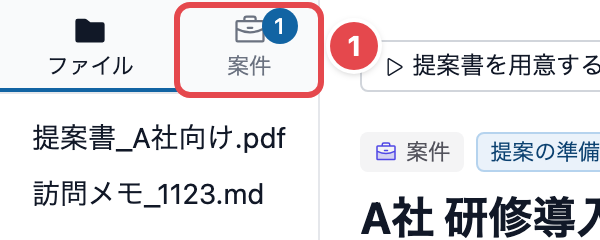
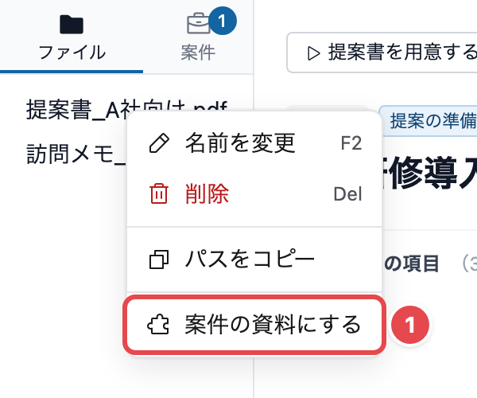
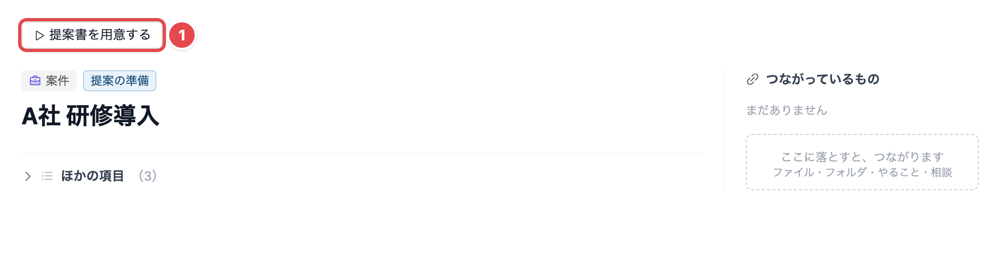
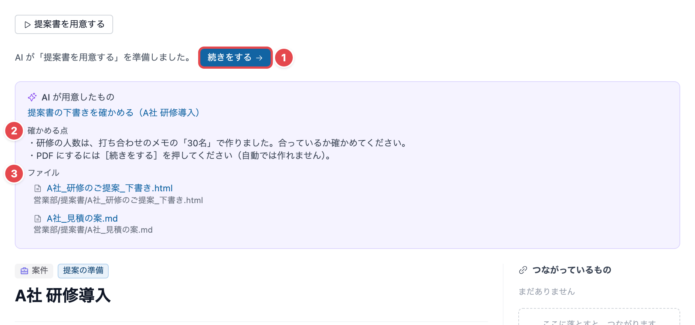
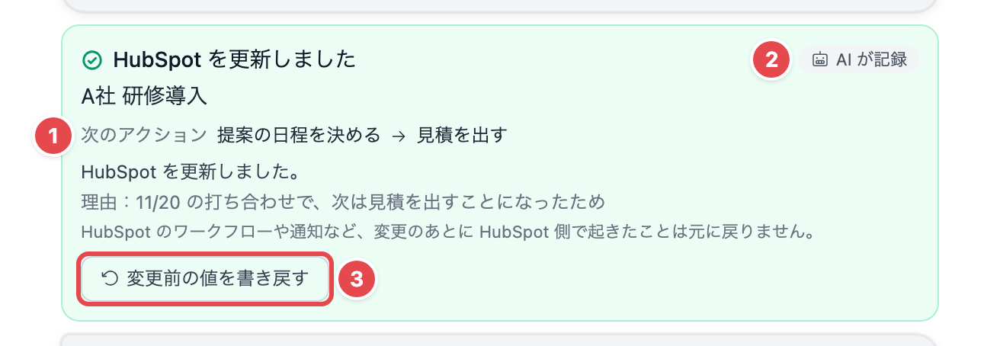
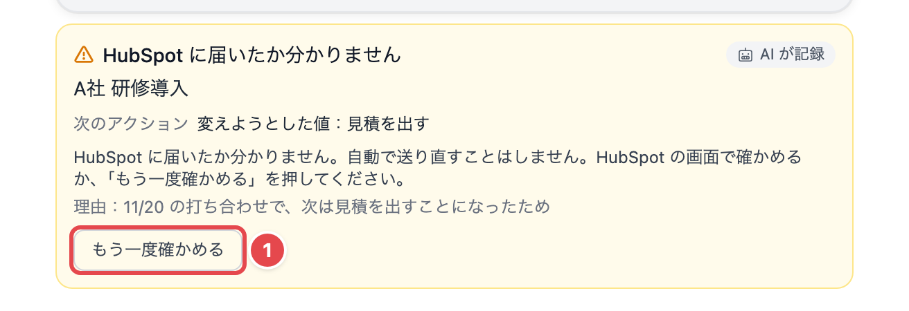

# 31章　会社が入れた仕事の画面（営業部の案件など）

## はじめに

前の章の最後に、こんな疑問が残りました。

「営業部には『案件』の画面があって、AI が手順を進めてくれるらしい。どう使うの？」

会社の営業管理のシステム（顧客台帳）に、商談の金額や段階を入力している人も多いでしょう。入力を間違えて、上司に直してもらったこともあるかもしれません。

ACB では、会社によって、その仕事のための画面（業務の画面）が入っていることがあります。営業部なら「案件」の画面、番組を作る会社なら「番組企画」の画面、といった具合です。**AI は会社の手順どおりに下準備を進め、決める・承認するのは人です。AI が顧客台帳を書き換えても、カードから元に戻せます。**

> **会社によって出るものです**
>
> この章のことは、管理者が業務の画面を入れた会社・部署だけに出ます。画面の名前やボタンの名前は、会社が入れた画面によって違います。この章では、検証A社の営業部の「法人営業」の画面を例にします。ほかにも、番組企画などの画面があります。出ていなければ、読み飛ばしてかまいません。

### この章で分かること

- 業務の画面が、アプリのどこに出るのか
- 手順のボタンと［続きをする］
- AI が顧客台帳を書き換えたあとのカードと、元に戻す方法

---

## 業務の画面が出る場所

業務の画面は、いつものアプリの中に、主に3か所で出ます。

### 左の欄のタブ

左の欄の［ファイル］の横に、業務の画面のタブが増えます。営業部なら「案件」です。

①を押すと、業務の画面が開きます。タブの数字は、その画面であなたの番になっているものの数です。マウスを乗せると、あなたの番の一覧がのぞけます。

### ファイルの右クリック

ファイルを右クリックしたメニューの最後に、業務の画面の操作が増えることがあります。

①のような操作を押すと、業務の画面がそのファイルと一緒に開きます（ここでは、提案書を案件の資料にする操作です）。

### 案件のカード

案件は、22章のプロジェクトと同じカードで開きます。会社が入れた画面によっては、カードの中に、その仕事のための欄が足されます。

---

## 手順のボタン

案件のカードの上には、その案件の段階に合った**手順のボタン**が出ます。

①を押すと、右の「AIへの相談」に、その手順についての相談が開きます。いちばん上に「この手順についての相談：（手順の名前）」と出て、AI は**会社が決めた手順（Skill）どおりに**進めます（Skill は 9章）。

手順の相談の中で AI が使える道具は、その手順に決められたものだけです。たとえば「提案書を用意する」の相談で、AI が勝手に金額を書き換えることはできません。

---

## AI が先に用意したら：［続きをする］

会社が「この手順は AI が自動で始める」と決めていると、会議のあとなどに、AI が先に下準備をしてくれます（AI の番は 21章）。準備ができると、案件のカードの上がこうなります。

1. 「AI が『提案書を用意する』を準備しました。」の横に、①［続きをする］が出ます。
2. その下の「AI が用意したもの」には、②**確かめる点**（AI が決めきれなかったことや、あなたに確かめてほしいこと）と、
3. ③AI が作った**ファイル**が並びます。押すとアプリで開きます。メールの下書きを用意したときは、ここにメールのカードも出ます（30章）。

**自動で用意できるのは、下準備までです。** PDF を作るなど、AI だけではできない作業が残っていることがあり、確かめる点にもそう書いてあります。①［続きをする］を押すと、あなたの相談が開き、AI がこれまでに用意したものを読んでから、残りを一緒に仕上げます。

同じ［続きをする］は、AI が渡してきたやることのカードの上にも出ます。

---

## AI が顧客台帳を書き換えたら

営業部の画面は、会社の顧客台帳（HubSpot のこともあります）とつながっていることがあります。相談の中で AI が顧客台帳の欄を書き換えると、結果のカードが出ます。

1. **何が変わったか**（①）— 変えた欄と、前の値 → 新しい値が出ます。その下に、AI がそうした理由も出ます。
2. **だれがしたか**（②）— 「AI が記録」は、AI があなたの代わりに変え、そのように記録されているしるしです。
3. **間違えたら**（③）— ［変更前の値を書き戻す］を押すと、前の値に戻します。

ただし、カードにも書いてあるとおり、**顧客台帳の側で、変更のあとに起きたこと（ワークフローや通知など）は元に戻りません。** また、AI が書き換えたあとにほかの人がその欄を変えていたら、書き戻しません。

新しく作ったもの（商談の記録など）なら、ボタンは［作ったものを取り消す］になります。顧客台帳のごみ箱に移します。

### 結果が分からないとき

顧客台帳から答えが返ってこなかったときは、こう出ます。

ACB は、自動で送り直しません（二重に書かないためです）。①［もう一度確かめる］を押すと、顧客台帳をもう一度読んで、変わっていたかを確かめます。顧客台帳の画面で確かめてもかまいません。

ほかに、こんなカードが出ることもあります。

- 「先にほかの変更がありました」— あなたや AI より先に、だれかがその欄を変えていました。何も変えていません。最新の値を確かめてから、もう一度頼んでください。
- 「値は変わっていますが、確かめきれていません」— 顧客台帳はその値になっていますが、ACB が書いたとは確かめられませんでした（同じ値をほかの人が入れたのかもしれません）。この場合は書き戻せません。

### 金額などは承認のお願いになる

金額の変更や、受注・失注にするなど、会社が「人が決める」と決めた変更は、AI が書き換えずに**承認のお願い**になります（23章）。承認されるまで、顧客台帳には何も書きません。

AI が顧客台帳を**読むだけ**のこともあります（案件の今の状態を調べる、など）。読んだことは記録に残りますが、読んだ中身は保存しません。

---

## 山田さんの場合

営業部の「A社 研修導入」の案件を開くと、「提案書を用意する」のボタンがありました。会社がこの手順を自動で始めるようにしていたので、翌朝には AI が提案書の下書きと確かめる点を用意していました。

山田さんは確かめる点の「研修の人数は 30名で作りました」を読んで合っていることを確かめ、［続きをする］で PDF まで仕上げてもらいました。顧客台帳の「次のアクション」は AI が書き換えてくれましたが、金額の変更は承認のお願いになり、佐藤さんが承認しました。

---

## まとめ

- 業務の画面は、左の欄のタブ、ファイルの右クリック、案件のカードの中に出ます。会社が入れたときだけです。
- 手順のボタンを押すと、その手順についての相談が開き、AI は会社の手順どおりに進めます。
- AI が先に下準備をしたら、［続きをする］で残りを仕上げます。
- AI が顧客台帳を書き換えたら、カードで何が変わったかが分かり、［変更前の値を書き戻す］で戻せます。結果が分からないときは［もう一度確かめる］。
- 金額などの大事な変更は、承認のお願いになります。決めるのは人です。

## やってみよう

1. 左の欄に、業務の画面のタブがあるか見てみましょう。あれば、マウスを乗せて「あなたの番」の一覧をのぞいてみましょう。
2. 案件のカードに手順のボタンがあれば、押して、開いた相談のいちばん上の「この手順についての相談」を読んでみましょう。

---

顧客台帳はアプリの画面で操作できますが、配信ツールのように、ウェブの「サイト」でしか操作できない仕事もあります。

そういう作業も、AI に任せられるのでしょうか？
