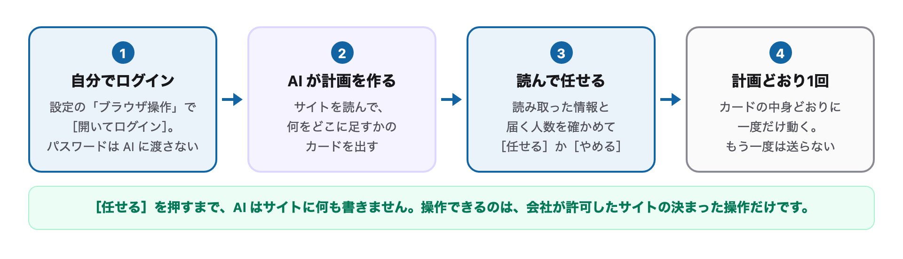
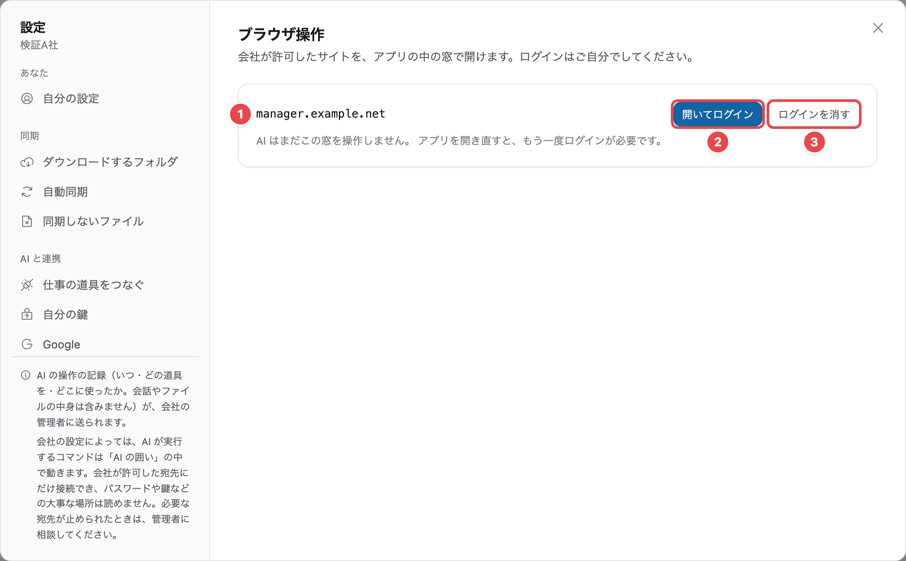
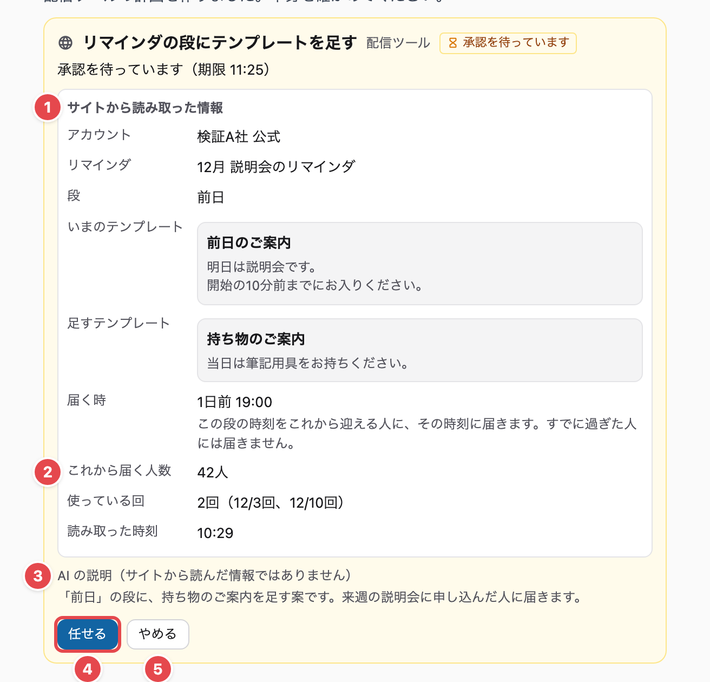
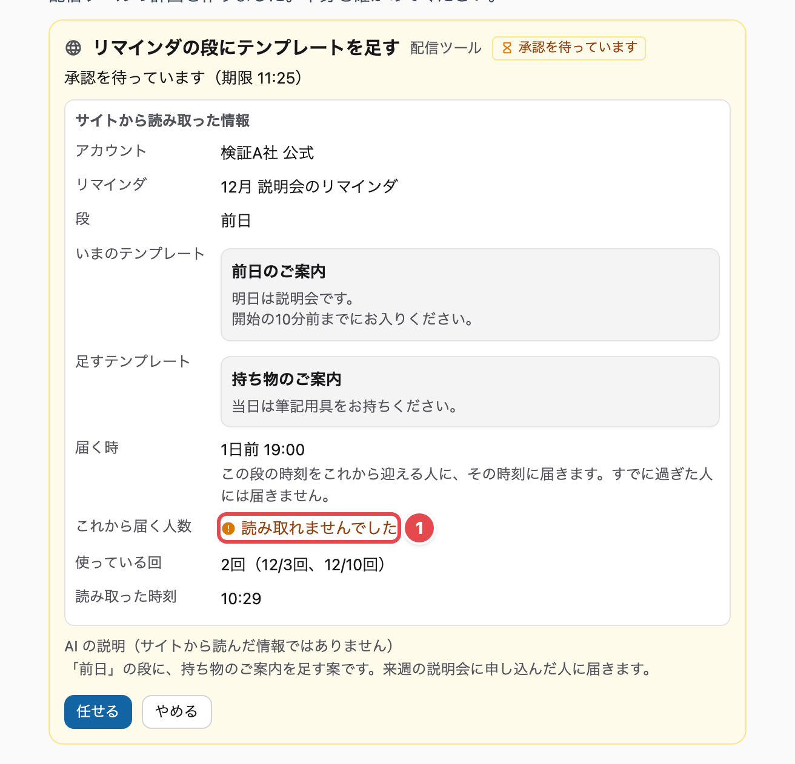
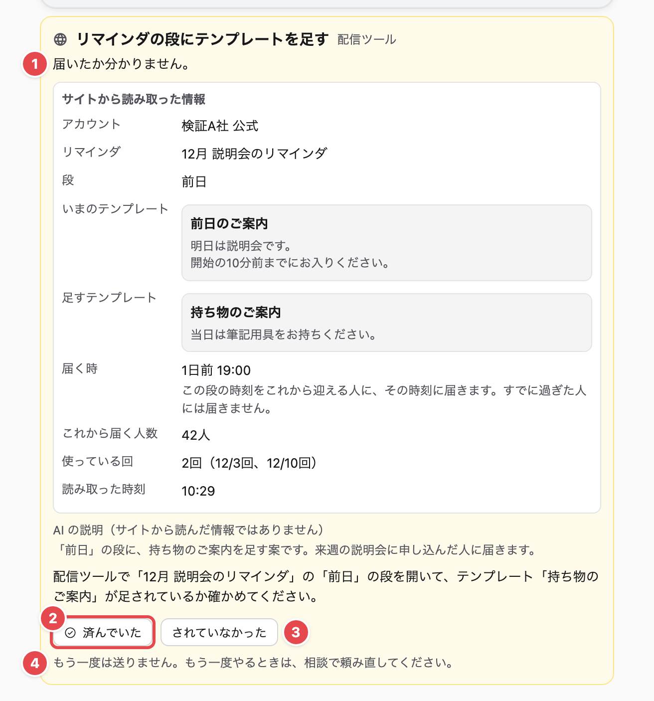
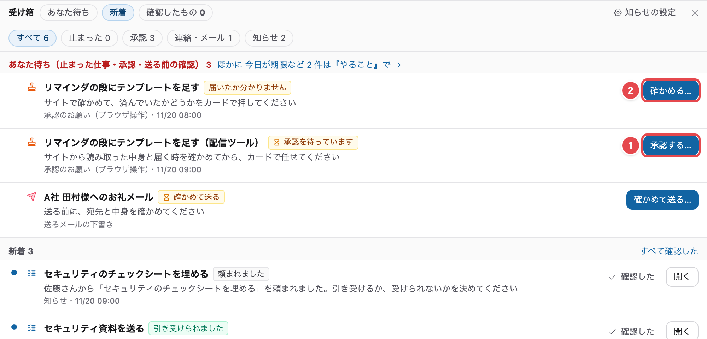

# 32章　AI にサイトを操作してもらう（ブラウザ操作）

## はじめに

前の章の最後に、こんな疑問が残りました。

「サイトでしか操作できない仕事も、AI に任せられる？」

毎週、配信ツールのサイトにログインして、同じ手順でお知らせを足している。押し間違えると、お客さんに変なメッセージが届いてしまう。そんな作業がある人もいるでしょう。

ACB の「ブラウザ操作」では、AI が会社の許可したサイトを操作します。とはいえ、AI がサイトを勝手にクリックして回るわけではありません。**AI はまず「何をするか」の計画をカードで見せます。あなたが読んで［任せる］を押すまで、AI はサイトに何も書きません。**

> **いま試しています**
>
> この機能は、いま一部の PC で試しています。会社で使うことになったら出ます。いまのアプリでは、計画のカードが出ても「この機能は、このアプリではまだ使えません。」となり、［任せる］は押せません。この章は、使えるようになったときのために読んでおいてください。

### この章で分かること

- AI がサイトを操作するときの流れ
- サイトへのログインのしかた（パスワードは AI に渡しません）
- 計画のカードの読み方と、［任せる］［やめる］
- 結果が分からないときにすること

---

## 流れを先に見ておきましょう

**操作できるのは、管理者が許可したサイトの、決まった種類の操作だけです。** たとえば「配信ツールのリマインダの段に、お知らせを1つ足す」のように、サイトごとに決まった操作の型があり、AI はその型の中でしか動けません。

---

## サイトには、あなたがログインする

設定の「ブラウザ操作」に、会社が許可したサイトが並びます（会社が使っていて、許可したサイトがあるときだけ、この項目が出ます）。

1. ①が、会社が許可したサイトです。
2. ②［開いてログイン］を押すと、アプリの中に、そのサイトの窓が開きます。**ログインは、あなた自身がします。** パスワードを AI に教えることはありません。
3. ③［ログインを消す］で、この PC に残ったログインをいつでも消せます。

ログインをどこまで覚えているかは、サイトの下に1行で出ます。たいていは「ログインはアプリを閉じるまで覚えています」で、アプリを開き直すと、もう一度ログインが要ります。

AI に頼んだときに窓が閉じていても、ログインが残っていれば、窓は自動で開きます。ログインが切れていたら、開いた窓でログインしてから、もう一度頼んでください。

---

## AI に頼むと、まず計画のカード

ログインした窓が開いている状態で、相談でこう頼みます。

> 配信ツールの「12月 説明会のリマインダ」の前日の段に、持ち物のご案内を足して。

AI はサイトを読んで、計画を作り、相談の中に「承認のお願い（ブラウザ操作）」のカードを出します。

1. **サイトから読み取った情報**（①）— どのアカウントか、どのリマインダのどの段か、いまのテンプレート、足すテンプレート、届く時などが、サイトから読んだそのままで並びます。
2. **これから届く人数**（②）— この操作で、これからお知らせが届く人の数です。思っていたより多くないか、必ず見てください。
3. **AI の説明**（③）— 「サイトから読んだ情報ではありません」と、はっきり分けてあります。AI の説明と、サイトにある本当の情報を取り違えないためです。
4. よければ④［任せる］。**押したときだけ、この計画の中身どおりに、一度だけ**動きます。
5. やめるなら⑤［やめる］。サイトには何も送りません。

計画には期限があります（カードの上に「承認を待っています（期限 …）」と出ます）。過ぎたら、相談で頼み直してください。

### 「読み取れませんでした」と出たら

サイトから読み取れなかった数は、0 とは書かずに、黄色で「読み取れませんでした」と出ます。

**0 人なのか、分からないのかは、まったく違います。** 読み取れなかったときは、サイトの画面で人数を確かめてから決めてください。心配なら［やめる］で大丈夫です。

---

## 終わったら

うまくいくと、カードに「計画どおりの状態になっています。」と出ます。途中で止まったときは、「送る前に止めました。この操作の送信は行っていません。」のように、何が起きたかが出ます。

### 届いたか分からないとき

通信が切れるなどして、サイトに届いたかどうか分からないこともあります。

1. ①の下に、どこを見ればよいかが書いてあります。そのとおり、サイトの画面で確かめます。
2. 足されていたら②［済んでいた］。
3. 足されていなかったら③［されていなかった］。

④のとおり、**もう一度送るボタンはありません。** もう一度やるときは、相談で頼み直してください。二重に送ってしまわないためです（30章のメールと同じ考え方です）。

---

## 受け箱にも出ます

ブラウザ操作を使っている会社では、受け箱（25章）にも、計画のカードの行が出ます。

①［承認する…］や②［確かめる…］を押すと、一覧の横に計画のカードが開くだけです。**受け箱の行から直接任せることはありません。** カードを読んでから押します。

---

## 山田さんの場合

（使えるようになったら）山田さんは、来週の説明会の前日のお知らせに、持ち物のご案内を足したいと思いました。設定の「ブラウザ操作」で［開いてログイン］を押して配信ツールにログインし、相談で頼みます。

出てきたカードで、リマインダと段が合っていること、「これから届く人数」が申し込みの人数と同じくらいであることを確かめてから、［任せる］を押しました。

---

## まとめ

- ブラウザ操作は、いま一部の PC で試しています。会社で使うことになったら出ます。
- 操作できるのは、会社が許可したサイトの、決まった操作だけです。
- ログインはあなた自身がします。パスワードは AI に渡しません。
- AI はまず計画のカードを出します。サイトから読み取った情報と AI の説明は分けて出ます。［任せる］を押したときだけ、計画どおりに一度だけ動きます。
- 届いたか分からないときは、サイトで確かめて［済んでいた］か［されていなかった］。もう一度送るボタンはありません。

## やってみよう

1. 設定に「ブラウザ操作」の項目があるか見てみましょう。なければ、いまは使っていない会社です。
2. 使える会社なら、［開いてログイン］でサイトの窓を開き、自分でログインしてみましょう。

---

これで、「つなぐと広がる」の部はおしまいです。Google・Slack・ドライブ・メール・会社の画面・サイトと、AI が外とつながる場面を見てきました。

つなぐものは分かりました。今度は、毎日の操作をもっと速くしたくなってきます。あのファイルを、フォルダをたどらずにすぐ開けないでしょうか？　それは 33章で見ていきます。
