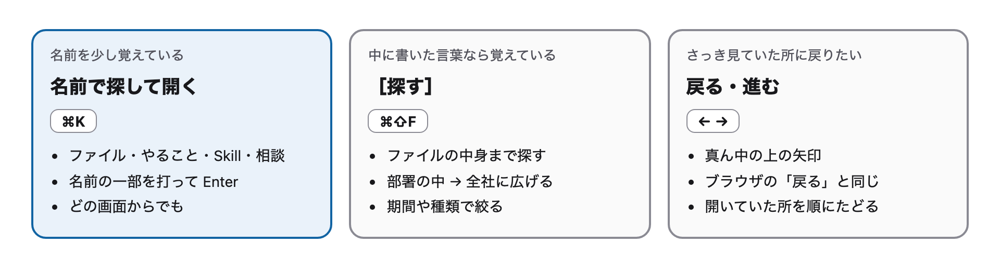
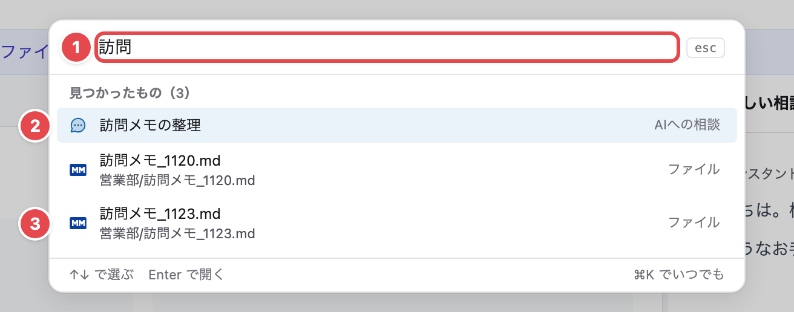
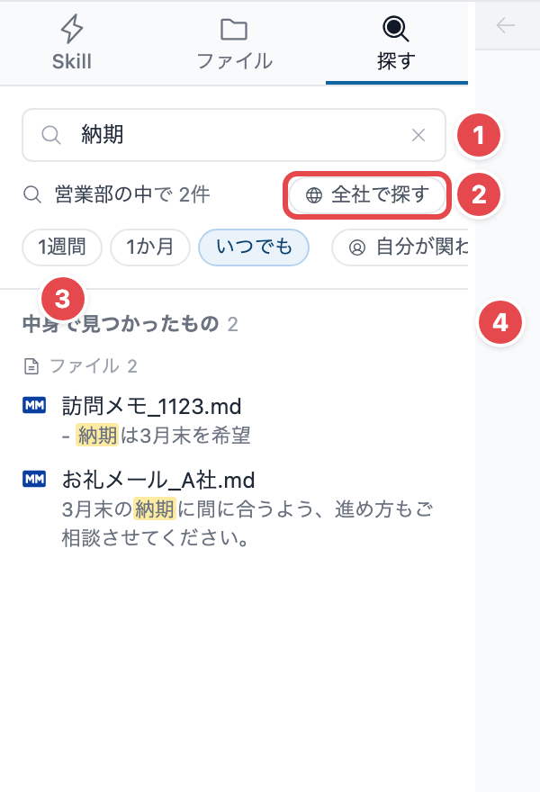
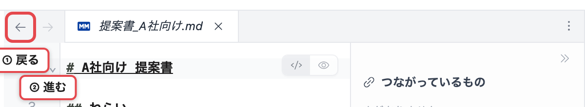
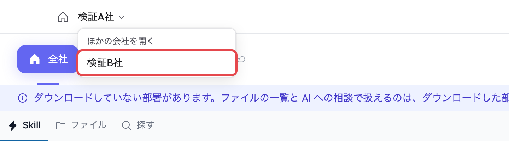

# 33章　探して開く・画面を自分の形に

## はじめに

前の章の最後に、こんな疑問が残りました。

「あのファイル、フォルダをたどらずにすぐ開けないの？」

Mac なら、Spotlight（⌘スペース）で名前の一部を打てば、アプリやファイルがすぐ開きますね。ブラウザでは「戻る」ボタンで、さっきのページに戻れます。ノートパソコンの小さな画面では、いらない欄を閉じて広く使いたいこともあるでしょう。

ACB にも、同じような近道があります。**覚えておくのは ⌘K ひとつで十分です。** 名前の一部を打てば、ファイルも、やることも、相談も開けます。

### この章で分かること

- ⌘K で、名前から探して開く
- 左の［探す］で、中に書いた言葉から探す
- ← → で、さっき見ていた所に戻る
- 画面の形を変える・いつもの形に戻す
- 2つの会社に入っているときの切り替え

---

## どれを使えばいい？

探し方は3つあります。何を覚えているかで選びます。

---

## ⌘K：名前で探して開く

どの画面にいても、⌘K（command キーと K を同時に押す）を押すと、真ん中に「探す」の窓が開きます。

1. ①に、名前の一部を打ちます。ここでは「訪問」と打ちました。
2. 名前に「訪問」が入っているものが並びます。②は前に AI とした「訪問メモの整理」という相談、③は営業部の訪問メモ（ファイル）です。右はしに、それが何か（AIへの相談・ファイルなど）が出ます。
3. 上下の矢印キーで選んで Enter を押すか、押したいものをクリックすると開きます。

⌘K で見つかるのは、次のようなものです。

- ファイル（あなたの PC にある会社のファイル）
- やること・プロジェクト・決めたことなど
- Skill（押すと Skill のところが開きます）
- AI への相談（押すと右の「AIへの相談」で開きます）
- 受け箱・記録の一覧・片づけたタブ・この「使い方」などの画面（「受け箱」「使い方」のように打つと出ます）

何も打たないうちは、「最近開いたもの」として、いま真ん中に開いているタブが新しい順に並びます。

Esc を押すと閉じます。⌘P でも、同じ窓が開きます。

---

## ［探す］：中に書いた言葉で探す

「名前は忘れたけれど、『納期』と書いたメモがあったはず」。そんなときは、左の欄の［探す］を使います（⌘⇧F でも開きます）。

1. ①に、覚えている言葉を打ちます。
2. はじめは、いま開いている部署（ここでは営業部）の中を探します。②［全社で探す］を押すと、会社全体に広げます。
3. ③で、期間（1週間・1か月・いつでも）や、［自分が関わった］ものだけに絞れます。見つかったものが多いときは、その下に種類（やること・ファイルなど）のボタンが出て、種類でも絞れます。
4. 「名前で見つかったもの」の下に、④「中身で見つかったもの」が並びます。ファイルなら、言葉が出てくる行が一緒に見えます。押すと、そのファイルが開きます。

やることやプロジェクトについての AI への相談も、一緒に見つかります。

> **ダウンロードしていない部署は？**
>
> あなたの PC に入れていない部署（3章）のファイルの中は、探せません。そのときは「ダウンロードしていないフォルダのファイルは探していません」と出ます。中を探したいときは、AI に頼む方法があります（37章）。

何も打たないうちは、「最近開いたもの」「自分が関わっている進行中のプロジェクト」「この1週間の会議」が並びます。朝いちばんに開くと、どこから手をつけるかの目安になります。

---

## ← →：さっき見ていた所に戻る

ファイルを次々に開いていると、「さっき見ていた提案書はどれだっけ」となりがちです。ブラウザの「戻る」と同じボタンが、真ん中の上にあります。

①を押すと、前に開いていたファイルややることに戻ります。戻りすぎたら、②で進みます。

---

## 画面を自分の形に

タイトルの右よりに、「画面の形」のボタンがあります。

1. ①で、左の欄（ファイルの一覧など）を閉じたり出したりします。⌘B でも同じです。
2. ②で、右の「AIへの相談」を閉じたり出したりします。⌘⇧C でも同じです。
3. 欄と欄の間の仕切りは、ドラッグして幅を変えられます。
4. 形がおかしくなったら、右はしのあなたの丸から［画面をいつもの形に戻す］を押すと、最初の大きさに戻ります。

下に開く受け箱は、⌘J で開いたり閉じたりできます（25章）。

**長い資料を書くときは ⌘B で左を閉じて広く、AI と話すときは ⌘⇧C で右を出す。** 迷ったら［画面をいつもの形に戻す］を押せば大丈夫です。

---

## 2つの会社に入っているとき

2つ以上の会社に入っている人は、タイトルの左の会社の名前を押すと、ほかの会社に切り替えられます。

切り替えるときに、次のように聞かれることがあります。

- **同期の途中です** — ［終わったら切り替える］を押すと、同期が終わってから切り替わります。待っている間は「同期が終わったら会社を切り替えます」と出て、［やめる］で取りやめられます。
- **AIが作業中です** — 切り替えると、AI の作業はそこで止まります（ここまでのやり取りは保存されます）。急がないなら［キャンセル］して、AI の作業が終わってから切り替えましょう。

---

## 山田さんの場合

山田さんは、朝いちばんに ⌘K を押して「訪問」と打ち、きのうの訪問メモを開きました。

「A社の納期、どこかに書いたな」と思ったときは、［探す］で「納期」と打ちました。訪問メモの1行と、お礼メールの下書きの1行が見つかりました。

提案書を書くときは ⌘B で左の欄を閉じ、画面を広く使いました。書き終わったら［画面をいつもの形に戻す］で元どおりです。

---

## まとめ

- ⌘K で、名前の一部を打てば、ファイル・やること・Skill・相談・画面を開けます。⌘P でも同じ窓です。
- 中に書いた言葉で探すときは、左の［探す］（⌘⇧F）。［全社で探す］で広げ、期間や種類で絞れます。
- 真ん中の上の ← → で、前に見ていた所に戻れます。
- ⌘B で左の欄、⌘⇧C で AI の欄を閉じたり出したり。［画面をいつもの形に戻す］で最初の形に戻ります。
- 会社の切り替えは、タイトルの会社の名前から。同期の途中なら、終わってから切り替えます。

## やってみよう

1. ⌘K を押して、自分の部署のファイルの名前の一部を打ち、Enter で開いてみましょう。
2. 左の［探す］で、メモに書いた言葉を1つ探してみましょう。［全社で探す］も押してみましょう。
3. ⌘B と ⌘⇧C で欄を閉じてから、あなたの丸の［画面をいつもの形に戻す］で元に戻してみましょう。

---

探して開けるようになると、今度は真ん中のタブがどんどんたまっていきます。ちょっとしたメモの置き場所にも迷います。

タブはどう片づければいいのでしょうか？　その日のメモは、どこに書けばいいのでしょうか？
