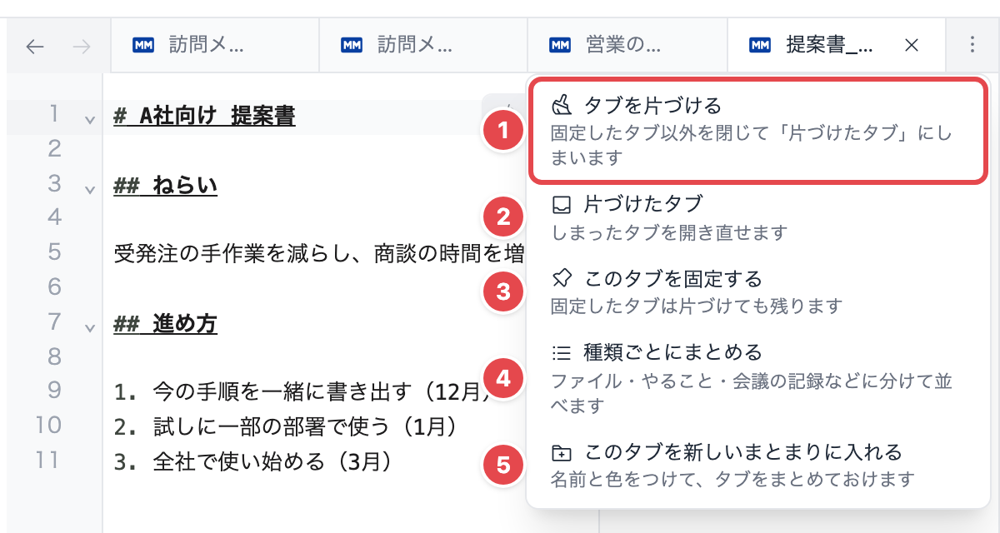
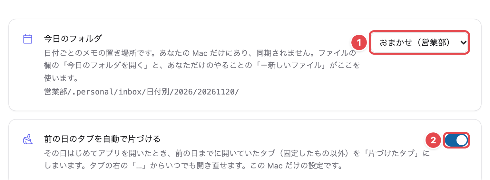
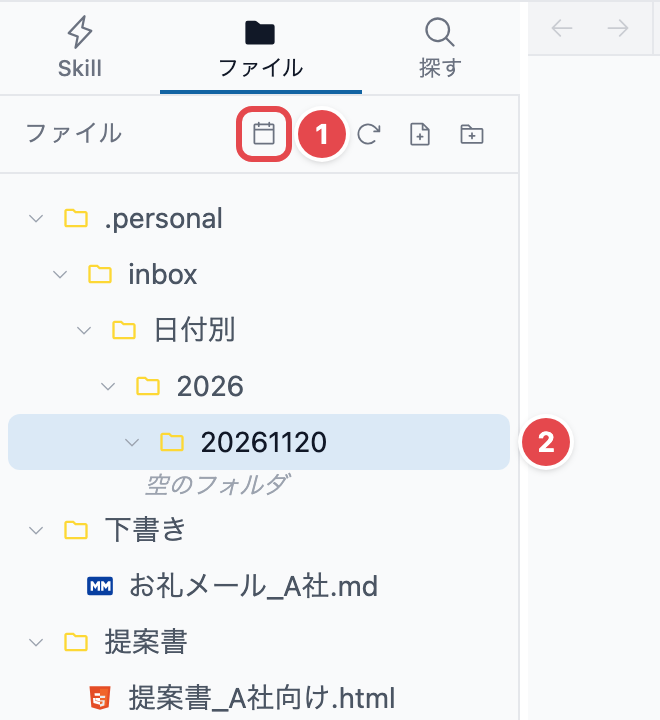
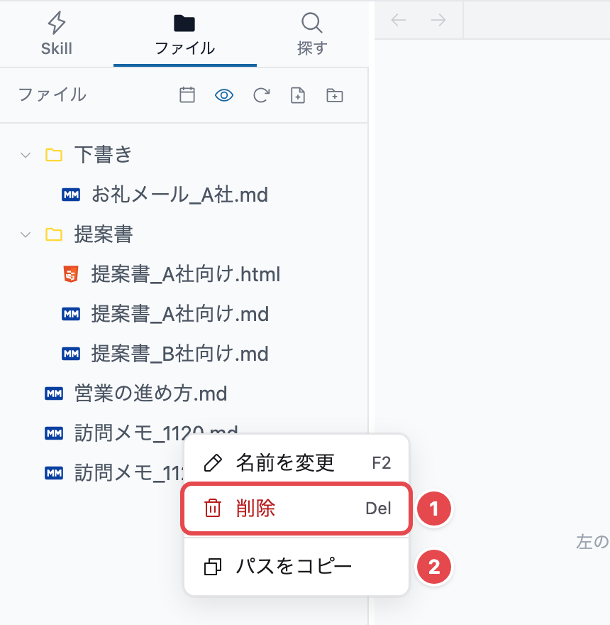
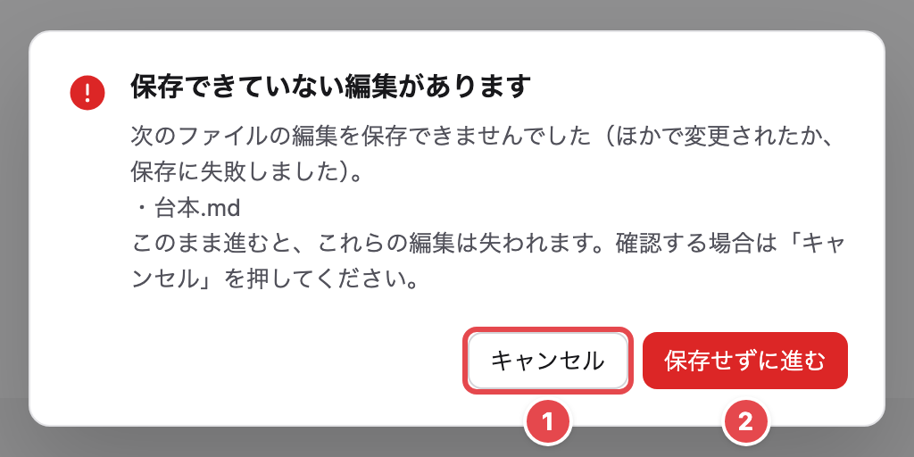

# 34章　タブ・今日のフォルダ・ファイルの小技

## はじめに

前の章の最後に、こんな疑問が残りました。

「タブがたまってきた。片づけ方は？　その日のメモは、どこに書けばいい？」

ブラウザのタブが30個になって、どれがどれだか分からなくなったことはありませんか？　デスクトップに「メモ.txt」「メモ (2).txt」がたまっていく、という人もいるでしょう。

ACB には、タブを一度にしまって、あとで開き直せるしくみがあります。その日のメモには、**あなたの Mac の中だけにある「今日のフォルダ」**が使えます。ほかの人には届かないので、気軽に書けます。

### この章で分かること

- タブを片づける・固定する・まとめる
- 今日のフォルダ（その日のメモの置き場所）
- ファイルを消す・移す・Finder から取り込む
- アプリを閉じるときに「保存できていない編集があります」と出たら

---

## タブを片づける

ファイルの一覧でファイルを1回押すと、名前が斜めの字のタブで開きます。これは「ちょっと見るだけ」のタブで、次のファイルを押すと入れ替わります。ダブルクリックするか、書き始めると、タブがそのまま残ります。

残したタブが増えてきたら、タブの右はしの「…」（タブの操作）を押します。

1. ①［タブを片づける］— 固定したタブ以外を閉じて、「片づけたタブ」にしまいます。閉じる前に、書きかけは保存されます（保存できないタブは閉じずに残します）。
2. ②［片づけたタブ］— しまったタブが日付ごとに並び、開き直せます。消えてしまうわけではないので、安心して片づけてください。
3. ③［このタブを固定する］— いつも使うファイルは固定しておくと、片づけても残ります。
4. ④［種類ごとにまとめる］— ファイル・やること・会議の記録などに分けて並べます。種類ごとに片づけることもできます。
5. ⑤［このタブを新しいまとまりに入れる］— 「A社の提案」のように名前と色をつけて、タブをまとめておけます。

相談で「タブを片づけて」と AI に頼んでも、同じように片づけてくれます。AI が片づけるのは、あなたが頼んだときだけです。

### 毎朝、自動で片づける

設定の「自分の設定」にある「前の日のタブを自動で片づける」がオンなら、その日はじめてアプリを開いたときに、前の日までのタブ（固定したもの以外）が「片づけたタブ」にしまわれます。

②のスイッチで、オン・オフを切り替えます。「片づけたタブ」も、この設定も、この Mac だけのものです。

---

## 今日のフォルダ：その日のメモの置き場所

電話のメモ、会議の走り書き、AI に読ませたい下書き。そういう「その日のもの」は、今日のフォルダに置きます。

ファイルの一覧の上にあるカレンダーのボタン（今日のフォルダを開く）を押すか、⌘⇧T を押します。

1. ①を押すと、部署のフォルダの中に、日付のフォルダ（②）ができて開きます。
2. ②の中に、［新規ファイル］でメモを作ります（5章）。

今日のフォルダは、**あなたの Mac の中だけにあります。同期しても、ほかの人には届きません。** 会社のサーバーにも送られないので、PC が壊れると一緒になくなります。みんなに見せたいもの・残したいものができたら、部署のふつうのフォルダに移しましょう（このあと「ファイルを移す」）。

どの部署の中に作るかは、設定の「自分の設定」で選べます（上の写真の①）。「おまかせ」のときは、あなたが所属する部署のうち、この PC にダウンロードしてある部署に作ります。

あなただけのやることのカードで「＋新しいファイル」を押して作ったファイルも、この今日のフォルダに入ります。

---

## ファイルを消す・移す・取り込む

5章では、新しいファイルを作る・名前を変えるを見ました。右クリックのメニューには、ほかにもこんなものがあります。

- **［削除］**（①）— 確かめの画面が出てから消えます。**この操作は取り消せません。** 同期すると、ほかの人の PC からも消えます。いくつか選んでから右クリックすると、まとめて消せます。
- **［パスをコピー］**（②）— ファイルの場所を文字でコピーします。AI に「このファイルを読んで」と頼むときに貼りつけると便利です。
- **ファイルを移す** — ファイルをつかんで（ドラッグして）、移したいフォルダの上で放します。⌘ を押しながら押して、いくつか選んでからまとめて移すこともできます。

> **非公開フォルダをまたぐとき**
>
> ふつうのフォルダと非公開フォルダの間で移すときは、確かめの画面が出ます。非公開フォルダの中のものをふつうのフォルダに移すと、次の同期でみんなの手元に届きます。反対に、ふつうのフォルダから非公開フォルダへ移しても、これまでに配られた分はみんなの手元に残ります。よく読んでから進めてください。

### Finder から取り込む

Finder のファイルを、ACB のファイルの一覧のフォルダの上にドラッグすると、そのフォルダに入ります。ファイルの上で放したときは、そのファイルと同じフォルダに入ります。

- **元の場所からは移動します（コピーではありません）。** 手元にも残したいときは、先に Finder でコピーを作っておきましょう。
- 入れられるのは、画像（png・jpg など）・PDF・Word・Excel・PowerPoint・HTML・テキスト・CSV などの決まった種類で、1つ 20MB までです。それ以外は「非対応の形式」「20MBを超えています」と出て、入りません。

反対に、ACB のファイルをほかのアプリ（メールやチャットなど）に渡したいときは、**option キーを押しながら**ドラッグします。

---

## 閉じるときに「保存できていない編集があります」と出たら

アプリを閉じるとき、ACB は開いているファイルの書きかけを、先に全部保存します。ふだんは何も聞かれずに閉じます。

ほかの人や AI が同じファイルを先に変えていたなどで、保存できなかったときだけ、こう聞かれます。

1. まずは①［キャンセル］を押して、画面に書いてあるファイルを開き、書いた内容を確かめましょう（書いた文をコピーしておくと安心です）。
2. ②［保存せずに進む］を押すと、その書きかけは失われます。いらないと分かっているときだけ押してください。

---

## 山田さんの場合

山田さんは、朝 ⌘⇧T で今日のフォルダを開き、「電話メモ.md」を作って、A社の田村さんからの電話の内容を書きました。夕方、AI に「今日のフォルダの電話メモを読んで、やることにして」と頼みました。

提案書と見積は［このタブを固定する］で固定しておき、ほかのタブは［タブを片づける］で一度にしまいました。翌朝は、前の日のタブが自動で片づいていて、固定した2つだけが残っていました。

---

## まとめ

- タブの「…」から［タブを片づける］。しまったタブは［片づけたタブ］で開き直せます。よく使うタブは固定しておきます。
- 「前の日のタブを自動で片づける」で、毎朝タブがすっきりします。
- 今日のフォルダ（⌘⇧T）は、その日のメモの置き場所です。あなたの Mac だけにあり、ほかの人には届きません。
- ファイルは右クリックで［削除］（取り消せません）、ドラッグで移動。Finder から入れると、元の場所からは移動します。
- 閉じるときに「保存できていない編集があります」と出たら、まず［キャンセル］で確かめます。

## やってみよう

1. ⌘⇧T で今日のフォルダを開き、メモを1つ作ってみましょう。
2. いくつかファイルを開いてから、1つを固定し、［タブを片づける］を押してみましょう。［片づけたタブ］から開き直せることも確かめましょう。

---

ファイルとタブは片づきました。毎日いちばん使うのは、AI への相談です。

よく使う相談をすぐに開くには？　打つのが面倒なときは、話しかけて頼めないでしょうか？
