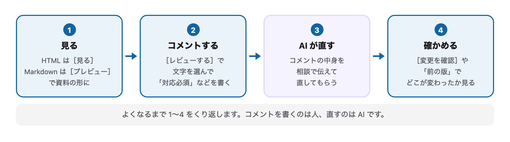
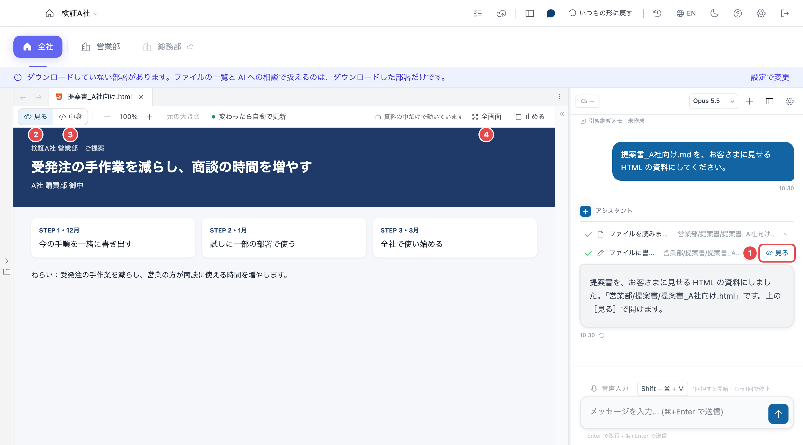
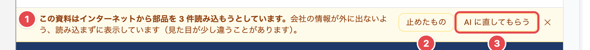
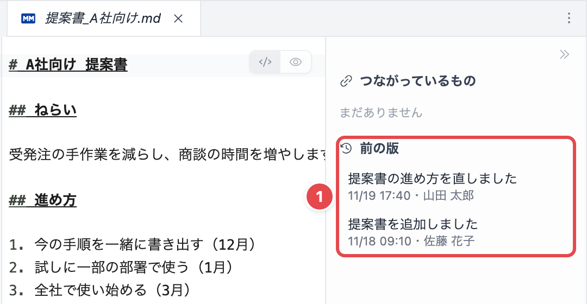
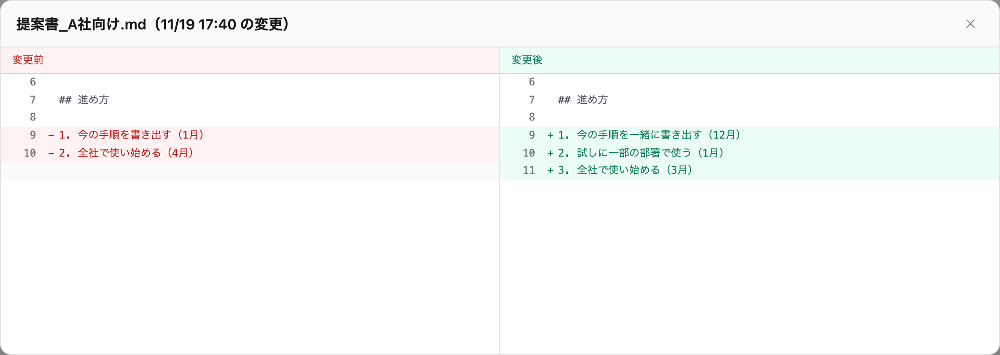
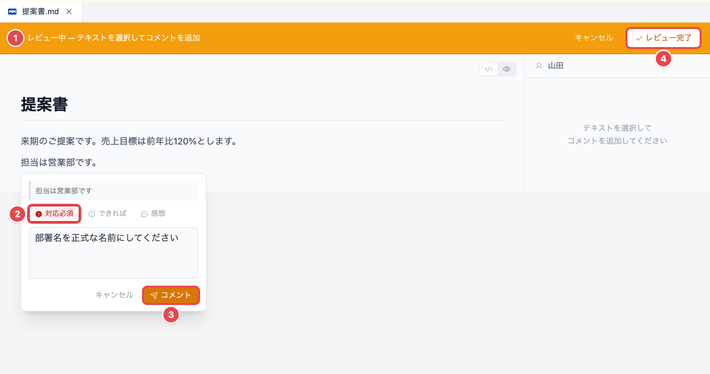
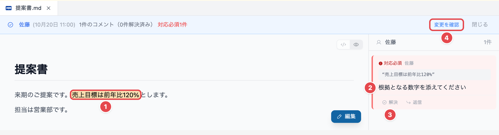

# 36章　AI が作った資料を見る・確かめる

## はじめに

前の章の最後に、こんな疑問が残りました。

「AI が HTML の資料を作ってくれた。どう開いて確かめるの？　直してほしいところは？」

メールに添付された HTML のファイルを開いたら、見た目が崩れていた、ということはありませんか？　Word なら、直してほしい所にコメントを付けて返しますね。Google ドキュメントの「変更履歴」で、前の版と比べたこともあるでしょう。

ACB では、AI が作った資料を**資料の形のまま**開いて確かめ、文書にコメントを付け、前の版と比べられます。**AI の資料は「見る → コメント → 直してもらう → 確かめる」をくり返して仕上げます。**

### この章で分かること

- HTML の資料を開く：［見る］と［中身］
- 「インターネットの部品」の帯が出たら
- Markdown の資料を読みやすく見る
- 「前の版」で、どこが変わったかを見る
- 文書にコメントを付ける（レビュー）

---

## HTML の資料を［見る］

AI に「提案書を、お客さまに見せる HTML の資料にして」のように頼むと、AI は HTML のファイルを作ります。相談の中の、そのファイルを書いた行に［見る］が出ます。

1. ①［見る］を押すと、真ん中のタブで、資料が資料の形で開きます。ファイルの一覧で .html のファイルを押しても開けます。
2. ②［見る］が資料の形、③［中身］が HTML の文字そのものです。ふだんは［見る］で確かめます。
3. 上の − ＋ で縮小・拡大、［元の大きさ］で 100% に戻ります。④［全画面］で画面いっぱいに広げ、［全画面を終える］で戻ります。
4. 「変わったら自動で更新」と出ているとおり、AI がファイルを直すと、表示もすぐに新しくなります。

### 資料は「資料の中だけで動いています」

開いた資料は、インターネットにも、ほかのアプリにも、あなたの PC のほかのファイルにも届きません。AI やほかの人が作った資料に何が書いてあっても、会社の情報が外に出ないようにするためです。

- 資料の中のリンクを押すと、「外のサイトを開きますか？」と聞かれます。知っているサイトのときだけ［ブラウザで開く］を押してください。
- 資料の動きが重すぎて止まると、「資料の表示が止まりました」と出ます。［もう一度表示する］で最初から表示します。動き続ける資料は［止める］で止められます。
- 会社のフォルダのいちばん上に置いた HTML は表示できません。部署などのフォルダに入れてください。

---

## 「インターネットの部品」の帯が出たら

資料の上に、黄色い帯が出ることがあります。

1. ①は、資料がインターネットから、文字の形（フォント）や部品のプログラムを読み込もうとした、という知らせです。会社の情報が外に出ないよう、**読み込まずに表示しています**。そのぶん、見た目が少し違うことがあります。
2. ②［止めたもの］を押すと、どこから読み込もうとしたかが出ます。
3. ③［AI に直してもらう］を押すと、「インターネットの部品を使わずに作り直してください」という頼みが、相談の入力欄に入ります。**送るのはあなたです。** 送れば、AI がインターネットの部品を使わない形に作り直し、帯は出なくなります。

いつもそうしてほしいときは、会社の AI への指示に「HTML は 1 つのファイルにまとめ、インターネットの部品を使わない」と書いてもらうと、この帯はほとんど出なくなります（管理者に頼みましょう）。

---

## Markdown の資料を読みやすく見る

「.md」のファイル（Markdown）は、見出しや箇条書きを記号で書いた文書です。真ん中の右上の、目のボタン（プレビュー）を押すと、見出しが大きく、箇条書きが点になった、読みやすい形で表示されます。記号のボタン（エディタ）で、書く画面に戻ります。⌘⇧V でも切り替わります。

プレビューの中を探したいときは、⌘F を押すと、文書の中を検索できます。

---

## 前の版：どこが変わったかを見る

ファイルを開くと、右の欄に「前の版」が出ます。同期でみんなに共有された版が、だれが・いつ変えたかと一緒に並びます。

①の1つを押すと、その時の変更が、左に「変更前」、右に「変更後」で並びます。消した行は赤、足した行は緑です。

**「前の版」は見るだけです。前の版に戻すボタンはありません。** 戻したいところがあれば、変更前の文をコピーして、自分で書き直すか、AI に「ここをこの文に戻して」と頼みます。

まだ一度も同期していないファイルには「まだ共有された版はありません」と出ます。

---

## 文書にコメントを付ける（レビュー）

Word のコメントのように、Markdown の文書に「ここを直して」と書けます。これをレビューと呼びます。

### コメントを書く

プレビューで開いて、右上の［レビューする］を押します。

1. 上に、①オレンジの帯が出ます。
2. 直してほしい文字をマウスでなぞって選ぶと、コメントを書く欄が開きます。
3. ②で種類を選びます。**対応必須**（必ず直してほしい）、**できれば**（直すとよくなる）、**感想**（気づいたこと）の3つです。
4. コメントを書いて、③［コメント］を押します。⌘+Enter でも送れます。
5. 全部書き終わったら、④［レビュー完了］を押します。やめるときは、帯の［キャンセル］です。

### コメントを読んで、直す

だれかのレビューがあると、プレビューの右上に「レビュー履歴 (1)」のように、レビューの数のついたボタンが出ます。押して、読みたいレビューを選びます。

1. コメントが付いた文字には、①のように色がつきます。
2. 右の欄に、②コメントが並びます。［返信］で答えを書けます。
3. 直し終わったコメントは、③［解決］を押して印をつけます。
4. ④［変更を確認］を押すと、レビューを終えた時点から、文書のどこが変わったかが見えます。

コメントを書くのは人です。直すのを AI に頼むときは、「提案書の『売上目標は前年比120%』の所に、根拠の数字を足して」のように、コメントの中身を相談で伝えます。直したら、④［変更を確認］で確かめましょう。

レビューも、同期でほかの人に届きます。ファイルの一覧では、レビューのあるファイルに小さな点がつき、まだ見ていない新しいレビューには新着の点がつきます。

---

## 山田さんの場合

山田さんは、AI に提案書を HTML の資料にしてもらい、［見る］で確かめました。黄色い帯が出たので［AI に直してもらう］を押して送ると、帯が出ない形に作り直されました。

Markdown の提案書は、佐藤さんにレビューを頼みました。佐藤さんの「対応必須：根拠となる数字を添えてください」を読んで、AI に「前年の実績の数字を足して」と頼み、［変更を確認］で直った所を確かめてから［解決］を押しました。

---

## まとめ

- HTML の資料は［見る］で資料の形に、［中身］で文字そのものに。拡大・全画面もできます。
- 資料は「資料の中だけで動いています」。外のサイトは確かめてから開きます。
- 黄色い帯は、インターネットの部品を読み込まなかった知らせ。［AI に直してもらう］で作り直しを頼めます。
- Markdown はプレビューで読みやすく。⌘F で中を探せます。
- 「前の版」で、だれがいつ何を変えたかを見られます（戻すボタンはありません）。
- ［レビューする］で文字を選んでコメント。直したら［変更を確認］と［解決］。

## やってみよう

1. 自分の部署の Markdown のファイルをプレビューで開き、右の「前の版」を1つ押してみましょう。
2. ［レビューする］を押して、文字を選び、「感想」のコメントを1つ書いてから［レビュー完了］を押してみましょう。

---

AI の作ったものを確かめて、仕上げられるようになりました。もっと AI に任せたくなります。

AI は、インターネットで調べものをしてくれるのでしょうか？　自分の PC に入れていない部署の資料や、前の相談まで使えるのでしょうか？
