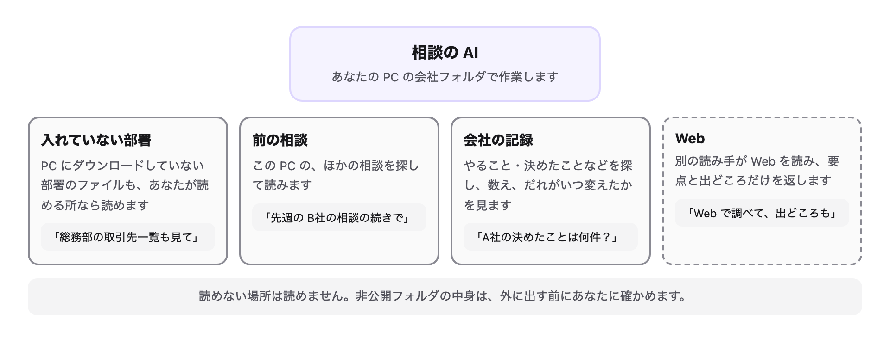
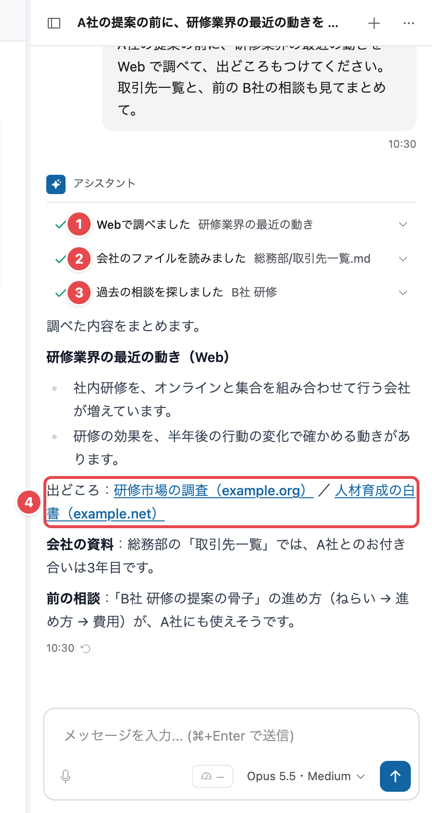
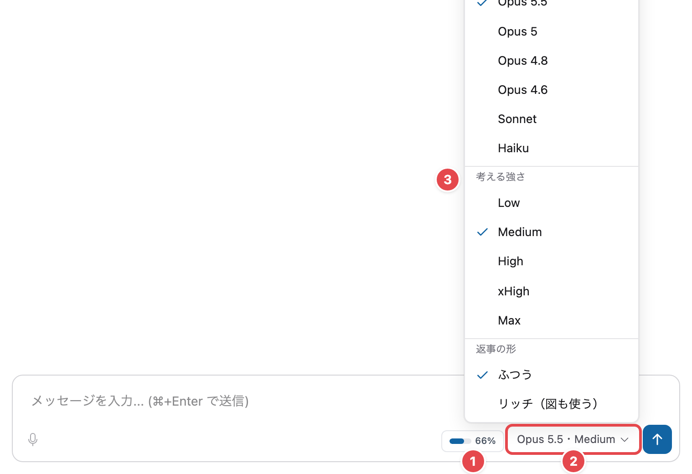
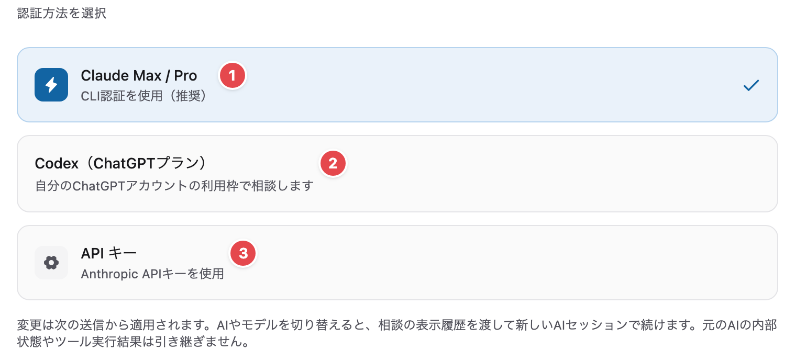

# 37章　AI にもっと頼む

## はじめに

前の章の最後に、こんな疑問が残りました。

「AI は、インターネットで調べものをしてくれるの？　PC に入れていない部署の資料や、前の相談まで使えるの？」

ChatGPT などに Web で調べてもらったら、どこに書いてあった話なのか分からなかった、ということはありませんか？　前に話した内容を、毎回いちから説明し直している人もいるでしょう。

ACB の AI は、あなたの PC の会社フォルダのほかにも、いくつかの場所を自分で探しに行けます。**調べもの・ほかの部署の資料・前の相談は、頼めば AI が自分で探します。** Web で調べた話には、出どころが付きます。

### この章で分かること

- AI が見に行ける場所（Web・入れていない部署・前の相談・会社の記録）
- もう一方の AI に意見を聞く
- 入力欄の中のモデル・考える強さ・利用上限（ふだんは触らなくてよい）
- 引き継ぎメモ
- AI を選ぶ設定と、Codex を使う会社

---

## AI が見に行ける場所

ひとつの頼みで、いくつも組み合わせられます。

### Web で調べる（①）

「〇〇を Web で調べて、出どころもつけて」のように頼みます。

- AI 本人は Web を読みません。**別の読み手が Web を読み、要点と出どころ（④のリンク）だけを AI に渡します。** Web のページに「AI への指示」のような文が書いてあっても、それは資料として扱われ、AI が言いなりになることはありません。
- 調べるのに数分かかることがあります。1つの相談で調べられる回数には上限（20回）があります。
- 大事なことは、④の出どころを開いて、自分の目で確かめましょう。
- AI を「API キー」でつないでいるときは、Web で調べられません（このあとの「AI を選ぶ」）。

### 入れていない部署のファイル（②）

3章で、自分の部署だけを PC にダウンロードしました。**AI は、PC に入れていない部署のファイルも、あなたが読める所なら、会社のサーバーから読めます。** 「総務部の取引先一覧も見て」のように頼みます。

- 読むだけです。AI が作るものは、あなたの PC にある部署のフォルダに置きます。
- あなたが読めない場所は、AI も読めません。
- 非公開フォルダの中は、あなたがはっきり頼んだときだけ探します。非公開フォルダから読んだ中身を、みんなに見える所に出す前には、あなたに確かめます。

### 前の相談（③）

「先週の B社の相談の続きで」「前に見積の進め方を相談したときの結論は？」のように頼むと、AI がこの PC の、ほかの相談を探して読みます。同じ説明をくり返さなくて済みます。

### 会社の記録

やること・決めたことなどの記録（17〜24章）も、AI が探せます。

- 「A社について、先月の決めたことは何件？」— 探して数えます。
- 「この案件の金額を、だれがいつ変えた？」— 変更の記録を見て答えます。

---

## もう一方の AI に聞く

会社が許していれば、いま話している AI とは別の AI（Claude と Codex）に、意見を聞いてもらえます。

- 「この提案書、Codex はどう言ってる？」のように、**あなたがもう一方の AI の名前を書いたときだけ**聞きます。AI が勝手に聞くことはありません。
- 聞き方は、見直し（誤り・抜けを探す）、別の案、反対の立場から、などです。
- 相談の中に「Codex に聞きました」の行が出て、AI が答えをまとめて伝えます。もう一方の AI の答えそのものは、たたまれた「Codex の答えを全部見る」で読めます。
- もう一方の AI が見るのは、この相談の最近のやり取りと、見せたファイル（5つまで）だけです。
- もう一方の AI がこの PC で使えないときは、「使えないので聞けませんでした」と返ってきます。

会社が許していないときは、聞けません（管理者が決めています）。

---

## 入力欄の中の目盛り・モデル・考える強さ

入力欄の右下には、こんなものが並んでいます。

1. ①**利用上限の目盛り** — あなたの AI の利用枠を、どのくらい使ったかの目安です。マウスを乗せると、5時間・1週間ごとの使った割合が出ます。100% に近づいたら、急がない頼みは後にしましょう。
2. ②**モデルと考える強さ** — どの AI のモデルで、どのくらい深く考えるかです（「Opus 5.5・Medium」のように出ます）。押すと③が開き、モデルと考える強さを選べます。**ふだんは触らなくて大丈夫です。** 会社から使い分けを言われたときだけ変えます。AI の返事を待っている間は、モデルは変えられません。同じところの「返事の形」で「リッチ（図も使う）」を選ぶと、その相談では AI が図を使って説明しやすくなります（いつもは「ふつう」のままで大丈夫です）。返事に図があれば、どちらでも図として表示されます。

相談のいちばん上の右にある「…」（その他の操作）には、［引き継ぎメモ］、表示の切り替え、［別ウィンドウで開く］（35章）、［相談の設定（使う AI）］があります。

---

## 引き継ぎメモ

引き継ぎメモは、長い相談を続けるための要点のメモです。

- やり取りが長くなると（およそ 16往復か、12,000字くらいから）、AI が自動で要点をまとめます。メモができると、相談のいちばん上に「引き継ぎメモ：11/20 10:30 保存」のように、保存した日時が出ます。メモがまだない相談には出ません。
- 押すと、メモの中身が読めます。［メモを更新］で、いま作り直すこともできます。メモがまだないときは、相談の上の「…」の［引き継ぎメモ］から開けます。
- 元のやり取りの履歴は残ります。メモは AI のまとめなので、大事な判断は元の履歴でも確かめてください。
- 相談を削除すると、メモも消えます。

---

## AI を選ぶ（Codex を使う会社）

1日目からここまで、AI は Claude で説明してきました。会社によっては、ChatGPT の AI「Codex」を使うこともあります。どれを使うかは、会社の決まりに従ってください。

相談の上の、いちばん右の「…」を押して［相談の設定（使う AI）］を押すと、「認証設定」が開きます。

1. ①**Claude Max / Pro** — 1日目（2章）につないだ、Claude のアカウントで相談します。ふつうはこれです。
2. ②**Codex（ChatGPTプラン）** — 自分の ChatGPT のアカウントの利用枠で相談します。いまは Mac だけで使えます（Windows では「Windowsでは未対応です」と出ます）。はじめて使うときの準備は、会社の担当者に聞いてください。
3. ③**API キー** — 会社の担当者が使う、つなぎ方です。

切り替えると、次に送るときから新しい AI になります。そのとき、相談のこれまでのやり取りは新しい AI に渡されるので、続きから話せます（前の AI が作業の途中で覚えていたことまでは引き継ぎません）。

その下の「権限モード」は、**「自動（推奨）」のままにしてください。** 安全な操作は自動で進め、危なそうな操作は止めるモードです。

---

## 山田さんの場合

山田さんは、A社への提案の前にこう頼みました。

> A社の提案の前に、研修業界の最近の動きを Web で調べて、出どころもつけてください。取引先一覧と、前の B社の相談も見てまとめて。

AI は Web で調べ、PC に入れていない総務部の「取引先一覧」を読み、「B社 研修の提案の骨子」の相談も見つけて、まとめてくれました。山田さんは出どころのリンクを開いて数字を確かめてから、提案書に足してもらいました。

---

## まとめ

- 「Web で調べて」と頼むと、別の読み手が Web を読み、要点と出どころを返します。大事なことは出どころで確かめます。
- AI は、PC に入れていない部署のファイルも、あなたが読める所なら読めます。前の相談や会社の記録も探せます。
- 会社が許していれば、「Codex はどう言ってる？」のように頼んで、もう一方の AI の意見を聞けます。
- モデル・考える強さは、ふだんは触らなくて大丈夫です。利用上限の目盛りだけ、ときどき見ます。
- 引き継ぎメモは、長い相談の要点です。大事な判断は元の履歴でも確かめます。
- AI の選び方は会社の決まりに従い、権限モードは「自動（推奨）」のままにします。

## やってみよう

1. 相談で「〇〇について Web で調べて、出どころもつけて」と頼み、出どころのリンクを1つ開いてみましょう。
2. 「先週の相談の続きで」と頼んで、AI が前の相談を見つけるか試してみましょう。

---

AI にたくさん頼めるようになると、「毎回同じ頼み方をしているな」と気づきます。

自分の仕事のやり方を、Skill にできるのでしょうか？　作ったら、みんなに届いてしまうのでしょうか？
