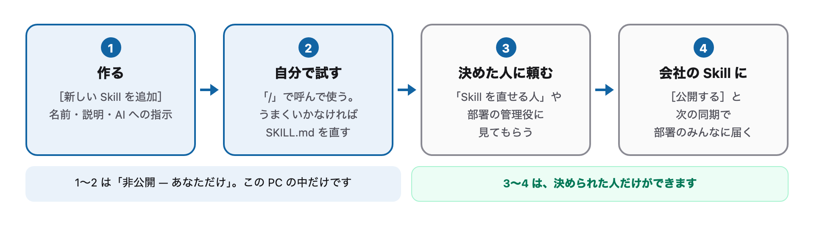
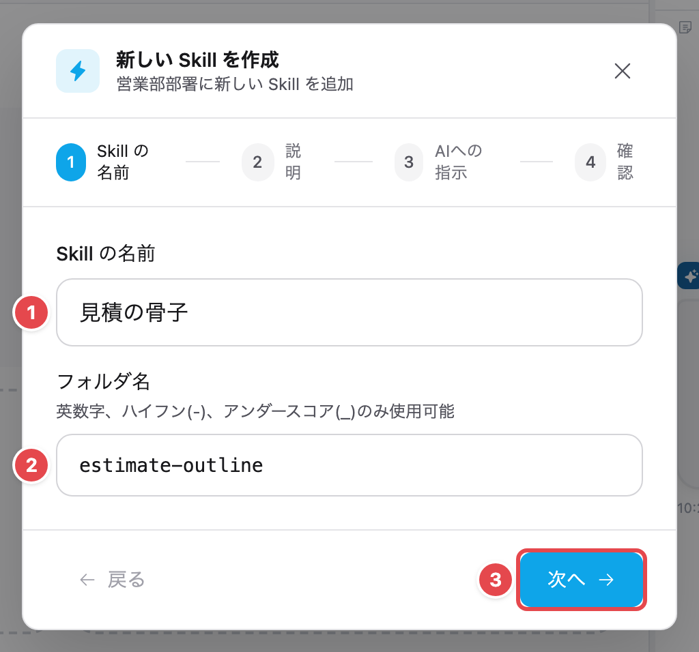
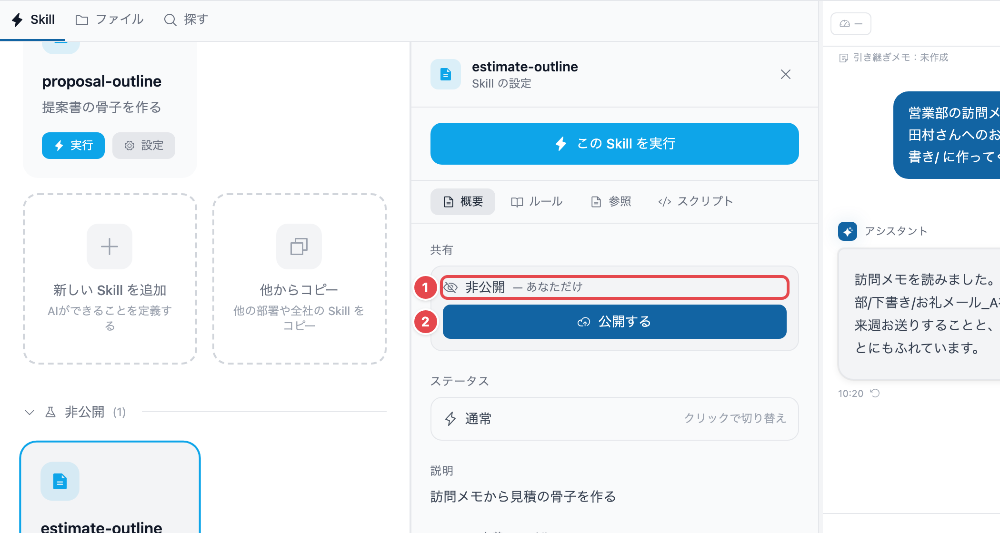

# 38章　Skill をもっと：自分で作る・会社に渡す・道具のある Skill

## はじめに

前の章の最後に、こんな疑問が残りました。

「自分の仕事のやり方を、Skill にできる？　作ったら、みんなに届いちゃう？」

よく使う手順は、まず自分用のメモにまとめて、何度か使ってうまくいったら、チームに共有しますよね。いきなり部署の共有フォルダの手順書を書き換えたりはしません。

ACB の Skill も同じです。10章では、会社の Skill をコピーして自分用に直しました。この章では、**いちから自分の Skill を作ります。作った Skill は、はじめは「非公開 — あなただけ」。勝手にみんなに届くことはありません。** 良くなったら、決められた人に渡して会社の Skill にしてもらいます。

### この章で分かること

- 新しい Skill を作る
- 作った Skill の「非公開」と［公開する］
- 会社の Skill を変えられる人
- 「道具」のついた Skill

---

## 新しい Skill を作る

Skill を置きたい部署のタブ（たとえば「営業部」）で、左の欄の［Skill］を開き、カードの並びの下の［新しい Skill を追加］を押します。

画面は4つの段に分かれています。

1. **Skill の名前**（①）— 「見積の骨子」のように、何をする Skill か分かる名前をつけます。
2. **フォルダ名**（②）— 英語の小文字・数字・「-」「_」だけで書きます（例：estimate-outline）。入力欄で「/」を打ったときに出る名前です。
3. ③［次へ］で進み、**説明**（いつ使う Skill か）を書きます。
4. **AIへの指示** に、AI にしてほしいことを順に書きます。「訪問メモを読み、会社名・人数・希望の時期・予算を確かめて、見積の骨子を『営業部/下書き/』に作る」のように、9章で見た Skill の中身と同じ書き方です。
5. **確認** で中身を見直して、作ります。

うまく書けないときは、相談で AI に「訪問メモから見積の骨子を作る Skill の指示を書いて」と頼み、できた文を貼りつけてもかまいません。

---

## 作った Skill は「非公開 — あなただけ」

作った Skill は、Skill の一覧の「非公開」のまとまりに入ります（まとまりの名前を押すと開きます）。カードの［設定］を押すと、こう出ます。

1. ①**非公開 — あなただけ** — この PC の中だけにある Skill です。同期しても、ほかの人には届きません。
2. 使い方は会社の Skill と同じです。入力欄で「/」を打つと出てきます（9章）。何度か使って、うまくいかないところは「Skill の定義ファイル」の SKILL.md を開いて直します（10章）。
3. ②［公開する］は、部署のみんなに渡すボタンです。押すと「公開すると次回の同期で全員に共有されます。公開後は非公開に戻せません。」と確かめられます。

その下の「ステータス」は、まだ試している途中の Skill に「育て中」の印をつけるものです。押すたびに「通常」と切り替わります。

---

## 会社の Skill を変えられる人

［公開する］を押せる（会社の Skill を足したり変えたりできる）のは、会社が決めた人だけです。

- 管理者
- その部署の「部署の管理役」
- 「Skill を直せる人」（会社全体、または部署ごとに、管理者が決めます。会社によっては、全員が直せるようにしていることもあります）

それ以外の人が［公開する］を押しても、公開の前に断られ、Skill はあなたの PC の中に「非公開」のまま残ります。会社の Skill を書き換えたときも、同期のところで止まります（14章）。

ですから、**良い Skill ができたら、Skill を直せる人に頼みましょう。** 「この Skill を3回使ってうまくいったので、営業部の Skill にしてもらえませんか」と伝えて、SKILL.md の中身を見てもらいます。だれが Skill を直せる人か分からないときは、管理者に聞いてください。

> **あなたが「Skill を直せる人」のとき**
>
> ［公開する］を押すと、次の同期で部署のみんなに届き、非公開には戻せません。みんなの AI の動きが変わるので、自分で試してから公開しましょう。

---

## 「道具」のついた Skill

会社の Skill の中には、小さな画面（道具）がついているものがあります。たとえば、表を入れると集計して見せる画面などです。

道具のある Skill の［設定］を開くと、「概要」「ルール」などと並んで、「Tools」というタブが出ます。

- タブの中に道具が並び、「Start」で動かします。動くと「Open in Browser」が出て、ブラウザでその画面を開けます。
- 使い終わったら「Stop」で止めます。

いまは、このタブとボタンの名前が英語で出ています。道具の使い方は、その Skill を作った人や管理者に聞いてください。

---

## 山田さんの場合

山田さんは、営業部のタブで［新しい Skill を追加］を押し、「見積の骨子」（estimate-outline）という Skill を作りました。訪問メモを読んで、見積の骨子を下書きフォルダに作る指示を書きました。

3回使って、毎回うまくいったので、営業部の「Skill を直せる人」の高橋さんに頼みました。高橋さんが中身を見て営業部の Skill にしてくれたので、いまは営業部のみんなが「/estimate-outline」で使っています。

---

## まとめ

- ［新しい Skill を追加］で、名前・フォルダ名・説明・AI への指示を書いて、自分の Skill を作れます。
- 作った Skill は「非公開 — あなただけ」。この PC の中だけで、勝手にみんなに届くことはありません。
- ［公開する］で部署のみんなに渡せるのは、管理者・部署の管理役・「Skill を直せる人」だけです。それ以外の人は、その人たちに頼みます。
- 道具のある Skill は、「Tools」のタブの「Start」で動かし、「Stop」で止めます。

## やってみよう

1. 自分の部署で［新しい Skill を追加］を押し、よくする仕事を1つ、Skill にしてみましょう。
2. 作った Skill の［設定］を開いて、「非公開 — あなただけ」と出ているか確かめましょう。入力欄で「/」を打って、使ってみましょう。

---

これで、「もっと便利に」の部はおしまいです。探して開く、タブとメモ、相談の近道、資料の仕上げ、AI に調べてもらう、Skill を作る、と毎日の近道を見てきました。

便利になった一方で、ときどき「あれ？」と思うこともあります。作ったファイルが、ほかの人に届いていないみたい。そんなときは、どうすればいいのでしょうか？
