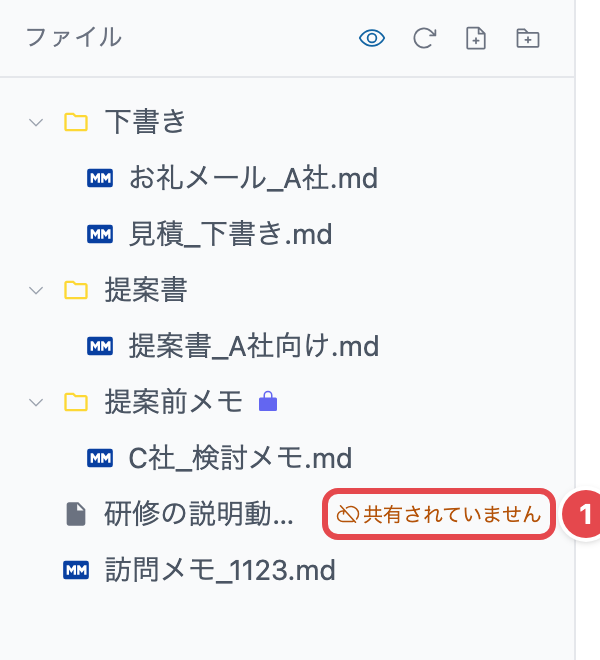
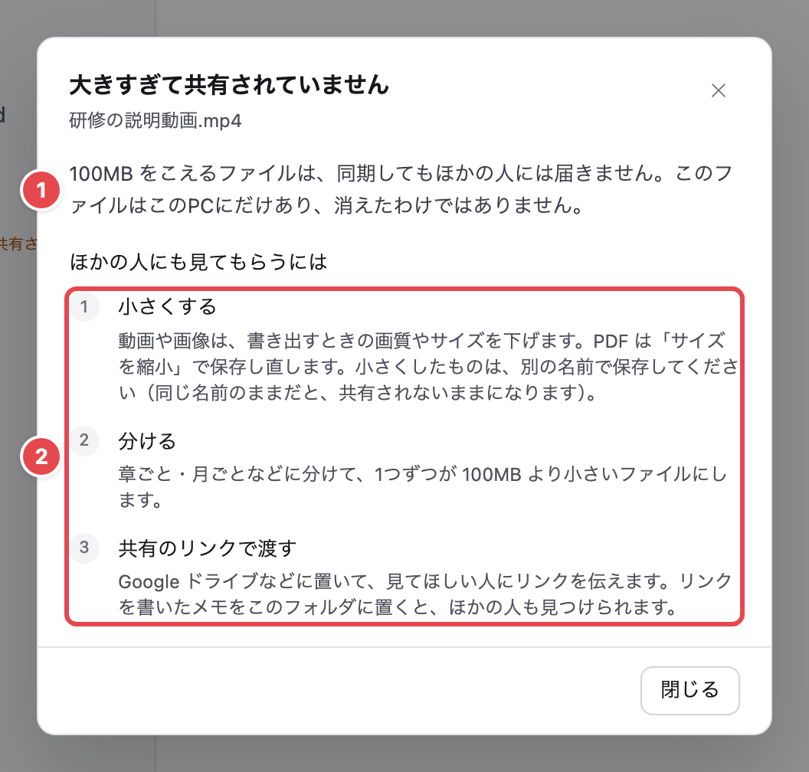
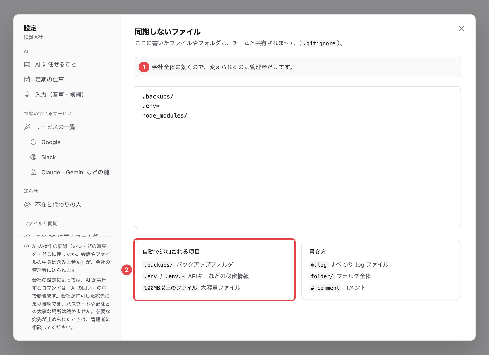
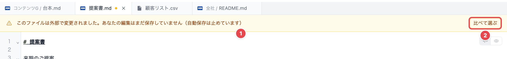
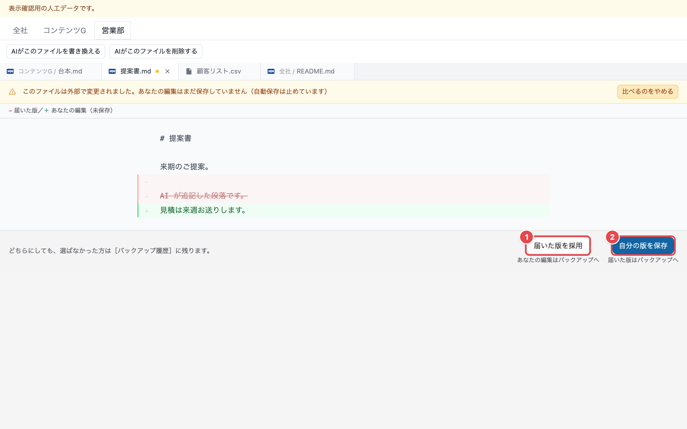

# 39章　ファイルがほかの人に届かない・知らないうちに変わった

## はじめに

前の章の最後に、こんな疑問が残りました。

「作ったファイルが、ほかの人に届いていないみたい。そんなときは、どうすればいい？」

メールに大きな動画を付けたら、「サイズが大きすぎます」と出て送れなかった。そんな経験はありませんか？　共有フォルダのファイルを開いている間に、ほかの人に直されていた、ということもあるでしょう。

ACB でも、同期したのにほかの人に届かないファイルがあります。また、開いているファイルが、ほかのアプリや同期で変わることがあります。**どちらにも理由があり、あなたのファイルが消えたわけではありません。** この章では、そのしるしと、することを見ていきます。

### この章で分かること

- 「共有されていません」の印が付いたファイル（大きすぎるファイル）
- 設定の「同期しないファイル」
- 開いているファイルの上に出る黄色い帯

---

## 大きすぎるファイルは、同期しても届かない

**100MB をこえるファイルは、同期してもほかの人には届きません。** 長い動画や、たくさんの写真をまとめたファイルなどが、これにあたります。メールの添付と同じで、大きすぎるものは送れない決まりです。

そういうファイルには、ファイルの一覧で印が付きます。

①の［共有されていません］を押すと、理由と、できることが出ます。

1. ①のとおり、**このファイルはあなたの PC にだけあり、消えたわけではありません。**
2. ほかの人にも見てもらうには、②の3つの方法があります。
   - **小さくする** — 動画や画像は、書き出すときの画質やサイズを下げます。PDF は「サイズを縮小」で保存し直します。小さくしたものは、**別の名前で保存**してください。同じ名前のままだと、共有されないままになります。
   - **分ける** — 章ごと・月ごとなどに分けて、1つずつが 100MB より小さいファイルにします。
   - **共有のリンクで渡す** — Google ドライブなどに置いて、見てほしい人にリンクを伝えます。リンクを書いたメモをこのフォルダに置くと、ほかの人も見つけられます。

読み終わったら［閉じる］を押します。

---

## 同期しないファイル

ほかにも、会社として「チームに共有しない」と決めているファイルがあります。タイトルバーの右はしのあなたの丸から［設定］を押し、左の一覧の［同期しないファイル］を開くと見られます。

1. ①のとおり、ここは会社全体に効くので、**変えられるのは管理者だけです。** あなたは見るだけで大丈夫です。
2. ②は、いつも共有されないものです。バックアップのフォルダ、パスワードや鍵などの秘密の情報、100MB 以上のファイルが入っています。

「このファイルを共有したくない」「共有したいのに入っている」というときは、管理者に頼みましょう。

---

## 開いているファイルの上に、黄色い帯が出たら

ファイルを開いて書いている途中に、そのファイルがほかのところで変わることがあります。AI が書き換えたとき、同期でほかの人の変更が届いたとき、ほかのアプリで直したとき、などです。

まだ何も書いていなければ、ACB は新しい内容をそのまま見せます。**あなたが書いた分がまだ保存されていないときだけ**、上に黄色い帯が出て、どちらを残すかをあなたに聞きます。

1. ①は、「ほかのところで変わったけれど、あなたが書いた分はまだ保存していない」という知らせです。この帯が出ている間は、自動の保存が止まり、**あなたの書いた分が勝手に上書きされることはありません。**
2. ②［比べて選ぶ］を押すと、届いた版とあなたの編集を並べて見られます。もう一度押すと閉じます。

3. 中身を見比べて、どちらか1つを押します。押したらそれで終わりです。
   - ①［届いた版を採用］：届いた版にします。あなたの編集は［バックアップ履歴］に残ります。
   - ②［自分の版を保存］：あなたの版を保存します。届いた版は［バックアップ履歴］に残ります。

> **どちらを選んでも消えません**
>
> 選ばなかった方は、いつも［バックアップ履歴］に残ります。あとで「やっぱりあちらがよかった」と思ったら、そこから戻せます。比べている間にファイルがまた変わったときは、何も保存せずに新しい内容で比べ直すので、もう一度選んでください。同じファイルを二人が直したときの同期のしくみは、13章で見ました。

---

## 山田さんの場合

山田さんは、研修の説明動画（300MB）を営業部のフォルダに入れて同期しました。ところが、佐藤さんから「動画が見当たらない」と言われました。

ファイルの一覧を見ると、動画に「共有されていません」の印が付いていました。押してみると、100MB をこえるファイルは届かないと書いてあります。山田さんは動画を Google ドライブに置き、リンクを書いた「説明動画のリンク.md」を営業部のフォルダに作って同期しました。今度は佐藤さんにも届きました。

---

## まとめ

- 100MB をこえるファイルは、同期してもほかの人に届きません。「共有されていません」の印が付き、あなたの PC にだけ残っています。
- 届けたいときは、小さくする（別の名前で保存）・分ける・共有のリンクで渡す、のどれかにします。
- 設定の「同期しないファイル」は、会社として共有しないと決めたものです。変えられるのは管理者だけです。
- 開いているファイルの上に黄色い帯が出たら、［比べて選ぶ］。［届いた版を採用］か［自分の版を保存］を押すと、選ばなかった方は［バックアップ履歴］に残ります。

## やってみよう

1. タイトルバーの右はしのあなたの丸から［設定］から［同期しないファイル］を開き、どんなものが共有されないのかを見てみましょう。
2. 自分の部署のファイルの一覧に、「共有されていません」の印が付いたファイルがないか、見てみましょう。

---

大きなファイルは、届かないだけで消えてはいませんでした。

では、決まった人だけが読める「非公開フォルダ」のファイルは、どうでしょうか？　もっと気をつけることがあるのでしょうか？
