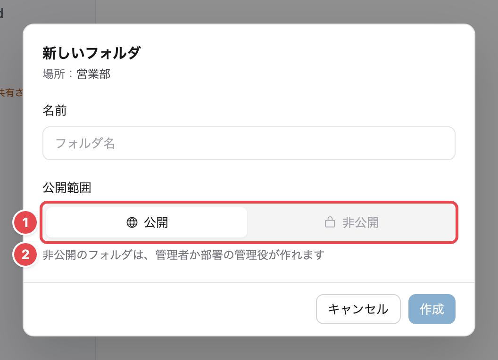
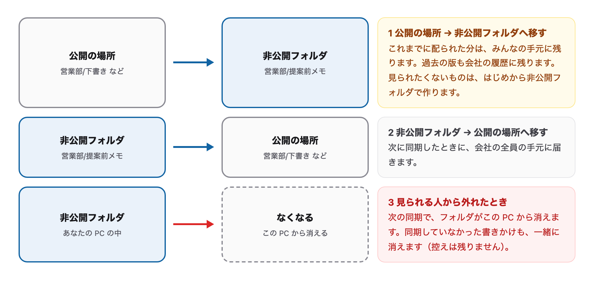
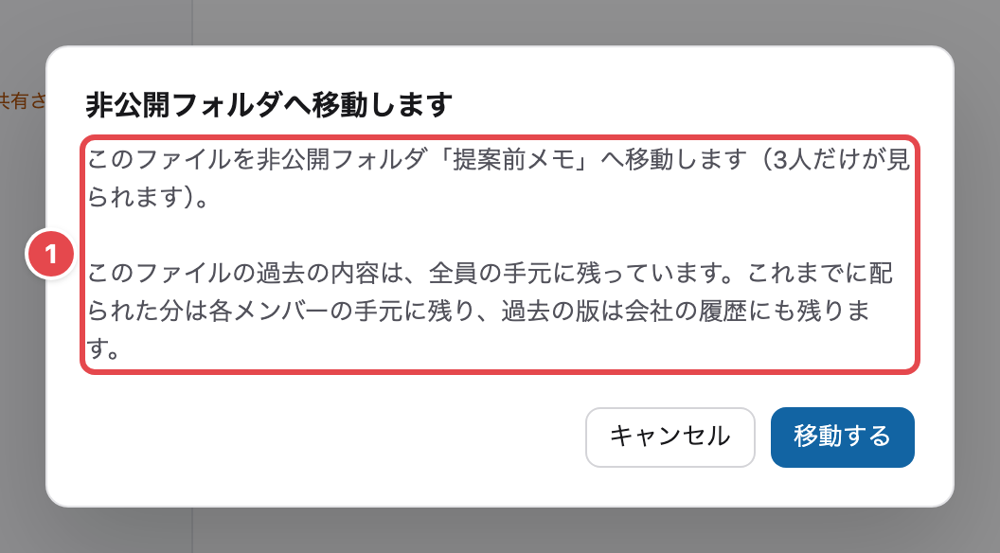
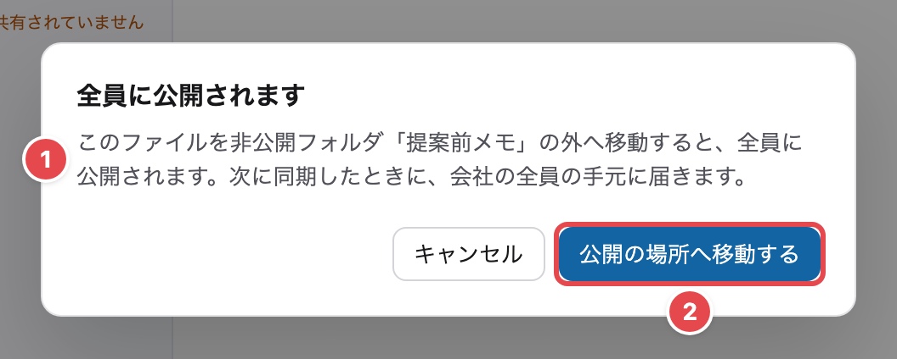
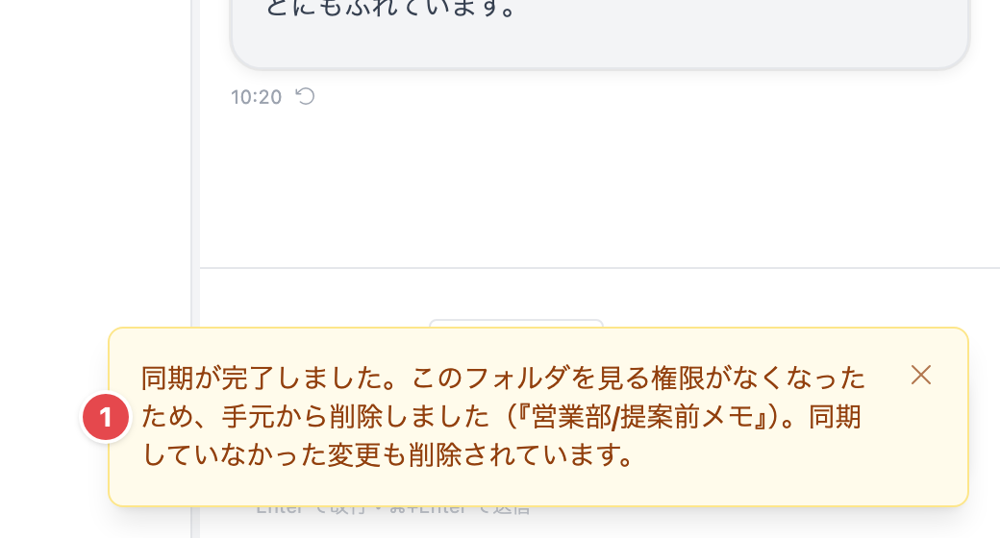

# 40章　非公開フォルダで知っておくこと

## はじめに

前の章の最後に、こんな疑問が残りました。

「非公開フォルダのファイルは、もっと気をつけることがある？」

Google ドライブで共有をやめても、相手がすでにダウンロードしたコピーは消せません。異動で、前の部署の共有フォルダが急に見られなくなった、という経験もあるかもしれません。

ACB の非公開フォルダ（15章の鍵の印のフォルダ）でも、同じようなことが起きます。**非公開は「はじめから」が大事です。そして、見られる人から外れると、そのフォルダはあなたの PC から消えます。** この章では、そのときに出る画面と、あなたがしておくことを見ていきます。

### この章で分かること

- 非公開フォルダを作れる人
- ファイルを非公開フォルダに入れる・外に出すときに出る確かめ
- 見られる人から外れたときに起きること

---

## 非公開フォルダを作れるのは、管理者と部署の管理役

ふつうのフォルダは、だれでも作れます。ファイルの一覧の上の［新しいフォルダ…］を押すと、名前と「公開範囲」を選ぶ画面が出ます。

1. ①の公開範囲で、［公開］を選ぶと、会社の全員に共有されるふつうのフォルダになります。
2. ［非公開］を選べるのは、**管理者と、その部署の管理役だけ**です。それ以外の人には薄く出て、②「非公開のフォルダは、管理者か部署の管理役が作れます」と書かれています。

非公開フォルダが必要なときは、部署の管理役か管理者に頼みましょう。なお、非公開フォルダは、会社のオーナーと管理者にはいつも見えます。

---

## 移すときの決まり

非公開フォルダの内と外の間でファイルを移すとき（34章のドラッグ）、何が起きるかを先に確かめる画面が出ます。全体をまとめると、こうなります。

### 公開の場所から、非公開フォルダへ移す

①をよく読んでください。**「このファイルの過去の内容は、全員の手元に残っています。」** 公開の場所に置いていた間に、同期でみんなの PC に配られた分は、それぞれの手元に残ります。過去の版も会社の履歴に残ります。

つまり、**非公開フォルダに移しても、もう配った分は取り戻せません。** メールを送ったあとで「送信取り消し」ができないのと同じです。見られたくないものは、**はじめから非公開フォルダの中で作りましょう。**

間違えて公開の場所に置いてしまったときは、移す前に、部署の管理役か管理者に相談してください。

### 非公開フォルダから、公開の場所へ移す

①のとおり、**次に同期したときに、会社の全員の手元に届きます。** 本当にみんなに見せてよいものかを確かめてから、②「公開の場所へ移動する」を押します。やめるときは［キャンセル］です。

別の非公開フォルダへ移すときは、「別の非公開フォルダへ移ります」と出て、移した先のフォルダを見られる人に届くことが書かれています。

非公開フォルダそのものは、移したり名前を変えたりできません。必要なときは管理者に相談してください。

---

## 見られる人から外れたとき

異動や退職などで、非公開フォルダを見られる人から外れることがあります。そのときは、次の同期で、そのフォルダがあなたの PC から消えます。同期のあとに、こう出ます。

**このとき、まだ同期していなかった書きかけも一緒に消えます。バックアップ（控え）も残りません。** ①の「同期していなかった変更も削除されています」は、そのことです。

これは［サーバーと同期］を押したときに起きます。設定で「自動で送る」をオンにしていれば（5章）、自動の同期のときにも起きます。

ですから、**非公開フォルダの書きかけは、こまめに同期しておきましょう。** 同期してあれば、あなたが書いた分はフォルダの中に残り、見られる人たちに届いています。

> **書きかけを取っておくしくみを準備しています**
>
> 見られなくなったときに、同期していなかった書きかけを取っておけるしくみを、いま準備しています。使えるようになったら、この章でお知らせします。それまでは、こまめな同期で守ってください。

反対に、非公開フォルダが全員に公開されたときは、「…は全員に公開されたため、会社のフォルダとして同期しました。」と出ます。このときは、同期していなかった変更は、非公開フォルダのバックアップに保存されます。

---

## 山田さんの場合

山田さんは、「見積_下書き.md」を営業部の公開の場所に作ってしまいました。提案前メモ（非公開フォルダ）へ移そうとすると、「このファイルの過去の内容は、全員の手元に残っています」と出ました。山田さんは［キャンセル］を押し、まず佐藤さんに相談しました。

その後、C社への提案は高橋さんが引き継ぐことになり、山田さんは提案前メモを見られる人から外れることになりました。山田さんは外れる前の日に、提案前メモの書きかけをすべて同期しました。次の同期で、山田さんの PC から提案前メモは消えましたが、書いた分は高橋さんたちの手元にきちんと届いていました。

---

## まとめ

- 非公開フォルダを作れるのは、管理者と部署の管理役です。ほかの人は頼みます。
- 公開の場所から非公開フォルダへ移しても、もう配られた分は戻りません。見られたくないものは、はじめから非公開フォルダで作ります。
- 非公開フォルダから外へ移すと、次の同期で全員に届きます。
- 見られる人から外れると、次の同期でそのフォルダが PC から消えます。同期していない書きかけも消え、控えは残りません。書きかけは、こまめに同期しましょう。

## やってみよう

1. ファイルの一覧で［新しいフォルダ…］を押し、「公開範囲」に何が出るかを見てみましょう（見るだけなら［キャンセル］で閉じます）。
2. 自分が見られる非公開フォルダがあれば、書きかけのファイルがないか確かめ、あれば同期しておきましょう。

---

ファイルとフォルダのことは、これで一通りです。

ある日、AI に頼んだら「管理者が AI の利用を一時停止しています」と出ました。AI が壊れてしまったのでしょうか？
